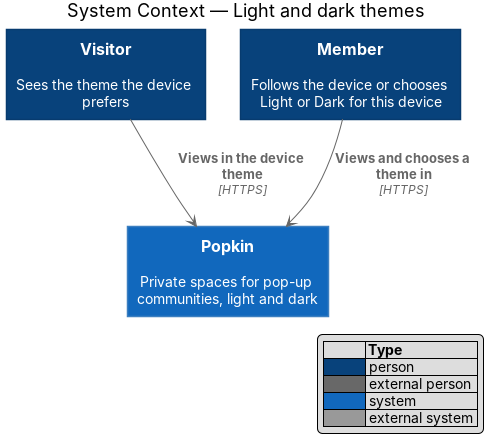
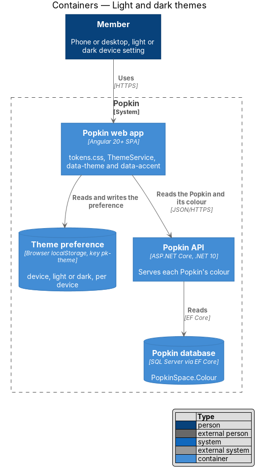
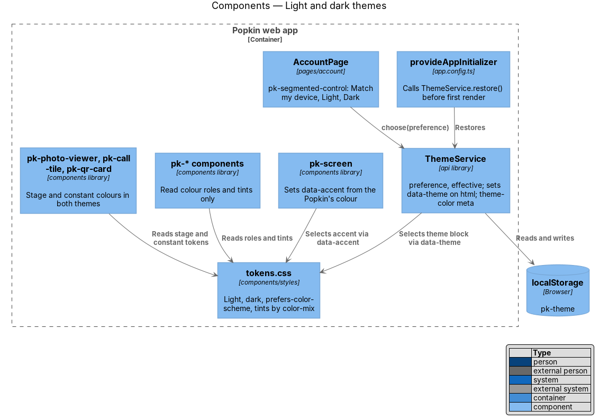
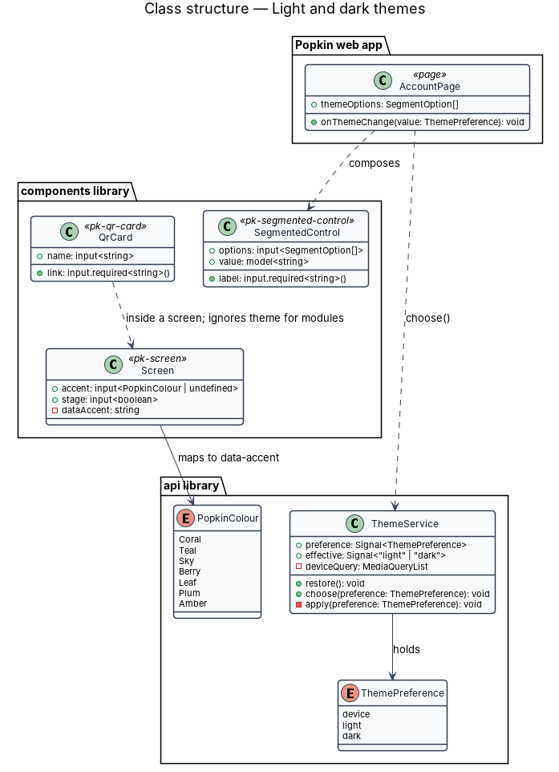
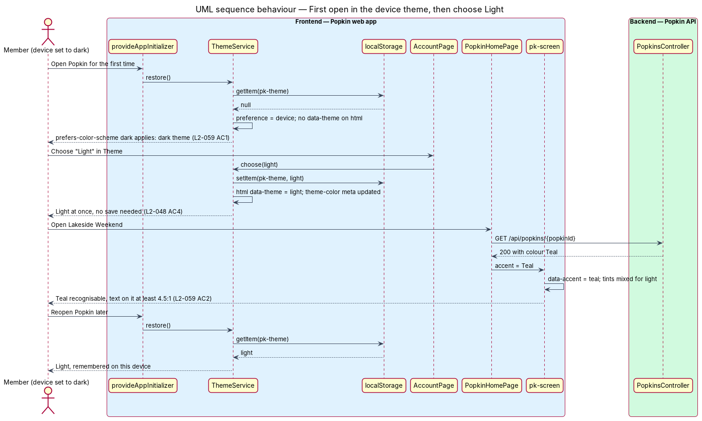

# Light and dark themes

## Overview

Popkin is opened in bright sun at a lake and late at night in a dark tent. This feature is the
cross-cutting mechanism that gives every screen a light and a dark theme, follows the device's
setting by default, and lets a person choose a theme for their device from their account. It also
keeps each Popkin's colour recognisable and legible in both themes, keeps calls and photos on a
dark stage in both themes, and keeps a QR code dark on white so it always scans.

The design system already defines both themes as tokens; this design states how the web app
applies them.

Local terms:

- **theme** — set of colour values for every colour role: light or dark
- **theme preference** — the person's choice for a device: Match my device (`device`), Light
  (`light`) or Dark (`dark`)
- **colour role** — token named for its purpose rather than its value, such as
  `--color-bg-surface` or `--color-fg-muted`; a theme changes the value, never the name
- **Popkin colour** — one of seven accents a Popkin carries (Coral, Teal, Sky, Berry, Leaf, Plum,
  Amber), set with `data-accent` and read as `--accent`
- **tint** — value mixed from the Popkin colour for a purpose in the current theme:
  `--accent-tint` (cards), `--accent-wash` (whole screens), `--accent-edge` (tile edge),
  `--accent-text` (the colour as text) and `--accent-line` (edges, rings and dots)
- **stage** — dark background of calls and the photo view, `--color-bg-stage`, the same in both
  themes
- **quiet zone** — light margin around a QR code that a scanner needs to find it

## Description

All parts below are introduced by this design unless marked existing.

### Tokens (`frontend/projects/components/src/lib/styles/tokens.css`)

- **Copy of the design system** — `tokens.css` is a copy of
  `docs/design-system/tokens/tokens.css` (AGENTS.md), with the `@font-face` URLs pointing at the
  self-hosted fonts. It is the only file that holds colour values.
- **Light** is `:root` and `[data-theme="light"]`. **Dark** is `[data-theme="dark"]`, and the
  same values under `@media (prefers-color-scheme: dark)` for `:root:not([data-theme="light"])`.
  Each theme sets `color-scheme`, so native controls and scrollbars follow (L2-059 AC1).
- **Tints** are recomputed with `color-mix()` wherever `data-accent` or `data-theme` is set, from
  per-theme strengths (`--accent-tint-strength`, `--accent-wash-strength`,
  `--accent-text-strength`, `--accent-text-toward`, `--accent-line-strength`). In dark the tints
  are stronger and text and lines mix toward white, so Berry and Plum edges stay at 3:1 or more
  on dark cards (`docs/design-system/README.md`, "Popkin colour contrast").
- **Constants** — `--color-constant-light` (white) and `--color-constant-dark` (ink) do not
  change with the theme; `--color-bg-stage`, `--color-bg-stage-tile` and `--color-fg-on-stage`
  are the same in both.

### Theme preference (`api` library)

- **`ThemePreference`** (`models/theme.ts`) — `'device' | 'light' | 'dark'`.
- **`ThemeService`** (`api/theme.service.ts`, `providedIn: 'root'`) — holds
  `preference: Signal<ThemePreference>` and `effective: Signal<'light' | 'dark'>`.
  - `restore()` reads the key `pk-theme` from `localStorage` inside `try`/`catch`; a missing,
    unreadable or unknown value means `device` (L2-059 AC1).
  - `choose(preference)` stores it under `pk-theme` and applies it at once (L2-048 AC4).
  - Applying sets `data-theme="light"` or `data-theme="dark"` on `document.documentElement`, or
    removes the attribute for `device`, so the `prefers-color-scheme` rule takes over.
  - `effective` follows `matchMedia('(prefers-color-scheme: dark)')` and its `change` event while
    the preference is `device`.
  - It updates `<meta name="theme-color">` to the effective theme's `--color-bg-canvas`, so the
    browser bar matches.
- **Registration** — `app.config.ts` calls `ThemeService.restore()` in
  `provideAppInitializer`, before the first screen renders. The preference never leaves the
  device; no endpoint stores it, because L2-048 AC4 asks for it to be remembered "on that
  device". With `device` there is no flash of the wrong theme, because CSS alone decides; with an
  explicit choice that differs from the device, the first paint before the app starts may show
  the device theme for a moment. Whether that flash is acceptable, or a pre-paint inline script
  (which needs a script hash in the content security policy) is wanted, is `<TO SUPPLY>`.
- **Sign-out** keeps the theme preference, because it belongs to the device, not the person.

### Choosing a theme

- **`AccountPage`** (`pages/account/account.page.ts`, owned by the account design) composes a
  `pk-segmented-control` in its radio-group variant labelled "Theme" with "Match my device",
  "Light" and "Dark" (`docs/mocks/pages/account/default.html`). Choosing an option calls
  `ThemeService.choose()` immediately, without "Save changes".

### Popkin colour on screens

- **`pk-screen`** has an `accent` input of type `PopkinColour`; it writes
  `data-accent="{colour}"` (lower case) on its host, so every component under it reads `--accent`
  and the tints (`docs/design-system/patterns/popkin-colour.html`). Pages inside a Popkin pass the
  `PopkinSpace.Colour` from the Popkin's view model, served by the Popkin API. Outside a Popkin
  the accent is Coral.
- **`pk-popkin-tile`**, **`pk-card`**, **`pk-avatar`** and **`pk-time-left`** take their own
  `accent` input where one screen shows several Popkins (My Popkins).
- Errors and destructive actions stay Coral, never the Popkin colour.
- A Popkin's colour is never the only cue: its emoji and name go with it, and the colour picker
  names each colour (L2-057 AC5).

### Stage and QR code

- **`pk-screen` in its stage variant** and **`pk-photo-viewer`**, **`pk-call-tile`** read
  `--color-bg-stage`, `--color-bg-stage-*` and `--color-fg-on-stage` only, which do not change
  with the theme, so calls and photos are dark in both themes (L2-059 AC3, L2-033).
- **`pk-qr-card`** draws the code's modules in `--color-constant-dark` on
  `--color-constant-light`, with a quiet zone of at least four modules, the QR code standard's
  minimum, inside the white ground (L2-059 AC4, L2-011 AC6). The surrounding card follows the
  theme; the code does not.

### Brand and components reference

`docs/mocks/pages/brand-components/default.html` gathers the logo, the colour roles, the seven
Popkin colours, type and the components on one sheet in both themes. Its manifest entry marks it
"reference, not a route": the web app does not build it as a page. Component parity specs
(ADR 0008) compare each component with this sheet and with the screen mocks in both themes.

### Verification

- Behaviour specs (ADR 0006) open the app with `colorScheme: 'dark'` and `'light'` and check the
  `color-scheme` the page reports (L2-059 AC1); choose "Dark" on the account screen and check it
  holds after a reload; and choose "Match my device" and check `data-theme` is gone.
- Component parity specs (ADR 0008) compare every component with its mock in both themes at
  360 px and 1280 px, which covers the tints, the stage and the QR card.
- Contrast is checked in the design system by `check_contrast.py` and the Popkin colour mix
  table; no test parses tokens (AGENTS.md, "Never write architecture tests").

### Screens and states

- `docs/mocks/pages/brand-components/default.html` — the reference sheet in both themes
- `docs/mocks/pages/account/default.html` — the theme choice
- `docs/mocks/pages/my-popkins/default.html` — Popkin colours side by side
- `docs/mocks/pages/popkin-home/default.html` — a screen in Teal
- `docs/mocks/pages/video-call/default.html` and `docs/mocks/pages/photo-view/default.html` — the
  stage
- `docs/mocks/pages/popkin-created/default.html` and `docs/mocks/dialogs/invite/default.html` —
  the QR card

Every mock switches theme with `?theme=dark` or `?theme=light` (`docs/mocks/README.md`).

### API

The feature adds no endpoint. The Popkin's colour arrives in the existing Popkin read
(`GET /api/popkins/{popkinId}`, 200, or 404 `popkin_not_found`) as `colour`, one of the seven
names.

## Requirements

| L2 ID | Refines (L1) | Requirement |
|-------|--------------|-------------|
| `L2-059` | `L1-014` | Light and dark themes: Popkin follows the device and the person. |
| `L2-048` | `L1-002` | Account: A person manages how they appear and their session. |

`L2-048` is listed for its criterion 4, the theme choice, which `ThemeService` enforces; the
account design owns the rest of that screen.

## Diagrams

### System context

A visitor or member sees Popkin in the theme their device or their choice sets.

### Containers

The Popkin web app applies the theme and stores the choice in the browser's local storage. The
Popkin API supplies each Popkin's colour.

### Components

`ThemeService` sets `data-theme` on the document; `pk-screen` sets `data-accent`; `tokens.css`
turns both into colour roles and tints that every `pk-*` component reads. The stage components
and `pk-qr-card` read constants that do not change.

### Class structure

`ThemeService` holds a `ThemePreference` and computes the effective theme. `Screen` maps a
`PopkinColour` to `data-accent`. `AccountPage` calls `ThemeService.choose()`.

### Behaviour — first open, then choose Light

Popkin opens on a device set to dark and is dark with no stored choice (L2-059 AC1). The member
chooses "Light" on the account screen; the theme changes at once and holds on the next visit
(L2-048 AC4). A Popkin screen then shows its colour tinted for the theme (L2-059 AC2).

