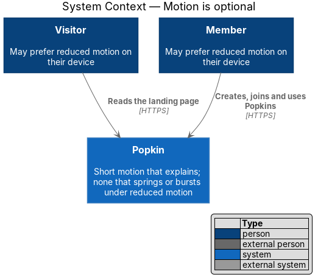
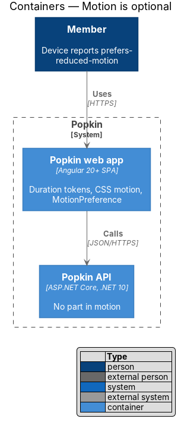
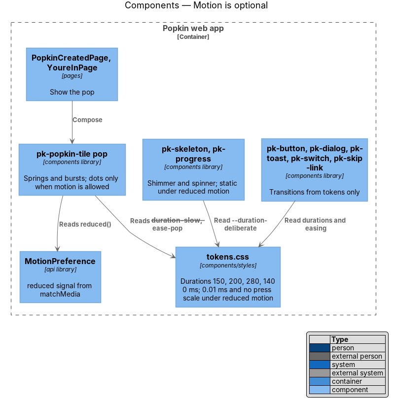
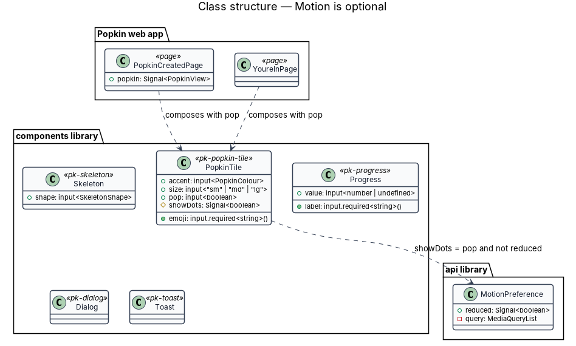
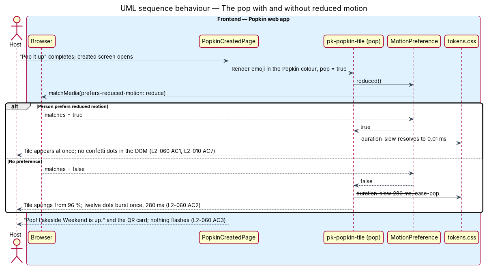

# Motion is optional

## Overview

Popkin moves a little: a pressed button squashes, a sheet slides up, a toast rises, and when a
Popkin is created or someone joins, the Popkin tile springs in with a burst of confetti. That
motion explains where things come from. For a person with a vestibular disorder, or anyone who has
asked their device for less motion, it gets in the way. This feature is the cross-cutting
mechanism that keeps every animation short, never flashes, and removes springing, bursting and
sliding when the person prefers reduced motion.

Local terms:

- **reduced motion** — the operating system setting a browser reports as
  `prefers-reduced-motion: reduce`
- **the pop** — celebration on the created and welcome screens: the Popkin tile scales from 96 %
  to 102 % to 100 % over 280 ms and twelve confetti dots burst once
- **duration token** — custom property that sets how long a kind of motion lasts:
  `--duration-fast` (150 ms), `--duration-base` (200 ms), `--duration-slow` (280 ms) and
  `--duration-deliberate` (1400 ms, loading and progress only)
- **press scale** — `--scale-press` (0.97), how far a pressed control squashes
- **flash** — change of brightness that alternates, counted per second

## Description

All parts below are introduced by this design unless marked existing.

### Tokens (`frontend/projects/components/src/lib/styles/tokens.css`)

- The copy of `docs/design-system/tokens/tokens.css` carries the duration and easing tokens
  (`--ease-pop`, `--ease-standard`) and the press scale. Every duration other than
  `--duration-deliberate` is 280 ms or less, inside the 320 ms limit (L2-060 AC2).
- Under `@media (prefers-reduced-motion: reduce)` the token file sets every duration to 0.01 ms
  and `--scale-press` to 1, so a component that reads only tokens loses its transitions with no
  extra query (`docs/design-system/foundations/motion.html`).
- The reset (`ui.css`) keeps `scroll-behavior: auto` under reduced motion; anchor scrolling on the
  landing page (L2-002 AC5) is instant there.

### Rules every component keeps

- **Durations from tokens only.** No `pk-*` stylesheet writes a duration or easing literal.
- **Nothing over 320 ms** except the skeleton shimmer, spinners, busy buttons and progress bars,
  which use `--duration-deliberate` (L2-060 AC2).
- **No motion on page load** except the shimmer and the pop.
- **Motion by CSS.** Enter and leave effects use CSS transitions and keyframes, attached with
  Angular's `animate.enter` and `animate.leave` class bindings; `@angular/animations` is not used.
- **Under reduced motion, appear or fade** (L2-060 AC1):

| Component | Normal | Reduced motion |
|-----------|--------|----------------|
| `pk-button`, `pk-icon-button`, `pk-card`, `pk-popkin-tile` press | Squash to 97 % over 150 ms | No scale; colour change at once |
| `pk-dialog` | Sheet slides up 280 ms; backdrop fades 200 ms | Appears at once |
| `pk-toast` | Rises from below 280 ms | Appears at once |
| `pk-skip-link` | Slides into view 150 ms | Appears at once |
| `pk-switch` | Thumb slides 200 ms | Moves at once |
| The pop (`pk-popkin-tile` in its pop wrapper) | Springs from 96 % and twelve dots burst, 280 ms | Only the tile appears; the dots are not rendered (L2-010 AC7, L2-014 AC5) |
| `pk-skeleton` | Shimmer every 1400 ms | Static sand shape |
| `pk-progress` spinner, busy `pk-button` | Turns every 1400 ms | Keeps turning; it is a status |

- **The pop** — the component that renders the confetti renders the dots only when
  `MotionPreference.reduced()` is false, so under reduced motion no dot exists in the DOM; the
  dots are `aria-hidden="true"` in either case.
- **Infinite animations under reduced motion.** The token file shortens
  `--duration-deliberate` to 0.01 ms under reduced motion. For the skeleton shimmer and the
  spinners, which repeat forever, a 0.01 ms cycle redraws on every frame. `pk-skeleton` therefore
  sets `animation: none` under reduced motion, as its design-system page states ("The shimmer
  stops under reduced motion"). For the spinner the design-system pages disagree: the progress
  page keeps it turning "at slower durations", while the token gives 0.01 ms. Which of the two the
  design system intends, and the correction to `tokens.css` or `progress.html` that follows, is
  `<TO SUPPLY>`; until then `pk-progress` and the busy `pk-button` show a static ring under reduced
  motion.

### Flashing (L2-060 AC3)

- No component alternates brightness more than three times a second. The fastest repeating
  effect is the 1400 ms shimmer, a low-contrast change between `--color-bg-subtle` and
  `--color-bg-subtle-hover`, well under one cycle per second.
- Video and photos supplied by members are not filtered; WCAG 2.3.1 applies to content the system
  authors. Whether member video needs a flash warning is `<TO SUPPLY>`.

### `api` library

- **`MotionPreference`** (`api/motion-preference.ts`, `providedIn: 'root'`) — exposes
  `reduced: Signal<boolean>` from `matchMedia('(prefers-reduced-motion: reduce)')` and its
  `change` event. Code that moves things from TypeScript reads it: the pop's dots,
  `scrollIntoView({ behavior })` for the landing page anchors, and the scroll to the latest message
  in a thread. Stylesheets do not need it; they read the tokens.

There is no in-app setting for motion; the requirement follows the device's preference.

### Verification

- Behaviour specs (ADR 0006) open the created screen with Playwright's
  `reducedMotion: 'reduce'` and check that no confetti dot is present and the tile and heading
  show (L2-010 AC7); the same for the welcome screen (L2-014 AC5). Without reduced motion the
  dots are present.
- Durations are held by the design-system tokens and review; no test reads stylesheets
  (AGENTS.md, "Never write architecture tests").

### Screens and states

- `docs/mocks/pages/popkin-created/default.html` — the pop; its note states the 280 ms burst and
  that reduced motion removes the dots
- `docs/mocks/pages/youre-in/default.html` — the pop on joining
- `docs/mocks/dialogs/invite/default.html` — a sheet that slides up
- `docs/mocks/notifications/toast/success.html` — a toast that rises
- `docs/mocks/pages/my-popkins/loading.html` — the skeleton shimmer
- `docs/mocks/pages/video-call/loading.html` — the spinner on the stage
- `docs/mocks/pages/how-long/submitting.html` — a busy button

### API

The feature adds no endpoint and changes none.

## Requirements

| L2 ID | Refines (L1) | Requirement |
|-------|--------------|-------------|
| `L2-060` | `L1-014` | Motion is optional: Motion explains; it never gets in the way. |
| `L2-010` | `L1-003` | The Popkin is created: When a Popkin exists, its Host is given its invite straight away. |
| `L2-014` | `L1-004` | Welcome a new member: A new member is welcomed and the group is told. |

`L2-010` and `L2-014` are listed for their reduced-motion criteria (AC7 and AC5), which this
feature enforces; their own designs own the rest of those screens.

## Diagrams

### System context

A visitor or member whose device asks for reduced motion uses Popkin without springing, bursting
or sliding.

### Containers

Motion lives in the Popkin web app; the browser reports the person's preference. The Popkin API
plays no part.

### Components

`tokens.css` shortens durations under reduced motion; `pk-*` components read only those tokens;
`MotionPreference` tells the code that moves things from TypeScript, such as the pop.

### Class structure

`MotionPreference` exposes `reduced`. `PopkinCreatedPage` composes `PopkinTile` in its pop
wrapper, which reads `MotionPreference` to decide whether to render the dots. `Skeleton` and
`Progress` hold their own reduced-motion rule.

### Behaviour — create a Popkin with and without reduced motion

The created screen opens. With reduced motion the tile appears at once and no confetti is drawn
(L2-060 AC1, L2-010 AC7); without it, the tile springs and the dots burst once in 280 ms
(L2-060 AC2).

