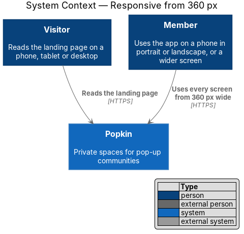
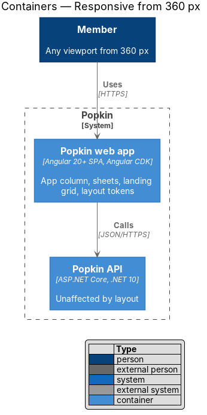
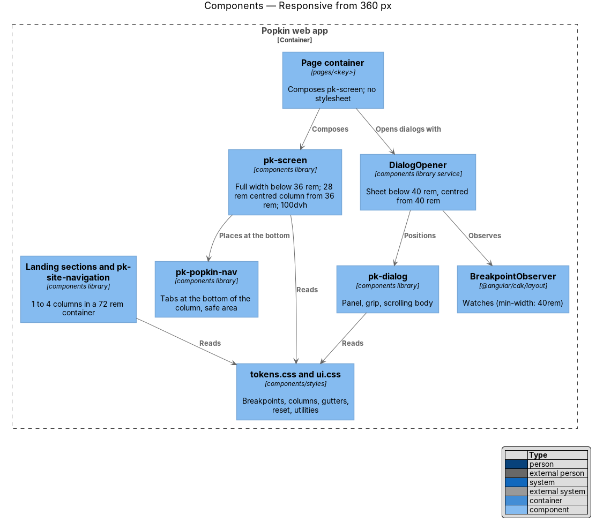
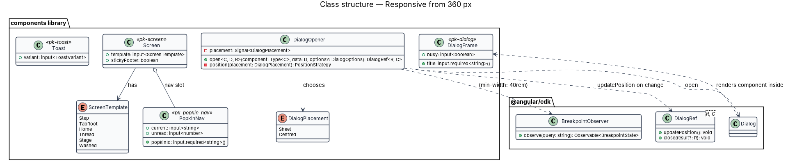
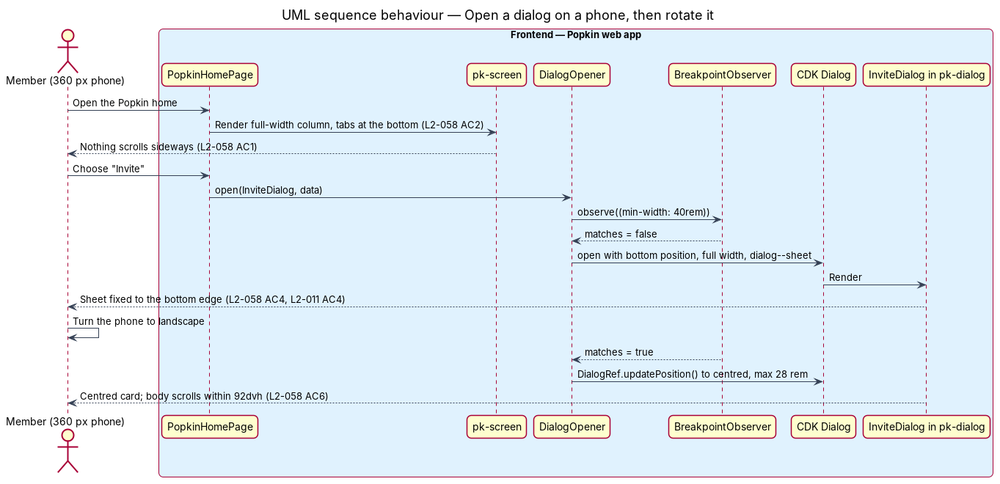

# Responsive from 360 px

## Overview

A Popkin is opened on whatever is to hand: a small phone held in one hand, a phone turned on its
side during a call, a tablet on a kitchen table, a laptop. This feature is the cross-cutting
mechanism that lets one layout serve every one of those viewports, from 360 px wide upward,
without sideways scrolling and with each screen's main action within reach.

The designs draw every app screen for five form factors: XS (below 640 px), S (640 px), M
(768 px), L (1024 px) and XL (1280 px). The design follows them: a screen always fills the width.
A phone gets one column with the Popkin tabs along the bottom; from M the tabs become a side rail
and the step screens split in two; from L the rail is a sidebar and a second column opens; from
XL a third. The landing page grows from one column to four. Dialogs rise from the bottom as
sheets on narrow screens and sit centred on wider ones.

Local terms:

- **form column** — the column that holds a form's fields and actions: `--layout-app-max`
  (28 rem), `--layout-form-max-s` (32 rem) from S and `--layout-form-max-l` (36 rem) from L,
  centred in the room it has
- **shell** — the frame of every screen inside a Popkin: tabs at the bottom below M, a rail from
  M (`--layout-rail-width`), a sidebar from L (`--layout-sidebar-width`, wider from XL)
- **split** — a step screen from M: the form column in one part, and in the other
  (`--layout-split-aside`) a picture of what the step makes
- **pane** — a further column beside the main content: the conversation list or the open thread
  from L (`--layout-list-pane`), who is here or on the call from XL (`--layout-detail-pane`)
- **sheet** — dialog fixed to the bottom edge of the viewport, full width, with a grip, used
  below 640 px
- **sticky footer** — bar at the bottom of a step screen that holds its main action and stays in
  view while the content scrolls
- **thumb zone** — lower part of a phone screen that a thumb reaches without changing grip
- **safe area** — part of the viewport not covered by a device's notch or home indicator,
  exposed as `env(safe-area-inset-*)`

## Description

All parts below are introduced by this design unless marked existing.

### Breakpoints and tokens

The breakpoints are the design system's (`docs/design-system/foundations/layout.html`) and
match L2-058 and L2-001. Media queries cannot read custom properties, so each component writes
the value in `rem` beside the token it mirrors.

| Token | Width | What changes | Criterion |
|-------|-------|--------------|-----------|
| (base) | 360 px | Everything fits; no sideways scroll | `L2-058 AC1` |
| `--layout-breakpoint-sm` | 36 rem (576 px) | Landing ideas two across; page margin 32 px | `L2-058 AC5` |
| `--layout-breakpoint-app-s` | 40 rem (640 px) | Popkins, experiences and photos gain a column; paired actions sit side by side; the form column is 32 rem | `L2-058 AC3`, `AC7` |
| `--layout-breakpoint-app-m` | 48 rem (768 px) | The shell's tabs become a rail; step screens split; a floating action moves to the header | `L2-058 AC8`, `AC9`, `AC10` |
| `--layout-breakpoint-app-l` | 64 rem (1024 px) | The rail becomes a sidebar; a second column or pane opens; the form column is 36 rem | `L2-058 AC8`, `AC11` |
| `--layout-breakpoint-app-xl` | 80 rem (1280 px) | A thread and a call open a third pane | `L2-058 AC12` |
| `--layout-breakpoint-sheet` | 40 rem (640 px) | Dialogs stop being sheets and centre; landing navigation shows "Sign in" | `L2-058 AC4`, `L2-002 AC4` |
| `--layout-breakpoint-md` | 48 rem (768 px) | Landing steps three across; 8 columns | `L2-058 AC5`, `L2-001 AC5` |
| `--layout-breakpoint-lg` | 62 rem (992 px) | Landing hero beside its preview; ideas four across; 12 columns | `L2-058 AC5`, `L2-001 AC6` |
| `--layout-breakpoint-xl` | 75 rem (1200 px) | Landing container reaches `--layout-container-max` (72 rem) | `L2-058 AC5` |

L2-001 AC6 places the hero side by side "at least 1024 px wide" while the
design system does so from 992 px, which also meets it.

### Components library (`frontend/projects/components/src/lib/`)

- **`pk-screen`** — Screen and layout component (`docs/design-system/components/screen.html`).
  The host fills the width at every size (L2-058 AC2, AC3). Its layout modifiers say how it uses
  a wider screen: `app` (the shell, AC8), `split` with a `pk-split-aside` slot for the picture
  (AC10), `page` and `column` (a top-level page, a single centred form column), `list` and
  `thread` (the chat panes, AC11, AC12). A part shown at one width only is removed with
  `display: none`, so it leaves the accessibility tree and the tab order too (AC13). It uses `min-height: 100dvh`, never a fixed height, so the content scrolls in
  both orientations (L2-058 AC6). Its variants follow the screen templates of the design system:
  step (top bar with step dots and a sticky footer), tab root (Popkin tabs at the bottom), thread
  (sticky top bar and composer), stage (calls and photos) and washed (a moment on the Popkin
  colour). The wide layouts are plain CSS in the component's stylesheet; no page reads the
  viewport width in TypeScript.
- **Sticky footer** — the step template's footer is `position: sticky; bottom: 0` inside the
  column, padded by `env(safe-area-inset-bottom)`, and holds the main action as a block button in
  the thumb zone (L2-058 AC2). When the on-screen keyboard opens, the footer stays above it
  because the column follows the visual viewport (`interactive-widget=resizes-content` in the
  viewport meta tag of `index.html`).
- **`pk-popkin-nav`** — the Popkin tabs. Below M they are fixed to the bottom of the screen,
  height `--layout-nav-height` plus the safe area, and the screen reserves the same space at its
  end (L2-058 AC2). From M the same `nav` is a rail on the left, and from L a sidebar that also
  shows the link back to Your Popkins and the Popkin's name, members and time left (AC8). A
  thread and an experience show it from M only.
- **`pk-dialog`** with **`DialogOpener`** — `DialogOpener` (components library service, also used
  by `accessibility/wcag-2-2-aa`) opens every dialog through the Angular CDK `Dialog`. It reads
  the CDK `BreakpointObserver` for `(min-width: 40rem)` and sets the overlay's position: below
  640 px a global position at the bottom, full width, with `panelClass: 'dialog--sheet'`; from
  640 px centred, `max-width: var(--layout-dialog-max)` (L2-058 AC4, L2-011 AC4). While a dialog is
  open, a change across 640 px updates its position with `DialogRef.updatePosition()`. The panel
  scrolls inside `max-height: 92dvh` and its header stays in view.
- **`pk-toast`** — full width minus 16 px above the tabs on a phone, up to
  `--layout-toast-max` (26 rem) and centred on wider screens.
- **`pk-site-navigation`** and the landing sections — the landing page uses the `container`
  utility (`max-width: var(--layout-container-max)`, margins `--layout-margin`) and CSS grid with
  `--layout-columns` and `--layout-gutter`, which the token file changes at 48 rem and 62 rem.
  The hero, steps and ideas stack in one column below 768 px (L2-001 AC5).

### Global foundations (`components/src/lib/styles/`)

- **Reset (existing, `ui.css`)** — `box-sizing: border-box` is kept. The design adds
  `overflow-wrap: anywhere` for user text (names, messages, captions), `max-width: 100%` for
  media, and `min-width: 0` on flex and grid children through the `stack`, `cluster` and `split`
  utilities, so long words and wide images never push the page sideways (L2-058 AC1).
- **Layout utilities** — `stack`, `cluster`, `split`, `form-grid`, `container` are the only
  layout classes an application template writes (ADR 0007).
- **No device detection.** Layout responds to width and to `(pointer: coarse)` only; nothing
  reads the user agent.

### Web app (`frontend/projects/popkin`)

- **`index.html` (existing)** — the viewport meta tag keeps `width=device-width,
  initial-scale=1, viewport-fit=cover` and gains `interactive-widget=resizes-content`. It never
  sets `maximum-scale` or `user-scalable=no`, so pinch zoom stays available.
- **Pages** — compose `pk-screen` and declare no stylesheet (ADR 0007), so every page inherits
  the layout, the footer and the tabs without a media query of its own. A page that has a pane
  or a picture (AC10 to AC12) projects it into the slot `pk-screen` gives it.

### Landscape (L2-058 AC6)

A phone in landscape is wide and short: it gets the S or M layout. The content
scrolls inside `100dvh`, the sticky footer and the tabs stay at the bottom of the visual
viewport. The call stage keeps `--layout-call-min-height` (24 rem) and scrolls when the
viewport is shorter. Whether the Popkin tabs should hide while scrolling on viewports shorter
than a given height is `<TO SUPPLY>`; the mocks do not draw landscape.

### Verification

- Behaviour specs (ADR 0006) prove the parts a person relies on: at 360 px a step screen's main
  action is visible and pressable; under 640 px the invite dialog is attached to the bottom edge
  and at 1280 px it is centred (L2-011 AC4).
- `e2e/tests/responsive.spec.ts` checks every screen state at 360, 768, 1024 and 1280 px for sideways
  scroll and clipped controls. It is a sweep: kept current with a `routes.ts` entry per state,
  never run by agents or CI (ADR 0006).
- Component parity specs (ADR 0008) compare each component at 360 px and 1280 px with the mock.

### Screens and states

Every page and dialog applies this feature. Representative mocks:
`docs/mocks/pages/landing/default.html` (one to four columns, 72 rem container),
`docs/mocks/pages/sign-up/default.html` (step screen, sticky footer, split from M),
`docs/mocks/pages/popkin-home/default.html` (tab root; tabs, rail, then sidebar; two columns from L),
`docs/mocks/pages/group-chat/default.html` (thread, sticky composer, list pane from L, who is here from XL),
`docs/mocks/pages/video-call/default.html` (stage, who is on the call from XL),
`docs/mocks/dialogs/invite/default.html` (sheet below 640 px, centred above) and
`docs/mocks/notifications/toast/stacked.html` (toasts above the tabs).

### API

The feature adds no endpoint and changes none.

## Requirements

| L2 ID | Refines (L1) | Requirement |
|-------|--------------|-------------|
| `L2-058` | `L1-014` | Responsive from 360 px: One layout serves every screen size. |
| `L2-001` | `L1-001` | Landing page content: The landing page explains Popkin to a visitor in six sections, in this order: the hero, how it works, ideas, the comparison with a group chat, the statement that it is free, and the footer. |

`L2-001` is listed for its criteria 5 and 6, the landing columns that this feature's grid
provides; the landing page's own design owns its content.

## Diagrams

### System context

Visitors read the landing page and members use the app on viewports from 360 px upward.

### Containers

Layout is decided entirely in the Popkin web app; the Popkin API is unaffected.

### Components

Pages compose `pk-screen`, which supplies the layout, the sticky footer and `pk-popkin-nav`;
`DialogOpener` places `pk-dialog` as a sheet or centred using the CDK `BreakpointObserver`; all
read the layout tokens.

### Class structure

`Screen` holds the template variant; `DialogOpener` depends on `Dialog` and `BreakpointObserver`
and chooses a `DialogPlacement`; `PopkinNav` and `Toast` read the same breakpoints.

### Behaviour — open a dialog on a phone, then rotate it

The member opens "Invite" on a 360 px phone and the dialog rises as a sheet (L2-058 AC4). The
phone turns to landscape, the viewport crosses 640 px, and the open dialog moves to the centre
while its content still scrolls (L2-058 AC6).

