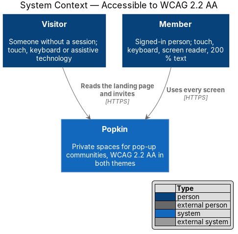
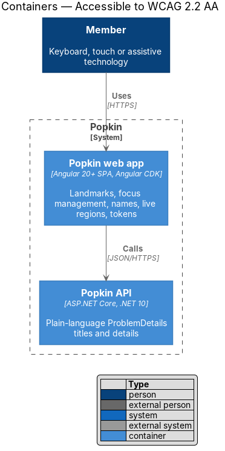
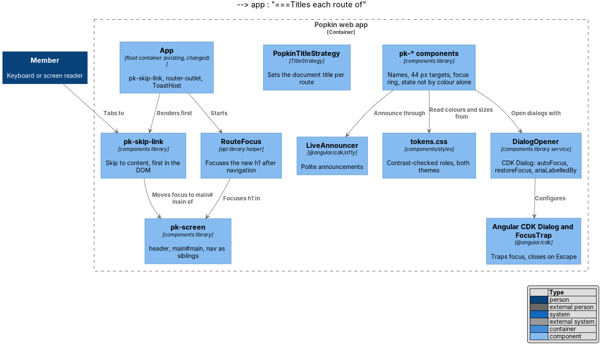
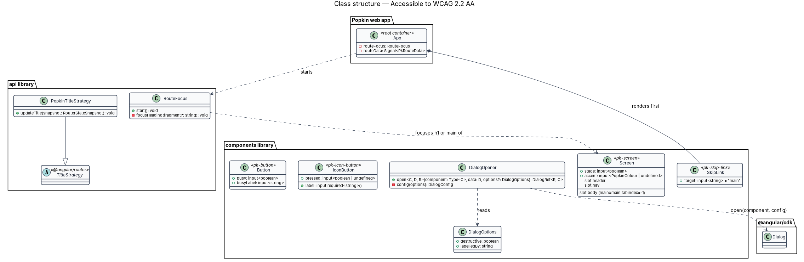
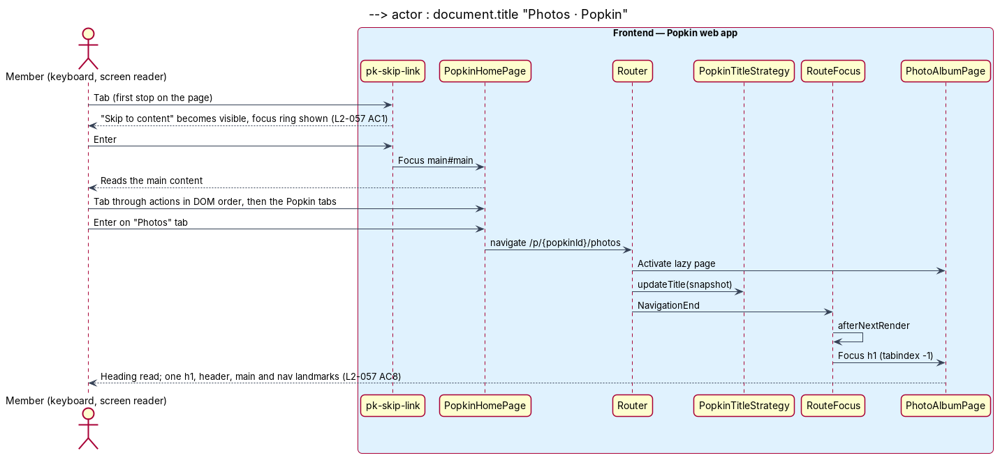
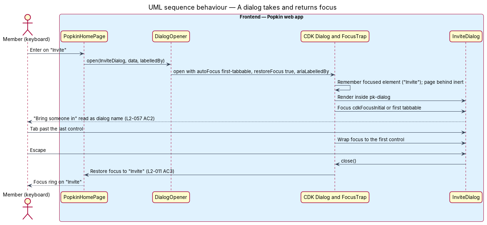

# Accessible to WCAG 2.2 AA

## Overview

Popkin is for whole groups: a grandparent at a reunion, a parent at the side of a pitch, a
teammate using a screen reader or a keyboard. A space that some of the group cannot use is not
a space for the group. This feature is the cross-cutting mechanism that makes every screen of
the Popkin web app meet the Web Content Accessibility Guidelines (WCAG) 2.2 at level AA, in the
light and the dark theme, with touch on a phone and with the keyboard on a desktop.

The feature adds no screen. It sets the page skeleton every screen shares (skip link, landmarks,
one `h1`), how focus moves on navigation and in dialogs, how live updates are announced, and the
contracts each `pk-*` component keeps for names, targets, contrast and state. The design
system's accessibility foundation (`docs/design-system/foundations/accessibility.html`) is the
reference for the visual rules; this design states how the web app enforces them.

Local terms:

- **landmark** — region that assistive technology can jump to: `header` (banner), `nav`
  (navigation) and `main`
- **skip link** — first focusable element of every screen, "Skip to content", visible only when
  focused, which moves focus to the main content
- **focus ring** — the single focus indicator: 3 px `--color-focus-ring` (ink in light, cream in
  dark) at a 2 px offset, shown on `:focus-visible`
- **target** — the area of a control that accepts a press or click
- **accessible name** — the text assistive technology reads for an element, from its content,
  its label, `aria-label` or `alt`
- **live region** — element whose changes assistive technology announces without moving focus

## Description

All parts below are introduced by this design unless marked existing.

### Page skeleton: skip link, landmarks, one `h1` (L2-057 AC8)

- **`App` (existing, `app.ts` + `app.html`)** — today the template wraps `router-outlet` in one
  `<main>`. A page's `<header>` inside that `<main>` is not a banner landmark, and the mocks place
  `header`, `main` and `nav` as siblings
  (`docs/mocks/pages/popkin-home/default.html`). The design therefore changes `app.html` to render
  `pk-skip-link` first, then `router-outlet`, then `ToastHost`; each page supplies its own
  landmarks through `pk-screen`.
- **`pk-skip-link`** — Skip link component (`docs/design-system/components/skip-link.html`):
  `<a class="skip-link" href="#main">Skip to content</a>`, first in the DOM, off-screen until
  focused. Choosing it moves focus to `main#main`.
- **`pk-screen`** — Screen and layout component (`docs/design-system/components/screen.html`).
  It renders three slots as siblings: `[slot=header]` inside `<header>`, the body inside
  `<main id="main" tabindex="-1">`, and `[slot=nav]` inside `<nav aria-label="Popkin">` when the
  page composes `pk-popkin-nav`. Each slot is declared once (AGENTS.md). The landing page uses
  `pk-site-nav`, `pk-site-main` and `pk-site-footer` for its `header`, `nav`, `main` and `footer`
  landmarks instead.
- **One `h1`** — each page template holds exactly one `h1`: in the top bar for threads and the
  Popkin home, in the body elsewhere. Section headings descend from it without skipping a level.
  A dialog's title is an `h2`.
- **`PopkinTitleStrategy`** (`api` library, extends Angular `TitleStrategy`) — sets
  `document.title` to "{route title} · Popkin" on every navigation, from the `title` of each route
  in `app.routes.ts` (WCAG 2.4.2). Registered in `app.config.ts` as
  `{ provide: TitleStrategy, useClass: PopkinTitleStrategy }`.

### Keyboard and focus (L2-057 AC1, AC2)

- **DOM order is focus order.** Templates place controls in reading order; no positive
  `tabindex`. Back is first in the top bar. Sticky footers and the Popkin tabs follow the main
  content in the DOM.
- **`RouteFocus`** (`api` library helper) — subscribes to `NavigationEnd` and, after every
  navigation except the first page load, waits for the next render (`afterNextRender`) and moves
  focus to the new screen's `h1`, giving it `tabindex="-1"`, or to `main#main` when the screen
  has no `h1` in its body. A navigation that only changes a fragment (L2-002 AC5, "How it works")
  focuses the target section's heading instead. Started by `App`.
- **Native elements first.** Buttons are `<button>`, links are `<a href>`, fields are `<input>`
  and `<textarea>` with a `<label>`. Composite widgets follow the WAI-ARIA Authoring Practices:
  `pk-segmented-control` is a radio group with arrow keys, `pk-switch` a `role="switch"` button,
  `pk-emoji-picker` and `pk-colour-picker` radio groups, `pk-chip` filters toggle buttons with
  `aria-pressed`.
- **Press and hold has a keyboard twin.** A message's actions open on long press and on Enter
  when the message has focus (`docs/mocks/dialogs/reactions/default.html`).
- **Dialogs** — every dialog opens through `DialogOpener` (components library), which calls the
  Angular CDK `Dialog` with: `autoFocus: 'first-tabbable'` (a dialog marks its first field or its
  safe action with `cdkFocusInitial`), `restoreFocus: true`, `closeOnNavigation: true`,
  `ariaLabelledBy` set to the `pk-dialog` title's id, and `role: 'alertdialog'` for destructive
  confirmations. The CDK focus trap keeps focus inside; Escape and a press on the backdrop close
  it unless the dialog is busy; focus returns to the control that opened it. While a dialog is
  open the page behind is `inert`. No other element traps focus.
- **Focus ring** — every focusable component styles `:focus-visible` with
  `--focus-ring-width`, `--focus-ring-offset` and `--color-focus-ring`; none removes the outline
  without that replacement. Sticky headers and footers leave `scroll-padding` so a focused
  element is never hidden behind them (WCAG 2.4.11).

### Contrast (L2-057 AC3)

- Components read colour by role (`--color-*`, `--accent-*`), never by hex (AGENTS.md); the
  token file is a copy of `docs/design-system/tokens/tokens.css`.
- The design system verified 143 foreground and background pairs in both themes with
  `check_contrast.py`, and 98 Popkin colour mixes, all at 4.5:1 for text and 3:1 for control
  edges (`docs/design-system/README.md`). A new pairing is added to
  `docs/design-system/tokens/contrast-pairs.json` and checked there before a component uses it.
- `@media (prefers-contrast: more)` and `@media (forced-colors: active)` overrides in
  `tokens.css` are kept; components use `currentColor` and `CanvasText`-safe borders so forced
  colours keep every edge.

### Targets (L2-057 AC4)

- Every interactive component sizes its target to at least `--target-comfortable` (44 px) at
  every width, which also meets the 24 px minimum (`--target-min`) off touch screens. A control
  drawn smaller, such as the 32 px "Dismiss" in `pk-toast` or the 36 px banner action, extends
  its target with padding or a pseudo-element to 44 px, or keeps 24 px with spacing as WCAG
  2.5.8 allows; which of the two applies to `pk-toast` and `pk-banner` is `<TO SUPPLY>`.

### Never colour alone (L2-057 AC5)

| State | Carried also by |
|-------|-----------------|
| Unread | Bold title, a dot and a count with a label ("3 unread") on `pk-badge` |
| Selected / chosen | A ring and a dot, plus `aria-checked` or `aria-pressed` |
| Speaking | A 3 px ring and the text "Speaking" in the tile's accessible name (`pk-call-tile`) |
| Invalid | An icon, the message under the field, `aria-invalid="true"` and `aria-describedby` |
| A Popkin's colour | The colour's name in `pk-colour-picker`; the Popkin's emoji and name everywhere else |
| Own reaction | Outline as well as tint, plus `aria-pressed="true"` |

### Names and decoration (L2-057 AC6)

- `pk-icon-button` declares `label = input.required<string>()`, which becomes its `aria-label`
  and its tooltip, so an icon-only control without a name does not compile.
- Every decorative SVG icon is `aria-hidden="true"`. An emoji that carries meaning (a Popkin's
  emoji on its own, a reaction) is wrapped in `role="img"` with an `aria-label`; an emoji beside
  the name it illustrates is `aria-hidden="true"`.
- Photos carry the caption as `alt`, or "Photo by {first name}" (L2-032 AC7). An avatar beside
  its person's name is decorative; a lone avatar has the name as its accessible name.
- Live updates use the Angular CDK `LiveAnnouncer` (polite) for new messages with their sender
  (L2-027 AC6), "Copied" (L2-010 AC2) and loading status lines; failures use `role="alert"`.

### Text at 200 % (L2-057 AC7)

- Every size is in `rem`; no text container has a fixed height; lines wrap. Components use
  `min-height` rather than `height` where text sits inside.
- A single-line name that `truncate` shortens keeps its full text in the accessible name and the
  tooltip. Whether ellipsis truncation of long names at 200 % text satisfies "no text is cut off"
  is `<TO SUPPLY>`.

### Verification

- Behaviour specs (ADR 0006) carry the checks people depend on: the skip link moves focus to
  main content; Tab reaches each action of a screen in order; after navigation focus is on the
  new `h1`; a dialog takes focus, keeps it, closes on Escape and returns focus to its opener;
  icon-only controls are found by their accessible names (`getByRole('button', { name })`).
- `e2e/tests/accessibility.spec.ts` runs automated rules (axe) per screen state. It is a sweep:
  written and kept current for every new screen state, never run by agents or CI (ADR 0006).
- Component parity specs (ADR 0008) keep focus rings, targets and colours equal to the mocks.

### Screens and states

Every page, dialog and notification in `docs/mocks` applies this feature. Representative mocks:
`docs/mocks/pages/landing/default.html` (skip link, site landmarks),
`docs/mocks/pages/popkin-home/default.html` (header, main and Popkin tabs),
`docs/mocks/pages/group-chat/default.html` (`h1` in the top bar, polite announcements),
`docs/mocks/pages/sign-up/invalid.html` (invalid fields and summary),
`docs/mocks/dialogs/leave-popkin/default.html` (danger with a safe default focused),
`docs/mocks/pages/video-call/default.html` (speaking ring with words) and
`docs/mocks/pages/brand-components/default.html` (the components on one reference sheet).

### API

The feature adds no endpoint. Error ProblemDetails `title` and `detail` are written as plain
sentences so a form can show them under the field they name.

## Requirements

| L2 ID | Refines (L1) | Requirement |
|-------|--------------|-------------|
| `L2-057` | `L1-014` | Accessible to WCAG 2.2 AA: Everyone can use every screen. |

## Diagrams

### System context

Visitors and members reach Popkin with touch, keyboard and assistive technology. Popkin is one
system; assistive technology is part of the person's own device.

### Containers

Accessibility lives in the Popkin web app. The Popkin API contributes plain-language
ProblemDetails text that forms show under their fields.

### Components

The `App` shell renders the skip link; `pk-screen` renders the landmarks; `RouteFocus` and
`PopkinTitleStrategy` act on each navigation; `DialogOpener` wraps the CDK dialog and its focus
trap; `LiveAnnouncer` speaks updates; the `pk-*` components read the token file for contrast and
targets.

### Class structure

`App` depends on `RouteFocus` and composes `SkipLink`. `Screen` exposes the header, body and nav
slots. `DialogOpener` builds a `DialogConfig` for the CDK `Dialog`. `IconButton` requires a
label.

### Behaviour — keyboard user moves between screens

A keyboard user skips to the main content, opens another screen, and lands on its heading with
the new title announced (L2-057 AC1, AC8).

### Behaviour — a dialog takes and returns focus

The member chooses "Invite" on the Popkin home and the "Bring someone in" dialog opens
(`docs/mocks/dialogs/invite/default.html`). Focus moves into it and stays there, Escape closes
it, and focus returns to "Invite" (L2-057 AC2, L2-011 AC3).

