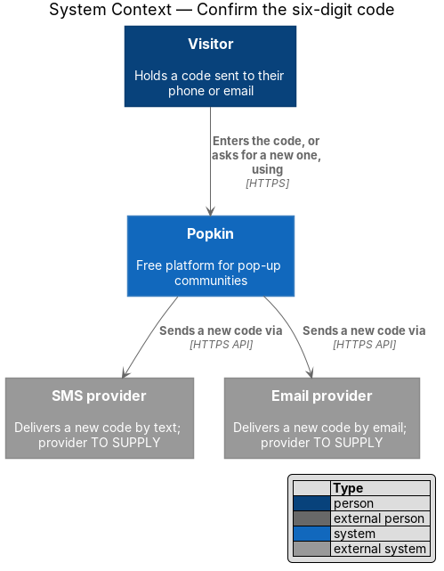
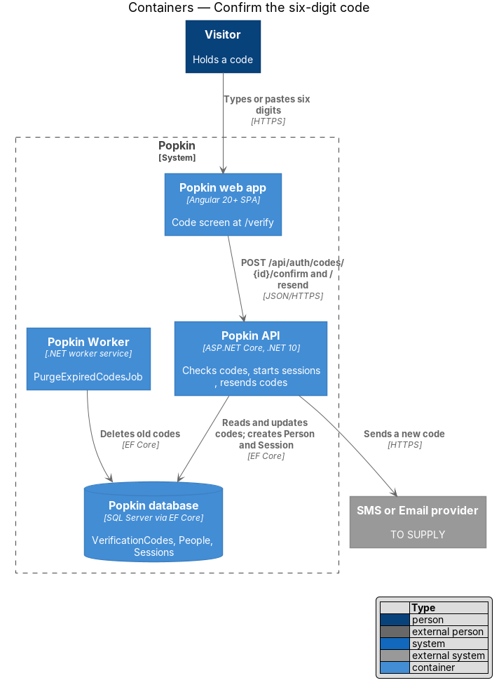
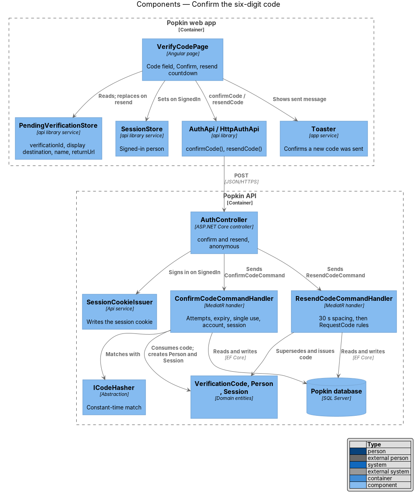
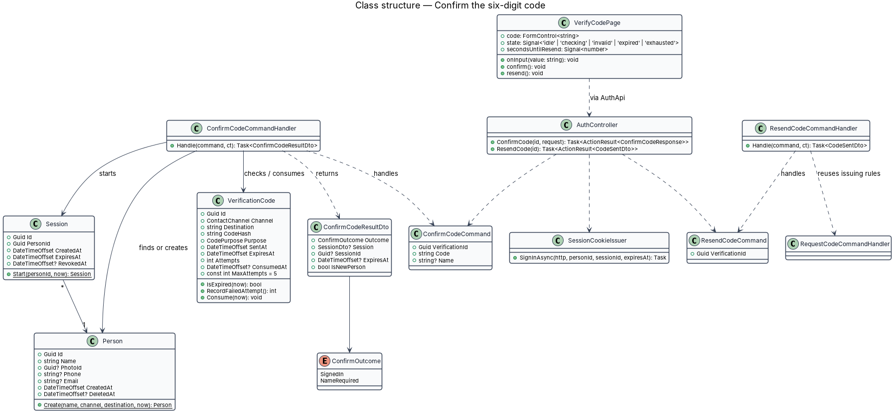
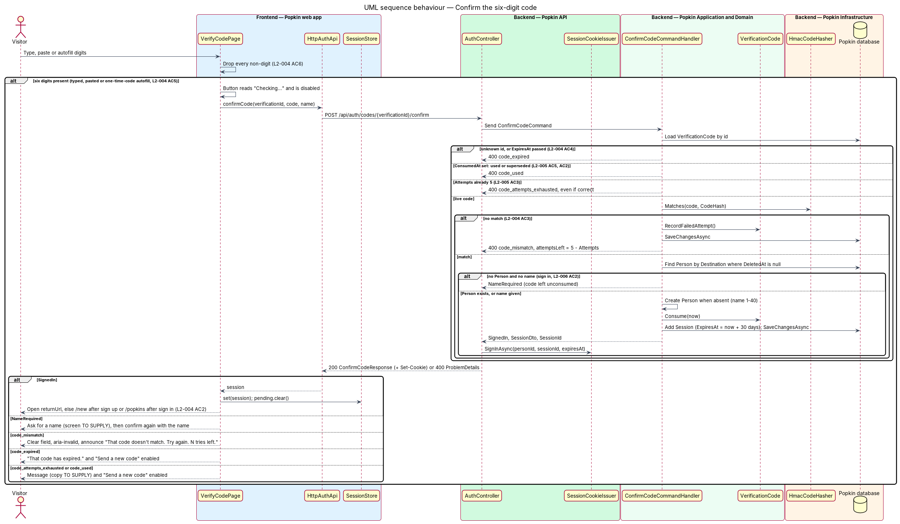
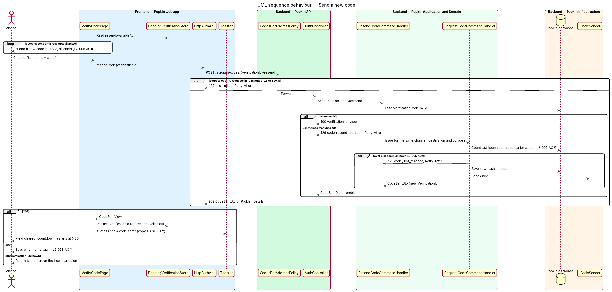

# Confirm the six-digit code

## Overview

Popkin signs people in without passwords. After sign up or sign in, Popkin sends a one-time
six-digit code to the person's phone number or email. This feature covers the code screen and
the backend checks behind it: matching the code, limiting attempts, expiring and resending codes,
and, on success, creating the account when needed and starting a session.

- **code screen** — the screen at `/verify` titled "Enter your code"
- **attempt** — one submission of six digits against one verification code
- **superseded code** — earlier code for the same destination and purpose that stopped working because a newer one was issued
- **resend window** — 30 seconds after a code is sent during which "Send a new code" is disabled
- **next step** — the screen the person's journey continues to after confirming: the `returnUrl` they came from, else `/new` after sign up, else `/popkins` after sign in

The feature sits between sign up or sign in (which issue the first code) and the sessions
feature (which owns the cookie and the server-side `Session`). The rules here make the code a
proof of ownership that cannot be guessed, replayed or requested without limit (L2-004, L2-005,
L2-053).

## Description

- **Screens and states**
  - `docs/mocks/pages/verify-code/default.html` — "Enter your code", "We texted 6 digits to (•••) •••-••48.", the "6-digit code" field, "Send a new code in 0:24", "Confirm" and "Use a different number".
  - `docs/mocks/pages/verify-code/invalid.html` — "That code doesn't match. Try again. 4 tries left."
  - `docs/mocks/pages/verify-code/expired.html` — "That code has expired." with "Send a new code" enabled.
  - `docs/mocks/pages/verify-code/submitting.html` — the button reads "Checking…" and is disabled.
  - `docs/mocks/notifications/toast/success.html` — the toast pattern for "a new code was sent" (L2-005 AC2).
- **API**
  - `POST /api/auth/codes/{verificationId}/confirm` — anonymous (L2-050 AC1). Body `{ code, name? }`. 200 `ConfirmCodeResponse { outcome: "SignedIn" | "NameRequired", session?: SessionDto, isNewPerson }`; `SignedIn` also sets the session cookie. Problems: 400 `code_mismatch` (extension `attemptsLeft`), 400 `code_expired`, 400 `code_used`, 400 `code_attempts_exhausted`, 400 `name_invalid` (field `name`).
  - `POST /api/auth/codes/{verificationId}/resend` — anonymous, `CodesPerAddressPolicy`. 202 `CodeSentDto` with a new `verificationId`. Problems: 400 `verification_unknown`, 429 `code_resend_too_soon`, 429 `code_limit_reached`, 429 `rate_limited`, 503 `code_not_sent`; every 429 carries `Retry-After`.

### Front end (introduced)

- **Route** — `/verify`, `VerifyCodePage`, data `{ shell: 'bare', page: 'verify-code' }`, public (L2-007 AC3). When `PendingVerificationStore` is empty the page redirects to `/sign-in`.
- **`VerifyCodePage`** — `pages/verify-code/verify-code.page.ts` and `.html`, selector `pk-verify-code-page`, OnPush.
  - The sub-heading names the destination from `displayDestination`: "We texted 6 digits to …" for a phone. Only the last two digits of a phone number show (L2-004 AC1). The wording for an email, and the "Use a different number" label for an email, are `<TO SUPPLY>`; the mocks draw a phone only.
  - The field is `pk-text-field` in its code variant: `inputmode="numeric"`, `autocomplete="one-time-code"`, `maxlength="6"`, focused on open. The `input` handler drops every non-digit (L2-004 AC6). When six digits are present the page submits without a further tap; typing, pasting and one-time-code autofill all raise `input`, so all three submit the same way (L2-004 AC2, AC5). "Confirm" stays for people who prefer to press it, as the mock notes.
  - While checking, "Confirm" reads "Checking…" and is disabled; a second submission is ignored (L2-056 AC3).
  - `code_mismatch` clears the field, sets `aria-invalid="true"` and announces "That code doesn't match. Try again. N tries left." from `attemptsLeft` (L2-004 AC3).
  - `code_expired` shows "That code has expired." and enables "Send a new code" at once (L2-004 AC4).
  - `code_attempts_exhausted` and `code_used` require a new code (L2-005 AC3, AC5). Their copy is `<TO SUPPLY>`; no mock draws them.
  - The resend countdown reads `resendAvailableAt` and ticks each second: "Send a new code in 0:24", disabled, until 30 seconds have passed (L2-005 AC1). The ticking text is not a live region, so assistive technology is not interrupted each second.
  - On `SignedIn` the page sets `SessionStore`, clears the pending verification and navigates to the next step. `returnUrl` is honoured only when it is a path inside the app (starts with a single `/`), to prevent open redirects.
  - On `NameRequired` the page asks for a name and then confirms again with the same code and the name (L2-006 AC2). The screen or state that asks for the name is `<TO SUPPLY>`; no mock draws it. The sign-in design describes this flow.
  - "Use a different number" returns to the screen the flow started on (`/sign-up` or `/sign-in`), keeping the name for sign up.
- **`PendingVerificationStore`** — introduced by sign up; resend replaces `verificationId` and `resendAvailableAt`.
- **`AuthApi`** — this slice adds `confirmCode(verificationId, code, name?)` and `resendCode(verificationId)`.
- **`Toaster`** — `toasts/toaster.ts`; shows `pk-toast` success "new code sent" for 8 seconds (L2-056 AC7). The copy is `<TO SUPPLY>`.
- **Components** — `pk-top-bar`, `pk-text-field`, `pk-button`, `pk-link`, `pk-toast`.

### Back end (introduced)

- **`VerificationCode`** gains behaviour: `MaxAttempts = 5`, `IsExpired(now)`, `RecordFailedAttempt()` and `Consume(now)`. A concurrency token (`rowversion` on SQL Server) prevents two concurrent confirmations from both consuming one code (L2-005 AC5).
- **`ConfirmCodeCommandHandler`** (`Popkin.Application.Auth`) — checks, in this order, then acts:
  1. Unknown identifier or `ExpiresAt` passed: `code_expired` (L2-004 AC4; 10 minutes from sending).
  2. `ConsumedAt` set, whether used or superseded: `code_used` (L2-005 AC5, AC2).
  3. `Attempts` already 5: `code_attempts_exhausted`, even for the correct code (L2-005 AC3).
  4. Hash does not match: increments `Attempts`, saves, `code_mismatch` with `attemptsLeft` (L2-004 AC3).
  5. Match: finds the `Person` whose `Phone` or `Email` equals the destination and who is not deleted. With no such person and no name, it returns `NameRequired` and leaves the code unconsumed. With a name it validates 1 to 40 characters and creates the `Person`. An existing person keeps their name, so sign up with a known destination signs into that account without saying so (L2-006 AC2).
  6. Consumes the code, adds `Session.Start(personId, now)` with `ExpiresAt` 30 days ahead (L2-007 AC1), saves in one unit of work and returns `SignedIn`.
- **`ResendCodeCommandHandler`** — loads the code by identifier (even an expired one, so the expired state can resend). It refuses with 429 `code_resend_too_soon` within 30 seconds of `SentAt` (L2-005 AC1). It then applies the issuing rules of `RequestCodeCommandHandler` for the same channel, destination and purpose: the hourly limit, superseding and sending (L2-005 AC2, AC4).
- **`AuthController.ConfirmCode`**, **`AuthController.ResendCode`** — `[AllowAnonymous]`; resend also carries `[EnableRateLimiting(CodesPerAddressPolicy.Name)]` (L2-053 AC1). On `SignedIn`, `ConfirmCode` calls `SessionCookieIssuer.SignInAsync`, introduced by the sessions feature.
- **`PurgeExpiredCodesJob`** (`Popkin.Worker`) — deletes verification codes once they no longer count toward the hourly limit. The retention (at least one hour after `SentAt`) and the schedule are `<TO SUPPLY>`.
- **Logging** — no code, destination, name or cookie value is logged (L2-054 AC3).

### Tests

- API integration tests on InMemory, with the fixed `ICodeGenerator` and the capturing `ICodeSender`, cover each outcome and problem code: match, mismatch with `attemptsLeft`, a sixth attempt that is correct but refused, expiry after 10 minutes (with `TimeProvider` advanced), single use, superseding after resend, resend inside 30 seconds and the sixth code in an hour.
- Playwright specs drive `e2e/pages/verify-code.page.ts` for typing, pasting, non-digit input, each error state and the countdown, with time controlled by the Playwright clock.

### Open questions settled in journey 1

- **Email wording** — "We emailed 6 digits to {email}." and "Use a different email".
- **Copy with no mock** — `code_attempts_exhausted`: "Too many tries. Send a new code to try
  again."; `code_used`: "That code has been used. Send a new code."; a failed check: "We couldn’t
  check your code. Try again."; the resend toast: "New code sent" / "Check your messages for the
  6 digits."
- **Error announcement** — the code field's error is its own `role="alert"`, because the code
  screen has no form summary.
- **Digits only** — the field drops anything that is not a digit as it is typed, before the page
  sees the value, so fast typing cannot race the filter.
- **`NameRequired`** — sign up always sends the name, so journey 1 never meets it; the sign-in
  journey builds the screen that asks for it.

## Requirements

| L2 ID | Refines (L1) | Requirement |
|-------|--------------|-------------|
| `L2-004` | `L1-002` | Confirm the six-digit code: A six-digit code sent to the phone number or email proves the person owns it. |
| `L2-005` | `L1-002` | Resend and limit codes: Codes are short lived and cannot be guessed or requested without limit. |
| `L2-053` | `L1-012` | Abuse is limited: One person cannot flood the system or another person. |

## Diagrams

### System context

The Visitor enters a code in Popkin or asks for a new one, which Popkin sends through the SMS
or email provider.

### Containers

The Popkin API checks codes and starts sessions in the Popkin database. The Popkin Worker
deletes old codes.

### Components

`VerifyCodePage` calls `AuthApi`. `AuthController` dispatches to the confirm and resend
handlers and uses `SessionCookieIssuer` when a session starts.

### Class structure

`ConfirmCodeCommandHandler` checks and consumes a `VerificationCode`, finds or creates a
`Person` and starts a `Session`. `ResendCodeCommandHandler` reuses the issuing rules.

### Behaviour — confirm the code

Six digits submit on their own. The handler checks expiry, single use and the attempt limit
before matching, then signs the person in, or asks for a name when no account exists.

### Behaviour — send a new code

The countdown keeps "Send a new code" disabled for 30 seconds. A resend supersedes the earlier
code and is refused when the address or destination limit is reached.

