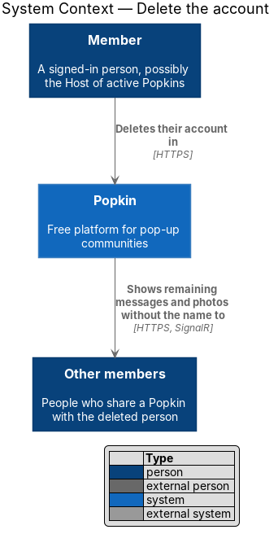
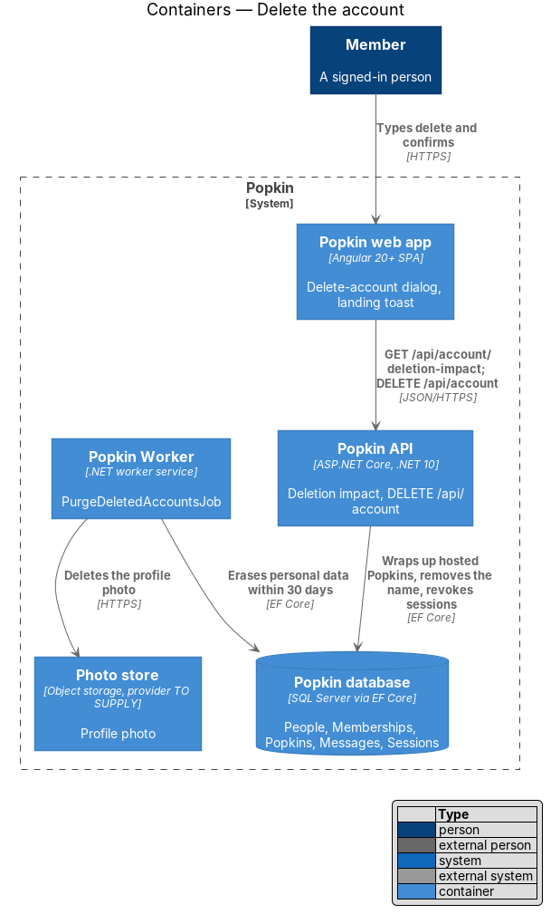
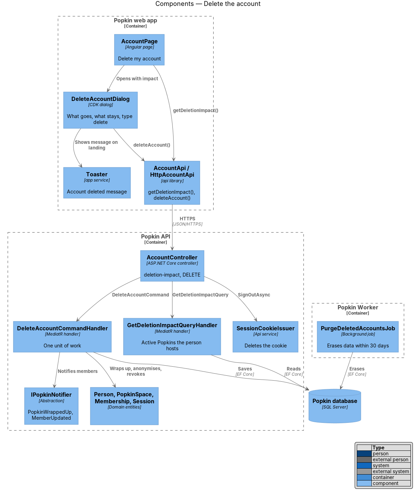
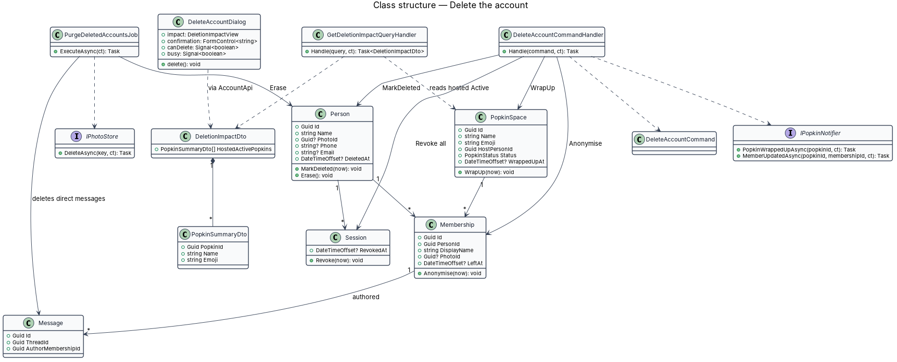
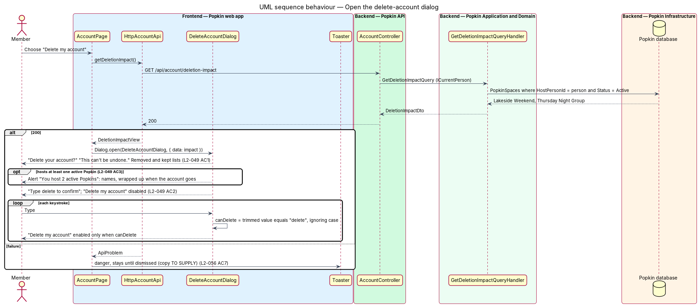
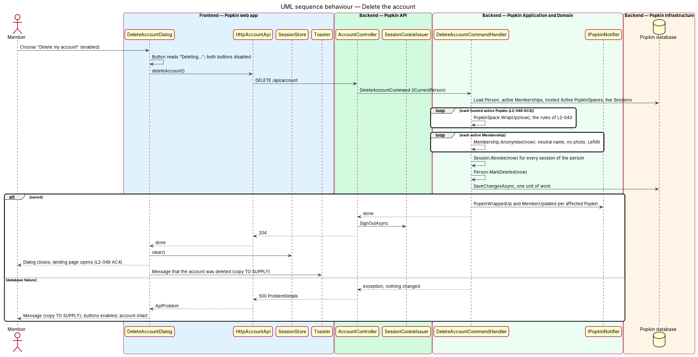
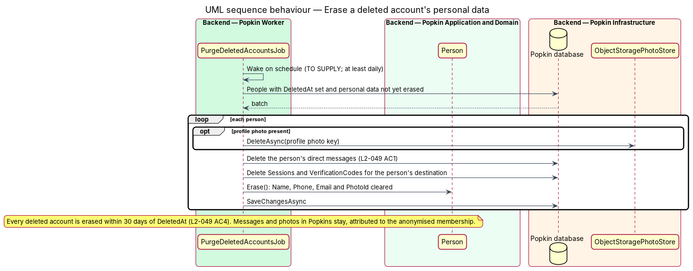

# Delete the account

## Overview

A person may leave Popkin entirely. Deleting an account removes what identifies the person,
ends every session they hold, and wraps up the active Popkins they host, while the messages and
photos they shared in Popkins stay for the other members without their name. This feature covers
the confirmation dialog on the account screen, the deletion itself, and the background job that
erases the remaining personal data within 30 days.

- **deletion** — the request that marks a `Person` deleted, wraps up the active Popkins they host, removes their name and photo from every membership and revokes every session, all in one unit of work
- **erasure** — the later removal of the name, phone number, email, profile photo and direct messages, completed within 30 days of deletion (L2-049 AC4)
- **deletion impact** — the list of active Popkins the person hosts, which the dialog names because they are wrapped up on deletion (L2-049 AC3)
- **confirmation word** — the word "delete", which the person types to enable the final button (L2-049 AC2)
- **wrap up** — ending a Popkin; a wrapped-up Popkin is read-only and has a recap (`docs/specs/L1.md`)

Deletion starts from "Delete my account" on the account screen (manage-account design). It
depends on the wrap-up rules of L2-043, owned by the wrap-up design, and on the session
revocation of the sessions design.

## Description

- **Screens and states**
  - `docs/mocks/dialogs/delete-account/default.html` — "Delete your account?", "This can't be undone.", the alert "You host 2 active Popkins" naming Lakeside Weekend and Thursday Night Group, the lists "Removed: your name, photo, phone number and direct messages." and "Kept, without your name: your messages and photos in Popkins.", the field "Type delete to confirm", "Delete my account" disabled, and "Keep my account".
  - `docs/mocks/dialogs/delete-account/confirm.html` — "delete" typed; "Delete my account" enabled.
  - `docs/mocks/dialogs/delete-account/busy.html` — "Deleting…".
  - `docs/mocks/pages/landing/default.html` — where the person lands; the deletion message uses the `pk-toast` pattern of `docs/mocks/notifications/toast/success.html`.
- **API**
  - `GET /api/account/deletion-impact` — 200 `DeletionImpactDto { hostedActivePopkins: [{ popkinId, name, emoji }] }`.
  - `DELETE /api/account` — 204; deletes the session cookie. 401 without a session. A failure answers 500 ProblemDetails and changes nothing.

### Front end (introduced)

- **Opening the dialog** — `AccountPage` calls `AccountApi.getDeletionImpact()` when "Delete my account" is chosen, then opens `DeleteAccountDialog` with the impact as dialog data. The dialog therefore opens complete, with no loading state the mocks do not draw. A failure shows a danger toast that stays until dismissed (L2-056 AC7); its copy is `<TO SUPPLY>`.
- **`DeleteAccountDialog`** — `dialogs/delete-account/delete-account.dialog.ts` and `.html`, selector `pk-delete-account-dialog`, composed in `pk-dialog`, opened with the CDK `Dialog` (a bottom sheet under 640 px, L2-058 AC4).
  - It lists what is removed and what stays (L2-049 AC1). When `hostedActivePopkins` is not empty it shows `pk-alert` with the count and the names (L2-049 AC3). The plural and singular forms of "You host N active Popkins" are `<TO SUPPLY>` for N = 1.
  - The field "Type delete to confirm" uses `autocomplete="off"` and `autocapitalize="none"`. `canDelete` is true only when the trimmed value equals "delete", ignoring case. "Delete my account" (`pk-button`, danger variant) stays disabled until then (L2-049 AC2).
  - While deleting, the button reads "Deleting…" and both buttons are disabled; Escape does not close the dialog during the request.
  - On 204 it stops the real-time connection, clears `SessionStore`, closes, navigates to `/` and asks `Toaster` to show that the account was deleted (L2-049 AC4). The copy is `<TO SUPPLY>`; no mock draws it.
  - On failure it keeps the dialog open with the typed word, shows a message (copy `<TO SUPPLY>`) and enables the buttons again.
  - "Keep my account", the close button and Escape close the dialog and return focus to "Delete my account" (L2-057 AC2).
- **`AccountApi`** — this slice adds `getDeletionImpact()` and `deleteAccount()`; view model `DeletionImpactView`.
- **Components** — `pk-dialog`, `pk-alert`, `pk-text-field`, `pk-button`, `pk-toast`.

### Back end (introduced)

- **`GetDeletionImpactQuery`** / **`GetDeletionImpactQueryHandler`** — returns the `PopkinSpace` rows whose `HostPersonId` is the caller and whose `Status` is `Active`.
- **`DeleteAccountCommand`** / **`DeleteAccountCommandHandler`** (`Popkin.Application.Account`) — runs in one unit of work:
  1. For each hosted active Popkin, applies `PopkinSpace.WrapUp(now)` under the rules of L2-043 (L2-049 AC3). Whether the Popkin keeps its photos when wrapped up this way, since the Host makes no choice, is `<TO SUPPLY>`.
  2. For each active `Membership`, calls `Anonymise(now)`: the display name becomes a neutral label, the photo is cleared and `LeftAt` is set. Messages and photos keep their `AuthorMembershipId` and `UploaderMembershipId`, so they stay without the person's name (L2-049 AC1). The neutral label is `<TO SUPPLY>`.
  3. Revokes every `Session` of the person, on every device.
  4. Calls `Person.MarkDeleted(now)`. The unique indexes on `Phone` and `Email` apply only where `DeletedAt` is null, so the same phone number or email may sign up again at once.
  5. Saves, then sends `IPopkinNotifier.PopkinWrappedUpAsync` for each wrapped-up Popkin and `MemberUpdatedAsync` for each other affected Popkin.
- **`AccountController.Delete`** — sends the command, calls `SessionCookieIssuer.SignOutAsync` and answers 204. From then on `SessionCookieEvents` rejects any copy of the cookie, because the person is deleted and the sessions are revoked.
- **`PurgeDeletedAccountsJob`** (`Popkin.Worker`) — erases each deleted person's remaining personal data within 30 days of `DeletedAt` (L2-049 AC4): it deletes the profile photo file through `IPhotoStore.DeleteAsync`, deletes the person's direct messages, deletes their sessions and any verification codes for their destination, and calls `Person.Erase()` to clear `Name`, `Phone`, `Email` and `PhotoId`. Its schedule is `<TO SUPPLY>` and shall run at least once every 30 days; daily is suggested. Whether the job also deletes the other member's messages in the same direct-message threads is `<TO SUPPLY>`; L2-049 AC1 names only "their direct messages".
- **Backups** — whether database backups retain erased data beyond 30 days, and for how long, is `<TO SUPPLY>`.
- **Logging** — no name, phone number or email of the deleted person is logged (L2-054 AC3).

### Tests

- API integration tests on InMemory: the impact lists only active Popkins the caller hosts; after `DELETE /api/account` the hosted Popkins are wrapped up, every membership shows the neutral label, the old cookie gets 401, the messages remain, and the same phone number can request a code again. A database fault injected through `IAppDbContext` leaves everything unchanged.
- Worker tests run `PurgeDeletedAccountsJob` against InMemory with `TimeProvider` advanced and assert the erased fields and deleted direct messages.
- Playwright specs drive `e2e/pages/delete-account.dialog.ts`: the disabled button until "delete" is typed, the hosted-Popkins alert, and the landing page with the message after success.

## Requirements

| L2 ID | Refines (L1) | Requirement |
|-------|--------------|-------------|
| `L2-049` | `L1-002` | Delete an account: A person removes themselves from Popkin. |

## Diagrams

### System context

The Member deletes their account. Other members of their Popkins keep seeing the messages and
photos, without the name.

### Containers

The Popkin API performs the deletion in the Popkin database. The Popkin Worker later erases the
remaining personal data and the profile photo in the Photo store.

### Components

`AccountPage` loads the deletion impact and opens `DeleteAccountDialog`.
`DeleteAccountCommandHandler` changes the domain entities in one unit of work;
`PurgeDeletedAccountsJob` completes the erasure.

### Class structure

The handler wraps up `PopkinSpace` rows, anonymises each `Membership`, revokes each `Session`
and marks the `Person` deleted. The job erases the `Person` and deletes direct messages.

### Behaviour — open the delete-account dialog

The dialog opens with the hosted active Popkins already known (L2-049 AC3) and enables the
final button only when "delete" is typed (L2-049 AC2).

### Behaviour — delete the account

One unit of work wraps up, anonymises, revokes and marks deleted. On success the cookie is
deleted and the landing page opens with a message (L2-049 AC4); on failure nothing changes.

### Behaviour — erase a deleted account's personal data

The worker removes the profile photo, direct messages, sessions, codes and identifying fields
within 30 days of deletion.

