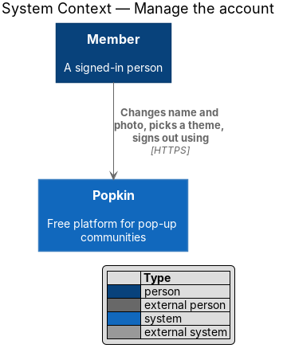
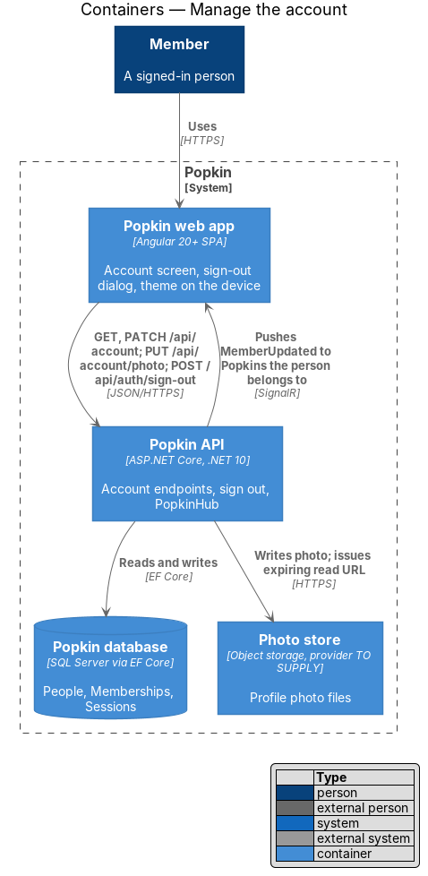
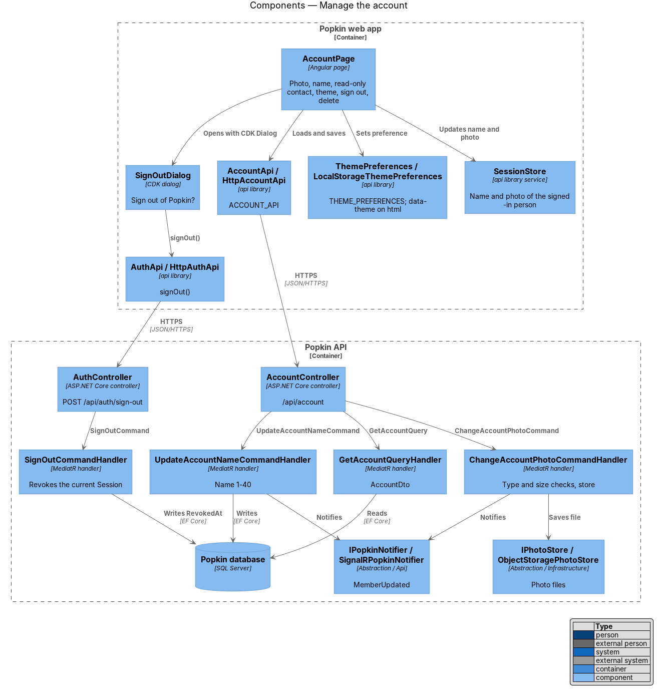
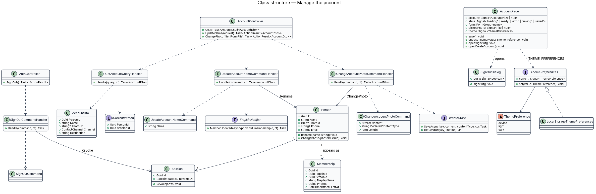
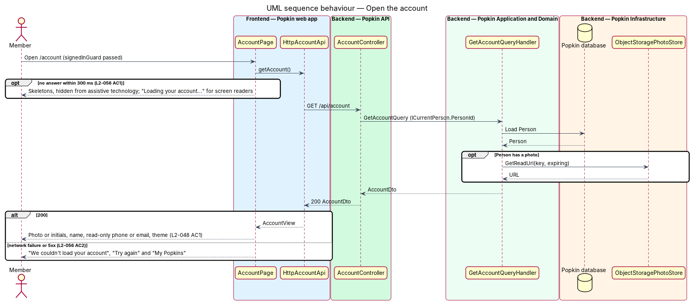
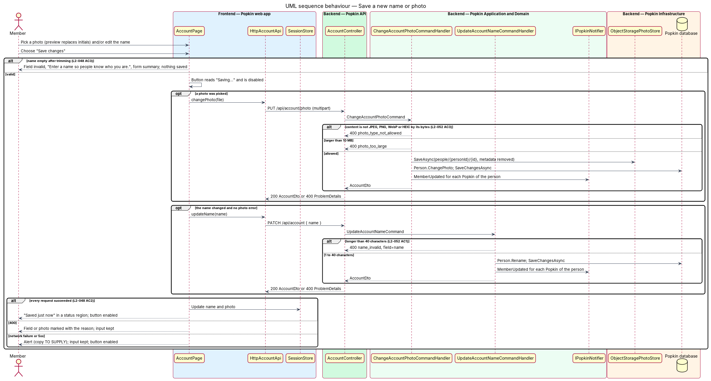
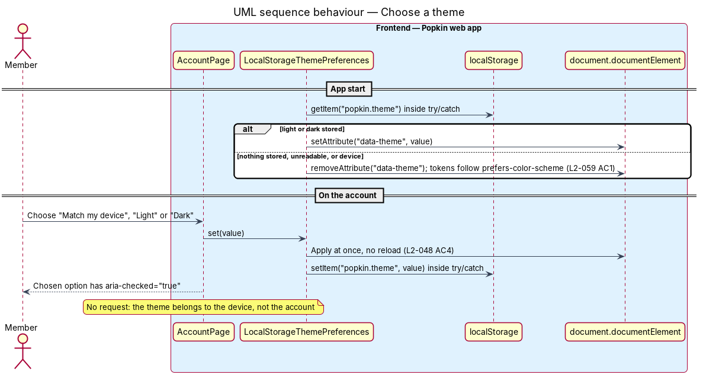
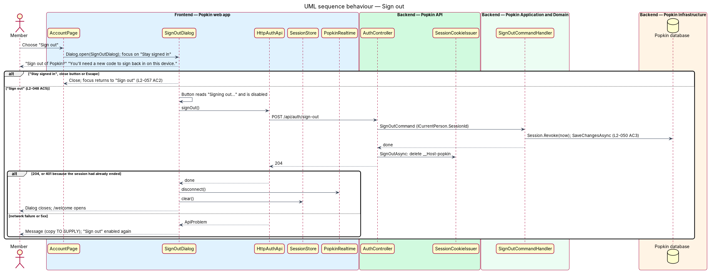

# Manage the account

## Overview

Every Popkin account belongs to one person and holds three things: a name, an optional photo and
the phone number or email used to sign in. This feature covers the account screen where a
signed-in person changes how they appear, picks a light or dark theme for their device, and
signs out. Deleting the account starts from the same screen but has its own design
(`docs/detailed-designs/accounts/delete-account`).

- **account screen** — the screen at `/account` titled "Your account"
- **sign-in contact** — the phone number or email a person signs in with; shown read-only on the account screen and never to other members (L2-054 AC2)
- **theme preference** — the device-level choice of "Match my device", "Light" or "Dark"; stored in the browser, not on the account
- **membership** — record that a person belongs to one Popkin, with the display name and photo shown there

The specs list account settings and signing out as assumptions the designs do not draw
(`docs/specs/L1.md`). The mocks for this screen are built from the sign-up step, as
`docs/mocks/README.md` records.

## Description

- **Screens and states**
  - `docs/mocks/pages/account/default.html` — "Your account", the photo picker ("Change your photo"), "Your name" with the hint "This is how you appear in every Popkin.", the read-only "Phone number" with "You sign in with this. It's never shown to other members.", the theme switch, "Save changes", "Sign out" and "Delete my account".
  - `docs/mocks/pages/account/loading.html` — skeletons and the hidden "Loading your account…".
  - `docs/mocks/pages/account/error.html` — "We couldn't load your account", "Try again", "My Popkins".
  - `docs/mocks/pages/account/invalid.html` — "One thing to fix" and "Enter a name so people know who you are."
  - `docs/mocks/pages/account/submitting.html` — "Saving…".
  - `docs/mocks/pages/account/success.html` — "Saved just now" in a status region.
  - `docs/mocks/dialogs/sign-out/default.html` — "Sign out of Popkin?", "You'll need a new code to sign back in on this device.", "Sign out", "Stay signed in".
  - `docs/mocks/dialogs/sign-out/busy.html` — "Signing out…".
- **API**
  - `GET /api/account` — 200 `AccountDto`. 401 without a session.
  - `PATCH /api/account` — body `{ name }`. 200 `AccountDto`. 400 `name_invalid` (field `name`).
  - `PUT /api/account/photo` — `multipart/form-data` with one file. 200 `AccountDto`. 400 `photo_type_not_allowed`, 400 `photo_too_large`.
  - `POST /api/auth/sign-out` — 204. Revokes the current session and deletes the cookie.

### Front end (introduced)

- **Route** — `/account`, `AccountPage`, `canActivate: [signedInGuard]`, data `{ shell: 'app', page: 'account' }`. The top bar's back button leads to `/popkins`, as in the mock.
- **`AccountPage`** — `pages/account/account.page.ts` and `.html`, selector `pk-account-page`, OnPush.
  - It loads the account through `ACCOUNT_API`. After 300 ms without an answer it shows the loading state; on failure it shows the error state with "Try again" and "My Popkins" (L2-056 AC1, AC2).
  - It shows the photo or the initials, the name, and the sign-in contact as a read-only field labelled "Phone number" or "Email" (L2-048 AC1).
  - "Change your photo" opens the device picker with `accept="image/jpeg,image/png,image/webp,image/heic"` and previews the picked file in place of the initials. The upload happens on "Save changes".
  - "Save changes" trims the name. An empty name marks the field invalid with the mock's message and saves nothing (L2-048 AC3). Otherwise the button reads "Saving…" and is disabled. The page uploads the photo when one was picked, then patches the name when it changed. When both succeed it updates `SessionStore` and shows "Saved just now" in a `role="status"` region (L2-048 AC2). The name field has `maxlength="40"`.
  - A save failure keeps the typed name and the picked photo and enables the button again. Its copy is `<TO SUPPLY>`; no mock draws it. A refused photo shows its reason; the copy is `<TO SUPPLY>`.
  - The theme switch is `pk-segmented-control` in its radio form (`role="radio"`, `aria-checked`). Choosing an option calls `ThemePreferences.set` at once, independent of "Save changes" (L2-048 AC4).
  - "Sign out" opens `SignOutDialog`; "Delete my account" opens `DeleteAccountDialog` (delete-account design). Both use the CDK `Dialog`.
- **`SignOutDialog`** — `dialogs/sign-out/sign-out.dialog.ts` and `.html`, selector `pk-sign-out-dialog`, composed in `pk-dialog`. Focus starts on "Stay signed in", as in the mock. "Sign out" reads "Signing out…" while busy. On 204, or on 401 because the session had already ended, it stops the real-time connection (`PopkinRealtime.disconnect()`), clears `SessionStore` and navigates to `/welcome` (L2-048 AC5). Any other failure keeps the dialog open; its copy is `<TO SUPPLY>`.
- **`AccountApi` / `ACCOUNT_API` / `HttpAccountApi`** — `api` library (`lib/api/account/`): `getAccount()`, `updateName(name)`, `changePhoto(file)`. View model `AccountView` in `lib/models/`.
- **`AuthApi`** — this slice adds `signOut()`.
- **`ThemePreferences` / `THEME_PREFERENCES` / `LocalStorageThemePreferences`** — `api` library (`lib/api/theme/`). `current` is a signal of `'device' | 'light' | 'dark'`. `set` writes `data-theme` on the `html` element, or removes it for `device` so the tokens follow `prefers-color-scheme`. It stores the value under the key `popkin.theme`. Each read and write is wrapped in `try/catch`, so a blocked storage falls back to `device` (L2-059 AC1). The app applies the stored value at start through `provideAppInitializer`. Signing out does not clear it, because it belongs to the device.
- **Components** — `pk-top-bar`, `pk-photo-picker`, `pk-avatar`, `pk-text-field`, `pk-segmented-control`, `pk-button`, `pk-list-row` (the menu list for "Sign out" and "Delete my account"), `pk-form-summary`, `pk-alert`, `pk-skeleton`, `pk-empty-state`, `pk-dialog`.

### Back end (introduced)

- **`AccountController`** (`Popkin.Api`) — `/api/account`, authenticated by the fallback policy. It acts only on `ICurrentPerson.PersonId`, so a person sees and changes only their own account.
- **`GetAccountQuery`** / **`GetAccountQueryHandler`** — returns `AccountDto { PersonId, Name, PhotoUrl?, Channel, Destination }`. `Destination` is the person's own phone number or email, formatted for display. `PhotoUrl` is an expiring read URL from `IPhotoStore`.
- **`UpdateAccountNameCommand`** / **`…Validator`** / **`…Handler`** — validates 1 to 40 characters after trimming (L2-048 AC2, L2-052 AC1) and calls `Person.Rename`. It then sends `IPopkinNotifier.MemberUpdatedAsync` for each Popkin where the person has an active membership, so open screens show the new name without a reload.
- **Name and photo in each Popkin** — L2-048 AC2 says a new name or photo "shows wherever they appear", but each `Membership` holds its own `DisplayName` and `PhotoId`, chosen when joining (L2-013). Whether an account change overwrites every membership's name and photo, or only those that still match the account's, is `<TO SUPPLY>`.
- **`ChangeAccountPhotoCommand`** / **`…Handler`** — checks the file's leading bytes, not its name or declared type, against JPEG, PNG, WebP and HEIC (L2-052 AC3), and refuses files over 10 MB. These are the profile-photo rules of L2-013 AC2; L2-048 sets none of its own. It removes location and device metadata before storing, as L2-031 AC6 does for album photos. It writes the file through `IPhotoStore` and calls `Person.ChangePhoto`.
- **Profile photo record** — `Person.PhotoId` needs a target. The `Photo` entity belongs to one Popkin (`PopkinId`), which a profile photo does not. Whether profile photos use `Photo` with a nullable `PopkinId` or a separate record is `<TO SUPPLY>`. Thumbnail sizes for avatars are `<TO SUPPLY>`.
- **`SignOutCommand`** / **`SignOutCommandHandler`** (`Popkin.Application.Auth`) — loads the `Session` named by `ICurrentPerson.SessionId` and calls `Revoke(now)`. **`AuthController.SignOut`** then calls `SessionCookieIssuer.SignOutAsync` and answers 204. Because `SessionCookieEvents` checks the session on every request, the cookie stops working at once, even if a copy of it exists elsewhere (L2-050 AC3).
- **Open real-time connections** — a SignalR connection authenticates once, when it opens. The front end closes its own connection on sign out. Ending other open connections of a revoked session on the server, for example by checking the session on each hub call, is `<TO SUPPLY>`.

### Tests

- API integration tests on InMemory: `GET /api/account` returns only the caller's data; `PATCH` with an empty and a 41-character name answers 400 `name_invalid`; a file with a `.jpg` name but other bytes answers 400 `photo_type_not_allowed`; after `POST /api/auth/sign-out` the same cookie gets 401.
- Playwright specs drive `e2e/pages/account.page.ts` and `e2e/pages/sign-out.dialog.ts`: each account state, theme switching (asserting `data-theme` on `html`), and sign out to the welcome screen.

### Built in journey 17

Each `<TO SUPPLY>` above is settled here, as the simplest choice that fits; the bullets above keep
the question so its history reads.

- **Form factors** — the screen keeps one centred column at every width, as
  `docs/mocks/README.md` says of the account screen: `pk-screen layout="column"` (`screen--column`),
  28 rem wide on XS and 32 rem from S (L2-058 AC2, AC3).
- **Name and photo in each Popkin** — an account change overwrites the name and the photo of every
  membership the person has not left, so a new name or photo shows wherever they appear
  (L2-048 AC2). Nothing is sent over the hub: another member sees it when their screen next reads
  the members or the messages (`MemberUpdated` is not built; the open point below).
- **Profile photo record** — `Person.PhotoKey`, a photo store key, as `Membership.PhotoKey` is. It
  replaces `Person.PhotoId`, which pointed nowhere. The file is made as the avatar of joining is
  (`IPhotoProcessor.MakeAvatar`), under `avatars/`, and the photo replaced is deleted after the save.
  `SessionDto.PhotoUrl` and `AccountDto.PhotoUrl` read it.
- **`Destination`** — a phone number reads "(415) 555-0148", as it was typed; an email reads as
  stored.
- **Copy** — a save that fails: "We couldn’t save that." / "Your changes are still here. Give it
  another go." A refused photo: the reasons of joining (`photoProblemText`). A sign out that fails:
  "We couldn’t sign you out." / "You’re still signed in. Try again."
- **Sign out on the device** — the dialog stops the real-time connection, clears `SessionStore`
  and forgets the saved list of My Popkins (`POPKINS_SNAPSHOT.clear()`, known gap 25). A 401 from
  `POST /api/auth/sign-out` is not sent to the sign-in screen by the interceptor: it means the
  session had already ended, and the welcome screen opens as on 204.
- **The mock's menu, aligned** — the account mocks drew Sign out and Delete my account as bare
  icons under an inline rule, unlike every other `menu-list`. They now use the design system's
  rows, an icon on a tile (`pk-menu-item`), and the new `menu-list--separated` modifier for the
  rule and the space above (`docs/design-system/components/list-row.html`).
- **The mock's spacing, aligned** — the account mocks moved the photo picker up with an inline
  `margin-top`, closer to the heading than the design system's `photo-picker` puts it on every
  other screen. The override is gone, so the mock and the app both follow the design system.
- **New components** — `pk-status-note` ("Saved just now", `docs/design-system/components/status-note.html`)
  replaces the mock's inline-styled line; `pk-field-label` is the text field's label standing
  alone above the theme's `pk-segmented-control`, which gains its radio form (`kind="radio"`).
  `pk-screen` gains `layout="column"` and `pk-menu-list` the `separated` input.
- **The theme at start** — `provideAppInitializer` applies the stored choice before the first
  screen draws.

### Open points

- Telling the members with a Popkin open that a member's name or photo changed (`MemberUpdated`).
  L2-048 AC2 is met on the next read; no criterion asks for it live.
- Ending the other open hub connections of a revoked session on the server (known gap 8).

## Requirements

| L2 ID | Refines (L1) | Requirement |
|-------|--------------|-------------|
| `L2-048` | `L1-002` | Account: A person manages how they appear and their session. |
| `L2-050` | `L1-012` | Every request is authenticated: Nothing private is served without a session. |

## Diagrams

### System context

A Member uses Popkin to change their name and photo, pick a theme and sign out. No external
system takes part.

### Containers

The Popkin API stores the name and session state in the Popkin database and the photo in the
Photo store, and pushes `MemberUpdated` to open screens over SignalR.

### Components

`AccountPage` uses `AccountApi` and `ThemePreferences` and opens `SignOutDialog`. In the API,
`AccountController` and `AuthController` dispatch to one handler per action.

### Class structure

The handlers change `Person` and revoke `Session`. A person appears in each Popkin through a
`Membership`. The theme preference lives only in the web app.

### Behaviour — open the account

The page shows skeletons after 300 ms, then the account (L2-048 AC1), or the error state with
"Try again" and "My Popkins".

### Behaviour — save a new name or photo

An empty name saves nothing (L2-048 AC3). Otherwise the photo uploads first, the name is
patched, and "Saved just now" confirms both (L2-048 AC2).

### Behaviour — choose a theme

The theme applies at once and is remembered in the browser; nothing is sent to the API
(L2-048 AC4).

### Behaviour — sign out

Confirming revokes the `Session`, deletes the cookie and opens the welcome screen (L2-048 AC5,
L2-050 AC3). "Stay signed in" or Escape closes the dialog and returns focus.

