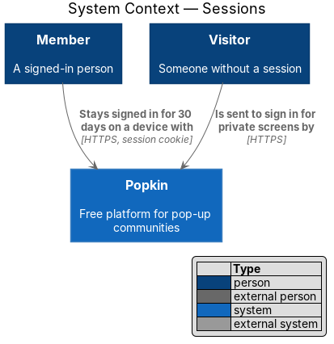
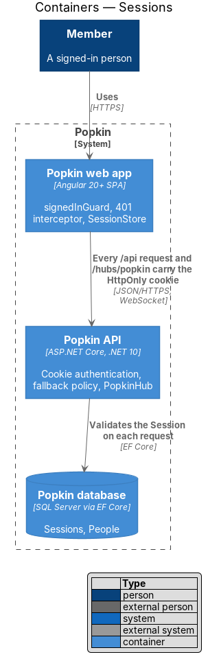
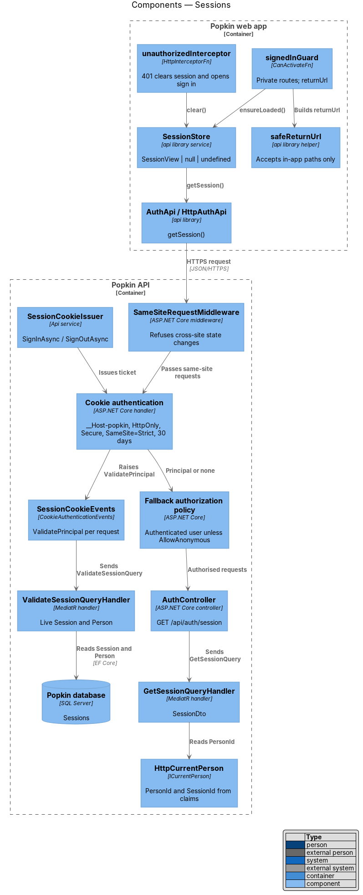
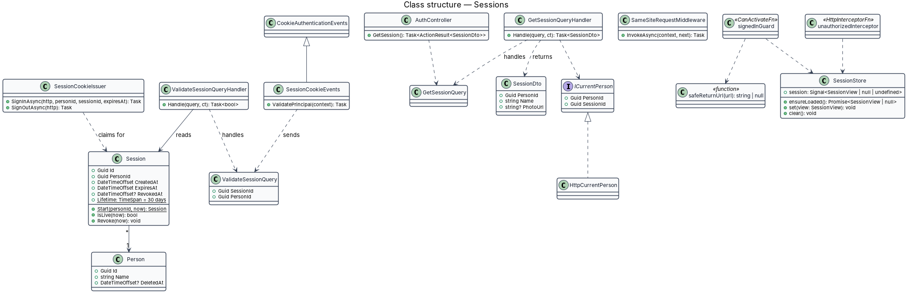
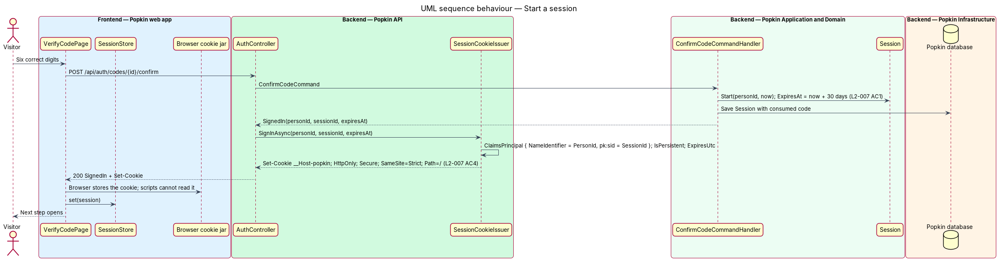
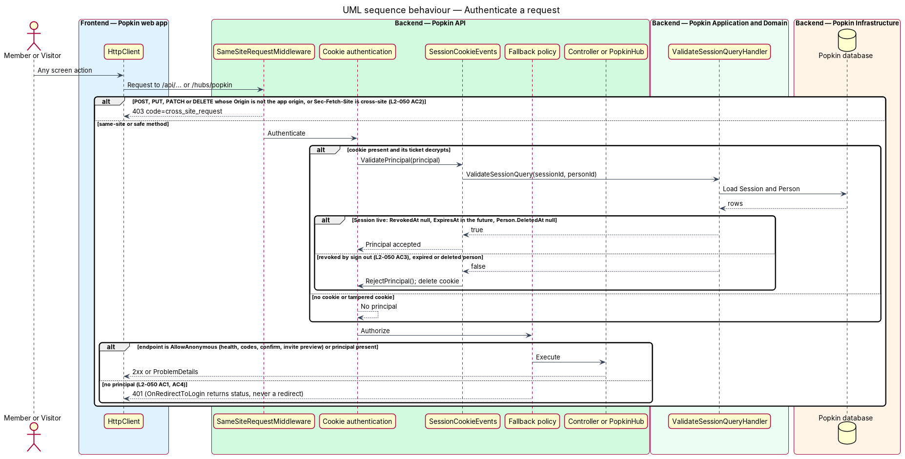
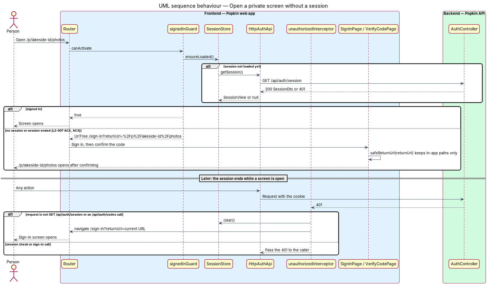

# Sessions

## Overview

Once a person confirms a code, Popkin keeps them signed in on that device until they sign out
or the session ends. This feature defines what a session is, how the browser holds it, how the
API checks it on every request, and how the web app sends a person without one to sign in and
back to the screen they asked for.

- **session** — server-side `Session` record that ties one device's sign-in to one `Person`, with a start, an expiry and an optional revocation
- **session cookie** — HttpOnly, Secure, same-site cookie named `__Host-popkin` that carries an encrypted authentication ticket naming the `Session`
- **live session** — session that is not revoked, has not expired, and whose person is not deleted
- **public screen** — screen a Visitor may open without a session: the landing page, the welcome screen, sign up, sign in, the code screen and an invite (L2-007 AC3)
- **anonymous endpoint** — API endpoint served without a session: health, sign up, sign in, code confirmation and invite preview (L2-050 AC1)

The API already uses cookie authentication and a fallback policy that requires an authenticated
user (`backend/src/Popkin.Api/Program.cs`). The cookie is HttpOnly, SameSite=Lax, and answers
401 or 403 instead of redirecting. `HealthController` is the only endpoint today. This design
adds the server-side `Session` so a session can end at once (L2-050 AC3), tightens the cookie
to meet L2-007 AC4, adds same-site proof for state changes (L2-050 AC2), and adds the
front-end guard and interceptor.

## Description

- **Screens and states** — sessions own no screen of their own. They decide when `docs/mocks/pages/sign-in/default.html` opens instead of a private screen, and they serve every mock of a signed-in screen.
- **API**
  - `GET /api/auth/session` — 200 `SessionDto { personId, name, photoUrl? }`; 401 without a live session (no `code`; the fallback policy answers).
  - Every other non-anonymous endpoint and the SignalR hub `/hubs/popkin` — 401 without a live session (L2-050 AC1, AC4).
  - Any `POST`, `PUT`, `PATCH` or `DELETE` that fails the same-site check — 403 `cross_site_request` (L2-050 AC2).

### Back end

- **`Session`** (`Popkin.Domain`, introduced) — `Id`, `PersonId`, `CreatedAt`, `ExpiresAt`, `RevokedAt?`. `Start(personId, now)` sets `ExpiresAt` to 30 days after `now` (L2-007 AC1). `IsLive(now)` and `Revoke(now)` express the rules. `IAppDbContext` gains `DbSet<Session> Sessions`; `SessionConfiguration` indexes `PersonId`. Whether each authenticated request extends `ExpiresAt` (sliding expiry) or the 30 days run from sign in (absolute expiry) is `<TO SUPPLY>`.
- **Cookie options** (`Program.cs`, changed) — `Cookie.Name = "__Host-popkin"`, `Cookie.HttpOnly = true` (existing), `Cookie.SecurePolicy = CookieSecurePolicy.Always`, `Cookie.Path = "/"`, `ExpireTimeSpan` 30 days, `Events` replaced by `SessionCookieEvents`, which keeps the existing 401 and 403 answers instead of redirects. The `__Host-` prefix forbids a `Domain` attribute and requires `Secure`, so the cookie goes only to the origin that set it and only over HTTPS (L2-007 AC4).
- **SameSite: Lax to Strict (changed)** — L2-007 AC4 requires that the cookie "is not sent with requests from other sites". `SameSite=Lax` still sends it on top-level cross-site navigations, so it does not meet the criterion. `SameSite=Strict` does. All API calls come from the single-page app on the same site, so Strict costs nothing: an invite link opened from another site loads the app shell, and the app's later API calls are same-site. This corrects the existing setting; the change belongs in the same change set as this feature.
- **`SameSiteRequestMiddleware`** (`Popkin.Api`, introduced) — runs before authentication. For `POST`, `PUT`, `PATCH` and `DELETE` under `/api` and `/hubs`, it accepts the request when `Sec-Fetch-Site` is `same-origin`, or, where that header is absent, when `Origin` equals the configured app origin (`App:Origin`). Otherwise it answers 403 `cross_site_request` (L2-050 AC2). This "same-site proof" replaces anti-forgery tokens, which the SPA would otherwise have to fetch from an extra anonymous endpoint; together with `SameSite=Strict` it closes cross-site request forgery.
- **`SessionCookieIssuer`** (`Popkin.Api`, introduced) — `SignInAsync(http, personId, sessionId, expiresAt)` builds a `ClaimsPrincipal` with `ClaimTypes.NameIdentifier` = `PersonId` and `pk:sid` = `SessionId`, sets `IsPersistent` and `ExpiresUtc`, and calls `HttpContext.SignInAsync`. `SignOutAsync(http)` deletes the cookie. The confirm-code endpoint calls the first; sign out (manage-account design) and account deletion call the second.
- **`SessionCookieEvents`** (`Popkin.Api`, introduced, derives from `CookieAuthenticationEvents`) — `ValidatePrincipal` sends `ValidateSessionQuery` on every request. When the session is not live it calls `RejectPrincipal()` and deletes the cookie, so a revoked session stops working at once (L2-050 AC3). There is no cache in front of this check; a cache would delay revocation.
- **`ValidateSessionQuery`** / **`ValidateSessionQueryHandler`** (`Popkin.Application.Auth`, introduced) — loads the `Session` by `SessionId` and checks that it belongs to `PersonId`, is live at `TimeProvider.GetUtcNow()`, and that the `Person` has no `DeletedAt`.
- **`ICurrentPerson`** / **`HttpCurrentPerson`** (introduced) — reads `PersonId` and `SessionId` from the claims for handlers. Handlers never read `HttpContext` themselves.
- **`GetSessionQuery`** / **`GetSessionQueryHandler`**, **`SessionDto`** (introduced) — return the caller's id, name and photo URL for `AuthController.GetSession`.
- **Fallback policy** (existing) — every endpoint requires an authenticated user unless it carries `[AllowAnonymous]`. The anonymous set is exactly `HealthController`, `AuthController.RequestCode`, `ResendCode`, `ConfirmCode` and the invite preview (`InvitesController`, invites design) (L2-050 AC1). Swagger stays above `UseAuthentication`. `PopkinHub` is mapped under the same policy, so a connection without a live session is refused with 401 during negotiation (L2-050 AC4).
- **Ticket protection** — ASP.NET Core Data Protection encrypts the ticket. Where the key ring is persisted for more than one API instance is `<TO SUPPLY>`.
- **Logging** — the request log never writes the cookie or `Set-Cookie` header (L2-054 AC3).

### Front end (introduced)

- **`SessionStore`** — `api` library service. Its `session` signal is `undefined` until loaded, then a `SessionView` or `null`. `ensureLoaded()` calls `AuthApi.getSession()` once and shares the result; a 401 resolves to `null`. `set()` is called after a confirmation; `clear()` after sign out, deletion or a 401.
- **`signedInGuard`** — `guards/signed-in.guard.ts`, `CanActivateFn` on every route except the public screens. Without a session it returns a `UrlTree` for `/sign-in?returnUrl=<requested path>` (L2-007 AC2, AC3). Whether `/join` (join with a code) is public is decided by the invites design and is `<TO SUPPLY>` here.
- **`unauthorizedInterceptor`** — `guards/unauthorized.interceptor.ts`, `HttpInterceptorFn` registered in `app.config.ts` through `provideHttpClient(withInterceptors([...]))`. On a 401 from any request except `GET /api/auth/session` and the `/api/auth/codes` calls, it clears `SessionStore` and navigates to `/sign-in?returnUrl=<current URL>`. Any unsaved input on the screen is lost in that case; keeping it is `<TO SUPPLY>`.
- **`safeReturnUrl(url)`** — `api` library helper. It accepts a path that starts with one `/`, not `//`, and contains no scheme; anything else yields `null`, which prevents open redirects.
- **Route data** — public routes carry no guard; private routes carry `signedInGuard`. The route table's `shell` and `page` data are unchanged.

### Tests

- API integration tests on InMemory sign in through the code endpoints, then assert: the `Set-Cookie` attributes (`HttpOnly`, `Secure`, `SameSite=Strict`, `Path=/`, expiry 30 days ahead); 401 on a private endpoint without a cookie; 401 after the session is revoked or expires (with `TimeProvider` advanced); 403 `cross_site_request` for a `POST` with a foreign `Origin`; 200 for each anonymous endpoint without a cookie.
- Playwright specs open a private route with `GET /api/auth/session` stubbed to 401 and assert the sign-in screen opens and, after confirming, the requested screen opens.

### Open questions settled in journey 1

- **Expiry** — absolute: 30 days from sign in, no sliding (`SlidingExpiration = false`).
- **SameSite** — changed from `Lax` to `Strict`, with `__Host-popkin`, `Secure`, `HttpOnly` and
  `Path=/`.
- **Same-site proof** — `SameSiteRequestMiddleware` as designed; a request with neither
  `Sec-Fetch-Site` nor `Origin` (a non-browser client) is accepted, because only a browser carries
  the cookie into a cross-site request, and browsers send one of the two.
- **`/join`** — decided by the join-by-code journey.

## Requirements

| L2 ID | Refines (L1) | Requirement |
|-------|--------------|-------------|
| `L2-007` | `L1-002` | Sessions: A signed-in person stays signed in on their device until they sign out or the session ends. |
| `L2-050` | `L1-012` | Every request is authenticated: Nothing private is served without a session. |

## Diagrams

### System context

A Member stays signed in on a device through a session cookie. A Visitor who opens a private
screen is sent to sign in.

### Containers

The Popkin web app sends the cookie with every API request and hub connection. The Popkin API
checks the `Session` in the Popkin database each time.

### Components

On the front end, `signedInGuard` and `unauthorizedInterceptor` share `SessionStore`. In the
API, the same-site middleware runs first, then cookie authentication validates the `Session`
through `SessionCookieEvents`, then the fallback policy authorises.

### Class structure

`Session` belongs to one `Person`. `SessionCookieEvents` sends `ValidateSessionQuery`;
`HttpCurrentPerson` exposes the claims to handlers through `ICurrentPerson`.

### Behaviour — start a session

A confirmed code starts a `Session` that lasts 30 days. `SessionCookieIssuer` writes the
`__Host-popkin` cookie with the attributes L2-007 AC4 requires.

### Behaviour — authenticate a request

A cross-site state change is refused with 403. A cookie whose session is revoked, expired or
whose person is deleted is rejected, and the fallback policy answers 401 for any endpoint that
is not anonymous, the hub included.

### Behaviour — open a private screen without a session

`signedInGuard` sends the person to sign in with a `returnUrl`, and the requested screen opens
after confirming (L2-007 AC2). A 401 during use clears the session and does the same.

