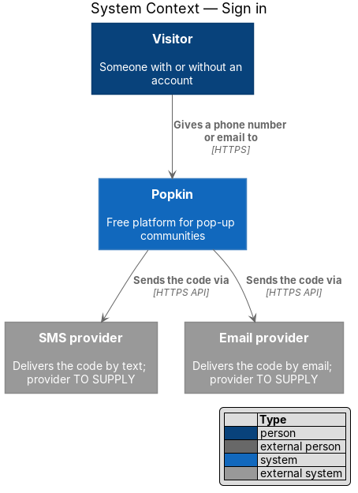
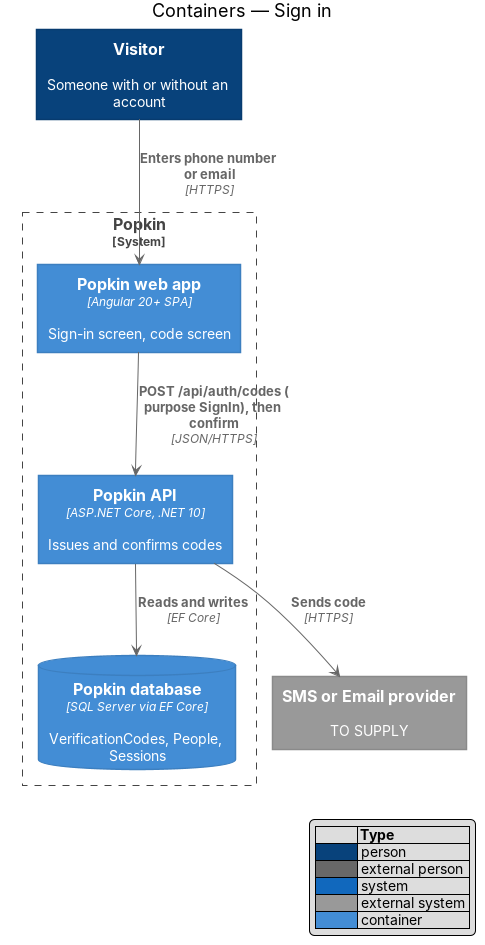
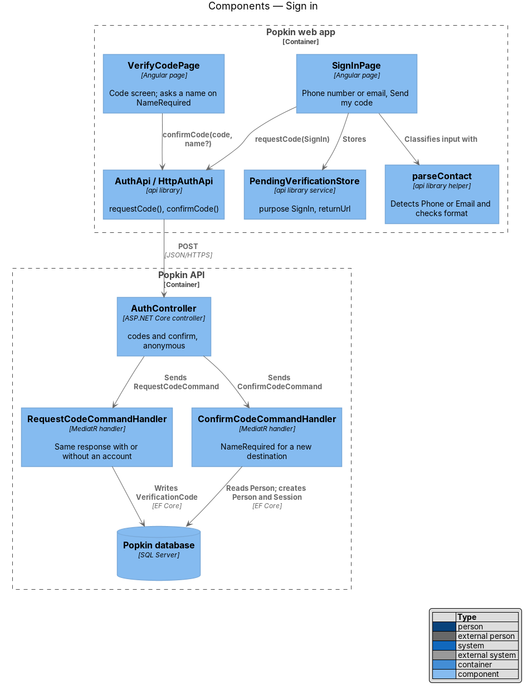
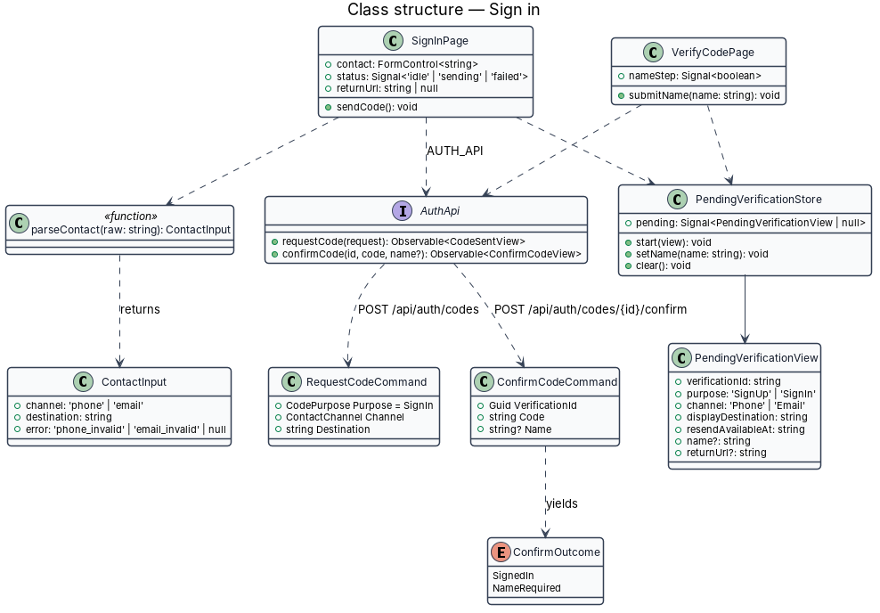
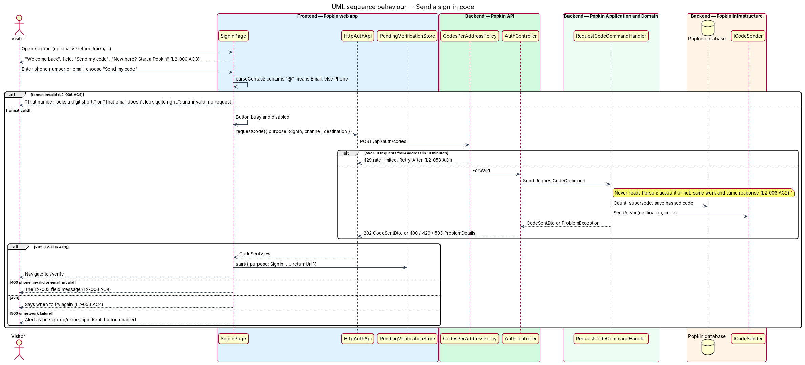
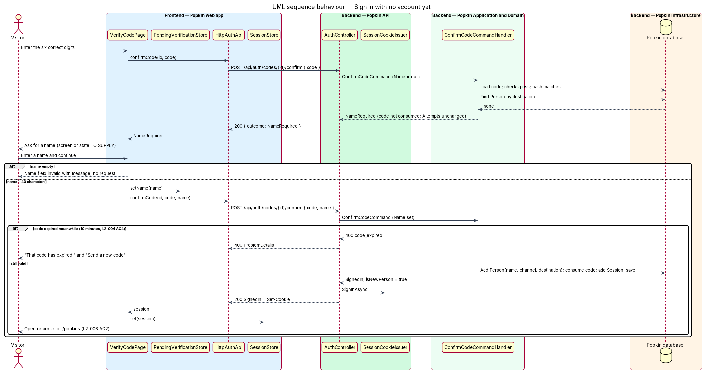

# Sign in

## Overview

A person who already has a Popkin account signs in on a new device, or after signing out, with
the same phone number or email and a fresh six-digit code. There is no password. This feature
covers the sign-in screen and the rules that keep sign in from revealing who has an account.

- **sign in** — requesting a code with purpose `SignIn` for a phone number or email, then confirming it on the code screen
- **account enumeration** — learning whether a phone number or email has an account by watching how Popkin answers; sign in shall not allow it (L2-006 AC2)
- **return URL** — the in-app path a person asked for before being sent to sign in, carried through the flow so it opens afterwards (L2-007 AC2)
- **name step** — the extra step after confirming a code for a destination with no account, which asks for a name and creates the account

Sign in shares its backend with sign up: the same `RequestCodeCommand` issues the code and the
same `ConfirmCodeCommand` checks it. What differs is the screen, which takes one field for a
phone number or an email, and the outcome when no account exists: the person is asked for a
name after confirming, and an account is made (L2-006 AC2).

## Description

- **Screens and states**
  - `docs/mocks/pages/sign-in/default.html` — "Welcome back", "Tell us where to send your code. Still no passwords.", the "Phone number or email" field with the hint "The one you signed up with.", "Send my code" and "New here? Start a Popkin".
  - `docs/mocks/pages/sign-in/invalid.html` — "That email doesn't look quite right." under the field.
  - `docs/mocks/pages/sign-in/submitting.html` — "Send my code" busy and disabled.
  - `docs/mocks/pages/sign-up/error.html` — the failed-send alert; the manifest states sign in shows the same message.
  - `docs/mocks/pages/verify-code/*` — the code screen that follows.
- **API**
  - `POST /api/auth/codes` with `purpose: "SignIn"` — 202 `CodeSentDto`; problems as in the sign-up design: 400 `phone_invalid`, 400 `email_invalid`, 429 `rate_limited`, 429 `code_limit_reached`, 503 `code_not_sent`.
  - `POST /api/auth/codes/{verificationId}/confirm` — 200 with `outcome: "NameRequired"` when no account exists and no name was sent; 200 `SignedIn` once the name is sent. Problems as in the confirm-code design.

### Front end (introduced)

- **Route** — `/sign-in`, `SignInPage`, data `{ shell: 'bare', page: 'sign-in' }`, public (L2-007 AC3). It reads an optional `returnUrl` query parameter, set by `signedInGuard` and the 401 interceptor (sessions design).
- **`SignInPage`** — `pages/sign-in/sign-in.page.ts` and `.html`, selector `pk-sign-in-page`, OnPush.
  - The single field uses `type="text"`, `autocomplete="username"` and autofocus, as in the mock.
  - `parseContact(raw)` (`api` library helper, `lib/api/auth/parse-contact.ts`) classifies the input: text with `@` is an email, otherwise a phone number. It returns the channel, the cleaned destination and an error key. The same rules as sign up apply, with the same messages (L2-006 AC4).
  - "Send my code" is disabled and busy while the request runs (L2-056 AC3). The busy label is `<TO SUPPLY>`; the mock shows only the busy state of the button.
  - On 202 the page stores the pending verification with `purpose: 'SignIn'` and the `returnUrl`, then opens `/verify` (L2-006 AC1). On a 503 or a network failure it shows the alert from `sign-up/error.html` and keeps the input. On 429 it states when to try again (L2-053 AC4).
  - "New here? Start a Popkin" links to `/sign-up`, passing `returnUrl` on (L2-006 AC3). The back button in `pk-top-bar` returns to `/welcome`.
- **Name step** — when confirm answers `NameRequired`, `VerifyCodePage` asks "Your name" and confirms again with the same code and the name. Which screen or state holds this step, and its copy, are `<TO SUPPLY>`: no mock draws it. A reasonable source is the name field of `docs/mocks/pages/sign-up/default.html`. The name is validated as 1 to 40 characters.
- **Components** — `pk-top-bar`, `pk-text-field`, `pk-button`, `pk-link`, `pk-alert`.

### Back end (reused)

- **`RequestCodeCommandHandler`** — introduced by the sign-up design. It never reads `Person`, so a destination with an account and one without produce the same work, the same 202 body and the same provider call (L2-006 AC2). The response time therefore does not depend on whether an account exists.
- **`ConfirmCodeCommandHandler`** — introduced by the confirm-code design. For a destination with no account it returns `NameRequired` without consuming the code or counting an attempt; the second call with a name creates the `Person`, consumes the code and starts a `Session`. The second call still has to arrive within the code's 10 minutes (L2-004 AC4).
- **What the person learns** — `NameRequired` appears only after the person has proven they own the destination, so it reveals nothing to someone who does not.

### Tests

- API integration tests compare the 202 body for a known and an unknown destination, and cover `NameRequired` followed by a confirm with a name that creates exactly one `Person`.
- Playwright specs drive `e2e/pages/sign-in.page.ts`: valid phone, valid email, invalid email, the failure alert, and the link to sign up.

## Requirements

| L2 ID | Refines (L1) | Requirement |
|-------|--------------|-------------|
| `L2-006` | `L1-002` | Sign in: A person with an account signs in with the same phone number or email and a new code. |

## Diagrams

### System context

The Visitor gives a phone number or email; Popkin sends a code through the SMS or email
provider whether or not an account exists.

### Containers

The Popkin web app posts the sign-in request and later the confirmation to the Popkin API,
which keeps codes, people and sessions in the Popkin database.

### Components

`SignInPage` classifies the input with `parseContact` and calls `AuthApi`. `VerifyCodePage`
confirms the code and runs the name step when needed.

### Class structure

The sign-in screen produces a `RequestCodeCommand` with purpose `SignIn`. The code screen
produces a `ConfirmCodeCommand` whose outcome is `SignedIn` or `NameRequired`.

### Behaviour — send a sign-in code

An invalid phone number or email stops at the screen with the L2-003 messages. A valid one is
sent with purpose `SignIn`, and the answer is the same with or without an account.

### Behaviour — sign in with no account yet

The first confirmation returns `NameRequired`. The second, with a name, creates the account,
consumes the code and starts the session (L2-006 AC2).

