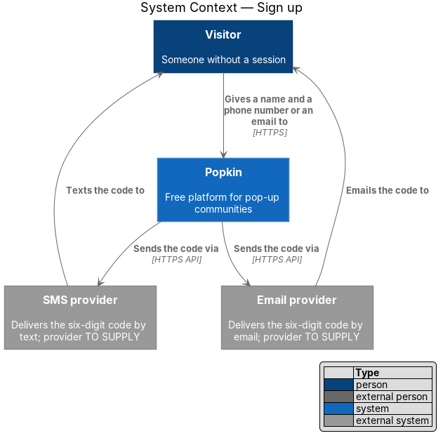
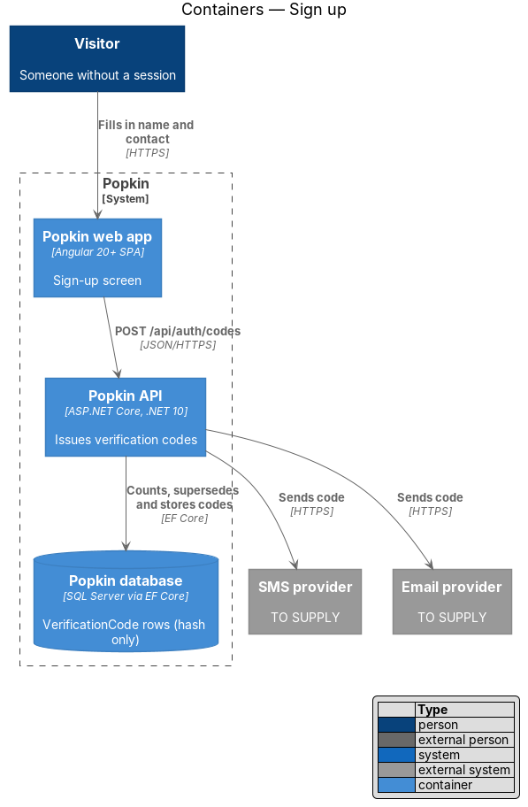
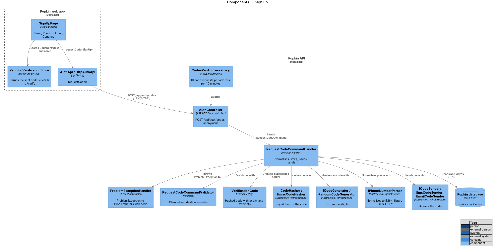
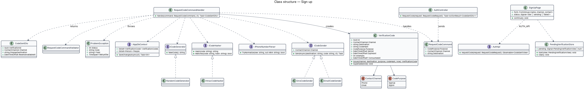
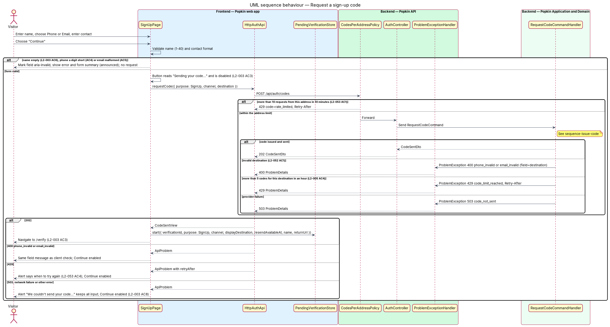
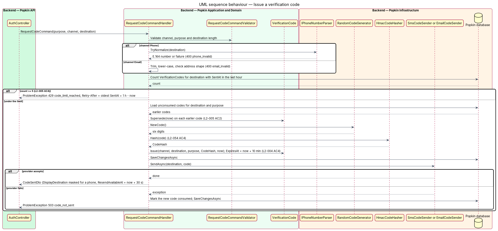

# Sign up

## Overview

Popkin has no passwords. A person proves who they are with a one-time six-digit code sent to a
phone number or an email address they own. This feature covers the first half of creating an
account: the sign-up screen that asks for a name and one way to reach the person, and the
backend that issues and sends the code. The second half, typing the code and receiving a
session, belongs to the confirm-code feature (`docs/detailed-designs/accounts/confirm-code`).

- **contact channel** — the way a code reaches a person, either `Phone` (by text) or `Email`
- **destination** — the phone number or email address a code is sent to, stored in normalised form (E.164 for a phone, trimmed lower case for an email)
- **verification code** — record of one issued six-digit code: its destination, purpose, keyed hash, expiry, attempt count and whether it was consumed
- **code purpose** — whether a code was requested from sign up (`SignUp`) or from sign in (`SignIn`)
- **pending verification** — front-end state that carries a sent code's identifier, display destination and the typed name from the sign-up screen to the code screen

Sign up sits at the start of the *accounts* subsystem. A Visitor reaches it from "Start a
Popkin" on the landing page or the welcome screen. Issuing a code does not reveal whether an
account already exists for the destination: the response is the same either way, as sign in
requires (L2-006 AC2). The code-issuing command introduced here is shared with sign in.

## Description

- **Screens and states**
  - `docs/mocks/pages/sign-up/default.html` — "First, what should we call you?", "Your name", "Phone number", the Phone/Email switch, "Continue" and the legal line.
  - `docs/mocks/pages/sign-up/email.html` — the switch on Email; the second field reads "Email".
  - `docs/mocks/pages/sign-up/invalid.html` — the form summary "One thing to fix" and "That number looks a digit short." under the field.
  - `docs/mocks/pages/sign-up/submitting.html` — the button reads "Sending your code…" and is disabled.
  - `docs/mocks/pages/sign-up/error.html` — the alert "We couldn't send your code. Check your connection and try again. Nothing you typed was lost."
- **API**
  - `POST /api/auth/codes` — anonymous (L2-050 AC1), rate-limited by `CodesPerAddressPolicy`. Body `{ purpose: "SignUp" | "SignIn", channel: "Phone" | "Email", destination }`. 202 `CodeSentDto`. Problems: 400 `phone_invalid`, 400 `email_invalid`, 400 `validation_failed` (unknown channel or purpose), 429 `rate_limited` (per address, L2-053 AC1), 429 `code_limit_reached` (per destination, L2-005 AC4), 503 `code_not_sent`. Each 429 carries `Retry-After` and a `retryAfterSeconds` extension.

### Front end (introduced)

- **Route** — `/sign-up`, `SignUpPage`, data `{ shell: 'bare', page: 'sign-up' }`, public (L2-007 AC3). It accepts an optional `returnUrl` query parameter that the invite journey sets; the page passes it to the pending verification.
- **`SignUpPage`** — `pages/sign-up/sign-up.page.ts` and `.html`, selector `pk-sign-up-page`, OnPush. It owns a typed reactive form with `name`, `channel` (`'phone' | 'email'`, default `'phone'`) and `contact`, and a `status` signal (`'idle' | 'sending' | 'failed'`).
  - Switching the channel relabels the field ("Phone number" or "Email"), sets `type="tel"` with `inputmode="tel"` and `autocomplete="tel"`, or `type="email"` with `inputmode="email"` and `autocomplete="email"`, clears only the contact error and keeps the name (L2-003 AC2).
  - "Continue" validates locally first. An empty name shows the name error (L2-003 AC6). A phone number with too few digits shows "That number looks a digit short." (L2-003 AC4). A malformed email shows "That email doesn't look quite right." (L2-003 AC5). The field takes `aria-invalid="true"` and `aria-describedby` on its error. `pk-form-summary` lists each error, takes focus and is announced. No request is sent.
  - The exact copy of the empty-name message on sign up is `<TO SUPPLY>`; the account mock uses "Enter a name so people know who you are." and the sign-up screen should reuse it.
  - The digit rule for "too few digits" depends on the region of the number. The default region and support for international numbers are `<TO SUPPLY>`; the mocks show United States numbers only.
  - While the request is in flight the button reads "Sending your code…" and is disabled, so it cannot send twice (L2-003 AC3, L2-056 AC3).
  - On 202 it stores the pending verification and navigates to `/verify`. On a 503, a network failure or an unexpected status it shows the `pk-alert` from `sign-up/error.html`, keeps every typed value and enables "Continue" again (L2-003 AC8). On 429 the alert states when to try again from `retryAfterSeconds` (L2-053 AC4); the copy is `<TO SUPPLY>`.
  - The legal line "By continuing you agree to the Terms and Privacy." renders both words as `pk-link` links (L2-003 AC7). The Terms and Privacy pages do not exist yet; the links lead to the not-found screen until they do.
- **`PendingVerificationStore`** — `api` library service (`lib/api/auth/pending-verification.store.ts`). It holds a `PendingVerificationView { verificationId, purpose, channel, displayDestination, resendAvailableAt, name?, returnUrl? }` in a signal, in memory only, so no phone number, email or name is written to browser storage. A reload of `/verify` with no pending verification returns to the screen the flow started on.
- **`AuthApi` / `AUTH_API` / `HttpAuthApi`** — `api` library (`lib/api/auth/`). This slice adds `requestCode(request): Observable<CodeSentView>`. Errors are mapped by a shared helper `toApiProblem(error): ApiProblem { status, code, field?, retryAfterSeconds? }`.
- **Components** — `pk-top-bar` (back to `/welcome`, step dots), `pk-text-field`, `pk-segmented-control`, `pk-form-summary`, `pk-alert`, `pk-button`, `pk-link`, `pk-skip-link`.

### Back end (introduced)

- **`Person`** (`Popkin.Domain`) — `Id`, `Name`, `PhotoId?`, `Phone?`, `Email?`, `CreatedAt`, `DeletedAt?`. Sign up reads it nowhere; confirm-code creates it. Unique filtered indexes on `Phone` and `Email` apply where `DeletedAt` is null.
- **`VerificationCode`** (`Popkin.Domain`) — `Id`, `Channel: ContactChannel`, `Destination`, `CodeHash`, `Purpose: CodePurpose`, `SentAt`, `ExpiresAt`, `Attempts`, `ConsumedAt?`. `Issue(...)` sets `ExpiresAt` to `SentAt` plus 10 minutes (L2-004 AC4). `Supersede(now)` sets `ConsumedAt`, so an earlier code stops working when a new one is issued (L2-005 AC2).
- **`RequestCodeCommand`**, **`RequestCodeCommandValidator`**, **`RequestCodeCommandHandler`** (`Popkin.Application.Auth`) — the handler normalises the destination, enforces at most 5 codes per destination in any hour (L2-005 AC4), supersedes unconsumed codes for the same destination and purpose, generates six digits with `ICodeGenerator`, stores only `ICodeHasher.Hash(code)` (L2-054 AC4), saves, then sends through the `ICodeSender` whose `Channel` matches. When the provider fails it marks the new code consumed and throws `ProblemException(503, "code_not_sent")`. It never reads `Person`, so the response is identical whether an account exists (L2-006 AC2). The validation library is `<TO SUPPLY>`; `Directory.Packages.props` lists none today.
- **`CodeSentDto`** — `VerificationId`, `Channel`, `DisplayDestination`, `ResendAvailableAt` (`SentAt` plus 30 seconds, L2-005 AC1). `DisplayDestination` masks all but the last two digits of a phone number, for example `(•••) •••-••48`, and shows an email in full (L2-004 AC1).
- **`ProblemException`** (`Popkin.Application.Problems`) — `Status`, `Code`, `Field?`, `RetryAfter?`. **`ProblemExceptionHandler`** (`Popkin.Api`, `IExceptionHandler`) turns it into ProblemDetails with a `code` extension, a `field` extension when set, and a `Retry-After` header for 429. It writes no stack trace or internal name (L2-052 AC5).
- **Abstractions** (`Popkin.Application.Abstractions`) — `ICodeGenerator` (`RandomCodeGenerator`, six digits from `RandomNumberGenerator.GetInt32(0, 1_000_000)`), `ICodeHasher` (`HmacCodeHasher`, HMAC-SHA-256 with a server key; constant-time comparison; key storage `<TO SUPPLY>`), `IPhoneNumberParser` (E.164 normalisation; library `<TO SUPPLY>`), `ICodeSender` (`SmsCodeSender`, `EmailCodeSender`; providers and message wording `<TO SUPPLY>`). `IAppDbContext` gains `DbSet<Person> People` and `DbSet<VerificationCode> VerificationCodes`.
- **`AuthController.RequestCode`** (`Popkin.Api`) — `[AllowAnonymous]`, `[EnableRateLimiting(CodesPerAddressPolicy.Name)]`; sends the command and returns 202.
- **`CodesPerAddressPolicy`** (`Popkin.Api`, `IRateLimiterPolicy<string>`) — a fixed window of 10 requests per remote address per 10 minutes over `POST /api/auth/codes` and the resend endpoint (L2-053 AC1). `OnRejected` writes 429 `rate_limited` with `Retry-After`. Behind a reverse proxy the remote address comes from forwarded headers; the trusted proxy list is `<TO SUPPLY>`.
- **Infrastructure** — `PersonConfiguration`, `VerificationCodeConfiguration` (index on `Destination, SentAt`). Logs never contain the code, the destination or the name (L2-054 AC3).

### Tests

- API integration tests (InMemory provider, ADR 0005) replace `ICodeSender` with a capturing fake and `ICodeGenerator` with a fixed generator. They cover 202 for a new and an existing destination with identical bodies, each 400 code, the 6th request in an hour (429 `code_limit_reached`) and a send failure (503).
- Playwright specs drive `e2e/pages/sign-up.page.ts`; the recording answers `POST /api/auth/codes`, and `stubs.ts` adds the 503 and 429 answers.

## Requirements

| L2 ID | Refines (L1) | Requirement |
|-------|--------------|-------------|
| `L2-003` | `L1-002` | Sign up with a name and a phone number or an email: Signing up asks for a name and one way to reach the person. It never asks for a password. |
| `L2-052` | `L1-012` | Input is validated and output is encoded: Nothing a person types can harm another person or the system. |
| `L2-053` | `L1-012` | Abuse is limited: One person cannot flood the system or another person. |

## Diagrams

### System context

A Visitor gives Popkin a name and a contact. Popkin sends the code through an external SMS or
email provider, both still to be chosen.

### Containers

The Popkin web app posts the request to the Popkin API, which stores a hashed code in the
Popkin database and hands the plain code to the provider.

### Components

`SignUpPage` calls `AuthApi` and fills `PendingVerificationStore`. In the API, the rate limiter
guards `AuthController`, and `RequestCodeCommandHandler` uses the generator, hasher, phone
parser and code senders.

### Class structure

`RequestCodeCommandHandler` creates `VerificationCode` entities and depends only on
abstractions. The two senders realise `ICodeSender`, one per contact channel.

### Behaviour — request a sign-up code

Local validation stops an empty name, a short number or a malformed email before any request
(L2-003 AC4–AC6). The server answers 202, 400, 429 or 503, and the page keeps every typed
value on failure (L2-003 AC8).

### Behaviour — issue a verification code

The handler normalises the destination, applies the per-destination hourly limit, supersedes
earlier codes, stores only a hash and sends the code. A provider failure invalidates the new
code and returns 503 `code_not_sent`.

