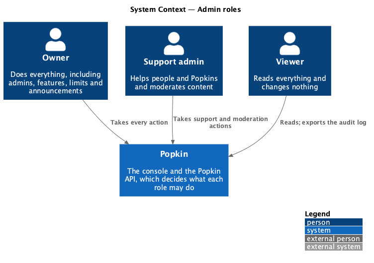
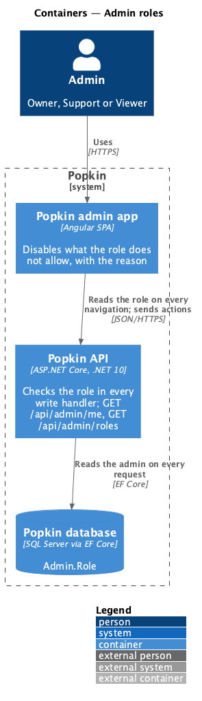
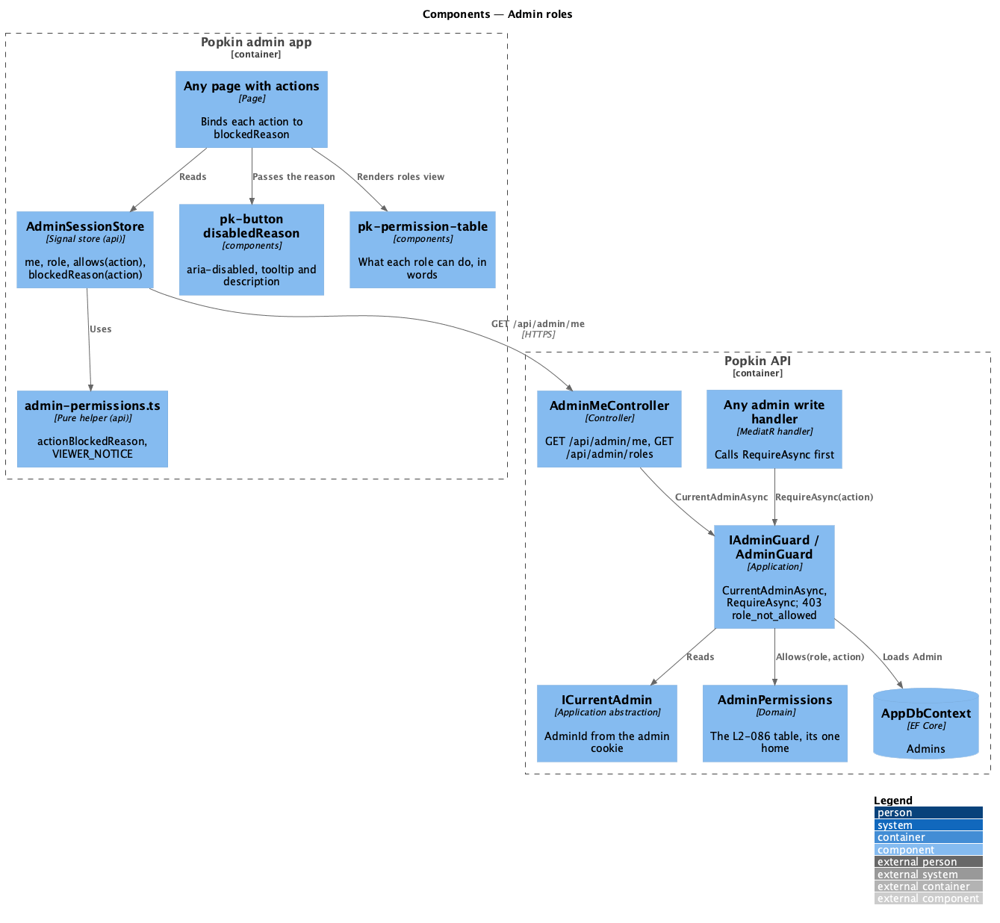
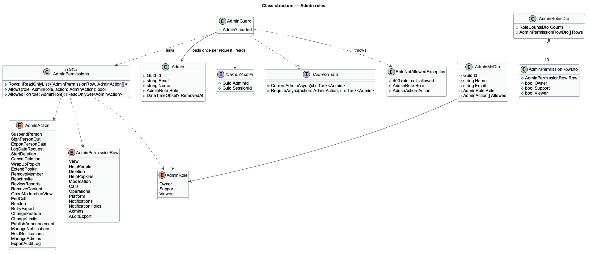
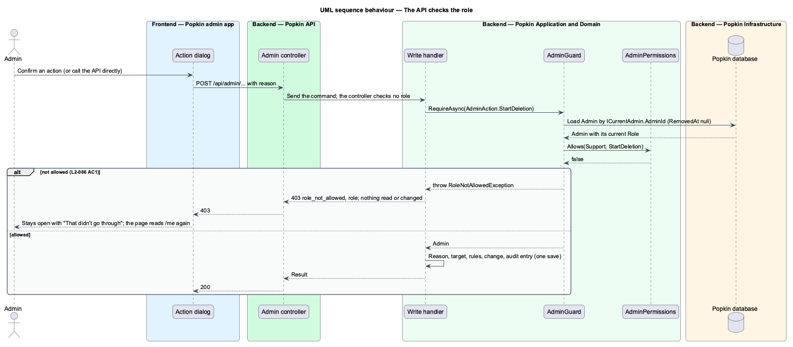
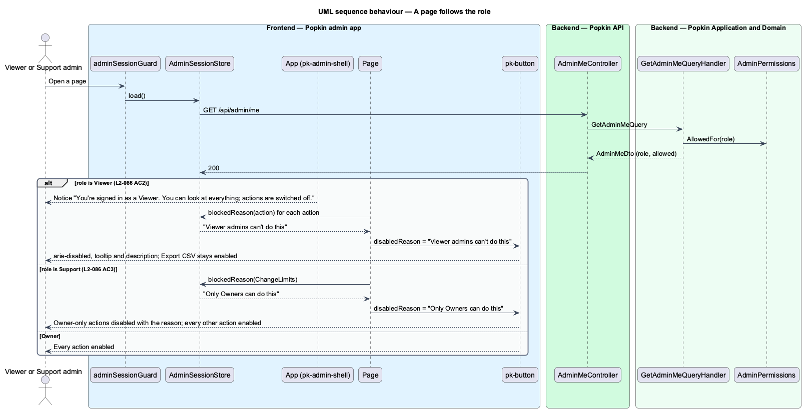
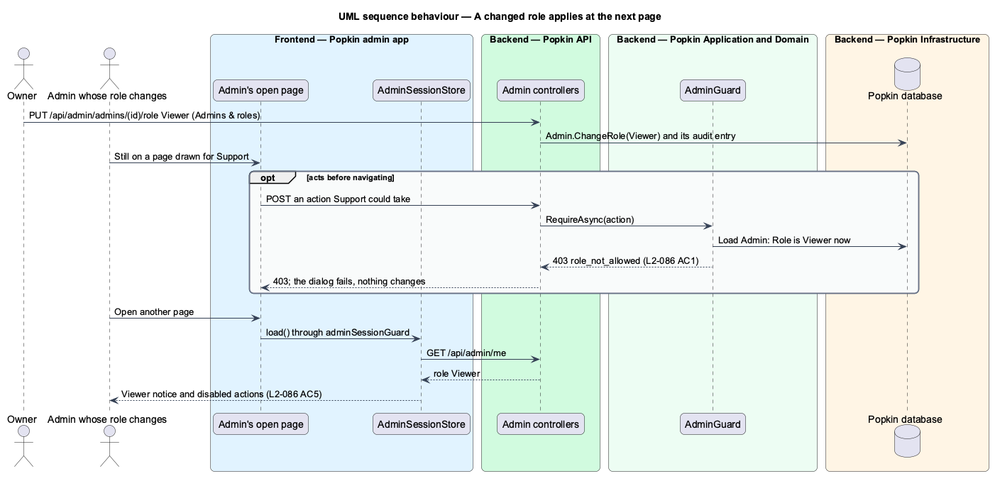
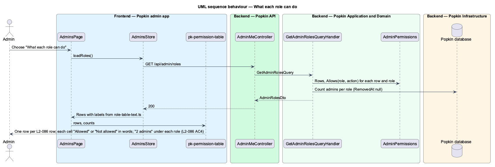

# Admin roles

## Overview

Every admin has one role, and the role decides what the admin may do in the console. Three roles
exist: an *Owner* does everything, including the admins, the features, the limits and the
announcements; a *Support* admin helps people and Popkins and moderates content; a *Viewer* reads
everything and changes nothing (`docs/specs/L1.md`, Roles). The owner of Popkin settled the three
roles on 15 November 2026; what each may do is the designs' table, L2-086.

- **role** — one of Owner, Support or Viewer, held by each admin
- **admin action** — change in the console that the role table names, such as suspending a
  person or changing a limit; viewing is not an action, and any admin may view
- **permission table** — the table of L2-086: one row per group of actions, one column per role

The API decides, not the screen (L2-086). Each write handler asks one guard whether the caller's
role allows its action before it reads or changes anything, and the guard answers from one
table, `AdminPermissions`, kept in the domain. The console reads the same answer from
`GET /api/admin/me` and disables what the role does not allow, saying why, so an admin is never
offered an action the API would refuse.

This design owns the shared types the other admin designs use: `Admin`, `AdminRole`,
`AdminAction`, `AdminPermissions`, `ICurrentAdmin`, `IAdminGuard` and `AdminMeDto`. Admins are
added and their roles changed in [Admins & roles](../manage-admins/README.md); the session that
names the admin is in [Admin sign in](../admin-sign-in/README.md).

## Description

### Screens and states

- **The Viewer's notice** — `docs/mocks/admin/pages/admins/viewer.html` (and every page's
  `viewer` state, such as `docs/mocks/admin/pages/calls/viewer.html`): `admin-shell__notice`
  reads "You’re signed in as a Viewer. You can look at everything; actions are switched off.";
  each action is disabled with "Viewer admins can’t do this" as its tooltip and description
  (L2-086 AC2). "Export CSV" on the audit log stays enabled: every role may export it.
- **A Support admin's page** — an Owner-only action ("Add admin", a feature's choices, "Save" on
  Limits, "Publish" on Announcements, "Pause all email", a notification kind's switch and "Save
  defaults" on Notifications, "Start deletion", "Cancel deletion") is disabled with "Only
  Owners can do this"; every other action is enabled (L2-086 AC3). No mock draws a Support
  admin's page; the copy is the brief's and the Viewer's state is the model. The design expects
  `docs/mocks/admin/pages/limits/support.html` as the example.
- `docs/mocks/admin/pages/admins/roles.html` — "What each role can do": `pk-permission-table`
  (block `perm-table`), the role columns headed with "Owner · 2 admins", "Support · 2 admins",
  "Viewer · 1 admins", each cell "Allowed" or "Not allowed" in words beside its mark, and each
  role's sentence under the table ("Everything, including admins, features and limits.", "Helps
  people and Popkins, moderates content.", "Reads everything, changes nothing.") (L2-086 AC4).
  The count reads "1 admin" for one; the mock's "1 admins" is a slip.

### The table (L2-086)

`AdminPermissions` (Domain, new, static) holds the table. Its rows are `AdminPermissionRow`
values, each with the `AdminAction` values it covers:

| `AdminPermissionRow` | `AdminAction` values | Owner | Support | Viewer |
|---|---|---|---|---|
| `View` | none: find and view people, Popkins, reports, calls, jobs, exports, features, limits, settings, admins and the audit log | Yes | Yes | Yes |
| `HelpPeople` | `SuspendPerson` (and lifting it), `SignPersonOut`, `ExportPersonData`, `LogDataRequest` | Yes | Yes | No |
| `Deletion` | `StartDeletion`, `CancelDeletion` | Yes | No | No |
| `HelpPopkins` | `WrapUpPopkin`, `ExtendPopkin`, `RemoveMember`, `ResetInvite` | Yes | Yes | No |
| `Moderation` | `ReviewReports` (deciding and dismissing), `RemoveContent`, `OpenModerationView` | Yes | Yes | No |
| `Calls` | `EndCall` | Yes | Yes | No |
| `Operations` | `RunJob`, `RetryExport` | Yes | Yes | No |
| `Platform` | `ChangeFeature`, `ChangeLimits`, `PublishAnnouncement` (and ending one) | Yes | No | No |
| `Notifications` | `ManageNotifications` (pause and resume member email, switch a notification kind for everyone, change notification defaults) | Yes | No | No |
| `NotificationHolds` | `HoldNotifications` (hold and release notifications to a Popkin) | Yes | Yes | No |
| `Admins` | `ManageAdmins` (add, remove, change a role) | Yes | No | No |
| `AuditExport` | `ExportAuditLog` | Yes | Yes | Yes |

- **`AdminPermissions.Allows(AdminRole role, AdminAction action)`** — the one answer every
  check uses. `AllowedFor(role)` gives the set, and `Rows` the table for the roles view.
- A direct test in `Popkin.Application.Tests` (or a `Popkin.Domain` test project when one is
  added) takes one case per cell: 23 actions by 3 roles.
- Opening a report or a moderation view's content is reached through `ReviewReports` and
  `OpenModerationView`; reading a report in the queue is viewing. The designs of the other admin
  subsystems name the action each endpoint requires from this enum.

### API

- **`GET /api/admin/me`** (`AdminMeController`, new) — `200` `AdminMeDto` (`id`, `name`,
  `email`, `role`, `allowed`: the `AdminAction` names the role allows, from `AllowedFor`). Any
  admin. `GetAdminMeQuery` reads the admin through `IAdminGuard.CurrentAdminAsync`. The same DTO
  is the answer of a confirmed code ([Admin sign in](../admin-sign-in/README.md)).
- **`GET /api/admin/roles`** (`AdminMeController`, new) — `200` `AdminRolesDto`: `counts`
  (`Owner`, `Support`, `Viewer`: admins not removed, invited ones included) and `rows`
  (`row`, `owner`, `support`, `viewer` booleans), in the table's order. Any admin.
- **Every admin write** — `403` with `code` `role_not_allowed` and the extension `role` (the
  caller's role) when the role does not allow its action (L2-078 AC3, L2-086 AC1).

### Backend

- **`Admin`** (Domain, new) — `Id`, `Email` (normalised staff email at `@popkin.app`), `Name`,
  `Role` (`AdminRole`), `InvitedAt`, `InvitedByAdminId?`, `ActivatedAt?` (first sign-in),
  `LastActiveAt?`, `RemovedAt?`. Behaviour (`Invite`, `SignedIn`, `ChangeRole`, `Remove`,
  `Reinvite`) is designed in [Admins & roles](../manage-admins/README.md) and
  [Admin sign in](../admin-sign-in/README.md). `IAppDbContext` gains `Admins`, `AdminSessions`,
  `AdminSignInLocks` and `AuditEntries`.
- **`AdminRole`** (Domain, new) — `Owner`, `Support`, `Viewer`, stored as text.
- **`AdminAction`** (Domain, new) — the 23 values of the table above. `ManageNotifications` and
  `HoldNotifications` join the 21 built in journey 24 for the two rows L2-086 gained on
  17 November 2026 ([Member email and notification kinds](../../admin-platform/notifications/README.md),
  [Notification holds](../../admin-platform/notification-holds/README.md),
  [Notification defaults](../../admin-platform/notification-defaults/README.md)).
- **`ICurrentAdmin`** (Application, new) — `AdminId` and `SessionId` of the admin session;
  `HttpCurrentAdmin` (Api) reads them from the admin principal.
- **`IAdminGuard`** (Application, new) — `Task<Admin> CurrentAdminAsync(CancellationToken)` loads
  the caller's `Admin` (with `RemovedAt` null) once per request scope and keeps it, so the audit
  log and the handler read the same row. `Task<Admin> RequireAsync(AdminAction, CancellationToken)`
  loads it and throws `RoleNotAllowedException` (`403` `role_not_allowed`) when
  `AdminPermissions.Allows` is false. An admin row that is missing or removed, which the cookie
  check already refuses, throws `401` `admin_session_required`.
- **`AdminGuard`** (Application, new, scoped) — implements `IAdminGuard`. The role is read from
  the database on every request, never from a claim in the cookie, so a changed role applies at
  once (L2-086 AC5).
- **Order in every write handler** — `RequireAsync` first; then the reason
  ([A reason for every change](../give-a-reason/README.md)); then the target (`404`); then the
  feature's rules; then the change and its audit entry in one save
  ([Audit log](../audit-log/README.md)). A refused role therefore reads nothing and changes
  nothing, and learns nothing about the target (L2-086 AC1).
- **Controllers check no role.** `AdminControllerBase` requires the admin scheme only; a hub has
  no admin method.

### Frontend (Popkin admin app)

- **`AdminSessionStore`** (`api/admin/access/admin-session.store.ts`, new) — `me`
  (`AdminMeDto | null`), `role`, `load()` (`GET /api/admin/me`, called by `adminSessionGuard` on
  every navigation), `allows(action)`, `blockedReason(action)`, `clear()` and `signOut()`.
- **`admin-permissions.ts`** (`api/admin/access/`, new, pure) —
  `actionBlockedReason(role, allowed, action)` answers `null` when `allowed` holds the action,
  "Viewer admins can’t do this" for a Viewer, and "Only Owners can do this" otherwise.
  `VIEWER_NOTICE` holds the notice. Unit tests cover the three roles and an action outside
  `allowed`.
- **The notice** — the root passes `VIEWER_NOTICE` to `pk-admin-shell`'s `notice` when the role
  is `Viewer` ([The admin shell](../admin-shell/README.md)).
- **Disabled actions** — every action is a `pk-button` (or `pk-role-select`, `pk-segmented-control`)
  bound to `blockedReason(action)`. `pk-button` gains the input `disabledReason`: when set, the
  button is `aria-disabled="true"`, ignores activation (a capture listener stops the click) and
  carries the reason as its `title`, which is both its tooltip and its accessible description.
  It stays focusable, so a keyboard or screen-reader user reaches the reason (L2-086 AC2, AC3).
  A role the row cannot change shows as text with the same `title`.
- **`pk-permission-table`** (`components`, block `perm-table`, new) — inputs `rows` (label,
  group, and the three booleans) and `counts`. Each cell shows its mark and the word "Allowed" or
  "Not allowed", so the mark never carries the meaning alone (L2-086 AC4). The labels and groups
  are copy in `role-table-text.ts` (`api/admin/access/`), keyed by `AdminPermissionRow`, with the
  wording of the L2-086 table.
- **A refused action** — a `403` `role_not_allowed` keeps the dialog open with its failure
  ([A reason for every change](../give-a-reason/README.md)) and calls `AdminSessionStore.load()`,
  so the page redraws for the role the API holds.

### Decisions

- **One table, in the domain.** The API checks and the console disables from the same
  `AdminPermissions`, reached by the console through `allowed` in `AdminMeDto`. The console
  holds no copy of the table, only its labels.
- **`aria-disabled` with a description, not `disabled` with `title`.** The mocks draw
  `disabled` buttons with a `title`, which a keyboard cannot reach and a screen reader may not
  read. L2-086 AC2 asks for the reason "as its description and tooltip"; WCAG 2.2 (1.3.1, 2.1.1,
  4.1.2) and the platform's practice lead to a focusable `aria-disabled` control with
  `aria-describedby` and a tooltip. Parity holds: the look of the disabled state does not change.
- **The roles view follows L2-086, not the mock.** `admins/roles.html` lists other rows ("Suspend
  and restore", "Start account deletion", "Switch and roll out features") and leaves out logging a
  data request, cancelling a deletion, opening a moderation view, the view rows of reports, calls,
  jobs, exports, features, limits, settings and admins, and exporting the audit log. L2-086 AC4
  shows "the table above", so the view has the requirement's rows (twelve since 17 November 2026) and the mock changes.

### Tests

- API tests (`Popkin.Api.Tests/Admin/AdminRolesTests`): `GET /api/admin/me` for each role lists
  the allowed actions; a Viewer's and a Support admin's request for an action they may not take
  is `403` `role_not_allowed` and the database is unchanged; after an Owner changes a role, the
  next request follows it. One representative endpoint per row is enough; the direct table test
  covers every cell.
- Unit tests (`frontend`): `actionBlockedReason`, `AdminSessionStore.allows`.
- Playwright (`e2e/tests/admin/roles.spec.ts`): the Viewer's notice and a disabled action with
  its description; a Support admin's Owner-only action; "What each role can do" with "Allowed"
  and "Not allowed" in words. Parity specs for `pk-permission-table` and the `disabledReason`
  state of `pk-button`.

## Requirements

| L2 ID | Refines (L1) | Requirement |
|-------|--------------|-------------|
| `L2-086` | `L1-028` | Admin roles: Every admin has one role, and the API, not the screen, decides what it allows. (AC1–AC5) |
| `L2-078` | `L1-012` | Admin access: Only admins reach the admin app, and the admin app reaches a Popkin's content only as moderation allows. (AC3, the role's `403`) |
| `L2-119` | `L1-028` | Admins & roles: An Owner decides who can use the console. (AC10) |

## Diagrams

### System context

The three roles use the same console; the API decides what each may do.

### Containers

The admin app reads the role on every navigation and disables what it does not allow; the API
reads the admin on every request and checks the role in each write handler.

### Components

Write handlers call `IAdminGuard.RequireAsync`, which loads the `Admin` and asks
`AdminPermissions`. The console's `AdminSessionStore` turns `allowed` into a reason that
`pk-button` shows.

### Class structure

`AdminPermissions` relates roles to actions through ten rows; `AdminGuard` implements
`IAdminGuard` over `ICurrentAdmin` and throws `RoleNotAllowedException`.

### Behaviour — the API checks the role

The handler asks the guard first; a refused role answers `403` `role_not_allowed` before anything
is read or changed.

### Behaviour — a page follows the role

A Viewer sees the notice and every action disabled with its reason; a Support admin sees only the
Owner-only actions disabled.

### Behaviour — a changed role applies at the next page

The API refuses at once what the new role does not allow; the next page reads the new role.

### Behaviour — what each role can do

The roles view reads the table and the counts from the API and says "Allowed" or "Not allowed"
in words.

