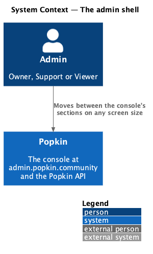
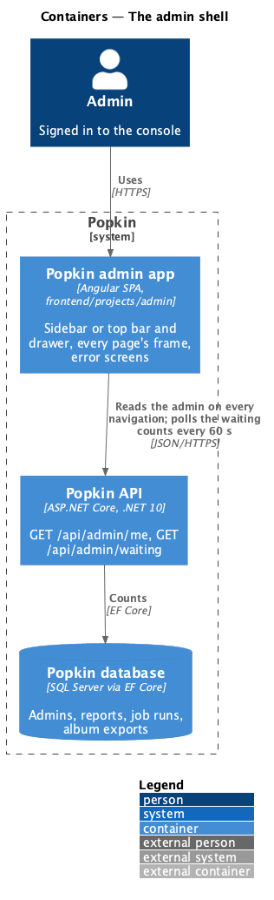
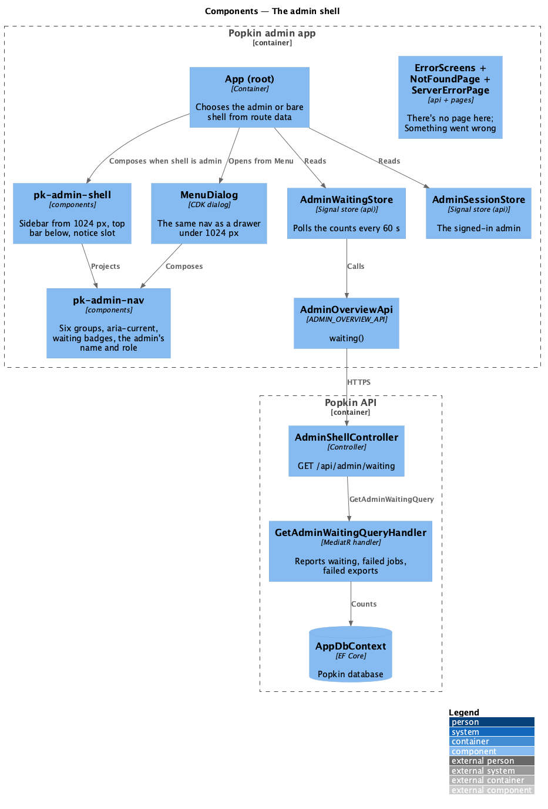
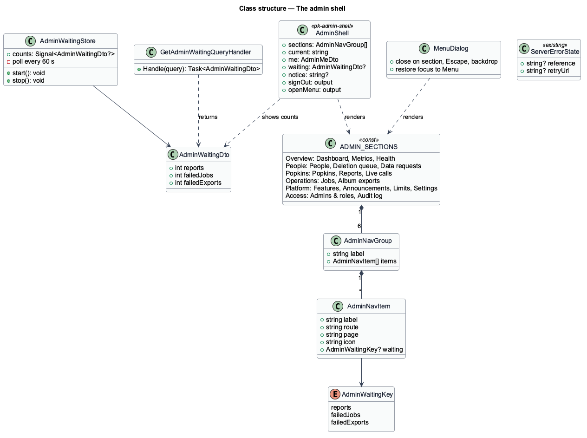
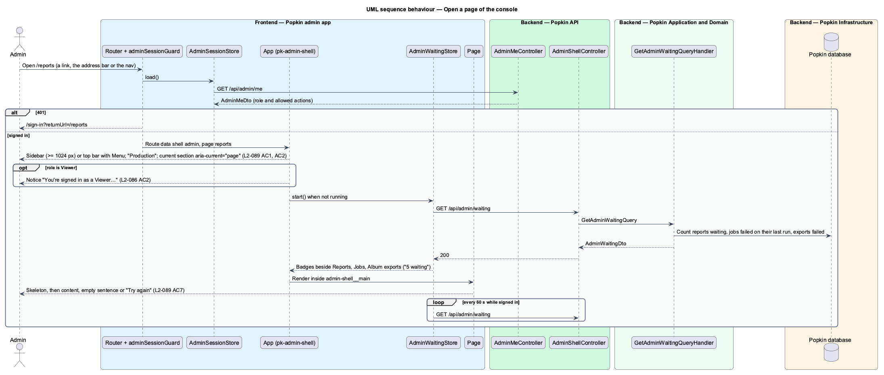
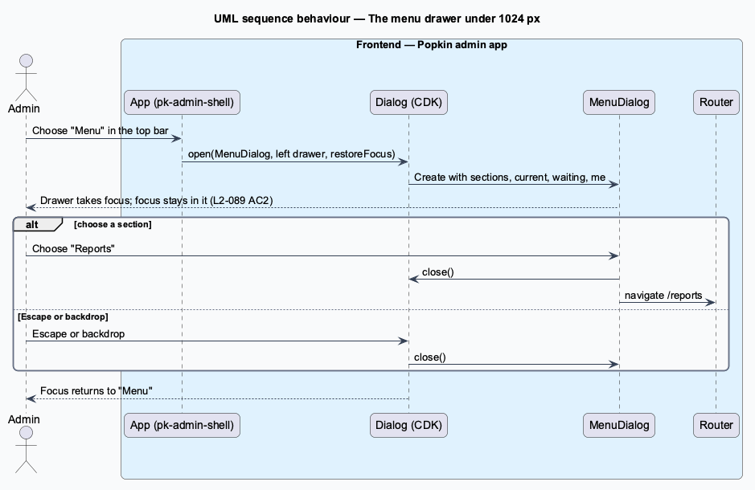
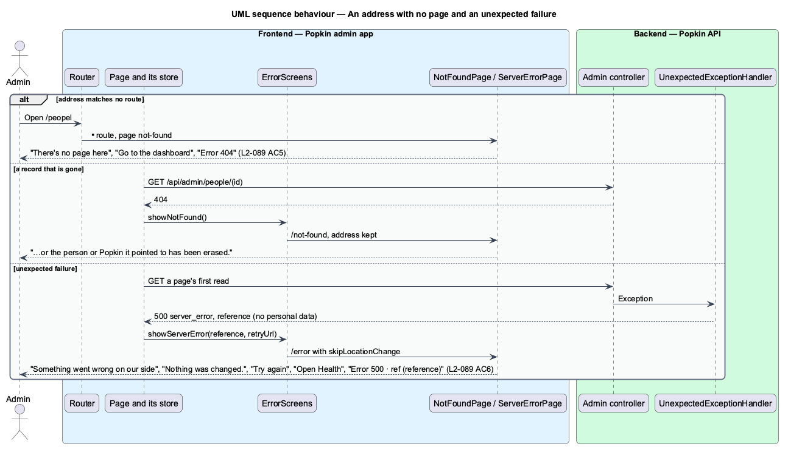

# The admin shell

## Overview

The console has 18 sections. Every signed-in page sits in one frame, the *admin shell*, which
names the system being changed ("Production"), lists the sections, says what waits in three of
them, shows who is signed in, and offers "Sign out". The frame keeps one shape on every screen
size, and every page inside it shares the same loading, failure and empty states, the same
responsive tables and the same dialog behaviour.

- **admin shell** — frame around every signed-in page of the console: a sidebar from 1024 px, a
  top bar with a menu drawer below 1024 px
- **section** — one page of the console reached from the shell's list, such as Reports or Jobs
- **waiting count** — number beside a section that says how much there needs an admin: reports
  waiting, jobs that failed on their last run, album exports that failed
- **Production** — label the console always shows, naming the system it changes

The shell is the first thing built after [Admin sign in](../admin-sign-in/README.md); every
other admin feature renders inside it. The shell is also where the console's content rule is
kept (L2-078 AC4): the console shows *who* is in a Popkin and *how* it is doing, never what its
members share, except a reported item in Reports (L2-109) and a moderation view (L2-111).

The console has no hub connection. What changes on its own (the waiting counts, the dashboard,
health, live calls) is read again on a timer, as ADR 0024 decides for what changes without a
hub event.

## Description

### Screens and states

- **Every signed-in page's frame** — for example `docs/mocks/admin/pages/dashboard/default.html`
  and `docs/mocks/admin/pages/admins/default.html`. From 1024 px, `admin-shell__side` holds the
  brand ("Popkin Admin", `admin-brand` with the "Admin" tag), the `env-tag` "Production", the
  `admin-nav` in six groups, and at its foot `admin-nav__me`: the admin's initials, name, role
  and "Sign out" (L2-089 AC1). The current section's link has `aria-current="page"`. Reports,
  Jobs and Album exports carry a `badge` with the count and the accessible name "{n} waiting";
  a count of 0 shows no badge.
- **Below 1024 px** — `admin-shell__bar` holds the brand, "Production" and "Menu"
  (`icon-btn`, "Open menu") (L2-089 AC2).
- `docs/mocks/admin/dialogs/menu/default.html` — the drawer (`admin-drawer`) over a `backdrop`,
  with "Close menu" and the same `admin-nav`.
- **The Viewer's notice** — `admin-shell__notice` under the bar, drawn in
  `docs/mocks/admin/pages/admins/viewer.html`; its rule is in
  [Admin roles](../admin-roles/README.md).
- `docs/mocks/admin/pages/not-found/default.html` — "There’s no page here", "The address may be
  mistyped, or the person or Popkin it pointed to has been erased.", "Go to the dashboard" and
  "Error 404" (L2-089 AC5), in `pk-admin-entry`.
- `docs/mocks/admin/pages/server-error/default.html` — "Something went wrong on our side", "The
  console couldn’t finish that. Nothing was changed. Try again in a moment; if it keeps happening,
  check Health.", "Try again", "Open Health" and "Error 500 · ref 7f3a-91c2" (L2-089 AC6), in
  `pk-admin-entry`.
- **Each page's own states** — every page's manifest entry draws `loading` (skeletons in the
  page's shape, such as "Loading the admins…"), `error` (`pk-empty-state`, `empty--compact`:
  "Couldn’t load the {thing}", "The admin API didn’t answer. Nothing has changed; try again, or
  check Health if it keeps happening.", "Try again", "Open Health") and, where a list can be
  empty, a sentence saying there is nothing there (L2-089 AC7).

### API

- **`GET /api/admin/waiting`** (`AdminShellController`, new) — `200` `AdminWaitingDto`
  (`reports`, `failedJobs`, `failedExports`). Any admin may read it; no role check.
  `GetAdminWaitingQueryHandler` counts the reports waiting for a decision (the report store of the
  Reports design), the jobs whose last run failed (the job runs of the Jobs
  design), and the `AlbumExport` rows with
  `AlbumExportStatus.Failed`. Those designs own the entity names.
- **`GET /api/admin/me`** — the signed-in admin and the actions the role allows, designed in
  [Admin roles](../admin-roles/README.md). The shell reads the name, role and initials from it.
- Every admin endpoint answers an unexpected failure through the existing
  `UnexpectedExceptionHandler`: `500` with `code` `server_error` and a `reference` that carries no
  personal data. The console shows that reference.

### Frontend (Popkin admin app)

- **The project** — `frontend/projects/admin`, added to `angular.json`, an application like
  `popkin` (ADR 0002, ADR 0016): `app.config.ts` (composition root: router, `HttpClient` with
  `adminAuthInterceptor`, every `ADMIN_*_API` token), `app.routes.ts`, `pages/`, `dialogs/`,
  `guards/`, `toasts/`. It declares no presentation component and no stylesheet (ADR 0007).
  `environment.ts` holds `popkinAppUrl` and `consoleLabel` ("Production" in production; the
  label of any other deployment is `<TO SUPPLY>`).
- **Routes** — the manifest's routes without the host: `/sign-in`, `/not-an-admin`, `/`,
  `/people`, `/people/:personId`, `/deletions`, `/data-requests`, `/popkins`,
  `/popkins/:popkinId`, `/reports`, `/calls`, `/metrics`, `/health`, `/jobs`, `/exports`,
  `/features`, `/announcements`, `/limits`, `/settings`, `/admins`, `/audit`, then `/not-found`,
  `/error` and `**`. Route data: `page` (the manifest id, stamped on `<body data-page>` as the
  e2e anchor), `shell` (`admin` | `bare`) and `title` ("{Section} · Popkin Admin").
- **`App`** (root, `app.ts` + `app.html`) — for `shell: 'admin'` it composes `pk-admin-shell`
  with the router outlet inside `admin-shell__main` (`id="main"`, the target of `pk-skip-link`
  "Skip to content"); for `bare` it renders the outlet alone. It starts `AdminWaitingStore` when
  an admin shell first shows and stops it at sign-out.
- **`pk-admin-shell`** (`components`, block `admin-shell`, new) — inputs `sections`, `current`,
  `me` (`name`, `role`, initials), `waiting`, `label` ("Production") and `notice`; outputs
  `signOut` and `openMenu`. It lays out `__side`, `__bar`, `__body`, `__notice` and `__main`, and
  shows the side from 1024 px and the bar below it. The design system's
  [Admin shell](../../../design-system/components/admin-shell.html) is its source.
- **`pk-admin-nav`** (`components`, block `admin-nav`, new) — the brand head, the groups
  (`__group`, `__label` as `h2`, `__list` labelled by it, `__item` links with `aria-current`),
  the badges, and the admin at the foot (`__me`) with "Sign out" (`icon-btn`, accessible name
  "Sign out"). Output `chosen` fires when a link is followed, which the drawer uses to close.
- **`ADMIN_SECTIONS`** (`api/admin/shell/admin-sections.ts`, new) — the six groups and 18 items
  of L2-089 AC1 as data (`AdminNavGroup`, `AdminNavItem`: label, route, page, icon and the
  `AdminWaitingKey` for Reports, Jobs and Album exports). The shell and the drawer read the same
  constant.
- **`AdminWaitingStore`** (`api/admin/shell/admin-waiting.store.ts`, new) — reads
  `GET /api/admin/waiting` at start and every 60 seconds while an admin is signed in; a failed
  read keeps the last counts. Unit tests drive the timer with fake time.
- **`MenuDialog`** (`dialogs/menu/menu.dialog.ts` + `.html`) — a CDK dialog positioned as a left
  drawer, composing `pk-admin-nav` inside `admin-drawer` with "Close menu". The CDK traps focus in
  it; Escape, the backdrop, "Close menu" and a chosen section close it; `restoreFocus` returns
  focus to "Menu" (L2-089 AC2). A section that is chosen navigates after the drawer closes.
- **`NotFoundPage`** and **`ServerErrorPage`** (`pages/not-found/`, `pages/server-error/`,
  shell `bare`) — the mocks' copy. The server-error page reads `ServerErrorState` (`reference`,
  `retryUrl`); "Try again" opens `retryUrl`, "Open Health" opens `/health`. The existing
  `ErrorScreens` service of the `api` library opens both in place of a failed page, keeping the
  address, so a reload retries (L2-089 AC5, AC6).
- **Lists** — every list of people, Popkins, reports, calls, jobs, exports, requests, admins or
  actions is a `pk-data-table`: a table from 768 px, and below 768 px each row a stacked record
  with the same fields, labelled by the column names (L2-089 AC3).
- **Dialogs** — every dialog is a CDK dialog in `pk-dialog`: centred from 640 px, a bottom sheet
  below it; focus moves into it, stays in it and returns to what opened it (L2-089 AC4). Action
  dialogs follow [A reason for every change](../give-a-reason/README.md).
- **Page states** — each page store exposes `loading` | `ready` | `empty` | `failed` and the page
  shows `pk-skeleton` in its shape, the content, the empty sentence, or `pk-empty-state` with "Try
  again" and "Open Health" (L2-089 AC7). Nothing is wider than 360 px at 360 px: tables become
  records, toolbars wrap (`cluster`), and long names truncate (`truncate`).
- **Accessibility, themes and motion** — the console meets L2-057 (WCAG 2.2 AA), L2-059 (light
  and dark themes, following the device through `ThemePreferences`) and L2-060 (no motion under
  `prefers-reduced-motion`) (L2-089 AC8). Colour never carries a state alone: each badge has its
  number and accessible name, each status pill its words.

### What the console shows of a Popkin (L2-078 AC4)

- An admin page shows a Popkin's emoji, name, Host, members, length, invite and counts. No admin
  DTO outside Reports and the moderation view carries a message, photo, comment, reaction,
  experience, story, time off or hours, and none carries a direct message that neither member
  reported.
- The rule is kept by the handlers' DTOs, not by the screen. Each admin read's API test seeds a
  Popkin with message text, a photo, a comment and an experience, and asserts that the answer
  contains none of them. That is a behaviour test of the endpoint, not a scan of the codebase.

### Decisions

- **Polling, not a hub.** The console holds no `PopkinHub` connection and the proxy forwards no
  `/hubs` on its host. The waiting counts are read every 60 seconds, the interval L2-076 AC10 and
  ADR 0024 use for every change shown to everyone.
- **The admin is read on every navigation.** `adminSessionGuard` reads `GET /api/admin/me`
  before each page, so a changed role shows on the next page (L2-086 AC5) and a removed admin
  meets `401` at the next navigation (L2-078 AC7). The read is small and the console is used by a
  handful of people.
- **One list of sections.** `ADMIN_SECTIONS` is the one place the six groups live; the sidebar
  and the drawer render the same component.

### Tests

- API test (`Popkin.Api.Tests/Admin/AdminWaitingTests`): seeded waiting reports, a failed job
  run and a failed export are counted; a Popkin app session is `403`.
- Unit tests (`frontend`, ADR 0011): `AdminWaitingStore` polls every 60 seconds and keeps the
  last counts on failure.
- Playwright (`e2e/tests/admin/shell.spec.ts`, page objects `e2e/pages/admin/admin-shell.ts` and
  `menu.dialog.ts`): the current section is marked; the badges show the recorded counts; under
  1024 px "Menu" opens the drawer, Escape closes it and focus returns to "Menu"; an unknown
  address shows "There's no page here"; a `500` shows the reference. Parity specs
  (`e2e/tests/parity/`) for `pk-admin-shell` and `pk-admin-nav`.

## Requirements

| L2 ID | Refines (L1) | Requirement |
|-------|--------------|-------------|
| `L2-089` | `L1-028` | The admin shell: Every page of the console shares one frame, on every screen size. (AC1–AC8) |
| `L2-078` | `L1-012` | Admin access: Only admins reach the admin app, and the admin app reaches a Popkin's content only as moderation allows. (AC4) |

## Diagrams

### System context

An admin moves between the console's sections; the shell is the same frame on every screen size.

### Containers

The admin app reads the signed-in admin on every navigation and the waiting counts every 60
seconds from the Popkin API.

### Components

The root composes `pk-admin-shell` and `pk-admin-nav`, opens `MenuDialog` below 1024 px, and
reads `AdminSessionStore` and `AdminWaitingStore`.

### Class structure

`ADMIN_SECTIONS` holds six groups of items; three items carry a waiting key that
`AdminWaitingDto` fills.

### Behaviour — open a page

The guard reads the admin, the shell draws the frame and the Viewer's notice, and the waiting
counts are read now and every 60 seconds.

### Behaviour — the menu drawer

Below 1024 px "Menu" opens the drawer, which holds focus, closes on a section, Escape or the
backdrop, and returns focus to "Menu".

### Behaviour — an address with no page and an unexpected failure

An unknown address or an erased record shows "There's no page here"; an unexpected failure shows
"Something went wrong on our side" with its reference.

