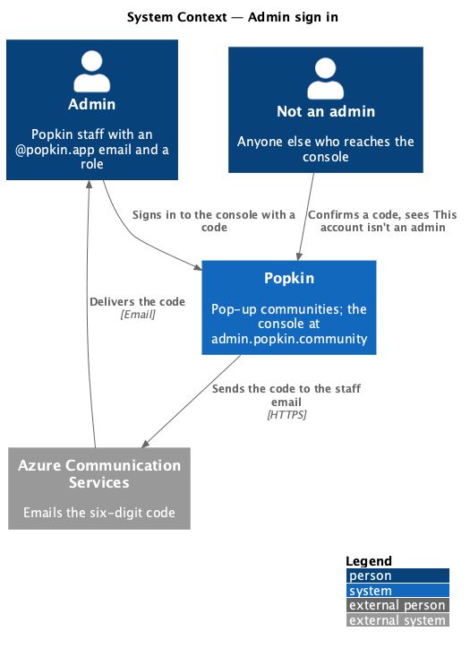
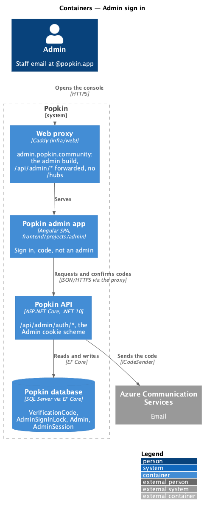
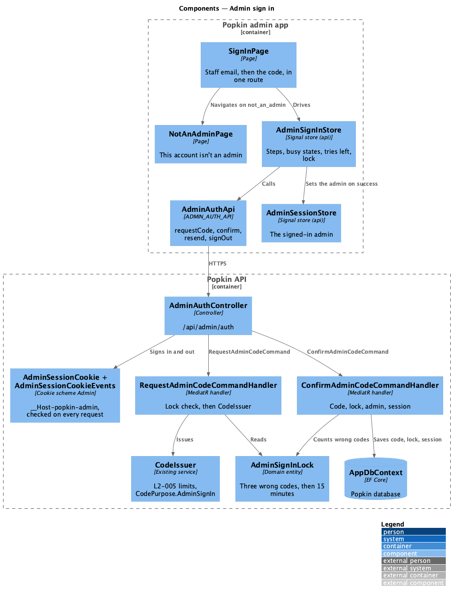
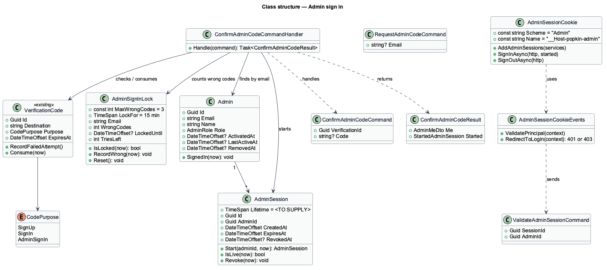
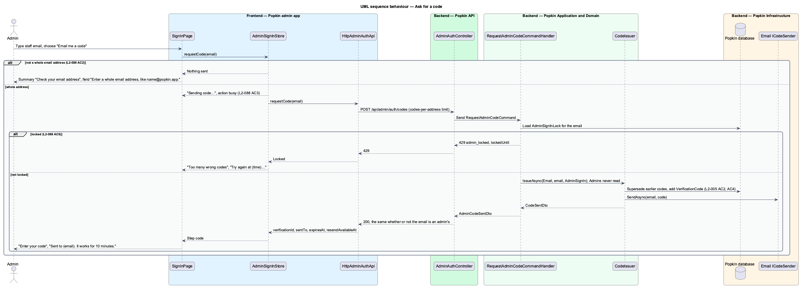
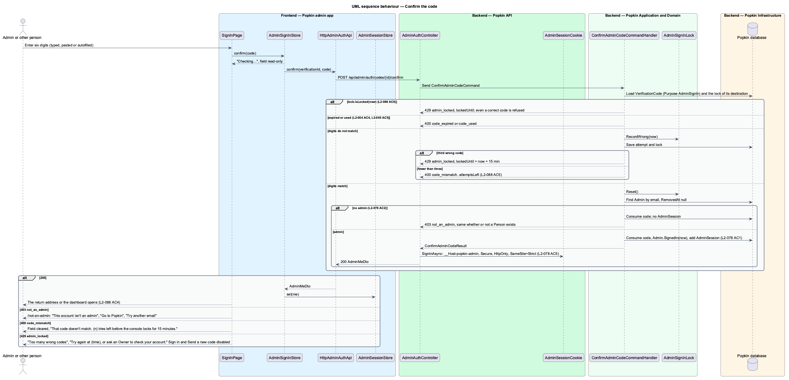
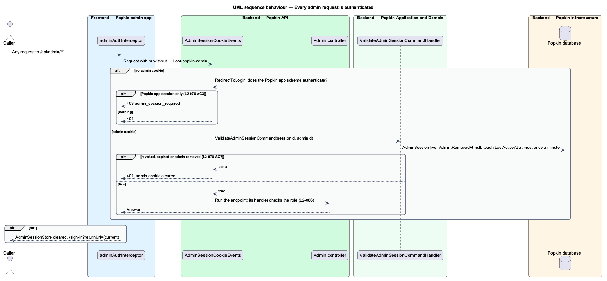
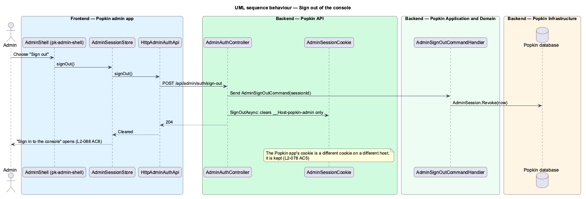

# Admin sign in

## Overview

Popkin is run from a separate application, the *admin app*, which its screens call "the
console". It is served at `https://admin.popkin.community` and reaches the same Popkin API under
`/api/admin/**` ([ADR 0016](../../../adr/0016-admin-app.md), amended by
[ADR 0024](../../../adr/0024-admins-moderation-and-switches-in-the-database.md)). *Admin sign in*
is the console's front door: an admin types their staff email, receives a six-digit code, enters
it, and the dashboard opens.

- **admin** — person who runs Popkin from the console, with one role: Owner, Support or Viewer
  ([Admin roles](../admin-roles/README.md))
- **staff email** — email address at `@popkin.app` that identifies an admin
- **admin session** — one browser's sign-in to the console, kept in its own cookie, separate from
  the Popkin app's session
- **console lock** — 15-minute refusal of every code for one email after three wrong codes

An admin is not a `Person`. The admin's staff email may also belong to a Popkin account, and
inside the Popkin app that account is an ordinary person. The two sessions never touch: signing
out of one leaves the other signed in (L2-078 AC5).

The sign-in reuses the Popkin app's code flow (`CodeIssuer`, `VerificationCode`, `ICodeSender`)
with a new purpose, `CodePurpose.AdminSignIn`, and adds the console lock, the admin session and
its cookie authentication scheme. Every other admin feature depends on this one: each
`/api/admin/**` endpoint requires the admin session, and its handler then checks the role
([Admin roles](../admin-roles/README.md)). Who is an admin is decided in
[Admins & roles](../manage-admins/README.md); the first Owner is named by configuration.

Nobody learns from the sign-in whether an email is an admin's or has a Popkin account: asking for
a code answers the same for every whole email address (L2-088 AC3), and confirming a code that
belongs to no admin shows "This account isn't an admin" whether or not a Popkin account exists
(L2-078 AC2).

## Description

### Screens and states

Every screen of this feature is drawn in `pk-admin-entry` (block `admin-entry`, the design
system's [Admin sign-in card](../../../design-system/components/admin-entry.html)): a centred card
on the sand page with the brand (`admin-brand`: the mark, the wordmark and "Admin") and a way out.
These screens use the `bare` shell; they have no sidebar.

- `docs/mocks/admin/pages/sign-in/default.html` — "Sign in to the console", "We’ll email a
  six-digit code to your Popkin staff address.", a "Staff email" field, "Email me a code", and the
  foot "Production console. Every action is recorded in the audit log." (L2-088 AC1).
- `sign-in/invalid-email.html` — the `pk-form-summary` "Check your email address" with the link
  "Staff email is missing its ending", and the field's error "Enter a whole email address, like
  name@popkin.app." (L2-088 AC2).
- `sign-in/sending.html` — the field disabled and the action "Sending code…" (L2-088 AC3).
- `sign-in/code.html` — "Enter your code", "Sent to {email}. It works for 10 minutes.", a
  "Six-digit code" field (`pk-text-field`, variant `code`, `inputmode="numeric"`,
  `autocomplete="one-time-code"`, 6 digits), "Sign in", "Use another email" and "Send a new code"
  (L2-088 AC3, AC7). The field takes a pasted code and the one-time-code autofill (L2-004 AC5).
- `sign-in/checking.html` — the field read-only and the action "Checking…" (L2-088 AC4).
- `sign-in/invalid.html` — the field cleared and invalid: "That code doesn’t match. 2 tries left
  before the console locks for 15 minutes." (L2-088 AC5). With one try left it reads "1 try
  left".
- `sign-in/locked.html` — `pk-alert` "Too many wrong codes", "Try again at 10:57, or ask an
  Owner to check your account."; the field, "Sign in" and "Send a new code" disabled; "Use another
  email" enabled (L2-088 AC6).
- `docs/mocks/admin/pages/not-an-admin/default.html` — `pk-empty-state`: "This account isn’t an
  admin", "Admins are set up by Popkin. If you were expecting to be one, ask an Owner. You can
  still use Popkin as usual.", "Go to Popkin" and "Try another email" (L2-078 AC2).
- States with no mock: a code that has expired ("That code has expired." with "Send a new code",
  L2-004 AC4), the confirmation that a new code was sent (L2-005 AC2), and the refusal of a
  sixth code request within an hour (L2-005 AC4). The design expects
  `docs/mocks/admin/pages/sign-in/expired.html`, `resent.html` and `code-limit.html`; until they
  exist the screen reuses the Popkin app's copy for each.

### API

All four endpoints are on `AdminAuthController` (`Popkin.Api/Controllers/Admin/`), under
`/api/admin/auth`. The first three are `[AllowAnonymous]`; sign-out requires the admin session.

- **`POST /api/admin/auth/codes`** — body `{ email }`; `200` `AdminCodeSentDto`
  (`verificationId`, `sentTo`, `expiresAt`, `resendAvailableAt`). Rate limit
  `RateLimitPolicyNames.CodesPerAddress`. Failures: `400` from `ContactRules.Normalise` for an
  address that is not whole; `429` `code_limit_reached` (L2-005 AC4); `429` `admin_locked` with
  `lockedUntil` while the email is locked; `503` `code_not_sent`.
- **`POST /api/admin/auth/codes/{verificationId}/confirm`** — body `{ code }`; `200`
  `AdminMeDto` ([Admin roles](../admin-roles/README.md)) and the admin cookie. Failures: `400`
  `code_mismatch` with `attemptsLeft`; `400` `code_expired`, `code_used`; `429` `admin_locked`
  with `lockedUntil`; `403` `not_an_admin`, with no cookie.
- **`POST /api/admin/auth/codes/{verificationId}/resend`** — `200` `AdminCodeSentDto`; the
  failures of a request, and `429` `rate_limited` within 30 seconds of the last code
  (L2-005 AC1, AC2).
- **`POST /api/admin/auth/sign-out`** — `204`; revokes the caller's `AdminSession` and clears
  the admin cookie only (L2-088 AC8, L2-078 AC5).

Every other `/api/admin/**` controller derives from **`AdminControllerBase`**, which carries
`[Authorize(AuthenticationSchemes = AdminSessionCookie.Scheme)]`. Its answers (L2-078 AC3):

| Request carries | Answer |
|---|---|
| No admin session and no Popkin app session | `401` |
| A Popkin app session only | `403` `admin_session_required` |
| An admin session whose role does not allow the action | `403` `role_not_allowed` ([Admin roles](../admin-roles/README.md)) |
| A revoked or expired admin session, or the session of a removed admin | `401`, the admin cookie cleared (L2-078 AC7) |

### Backend

- **`CodePurpose.AdminSignIn`** (Domain, changed) — a third value beside `SignUp` and `SignIn`.
  Codes of this purpose are issued by the existing `CodeIssuer`, so the rules of L2-004 and
  L2-005 apply as built: 10 minutes, superseded by a newer code, five per hour per destination,
  used once, only a keyed hash stored. The email is the Popkin code email that
  `ICodeSender` sends today; console wording for it is `<TO SUPPLY>`.
- **`AdminSignInLock`** (Domain, new) — one row per email: `Email` (key, normalised),
  `WrongCodes`, `LockedUntil?`. `MaxWrongCodes = 3`, `LockFor = 15 minutes`. `RecordWrong(now)`
  adds one; the third sets `LockedUntil = now + 15 minutes` and sets `WrongCodes` back to 0.
  `IsLocked(now)` is true while `now < LockedUntil`. `TriesLeft` is `3 - WrongCodes`. `Reset()`
  runs on a correct code. The lock is kept per email, not per code, so a new code does not
  undo it. A direct test in `Popkin.Application.Tests` takes one case per row:

  | Before | Event | After | Answer |
  |---|---|---|---|
  | 0 wrong | wrong code | 1 wrong | `400` `code_mismatch`, `attemptsLeft` 2 |
  | 1 wrong | wrong code | 2 wrong | `400` `code_mismatch`, `attemptsLeft` 1 |
  | 2 wrong | wrong code | locked until now + 15 min | `429` `admin_locked` |
  | locked | correct code | locked | `429` `admin_locked` (L2-088 AC6) |
  | locked | 15 minutes pass | 0 wrong, not locked | the next code is checked |
  | 2 wrong | correct code | 0 wrong | signed in, or `not_an_admin` |

- **`RequestAdminCodeCommand`** / **`ResendAdminCodeCommand`** (Application, new) — normalise the
  email with `ContactRules`, refuse `429` `admin_locked` while it is locked, then call
  `CodeIssuer.IssueAsync(ContactChannel.Email, email, CodePurpose.AdminSignIn)`. Neither reads
  `Admins`, so the answer is the same for every whole address (L2-088 AC3).
- **`ConfirmAdminCodeCommand`** / **`ConfirmAdminCodeCommandHandler`** (Application, new) — loads
  the `VerificationCode`, which shall have the purpose `AdminSignIn` (any other is answered as
  `code_expired`), and the lock of its destination. Order: lock, expiry and use, digits. A wrong
  code records the attempt on the code and on the lock in one save. A correct code resets the
  lock and consumes the code, then looks up the `Admin` with that `Email` and `RemovedAt` null.
  None: it saves and throws `403` `not_an_admin`, the same whether or not a `Person` has the
  email, and starts no session (L2-078 AC2). Found: `Admin.SignedIn(now)` sets `ActivatedAt` on
  the first sign-in ([Admins & roles](../manage-admins/README.md), L2-119 AC4) and `LastActiveAt`;
  `AdminSession.Start(admin.Id, now)` is added; one save; the result carries `AdminMeDto` and
  `StartedAdminSession`.
- **`AdminSession`** (Domain, new) — `Id`, `AdminId`, `CreatedAt`, `ExpiresAt`, `RevokedAt?`,
  `Start`, `IsLive(now)`, `Revoke(now)`, as `Session` is for people. `Lifetime` is
  `<TO SUPPLY>`: L2-078 AC5 gives the admin cookie the rules of L2-007 AC4 but no length, and the
  Popkin app's 30 days is not assumed for a console that changes production.
- **`AdminSignOutCommand`** (Application, new) — revokes the caller's `AdminSession`.
- **`ValidateAdminSessionCommand`** (Application, new) — true when the session is live and its
  admin is not removed. It sets `Admin.LastActiveAt` when the stored value is more than one
  minute old, so "Last active" on Admins & roles stays current without a write per request.
- **`AdminSessionCookie`** (`Popkin.Api/Auth/`, new) — `Scheme = "Admin"`, cookie name
  `__Host-popkin-admin`: `HttpOnly`, `SecurePolicy = Always`, `SameSite = Strict`, `Path = "/"`,
  no `Domain`, so the browser keeps it for `admin.popkin.community` alone and never sends it to
  the Popkin app or to a Popkin's address (L2-007 AC4, L2-078 AC5). Claims: `pk:aid` (the admin)
  and `pk:asid` (the session). `AddAdminSessions()` registers the scheme beside the existing
  default scheme; the Popkin app's cookie and scheme do not change.
- **`AdminSessionCookieEvents`** (`Popkin.Api/Auth/`, new) — `ValidatePrincipal` sends
  `ValidateAdminSessionCommand` on every request and rejects the principal when it is false, so
  a removed admin's next request is `401` (L2-078 AC7, L2-119 AC6). `RedirectToLogin`
  authenticates the request against the Popkin app's scheme: success answers `403`
  `admin_session_required`, otherwise `401` (L2-078 AC3). `RedirectToAccessDenied` answers `403`.
- **`ICurrentAdmin`** (Application, new) / **`HttpCurrentAdmin`** (Api, new) — `AdminId` and
  `SessionId` from the admin principal; handlers never read `HttpContext`.
- **Same-site checks.** `SameSiteRequestMiddleware` accepts `Sec-Fetch-Site: same-origin`, which
  the console sends because the proxy serves the app and `/api/admin` from one host. Where a
  client sends no fetch metadata, it compares `Origin` with `App:Origin`; it gains a second
  accepted origin, the new setting `Admin:Origin` (`https://admin.popkin.community`).
- **The first Owner.** `Admin:FirstOwner` and `AdminBootstrapper` are designed in
  [Admins & roles](../manage-admins/README.md) (L2-078 AC1, L2-119 AC9).
- **Telemetry.** `PopkinMetrics` gains the counter `popkin.admin.sign_ins` with the dimension
  `outcome` (`signed_in`, `not_an_admin`, `code_mismatch`, `admin_locked`). No log line, metric or
  span carries the email, the code or a session id (ADR 0012).

### Hosting

- **The proxy** (`infra/web/`) serves the admin build on the host `admin.popkin.community` and
  forwards `/api/admin/*` only; it forwards no `/hubs` there, because the console has no hub
  ([The admin shell](../admin-shell/README.md)). The Popkin app's hosts stop forwarding
  `/api/admin/*`.
- **The front door** (`infra/main.bicep`) gains the custom domain `admin.popkin.community` with
  its own route to `popkin-web`, as ADR 0024 requires; the wildcard route of ADR 0020 keeps
  serving every Popkin address.
- **`admin` stays reserved** as a Popkin's address, in the defaults of `Addresses:Reserved`
  ([Choose the address](../../popkins/choose-address/README.md), L2-063 AC5), so no Popkin can
  take the console's host (L2-078 AC6).
- `docs/deployment.md` gains `Admin:Origin`, `Admin:FirstOwner` and the host row for
  `https://admin.popkin.community` in the same change (ADR 0013).

### Frontend (Popkin admin app)

- **`SignInPage`** (`frontend/projects/admin/src/app/pages/sign-in/sign-in.page.ts`, route
  `/sign-in`, `page: 'sign-in'`, shell `bare`) — one route with two steps, as the mock's states
  share one route. It composes `pk-admin-entry`, `pk-form-summary`, `pk-text-field`,
  `pk-button`, `pk-link` and `pk-alert`. "Use another email" returns to the email step with the
  email kept (L2-088 AC7).
- **`AdminSignInStore`** (`frontend/projects/api/src/lib/admin/auth/admin-sign-in.store.ts`) —
  `step` (`email` | `code`), `status` (`idle` | `sending` | `checking` | `locked`), `emailError`,
  `codeError`, `attemptsLeft`, `lockedUntil`, and the 30-second countdown of "Send a new code"
  from `resendAvailableAt`. It checks a whole address with the existing `parse-contact` helper
  before sending anything (L2-088 AC2). It submits six digits as soon as they are entered.
- **`admin-sign-in-text.ts`** (`api`) — `mismatchText(attemptsLeft)` and
  `lockedText(lockedUntil, timeZone)` ("Try again at 10:57, or ask an Owner to check your
  account."). Unit tests cover each count and the time format.
- **`NotAnAdminPage`** (`pages/not-an-admin/`, route `/not-an-admin`, shell `bare`) — "Go to
  Popkin" links to the Popkin app (`environment.popkinAppUrl`, `https://app.popkin.community` in
  production); "Try another email" opens `/sign-in`.
- **`AdminAuthApi`** (`ADMIN_AUTH_API`, `api/admin/auth/admin-auth-api.ts`) — `requestCode`,
  `confirm`, `resend`, `signOut`, and `me` ([Admin roles](../admin-roles/README.md));
  `HttpAdminAuthApi` implements it, and `app.config.ts` provides it.
- **Guards** (`frontend/projects/admin/src/app/guards/`) — `signedOutAdminGuard` on `/sign-in`
  and `/not-an-admin` sends an admin who has a session to `/`. `adminSessionGuard` on every other
  route reads `AdminSessionStore.load()` and sends a caller without a session to
  `/sign-in?returnUrl=…`. After sign-in the page opens the safe return address
  (`safeReturnUrl`, as the Popkin app does) or the dashboard (L2-088 AC4).
- **`adminAuthInterceptor`** — a `401` from any `/api/admin/**` request other than the auth
  endpoints clears `AdminSessionStore` and opens `/sign-in?returnUrl=…`, so a removed admin or a
  revoked session leaves the console at the next request (L2-078 AC7).
- **Sign out** — the shell's "Sign out" ([The admin shell](../admin-shell/README.md)) calls
  `AdminSessionStore.signOut()` and opens `/sign-in`.

### Decisions

- **The third wrong code locks.** L2-088 AC6 locks "when a fourth is entered" after three wrong
  codes. The lock starts at the third wrong code, and that answer is already `429`
  `admin_locked`, so the screen says "Too many wrong codes" at once instead of "0 tries left".
  The fourth code, correct or not, and every code for 15 minutes, is refused. The Popkin app's
  limit of five tries per code (L2-005 AC3) stays and never binds first.
- **A locked email cannot ask for a code either.** The lock applies to every email, admin or
  not, so refusing a code request while it holds says nothing about who is an admin.
- **Codes go to every whole address.** L2-088 AC3 sends a code for any whole email, not only
  `@popkin.app` ones, so the answer never depends on the address. The existing
  `CodesPerAddress` limit and the five-per-hour rule bound the sending.
- **The confirmed code is consumed for a non-admin**, so the screen of L2-078 AC2 cannot be used
  to test the same code twice.
- **Sign-in is not an audit entry.** The audit log records changes and the reads of L2-120 AC5;
  a sign-in is neither. `LastActiveAt` and the session rows hold when an admin was there.
- **Two cookies, two hosts.** The admin cookie is host-only on the console's host, so the
  address design's base-domain cookie (`__Secure-popkin`) and the admin cookie never collide,
  and neither can stand in for the other: the scheme of each endpoint names the one it reads.
  This replaces ADR 0016's `__Secure-popkin-admin` and its `Admin:Accounts` setting (ADR 0024).

### Tests

- API tests (`Popkin.Api.Tests/Admin/AdminSignInTests`): a request for an admin's and a
  stranger's email answer alike; an admin's code signs in and sets `__Host-popkin-admin` with its
  attributes; a non-admin's code answers `403` `not_an_admin` and sets no cookie; three wrong
  codes lock and a correct fourth is refused; sign-out revokes the session and leaves a Popkin
  app session working; a Popkin app session alone on an admin endpoint is `403`; no session is
  `401`; a removed admin's next request is `401`. Time moves with `FakeTimeProvider`.
- Playwright (`e2e/tests/admin/sign-in.spec.ts`, page object `e2e/pages/admin/sign-in.page.ts`):
  each state of the mock, with `/api/admin/**` answered from the recording.

## Requirements

| L2 ID | Refines (L1) | Requirement |
|-------|--------------|-------------|
| `L2-088` | `L1-028` | Admin sign in: An admin signs in to the console with a code sent to their staff email. (AC1–AC8) |
| `L2-078` | `L1-012` | Admin access: Only admins reach the admin app, and the admin app reaches a Popkin's content only as moderation allows. (AC1, AC2, AC3, AC5, AC6, AC7) |
| `L2-007` | `L1-002` | Sessions: A signed-in person stays signed in on their device until they sign out or the session ends. (AC4, for the admin cookie) |
| `L2-004` | `L1-002` | Confirm the six-digit code: A six-digit code sent to the phone number or email proves the person owns it. (AC4, AC5) |
| `L2-005` | `L1-002` | Resend and limit codes: Codes are short lived and cannot be guessed or requested without limit. (AC1, AC2, AC4, AC5) |

## Diagrams

### System context

An admin signs in to the console with a code that Azure Communication Services emails; anyone
else who confirms a code is told the account is not an admin.

### Containers

The proxy serves the admin app and forwards `/api/admin/*` on the console's host. The API keeps
codes, locks, admins and admin sessions in the Popkin database.

### Components

`SignInPage` drives `AdminSignInStore`, which calls `AdminAuthController`. Two handlers apply the
lock and the code rules, and the admin cookie scheme checks every later request.

### Class structure

`AdminSignInLock` counts wrong codes per email beside the existing `VerificationCode`. A correct
code for an `Admin` starts an `AdminSession`, which `AdminSessionCookie` carries.

### Behaviour — ask for a code

A partial address sends nothing; a whole address gets the same answer whether or not it is an
admin's; a locked address is refused.

### Behaviour — confirm the code

The lock, the code's expiry and the digits are checked in order. A match for an admin starts the
session and opens the dashboard; a match for anyone else opens "This account isn't an admin".

### Behaviour — every admin request is authenticated

No session is `401`, a Popkin app session alone is `403`, and a revoked session or a removed
admin is `401` at the next request.

### Behaviour — sign out

Signing out revokes the admin session and clears the admin cookie; the Popkin app's session is
kept.

