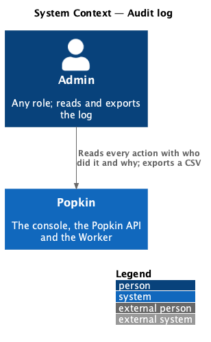
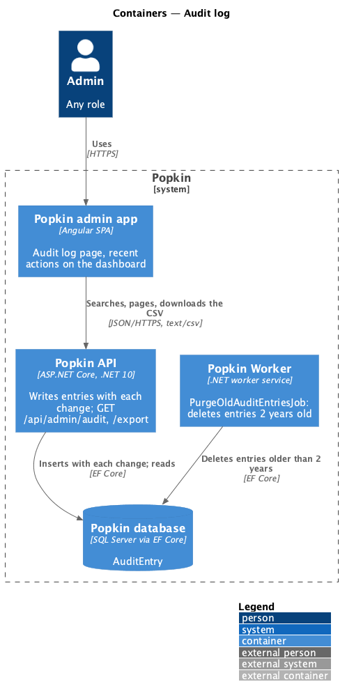
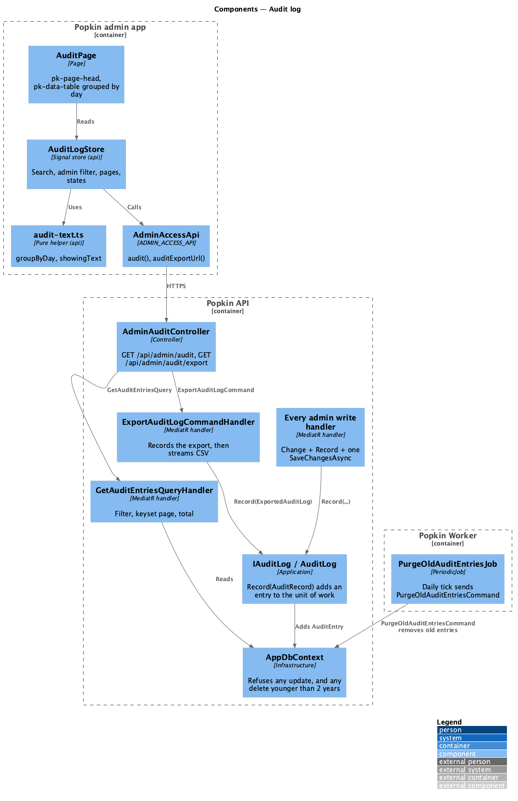
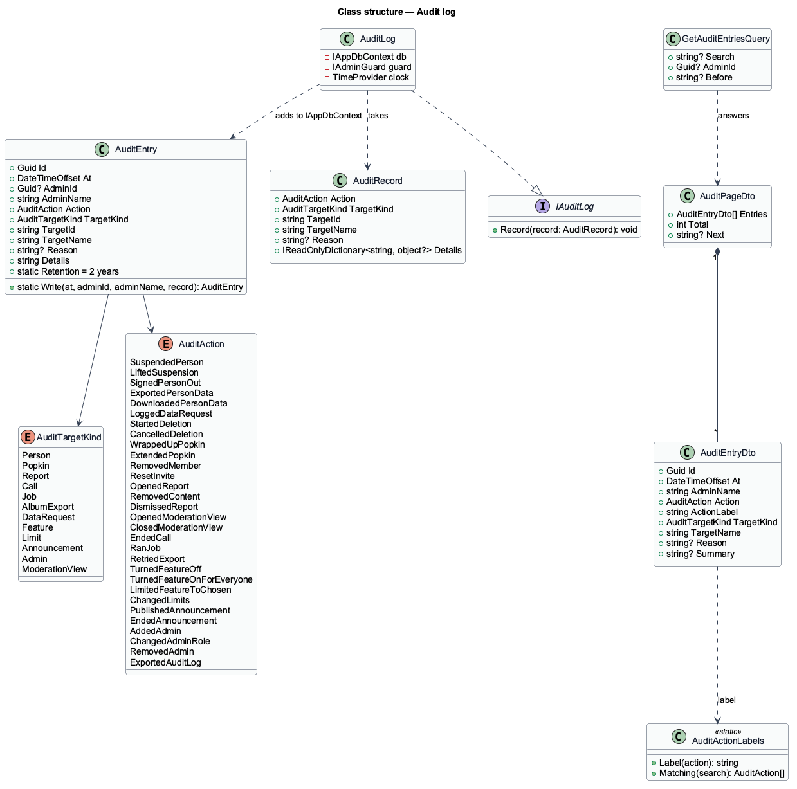
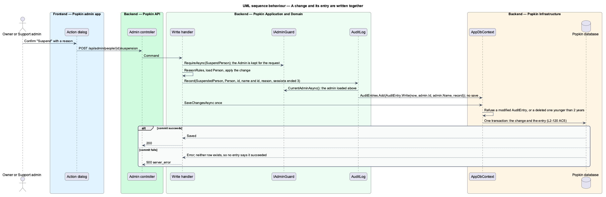
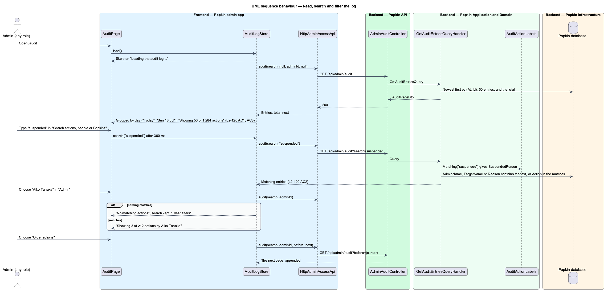
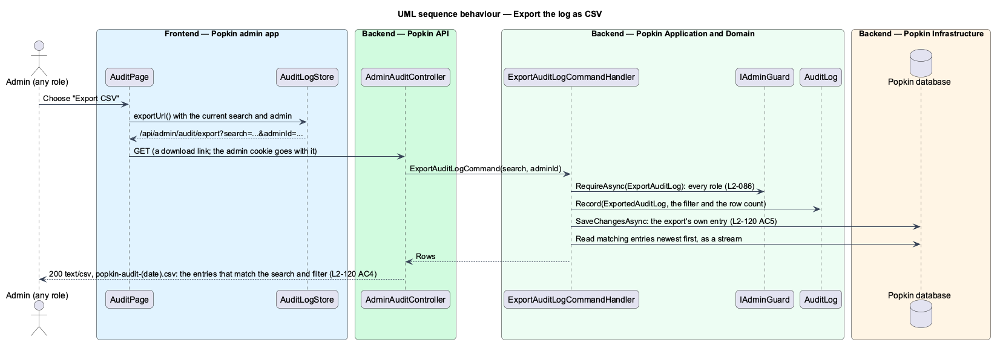
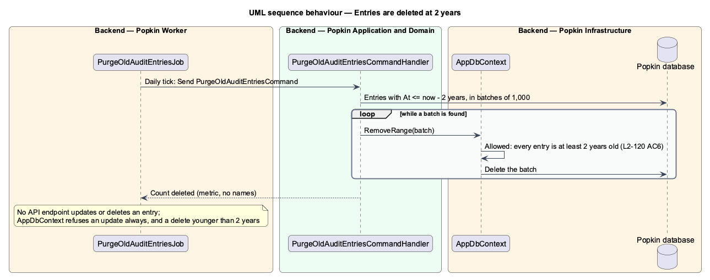

# Audit log

## Overview

The *audit log* is the record of every change an admin makes in the console: who, what, to whom
or what, why and when (`docs/specs/L1.md`, Terms). Every admin, Viewer included, can read it and
export it, and nobody can edit it. It is kept for two years, then each entry is deleted.

- **audit entry** — one line of the audit log: the time, the admin, the action, the target, the
  reason and a few details
- **target** — person, Popkin, report, call, job, album export, data request, feature, limit,
  announcement, admin or moderation view that an entry is about
- **audited read** — read that writes an entry as a change does: a report opened, a moderation
  view opened or closed, a data export or the audit log downloaded (L2-120 AC5)

Every admin write handler writes its entry through one service, `IAuditLog`, which adds the entry
to the same unit of work as the change. The handler's single `SaveChangesAsync` then writes both
or neither, so no entry says a change succeeded when it failed (L2-120 AC5). The reason of
[A reason for every change](../give-a-reason/README.md) lives in the entry. The dashboard's
"Recent admin actions" and a record's history on other pages read the same entries.

This design owns `AuditEntry`, `AuditAction`, `AuditTargetKind`, `AuditRecord` and `IAuditLog`,
which every other admin design uses.

## Description

### Screens and states

- `docs/mocks/admin/pages/audit/default.html` — `pk-page-head` "Audit log", "Every action taken in
  this console, with who did it and why. Kept for 2 years; nobody can edit it." and "Export CSV";
  a toolbar with `pk-search-field` "Search actions, people or Popkins" and a select "Admin" ("All
  admins" and each admin); `pk-data-table` with the columns Time, Admin, Action, "Target and
  reason", grouped by day (`table-group`: "Today", "Sun 13 Jul"), newest first; the foot
  "Showing 10 of 1,284 actions" and "Older actions" (L2-120 AC1, AC3).
- `audit/filtered.html` — one admin chosen, "Clear filters", "Showing 3 of 212 actions by Aiko
  Tanaka" (L2-120 AC2).
- `audit/no-results.html` — the search kept, `pk-empty-state` `empty--compact` "No matching
  actions", "Try a person’s name, a Popkin, or an action such as “suspended”." and "Clear filters"
  (L2-120 AC2).
- `audit/loading.html` — skeleton rows, "Loading the audit log…".
- `audit/error.html` — "Couldn’t load the audit log", "The admin API didn’t answer. Nothing has
  changed; try again, or check Health if it keeps happening.", "Try again", "Open Health".
- The page has no empty state: adding the first admin is itself recorded, so the log is never
  empty (the manifest's note).
- Each row shows the time, the admin's name, the action label ("Suspended person"), the target's
  name ("Tomás Reyes") and under it the reason or a summary of the details ("15 MB → 25 MB",
  "HRNT-1104 → HRNT-5561", "Role: Viewer"). Below 768 px each row is a stacked record
  ([The admin shell](../admin-shell/README.md)).

### API

`AdminAuditController` (new), any admin:

- **`GET /api/admin/audit?search=&adminId=&before=&limit=`** — `200` `AuditPageDto`: `entries`
  (`AuditEntryDto`: `id`, `at`, `adminId`, `adminName`, `action`, `actionLabel`, `targetKind`,
  `targetId`, `targetName`, `reason`, `summary`), `total` (entries matching the search and
  filter), `next` (an opaque cursor, or null on the last page). `limit` defaults to 50 and is at
  most 100; the dashboard asks for 4. Entries are newest first by `(At, Id)`; `before` continues
  after the cursor, so a page never repeats or skips an entry written while reading (L2-120 AC3).
- **`GET /api/admin/audit/export?search=&adminId=`** — `200` `text/csv; charset=utf-8`,
  `Content-Disposition: attachment; filename="popkin-audit-{yyyy-MM-dd}.csv"`, every entry that
  matches, newest first. Requires `AdminAction.ExportAuditLog`, which every role has (L2-086,
  L2-120 AC4). Writes an `ExportedAuditLog` entry before the first row.
- **No other endpoint.** Nothing answers `PUT`, `PATCH` or `DELETE` on an entry (L2-120 AC6).

### Backend

- **`AuditEntry`** (Domain, new) — `Id`, `At`, `AdminId?`, `AdminName`, `Action`
  (`AuditAction`), `TargetKind` (`AuditTargetKind`), `TargetId` (string: a `Guid` for a record,
  the key for a feature, limit or job), `TargetName`, `Reason?` (at most 500 characters),
  `Details` (a JSON object, at most 2,000 characters). Every property has a private setter and
  the type has no method that changes it; `Write(at, adminId, adminName, record)` is its only
  factory. `Retention = 2 years`. `AdminName` is the admin's name when the entry was written, so a
  renamed or removed admin's past entries read as they did (L2-119 AC6). `AdminId` is null only
  for an entry Popkin writes itself, the first Owner's addition, whose `AdminName` is "Popkin"
  ([Admins & roles](../manage-admins/README.md)).
- **`AuditTargetKind`** (Domain, new) — `Person`, `Popkin`, `Report`, `Call`, `Job`,
  `AlbumExport`, `DataRequest`, `Feature`, `Limit`, `Announcement`, `Admin`, `ModerationView`.
- **`AuditAction`** (Domain, new) — one value per audited change or read:

  | `AuditAction` | Target | Written by |
  |---|---|---|
  | `SuspendedPerson`, `LiftedSuspension`, `SignedPersonOut`, `StartedDeletion`, `CancelledDeletion` | `Person` | the people designs |
  | `ExportedPersonData`, `DownloadedPersonData`, `LoggedDataRequest` | `Person`, `DataRequest` | the people designs |
  | `WrappedUpPopkin`, `ExtendedPopkin`, `RemovedMember`, `ResetInvite` | `Popkin` | the Popkin designs |
  | `OpenedReport`, `RemovedContent`, `DismissedReport` | `Report` | the moderation designs |
  | `OpenedModerationView`, `ClosedModerationView` | `ModerationView` | the moderation designs |
  | `EndedCall` | `Call` | the live calls design |
  | `RanJob`, `RetriedExport` | `Job`, `AlbumExport` | the operations designs |
  | `TurnedFeatureOff`, `TurnedFeatureOnForEveryone`, `LimitedFeatureToChosen` | `Feature` | the features design |
  | `ChangedLimits`, `PublishedAnnouncement`, `EndedAnnouncement` | `Limit`, `Announcement` | the platform designs |
  | `AddedAdmin`, `ChangedAdminRole`, `RemovedAdmin` | `Admin` | [Admins & roles](../manage-admins/README.md) |
  | `ExportedAuditLog` | none (`TargetKind` `Admin`, the exporter) | this design |

  A design that needs a further value adds it here.
- **`AuditRecord`** (Application, new) — `Action`, `TargetKind`, `TargetId`, `TargetName`,
  `Reason?`, `Details` (a small dictionary of names to strings, numbers or booleans: old and new
  values, counts, codes).
- **`IAuditLog`** (Application, new) — `void Record(AuditRecord record)`. **`AuditLog`**
  (Application, scoped) reads the acting admin from `IAdminGuard.CurrentAdminAsync()`, which the
  handler's `RequireAsync` has already loaded for the request, stamps `At` from `TimeProvider`,
  serialises `Details`, and adds the entry to `IAppDbContext.AuditEntries`. It never saves. A
  handler that has not called the guard first gets an `InvalidOperationException`, which keeps
  the order of [Admin roles](../admin-roles/README.md).
- **What an entry never holds** (L2-120 AC7) — message text, a photo or its key, a comment, a
  code, a session token, an email or a phone number. A person or a Popkin is named by its name and
  id (`TargetName`, `TargetId`). Each writing design lists its `Details` keys; an invite code is
  a code of a Popkin's invite, which the mock shows ("HRNT-1104 → HRNT-5561") and which is not a
  sign-in code. The API test of each audited action asserts the entry's fields.
- **One transaction** (L2-120 AC5) — each handler calls `Record` and then its one
  `SaveChangesAsync`, which writes the change and the entry together. Work outside the database
  (an email, a stored photo deleted, a hub event) happens after the save, so a failed save leaves
  no entry and no outside effect. An outcome learnt later, such as a job run's result, is a
  further entry, never an update.
- **Nobody can edit it** (L2-120 AC6) — `AppDbContext.SaveChangesAsync` throws when the change
  tracker holds an `AuditEntry` in the `Modified` state, or in the `Deleted` state with `At` later
  than `now - Retention`. No handler, endpoint or tool updates an entry, and only the purge below
  deletes one. A direct test of `AppDbContext` on the InMemory provider covers the three cases.
- **`AuditActionLabels`** (Application, new) — the English label of each action ("Suspended
  person", "Rolled out feature" for `LimitedFeatureToChosen`), used for the DTO's `actionLabel`,
  for search and for the CSV.
- **`GetAuditEntriesQuery`** (Application, new) — `Search` (trimmed, at most 100 characters)
  matches, without regard to case, `AdminName`, `TargetName`, `Reason`, or an action whose label
  contains it (`AuditActionLabels.Matching`); `AdminId` keeps one admin's entries. `summary` is
  built from `Details` by the action's formatter. EF Core indexes: `(At, Id)` and
  `(AdminId, At)`.
- **`ExportAuditLogCommand`** (Application, new) — `RequireAsync(ExportAuditLog)`, records
  `ExportedAuditLog` with `Details` `{ search: present or not, adminId, rows }` (the search text
  itself is not kept), saves, then streams the rows. Columns: `Time (UTC)` (ISO 8601), `Admin`,
  `Admin id`, `Action`, `Target kind`, `Target`, `Target id`, `Reason`, `Details`. A cell that
  begins with `=`, `+`, `-` or `@` is prefixed with `'`, so a spreadsheet does not run it as a
  formula.
- **`PurgeOldAuditEntriesCommand`** (Application, new) — removes, in batches of 1,000, every
  entry with `At <= now - Retention` (L2-120 AC6). **`PurgeOldAuditEntriesJob`**
  (`Popkin.Worker/Jobs`, new) runs once a day and sends it; the job is the loop alone and sends no
  hub event (ADR 0015).
- **Telemetry** — `PopkinMetrics` gains `popkin.audit.entries_purged` (a counter). No log line,
  metric or span carries an entry's names, reason or search text.

### Frontend (Popkin admin app)

- **`AuditPage`** (`pages/audit/audit.page.ts` + `.html`, route `/audit`, `page: 'audit'`) —
  composes `pk-page-head`, `pk-button` "Export CSV" (an `<a>` with `download`, built from
  `AuditLogStore.exportUrl()`), `pk-search-field`, the "Admin" select, `pk-data-table` with its
  day groups, "Older actions", `pk-skeleton` and `pk-empty-state`.
- **`AuditLogStore`** (`api/admin/access/audit-log.store.ts`, new) — `search` (applied 300 ms
  after typing stops), `adminId`, `entries`, `total`, `next`, `status` (`loading` | `ready` |
  `no-results` | `failed`), `loadOlder()`, `clearFilters()` and `exportUrl()`. The admins of the
  filter come from `GET /api/admin/admins` ([Admins & roles](../manage-admins/README.md)).
- **`audit-text.ts`** (`api/admin/access/`, new, pure) — `groupByDay(entries, now, timeZone)`
  ("Today", "Yesterday", then "Sun 13 Jul"), `timeText`, and `showingText(shown, total,
  adminName?)` ("Showing 10 of 1,284 actions", "Showing 3 of 212 actions by Aiko Tanaka"). Unit
  tests cover each case.
- **`AdminAccessApi`** (`ADMIN_ACCESS_API`) — `audit(query)` and `auditExportUrl(query)`, beside
  the admins and roles calls.

### Decisions

- **The entry is written by the handler, not by a pipeline behaviour.** Each handler knows its
  target's name, its old and new values and its reason; a generic MediatR behaviour would not, and
  would have to guess which requests change something.
- **`AdminId` may be null.** The first Owner is added by Popkin at start-up, not by an admin; the
  entry names "Popkin" as its author so the log still starts with that addition.
- **Keyset paging.** "Older actions" continues from the last entry shown, so entries written
  meanwhile do not shift the next page.
- **The CSV is a `GET` that writes an entry.** A download is a link the browser follows with
  the admin cookie, which `SameSite=Strict` keeps from other sites; the entry of the download is
  the audited read L2-120 AC5 asks for.
- **Deletion at two years is a fifth Worker job.** L2-113 names four jobs, and the Jobs page
  lists those four; L2-120 AC6 deletes entries at two years, which needs a scheduled job.
  This design follows L2-120 and adds `PurgeOldAuditEntriesJob`. Whether Jobs lists it and runs
  it with "Run now" is `<TO SUPPLY>` (a conflict with L2-113 AC1, reported). ADR 0024 already
  names this Worker work.

### Known gaps

- An erased person's name stays in `TargetName` of their entries for up to two years after
  their account is erased (L2-049 erases what is left within 30 days; L2-120 AC7 names a person
  by name and id). Whether erasure replaces the name in audit entries, or the log keeps it as a
  record of who was acted on, is `<TO SUPPLY>`. The design keeps it until decided; the Privacy
  notice shall say which.
- The page size of 50 is this design's; the mock shows 10 rows.

### Tests

- API tests (`Popkin.Api.Tests/Admin/AuditLogTests`): an audited change writes one entry with the
  admin, action, target, reason and details; a change whose save fails (a fault injected through
  `IAppDbContext`) writes no entry; search, the admin filter and "Older actions" return what
  they should; a Viewer can read and export; the CSV holds the matching rows and its own export
  entry; no route updates or deletes an entry. The purge's handler test advances
  `FakeTimeProvider` past two years.
- Worker test (`Popkin.Worker.Tests`): one tick of `PurgeOldAuditEntriesJob` sends one command.
- Unit tests (`frontend`): `AuditLogStore`, `audit-text.ts`.
- Playwright (`e2e/tests/admin/audit.spec.ts`, page object `e2e/pages/admin/audit.page.ts`):
  each state of the mock; "Export CSV" points at the export URL with the current filter.

## Requirements

| L2 ID | Refines (L1) | Requirement |
|-------|--------------|-------------|
| `L2-120` | `L1-028` | Audit log: Every action in the console, with who did it and why. (AC1–AC7) |
| `L2-086` | `L1-028` | Admin roles: Every admin has one role, and the API, not the screen, decides what it allows. (the row "Export the audit log") |

## Diagrams

### System context

Any admin reads every action with who did it and why, and can export it.

### Containers

The API writes each entry with its change and answers the reads; the Worker deletes entries
that are two years old.

### Components

Every write handler records through `IAuditLog`; `AppDbContext` refuses edits; the audit page
reads through `AdminAuditController`.

### Class structure

`AuditEntry` holds an `AuditAction` and an `AuditTargetKind`; `AuditLog` turns an `AuditRecord`
into an entry in the unit of work.

### Behaviour — a change and its entry are written together

The handler records the entry before its one save, so the change and the entry are committed
together or not at all.

### Behaviour — read, search and filter

The log opens newest first, grouped by day; search, the admin filter and "Older actions" narrow
and extend it.

### Behaviour — export CSV

Any admin downloads the entries that match the search and filter; the download is itself
recorded.

### Behaviour — entries are deleted at two years

A daily Worker job removes entries older than two years; nothing else deletes or changes one.

