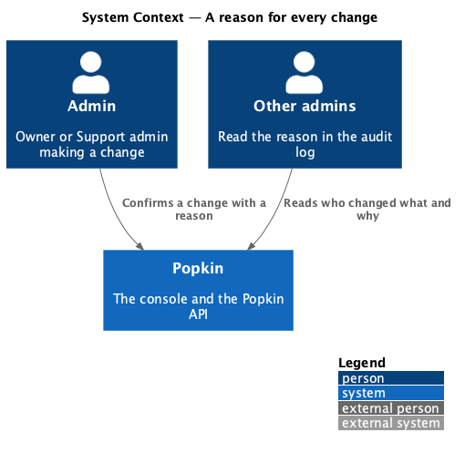
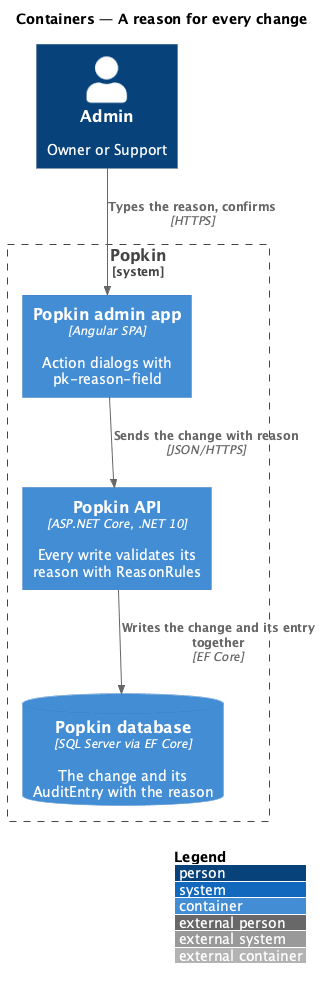
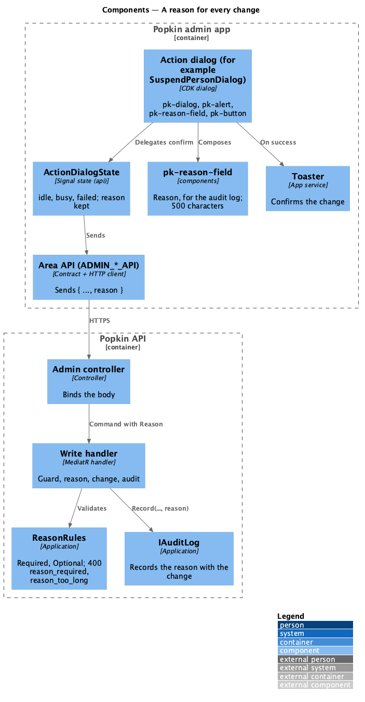
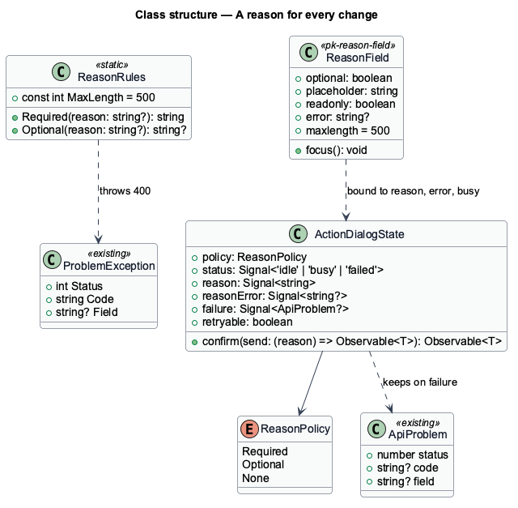
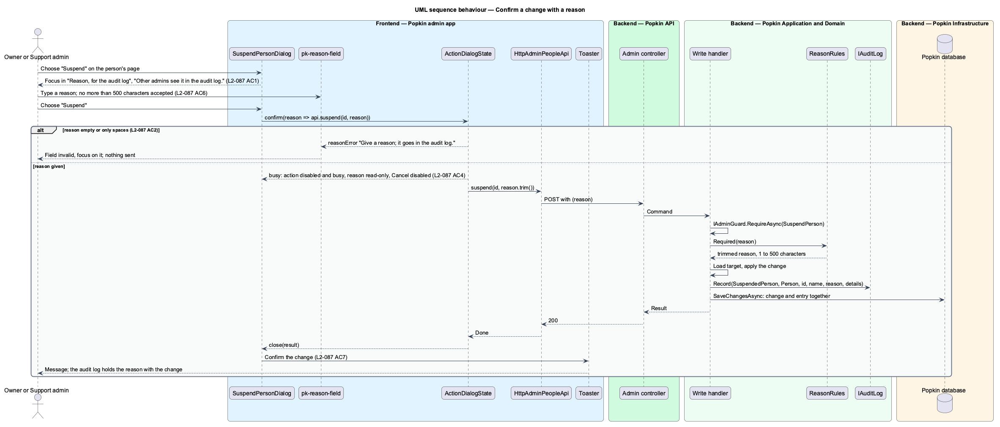
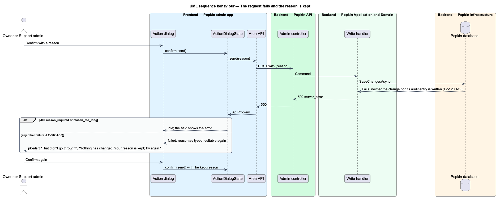
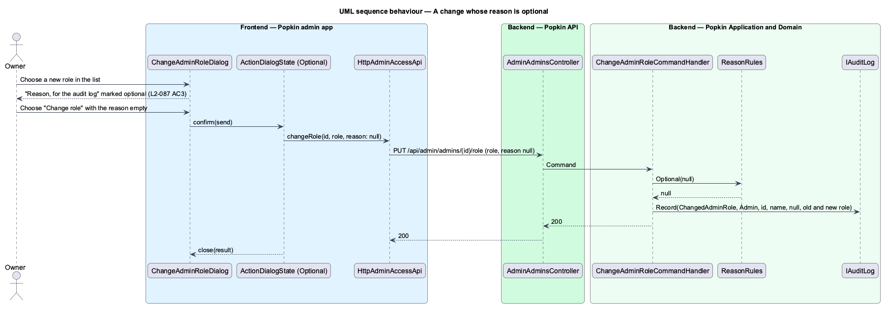

# A reason for every change

## Overview

The console changes production: it suspends people, wraps up Popkins, removes content and
changes limits. Every such change is made in a dialog that asks the admin why, and the answer,
the *reason*, is kept beside the change in the [Audit log](../audit-log/README.md), where every
other admin reads it.

- **reason** — what an admin writes when they change something, kept in the audit log beside
  the change (`docs/specs/L1.md`, Terms)
- **action dialog** — CDK dialog that confirms one admin action: what it will do, the reason
  field, the action and "Cancel"
- **reason policy** — whether an action's reason is required, optional or not asked

Most changes require a reason. Three take an optional one: changing a feature, changing an
admin's role and removing an admin (L2-087 AC3). A few changes have no reason field at all
(listed under [Which changes ask for a reason](#which-changes-ask-for-a-reason)).

The rule has two halves. On the console, one shared behaviour, `ActionDialogState`, and one
shared field, `pk-reason-field`, make every action dialog behave the same way: focus starts in
the reason, an empty required reason sends nothing, a request in flight cannot be sent twice,
and a failure keeps what was typed. On the API, `ReasonRules` validates the reason of every
admin write, so a request that skips the console is held to the same rule. Every action dialog
of the other admin designs is built on this one.

## Description

### Screens and states

The reason field is drawn in every action dialog of `docs/mocks/admin/dialogs/`. The person's
Suspend dialog is the model:

- `docs/mocks/admin/dialogs/person-suspend/default.html` — "Suspend Mara Okafor?", what it does,
  then the field: label "Reason, for the audit log", a two-row `textarea` with a placeholder
  ("e.g. Repeated harassment after a warning"), the hint "Other admins see it in the audit log."
  beneath, then "Suspend" and "Cancel". Focus is in the field (L2-087 AC1).
- `person-suspend/invalid.html` — the field `aria-invalid="true"`, described by its error "Give a
  reason; it goes in the audit log." (L2-087 AC2).
- `person-suspend/busy.html` — the reason read-only, "Suspend" busy and disabled, "Cancel"
  disabled (L2-087 AC4).
- `person-suspend/failed.html` — `pk-alert` "That didn’t go through", "Nothing has changed. Your
  reason is kept; try again.", the reason as typed (L2-087 AC5).
- `docs/mocks/admin/dialogs/admin-change-role/default.html`, `admin-remove/default.html`,
  `turn-off-feature/default.html`, `feature-everyone/default.html` and
  `feature-chosen/default.html` — the label followed by the `optional` marker, and no hint
  (L2-087 AC3).

### Which changes ask for a reason

| Reason | Changes | Source |
|---|---|---|
| Required | suspend a person, lift a suspension, sign a person out, start a deletion, cancel a deletion, export a person's data, log a data request, wrap up a Popkin, give it more time, remove a member, reset an invite, remove content, end a call, save limits | L2-087 AC1, and each dialog's mock |
| Required | open a moderation view | L1-024, the owner's note of 15 November 2026 ("by giving a reason the audit log records"), L2-111 |
| Optional | turn a feature off, on for everyone or on for chosen Popkins; change an admin's role; remove an admin | L2-087 AC3 |
| Not asked | add an admin, publish or end an announcement, dismiss a report, run a job, retry an export, export the audit log or a data export | not listed in L2-087; their mocks have no reason field |

Each command of the other admin designs states its policy with this table; a command whose
change is "Not asked" has no `Reason` in its body.

### API

- **The body** — every admin write whose reason is required or optional carries `reason`
  (string or null) beside its own fields.
- **Failures** — `400` `reason_required` ("Give a reason; it goes in the audit log.") for an
  empty or blank required reason; `400` `reason_too_long` for more than 500 characters. Both
  carry `field` `reason`.

### Backend

- **`ReasonRules`** (`Popkin.Application/Admin/ReasonRules.cs`, new, static) —
  `MaxLength = 500`. `string Required(string? reason)` trims, throws `reason_required` when
  nothing is left, throws `reason_too_long` past 500, and returns the trimmed reason.
  `string? Optional(string? reason)` returns null for null or blank, and otherwise applies the
  same length rule. Length is counted in UTF-16 code units, as the browser's `maxlength` counts
  them. A direct test takes one case per row: null, empty, spaces only, 1 character, 500
  characters, 501 characters, and surrounding spaces trimmed, for both methods.
- **`ReasonPolicy`** (Application, new) — `Required`, `Optional`, `None`; it names a command's
  policy in its documentation and in the console's dialog state.
- **Order** — each write handler calls `IAdminGuard.RequireAsync` first, then `ReasonRules`
  ([Admin roles](../admin-roles/README.md)), so a role that may not act is refused before its
  reason is read.
- **Keeping it** — the handler passes the trimmed reason to `IAuditLog.Record`, which writes it in
  `AuditEntry.Reason` in the same save as the change ([Audit log](../audit-log/README.md),
  L2-087 AC7).
- **Telemetry** — no log line, metric or span carries a reason (ADR 0012).

### Frontend

- **The reason field** — `pk-textarea` (`fieldId` `reason`) with the label "Reason, for the
  audit log", its `optional` marker ("optional") when the policy is `Optional`, the hint "Other
  admins see it in the audit log." when it is `Required`, a `placeholder`, `maxlength`
  `REASON_MAX_LENGTH` (500; no more characters are accepted, L2-087 AC6), `readonly` while busy
  and `error` from `reasonError`. The dialog is opened with `autoFocus: '#reason'`, so focus
  starts in the field (L2-087 AC1). A wrapper component would add nothing `pk-textarea` lacks,
  so the earlier `pk-reason-field` is not built; the name below means this configuration.
- **`ActionDialogState`** (`api/admin/dialogs/action-dialog-state.ts`, new) — created by each
  action dialog with its `ReasonPolicy`. Signals: `status` (`idle` | `busy` | `failed`),
  `reason`, `reasonError`, `failure` (`ApiProblem | null`). `confirm(send)`:
  1. `Required` and the reason blank: sets `reasonError` to "Give a reason; it goes in the audit
     log.", sends nothing, and leaves `status` at `idle` (L2-087 AC2).
  2. Otherwise sets `busy`, calls `send(trimmed reason or null)` once, and ignores a second
     confirm while busy (L2-087 AC4).
  3. Success: returns the answer; the dialog closes with it.
  4. `400` `reason_required` or `reason_too_long`: back to `idle` with the field's error.
  5. Any other failure: `failed`, with the reason kept as typed and editable (L2-087 AC5). A
     dialog may map a known `code` to its own copy (for example `last_owner` in
     [Admins & roles](../manage-admins/README.md)); everything else is the general alert.

  Unit tests (ADR 0011) cover each numbered case for each policy.
- **The dialog frame** — each action dialog (`frontend/projects/admin/src/app/dialogs/{id}/`)
  composes `pk-dialog` (title, description, "Close"), `pk-alert` in its `failed` state ("That
  didn’t go through", "Nothing has changed. Your reason is kept; try again."), its own content,
  `pk-reason-field`, a `pk-button` whose label turns to its busy label ("Suspending…",
  "Changing…", "Removing…"), and "Cancel". While `busy`, the dialog sets `disableClose` so
  Escape, the backdrop, "Close" and "Cancel" do nothing until the answer returns.
- **Confirmation** — the page that opened the dialog shows the success toast through the app's
  `Toaster` (`frontend/projects/admin/src/app/toasts/toaster.ts`, as the Popkin app has one) in
  `pk-toast-region` (L2-087 AC7).

### Decisions

- **Two checks, one rule.** The console stops an empty required reason before sending, and the
  API refuses it again, because the API decides (L2-086) and a request may not come from the
  console.
- **Validation after the role.** A Viewer who sends a blank reason is told `403`, not `400`:
  nothing about an action is checked for a role that may not take it.
- **The failure copy is the requirement's.** The failed states of `admin-change-role` and
  `admin-remove` read "We couldn’t save that." and "Nothing changed. Check your connection and
  try again."; L2-087 AC5 gives "That didn’t go through" and "Nothing has changed. Your reason is
  kept; try again.", which `person-suspend/failed.html` draws. Every action dialog uses the
  requirement's copy and those two mocks change. `admin-add` has no reason and keeps its own
  failure ("We couldn’t send the invite.").
- **Not every write has a reason.** Adding an admin, announcements, running a job, retrying an
  export and the downloads have no reason field in L2-087 or the mocks, so their bodies have no
  `reason`, and their audit entries have `Reason` null.

### Tests

- API test (`Popkin.Api.Tests/Admin/ReasonTests`): one required endpoint answers `400`
  `reason_required` for a blank reason and writes nothing, and keeps a trimmed reason in its
  audit entry; one optional endpoint succeeds without a reason.
- Unit tests (`frontend`): `ActionDialogState`, as above.
- Playwright (`e2e/tests/admin/person-suspend.spec.ts` as the model): focus in the reason; a blank
  reason shows the error and sends nothing; a failure keeps the reason; success shows the toast.
  Parity spec for `pk-reason-field` (required, optional, invalid, read-only).

## Requirements

| L2 ID | Refines (L1) | Requirement |
|-------|--------------|-------------|
| `L2-087` | `L1-028` | A reason for every change: An admin says why they change something, and the audit log keeps it. (AC1–AC7) |

## Diagrams

### System context

An admin confirms a change with a reason; other admins read it in the audit log.

### Containers

The admin app sends the reason with the change; the API validates it and writes it with the
change in one save.

### Components

Each action dialog composes `pk-reason-field` and delegates to `ActionDialogState`; each write
handler validates with `ReasonRules` and records through `IAuditLog`.

### Class structure

`ReasonRules` refuses with `ProblemException`; `ActionDialogState` holds the policy, the status
and the reason that `pk-reason-field` shows.

### Behaviour — confirm a change with a reason

A blank required reason sends nothing; a given one disables the action until the change and its
audit entry are saved, and a message confirms it.

### Behaviour — the request fails

Nothing is written; the dialog stays open with the alert and the reason as typed.

### Behaviour — an optional reason

Changing a role, removing an admin or changing a feature can be confirmed without a reason; the
entry then has none.

