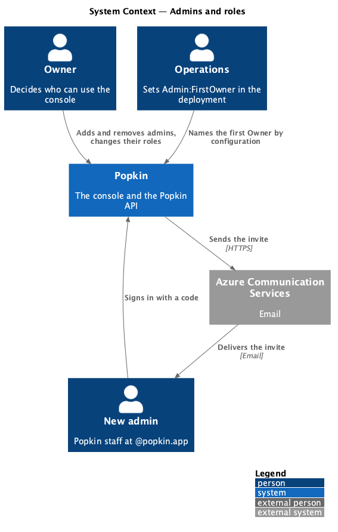
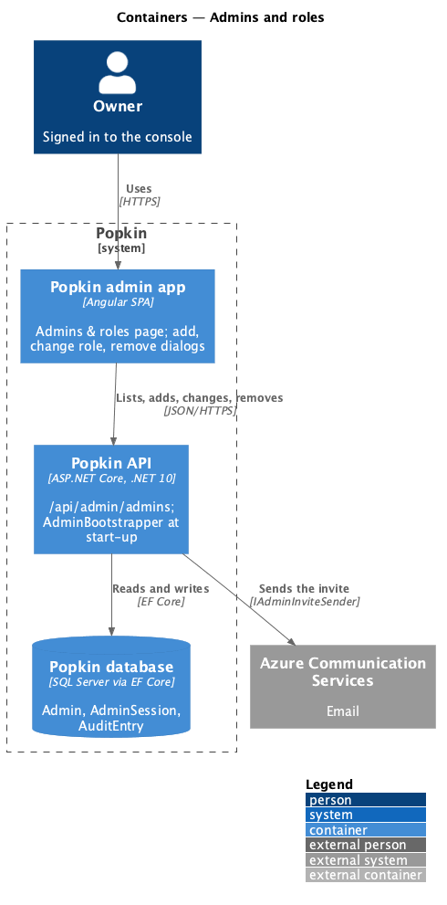
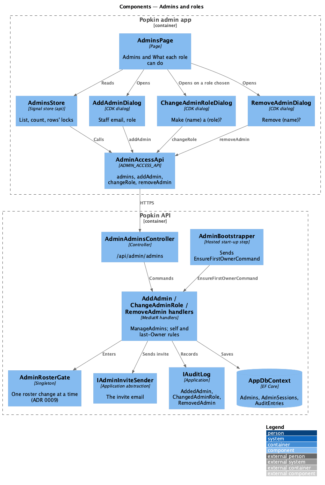
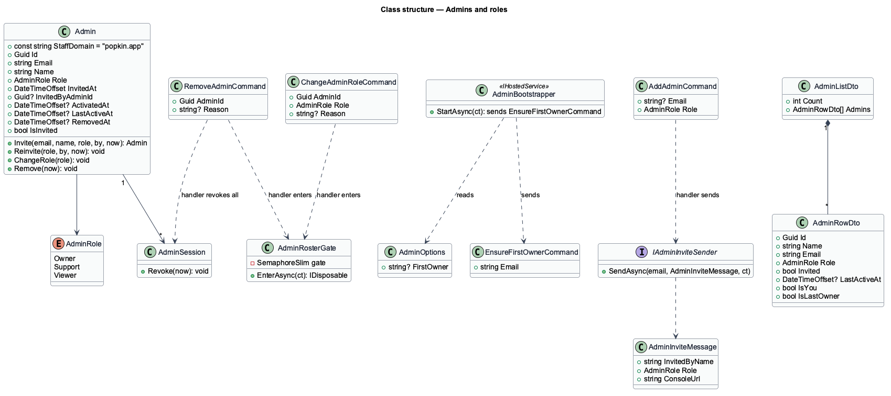
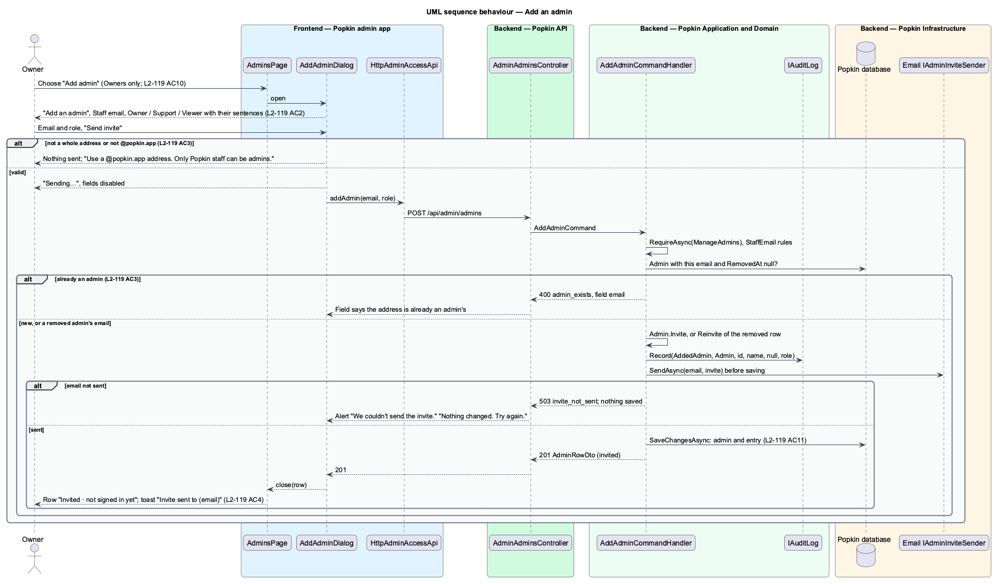
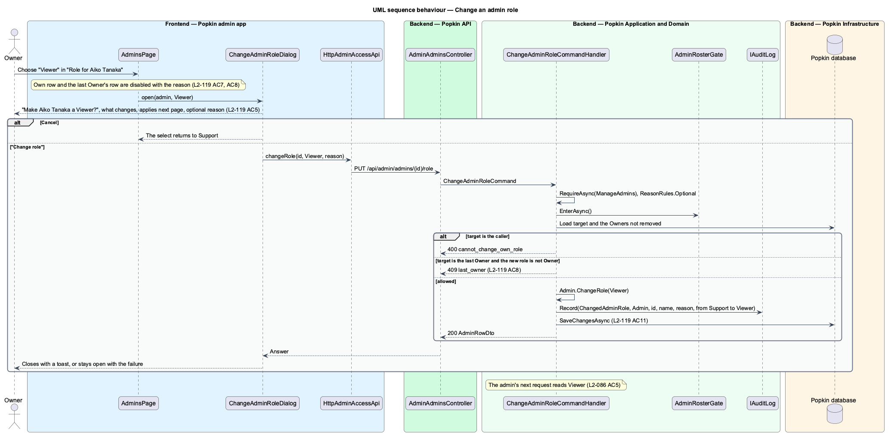
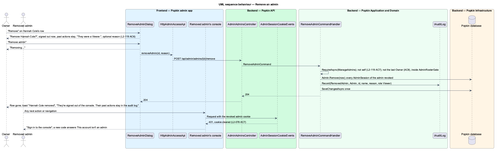
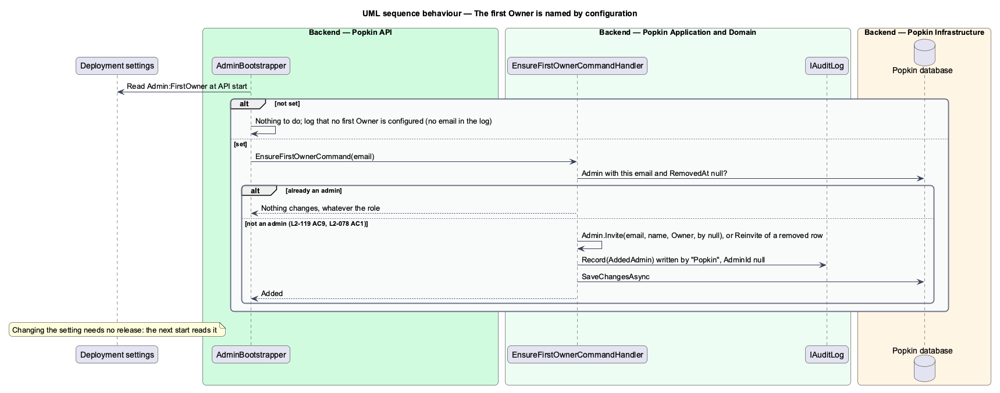

# Admins & roles

## Overview

An Owner decides who can use the console. *Admins & roles* lists everyone who can sign in, with
their role and when they were last active, and lets an Owner add an admin, change an admin's
role and remove an admin. The owner of Popkin settled on 15 November 2026 that configuration
names the first Owner and that Owners manage every other admin in the app
(`docs/specs/L1.md`, Notes).

- **invited admin** — admin who has been added but has not yet signed in with a code
- **active admin** — admin who has signed in at least once
- **last Owner** — the only admin left with the role Owner
- **first Owner** — admin whose staff email the setting `Admin:FirstOwner` names

An admin is added by staff email, at `@popkin.app` only, with one role. They receive an email
that tells them to sign in to the console with a code, and become active at their first sign-in
([Admin sign in](../admin-sign-in/README.md)). A role change applies to the admin's next request
and next page ([Admin roles](../admin-roles/README.md)). A removed admin is signed out of the
console at once and cannot sign back in; their past actions stay in the
[Audit log](../audit-log/README.md) under their name.

Two rules protect the console from locking itself out: an admin cannot change their own role or
remove themselves, and the last Owner can be neither demoted nor removed (L2-119 AC7, AC8). The
first Owner is added at start-up when absent, so a new deployment always has someone who can
add the rest (L2-119 AC9).

## Description

### Screens and states

- `docs/mocks/admin/pages/admins/default.html` — `pk-page-head` "Admins & roles", "5 people can
  sign in to this console", "Add admin"; `pk-segmented-control` "Admins 5" and "What each role can
  do"; `pk-data-table` with Admin (avatar, name, "You" on the signed-in admin's row, email), Role
  (`pk-role-select`, "Role for {name}"), Last active ("Now", "14 min ago", "2 hr ago",
  "Yesterday", "9 Jul") and Actions ("Remove", accessible name "Remove {name}"). The signed-in
  admin's role is shown as text with "You can’t change your own role", and their row has no
  "Remove" (L2-119 AC1, AC7).
- `admins/invited.html` — six people; Priya Raman's row "Invited · not signed in yet"; the toast
  "Invite sent to priya.r@popkin.app", "They’re a Support admin once they sign in with a code."
  (L2-119 AC4).
- `admins/removed.html` — four people; the toast "Hannah Cole removed", "They’re signed out of
  the console. Their past actions stay in the audit log." (L2-119 AC6).
- `admins/roles.html` — "What each role can do" ([Admin roles](../admin-roles/README.md),
  L2-086 AC4).
- `admins/loading.html` ("Loading the admins…"), `admins/error.html` ("Couldn’t load the
  admins", "Try again", "Open Health").
- `admins/viewer.html` — a Viewer: "Add admin", every role select and every "Remove" disabled
  with "Viewer admins can’t do this" (L2-119 AC10). A Support admin sees "Only Owners can do
  this".
- `docs/mocks/admin/dialogs/admin-add/default.html` — "Add an admin", "They’ll get an email to
  sign in with a code. Only @popkin.app addresses can be admins.", "Staff email"
  (placeholder `name@popkin.app`), "Role" as three option cards (block `option-card`: "Owner —
  Everything, including admins, features and limits.", "Support — Helps people and Popkins,
  moderates content.", "Viewer — Reads everything, changes nothing."), "Send invite" and
  "Cancel" (L2-119 AC2). `invalid.html`: "Use a @popkin.app address. Only Popkin staff can be
  admins." (L2-119 AC3). `busy.html`: "Sending…", every control disabled. `failed.html`: "We
  couldn’t send the invite." and "Nothing changed. Try again."
- `docs/mocks/admin/dialogs/admin-change-role/default.html` — "Make Aiko Tanaka a Viewer?", "Aiko
  can still look at everything but can no longer help people, moderate or end calls. It applies
  the next time they open a page.", the optional reason, "Change role" and "Cancel" (L2-119 AC5).
  `busy.html`: "Changing…". `failed.html`: the failure of
  [A reason for every change](../give-a-reason/README.md).
- `docs/mocks/admin/dialogs/admin-remove/default.html` — "Remove Hannah Cole?", "They’re signed
  out of the console now and can’t sign back in. Their past actions stay in the audit log. They
  were a Viewer.", the optional reason, the danger button "Remove admin" and "Cancel"
  (L2-119 AC6). `busy.html`: "Removing…".
- States with no mock, which the design expects, take these defaults (settled 15 November 2026
  under the owner's decision to use the designs' defaults): an address that is already an
  admin's is refused on the field with "{name} is already an admin." ("That address is already
  an admin’s." when the name is not listed); the last Owner's role shows as text titled "The
  console needs at least one Owner."; a `409` `last_owner` in a dialog shows the alert "The
  console needs at least one Owner." with "Nothing changed. Make someone else an Owner first."
  (change) or "Nothing changed. They stay an admin." (remove).
- The change dialog's sentence for each pair of roles: the mock gives Support to Viewer;
  `changeRoleSentence` in `admin-role-text.ts` writes the other pairs in the same form (to Owner:
  "{first} can do everything, including adding and removing admins, features and limits.";
  Owner to Support: "{first} can still help people and Popkins but can no longer change admins,
  features or limits."; Viewer to Support: "{first} can help people and Popkins, moderate
  content and end calls."), each ending "It applies the next time they open a page." The toast
  after a role change reads "{name} is now a {role}".

### API

`AdminAdminsController` (new), under `/api/admin/admins`:

- **`GET /api/admin/admins`** — any admin. `200` `AdminListDto`: `count` (admins not removed,
  invited included: "{n} people can sign in to this console") and `admins` (`AdminRowDto`: `id`,
  `name`, `email`, `role`, `invited`, `lastActiveAt`, `isYou`, `isLastOwner`), the caller first,
  then by name.
- **`POST /api/admin/admins`** — body `{ email, role }`; `201` `AdminRowDto`. Requires
  `ManageAdmins`. Failures: `400` `email_invalid`, `400` `email_not_staff` (not at
  `@popkin.app`), `400` `admin_exists` (an admin not removed has it), each with `field` `email`
  (L2-119 AC3); `503` `invite_not_sent`; `403` `role_not_allowed`. Adding an admin takes no
  reason (L2-087).
- **`PUT /api/admin/admins/{adminId}/role`** — body `{ role, reason }` (reason optional,
  L2-087 AC3); `200` `AdminRowDto`. Failures: `400` `cannot_change_own_role` (L2-119 AC7); `409`
  `last_owner` (L2-119 AC8); `404` `admin_not_found`; `400` `reason_too_long`; `403`
  `role_not_allowed`. The same role as now answers `200` and writes nothing.
- **`POST /api/admin/admins/{adminId}/remove`** — body `{ reason }` (optional); `204`.
  Failures: `400` `cannot_remove_self`; `409` `last_owner`; `404` `admin_not_found`; `403`
  `role_not_allowed`. A `POST` to a named action, not `DELETE` with a body, because the request
  carries a reason and the admin's row is kept.

### Backend

- **`Admin`** (Domain; fields in [Admin roles](../admin-roles/README.md)) — behaviour this design
  adds:
  - `Admin.Invite(email, name, role, invitedBy, now)` — `StaffDomain = "popkin.app"`; the email
    is normalised (trimmed, lower case) and shall end in `@popkin.app`.
  - `Reinvite(role, invitedBy, now)` — clears `RemovedAt`, `ActivatedAt` and `LastActiveAt` of
    a removed admin's row and sets the new role, so a person who returns keeps one id and one
    history in the audit log.
  - `ChangeRole(role)`; `Remove(now)` sets `RemovedAt`; `IsInvited` is `ActivatedAt == null`.
  - A unique index covers `Email` among rows with `RemovedAt` null.
- **`Admin.Name`** — `<TO SUPPLY>`. The add dialog asks for an email and a role only, the sign-in
  asks for no name, and yet the list and the audit log name each admin, an invited one included
  ("Priya Raman"). Where the name comes from (a field in "Add an admin", the first sign-in, or a
  staff directory) is undecided, as is the first Owner's (a setting beside `Admin:FirstOwner`).
  Until it is decided, the name is the email's local part.
- **`AddAdminCommand`** / handler (Application, new) — `RequireAsync(ManageAdmins)`; validates the
  email (`email_invalid`, `email_not_staff`); refuses `admin_exists`; calls `Admin.Invite`, or
  `Reinvite` on a removed admin's row; records `AddedAdmin` with `Details` `{ role }`; sends the
  invite through `IAdminInviteSender`; then saves. When the email cannot be sent the handler
  throws `503` `invite_not_sent` before saving, so nothing changes, as the failed mock says.
- **`IAdminInviteSender`** (Application, new) — `SendAsync(email, AdminInviteMessage, ct)`,
  `AdminInviteMessage(InvitedByName, Role, ConsoleUrl)`, throws `AdminInviteNotSentException`.
  `CommunicationAdminInviteSender` (Infrastructure, beside `CommunicationSenders`) sends it by
  Azure Communication Services email (ADR 0021); in Development the invite is written to the log
  without the email address, as codes are. The email's copy is `<TO SUPPLY>`. The console's
  address comes from the new setting `Admin:Origin`.
- **`ChangeAdminRoleCommand`** / handler (Application, new) — `RequireAsync(ManageAdmins)`,
  `ReasonRules.Optional`, then inside `AdminRosterGate`: load the target (`404` when missing or
  removed); refuse the caller's own row; refuse `last_owner` when the target is an Owner, the new
  role is not, and no other Owner is left; `ChangeRole`; record `ChangedAdminRole` with `Details`
  `{ from, to }`; save (L2-119 AC5, AC11).
- **`RemoveAdminCommand`** / handler (Application, new) — the same order; refuse self and
  `last_owner`; `Admin.Remove(now)`; revoke every live `AdminSession` of the admin; record
  `RemovedAdmin` with `Details` `{ role }`; one save (L2-119 AC6, AC11). The admin's next request
  fails the cookie check with `401` (L2-078 AC7).
- **Who counts as an Owner** — every admin with the role Owner and `RemovedAt` null, invited or
  active. An Owner can act only on another admin's row, so an Owner always remains while one
  acts; the last-Owner rule guards against two Owners changing each other at the same moment.
- **`AdminRosterGate`** (Application, new, singleton) — a `SemaphoreSlim(1)` that every role
  change and removal enters, so two concurrent changes cannot both pass the last-Owner check.
  It holds for one API instance, which ADR 0009 makes the deployment.
- **`Admin:FirstOwner`** (setting, new) — the first Owner's staff email; added to
  `docs/deployment.md` (ADR 0013). Bound by `AdminOptions` (Application).
- **`AdminBootstrapper`** (`Popkin.Api`, new, `IHostedService`) — at start-up it sends
  `EnsureFirstOwnerCommand(email)` when the setting is set. The handler adds the email as an
  Owner when no admin with `RemovedAt` null has it, or reinvites a removed row, and records
  `AddedAdmin` with `AdminId` null and `AdminName` "Popkin" ([Audit log](../audit-log/README.md)).
  It changes nothing when the email is already an admin, whatever the role (L2-119 AC9,
  L2-078 AC1). A changed setting takes effect at the next start of the API, with no release. The
  database shall be migrated before the API starts (`popkin migrate`); the bootstrapper writes
  rows and applies no migration.
- **Telemetry** — no log line, metric or span carries an admin's email or name.

### Frontend (Popkin admin app)

- **`AdminsPage`** (`pages/admins/admins.page.ts` + `.html`, route `/admins`, `page: 'admins'`)
  — composes `pk-page-head`, `pk-segmented-control` (Admins, What each role can do),
  `pk-data-table`, `pk-avatar`, `pk-badge` ("You"), `pk-role-select`, `pk-button`,
  `pk-permission-table`, `pk-skeleton` and `pk-empty-state`. Choosing a role in a row opens
  `ChangeAdminRoleDialog`; "Cancel" returns the select to the admin's role.
- **`AdminsStore`** (`api/admin/access/admins.store.ts`, new) — `admins`, `count`, `status`,
  `roles` (the roles view), `load()`, and `rowLock(row)`: `self` ("You can’t change your own
  role"), `lastOwner` (`<TO SUPPLY>` copy), or the role's `blockedReason(ManageAdmins)`
  ([Admin roles](../admin-roles/README.md)). It replaces or removes a row from a dialog's result.
- **`admin-role-text.ts`** (`api/admin/access/`, new, pure) — each role's sentence, the change
  dialog's sentence per pair of roles, and `lastActiveText(lastActiveAt, invited, now)` ("Now"
  under a minute, "{n} min ago", "{n} hr ago", "Yesterday", "9 Jul", "Invited · not signed in
  yet"). Unit tests cover each case.
- **`AddAdminDialog`** (`dialogs/admin-add/`) — `pk-dialog`, `pk-text-field` ("Staff email",
  `type="email"`, `autocomplete="off"`), three option cards in a `radiogroup` labelled "Role"
  (block `option-card`; `pk-choice-card` draws it if its parity spec passes, otherwise a new
  `pk-option-card`), `pk-alert` for the failure, "Send invite" ("Sending…") and "Cancel". It
  checks a whole address at `@popkin.app` before sending (L2-119 AC3) and maps `400`
  `email_not_staff` and `admin_exists` to the field. It has no reason field.
- **`ChangeAdminRoleDialog`** (`dialogs/admin-change-role/`) and **`RemoveAdminDialog`**
  (`dialogs/admin-remove/`) — built on `ActionDialogState` with the policy `Optional` and
  the reason field ([A reason for every change](../give-a-reason/README.md)). Each maps `409`
  `last_owner` to its own alert and reloads the list.
- **Toasts** — through the app's `Toaster`: the invite's and the removal's copy from the mocks;
  the role change's `<TO SUPPLY>`.
- **`AdminAccessApi`** (`ADMIN_ACCESS_API`) — `admins()`, `addAdmin(email, role)`,
  `changeRole(id, role, reason)`, `removeAdmin(id, reason)`, `roles()`, and the audit calls.

### Decisions

- **The invite is sent before the save.** The failed mock says "Nothing changed": an admin row
  without a sent invite would be a change. A save that fails after the email was sent leaves an
  email whose sign-in answers "This account isn't an admin", which harms nothing.
- **A removed admin's row is kept.** The audit log keeps names in its entries, and the row keeps
  `InvitedByAdminId` and the dates. Adding the same email again reuses the row.
- **The first Owner returns at start-up.** L2-119 AC9 adds the configured email "when that email
  is not an admin", so removing the first Owner holds only until the API next starts while
  `Admin:FirstOwner` still names them. To retire the first Owner, operations change the setting.
  This is the console's recovery path when every Owner is lost.
- **An invited Owner counts as an Owner** for the last-Owner rule. An Owner who acts is always
  another Owner, so the rule cannot strand the console while that Owner remains.

### Tests

- API tests (`Popkin.Api.Tests/Admin/ManageAdminsTests`): an Owner adds a Support admin, who is
  listed as invited, gets an invite (a fake `IAdminInviteSender`) and becomes active at first
  sign-in; a non-staff or existing email is refused; a failed invite saves nothing; a role change
  and a removal write their audit entries; the removed admin's next request is `401`; an Owner
  cannot change their own role or remove themselves; the last Owner cannot be demoted or removed;
  a Support or Viewer admin is `403`. A handler test runs two role changes at once and shows one
  is refused `last_owner`.
- Start-up test (`ApiFactory` with `Admin:FirstOwner` set): the email is an Owner after start;
  a second start adds nothing.
- Unit tests (`frontend`): `AdminsStore.rowLock`, `admin-role-text.ts`.
- Playwright (`e2e/tests/admin/admins.spec.ts`, page objects `e2e/pages/admin/admins.page.ts`,
  `admin-add.dialog.ts`, `admin-change-role.dialog.ts`, `admin-remove.dialog.ts`): each state of
  the mocks. Parity specs for `pk-role-select` and the option card.

## Requirements

| L2 ID | Refines (L1) | Requirement |
|-------|--------------|-------------|
| `L2-119` | `L1-028` | Admins & roles: An Owner decides who can use the console. (AC1–AC11) |
| `L2-078` | `L1-012` | Admin access: Only admins reach the admin app, and the admin app reaches a Popkin's content only as moderation allows. (AC1, AC7) |
| `L2-087` | `L1-028` | A reason for every change: An admin says why they change something, and the audit log keeps it. (AC3, for a role change and a removal) |

## Diagrams

### System context

Operations name the first Owner; Owners add, change and remove admins; a new admin receives the
invite by email and signs in with a code.

### Containers

The admin app manages admins through `/api/admin/admins`; the API keeps them in the database and
sends the invite through Azure Communication Services.

### Components

Three dialogs reach three handlers that require `ManageAdmins`, pass through `AdminRosterGate`,
and record through `IAuditLog`; `AdminBootstrapper` adds the first Owner.

### Class structure

`Admin` carries the invite, role change and removal; the commands, the invite sender and the
gate surround it.

### Behaviour — add an admin

A non-staff or existing email is refused at the field; a failed email saves nothing; success
lists the admin as invited.

### Behaviour — change a role

The admin's own role and the last Owner's role cannot change; a change is recorded and applies to
the admin's next request.

### Behaviour — remove an admin

The admin's sessions end in the same save, so their next request is refused and they are back at
the sign-in.

### Behaviour — the first Owner

At start-up the configured email is added as an Owner when it is not an admin.

