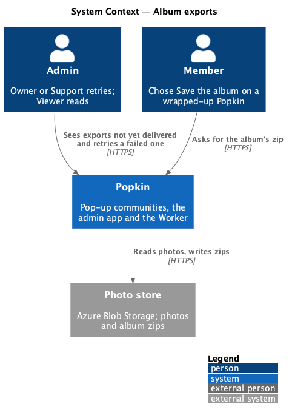
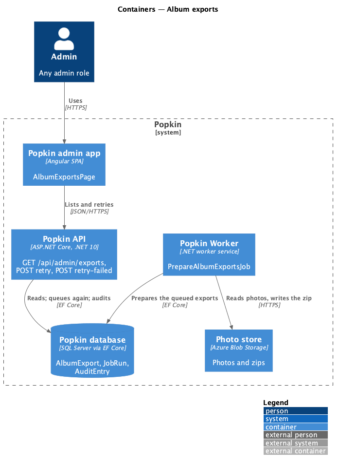
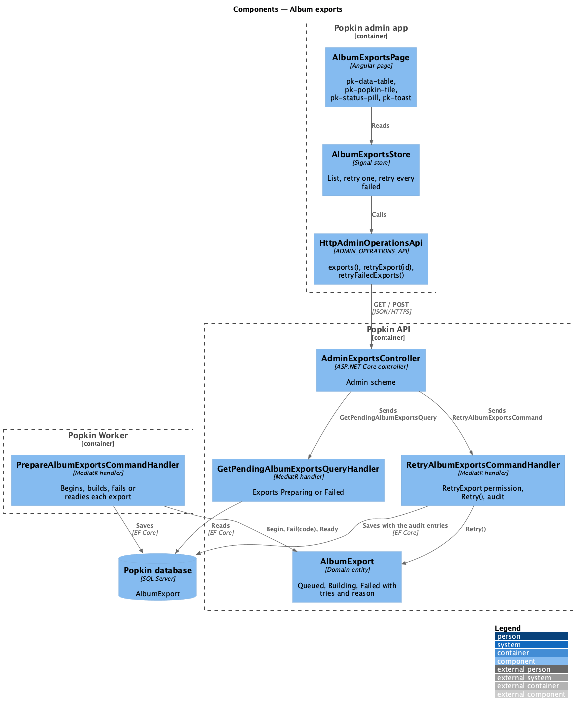
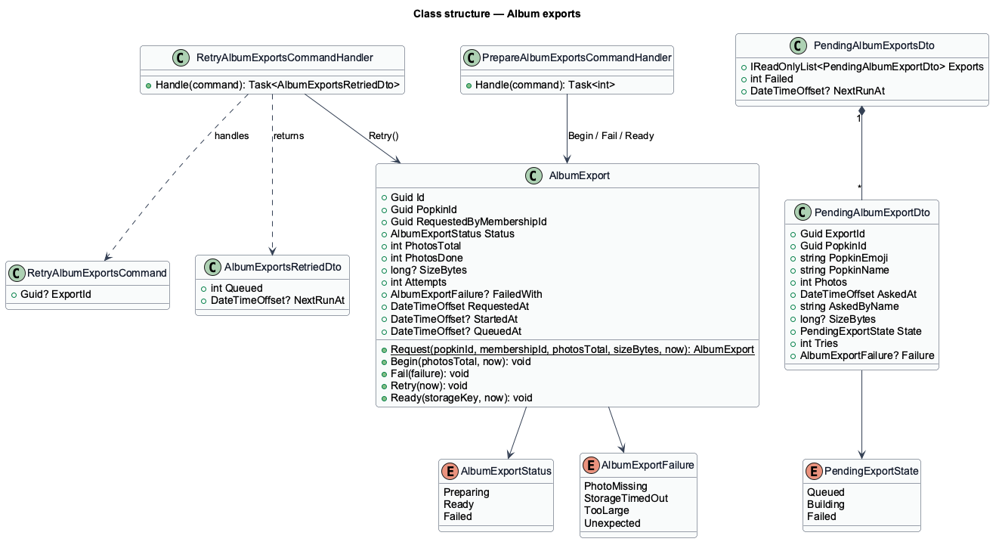
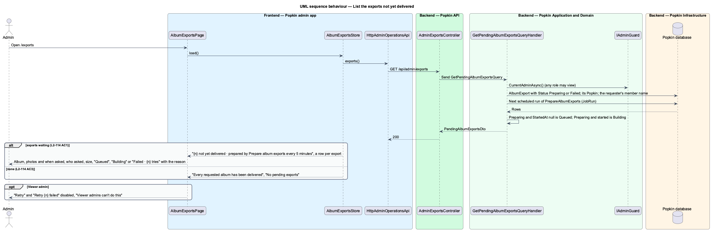
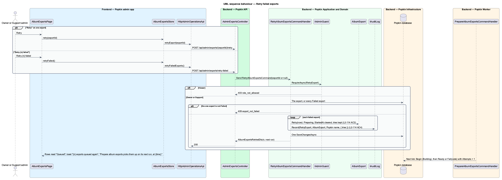

# Album exports

## Overview

*Album exports* is the admin page at `/exports` that lists every album export asked for and not
yet delivered, and lets an Owner or Support admin queue a failed one again. An album export is
the zip of a wrapped-up Popkin's photos that a member asks for with "Save the album" (L2-046
AC4); the Worker's job Prepare album exports (`PrepareAlbumExportsJob`) builds it from the photo
store, and the member downloads it once it is ready.

- **album export** — the `AlbumExport` row of one zip: its Popkin, the member who asked, the
  photos to put in it and its status
- **delivered** — ready: the zip is in the photo store and the member can download it
- **queued** — waiting for the job to begin it
- **building** — begun by the job and not yet ready
- **failed** — the job's last attempt to build it ended in an error; it waits for a retry
- **try** — one attempt of the job to build an export

Today an export is `Preparing`, `Ready` or `Failed`. A failure is final: the export keeps
`Failed`, and a member who asks again starts a new export. The domain records no tries, no reason
for a failure and no size. This design adds those, lets a retry queue the same export again, and
makes a member's new ask reuse a failed export instead of starting another, so each album has one
row an admin can follow.

## Description

### Screens and states

- `docs/mocks/admin/pages/exports/default.html` — "Album exports", "4 not yet delivered · prepared
  by Prepare album exports every 5 minutes", the button "Retry 2 failed" in the page head; a
  `data-table` with the columns Album, Asked by, Size, Status, Action. Each row: `popkin-tile`
  with the emoji, the Popkin's name and `who__sub` "{n} photos · {when}"; the asker; the size
  (`data-table__num`, "6.2 GB"); a `status` pill "Failed · 3 tries" (`status--bad`) with
  `cell-error` "Archive exceeded the 5 GB part limit", "Building" (`status--info status--busy`) or
  "Queued"; and "Retry" on a failed row (L2-114 AC1).
- `retried.html` — every failed row "Queued", its time "Just now", "Retry 2 failed" gone, and the
  success `toast` "2 exports queued again", "Prepare album exports picks them up on its next run,
  at 10:45." (L2-114 AC2).
- `viewer.html` — "Retry" and "Retry 2 failed" `disabled` with "Viewer admins can't do this".
- `empty.html` — "Every requested album has been delivered", `empty` "No pending exports", "When a
  member downloads an album, it waits here until its zip is ready." (L2-114 AC3).
- `loading.html`, `error.html` — L2-089 AC7.

### Conflicts and gaps

- **Every 5 minutes.** L2-114 AC1 and the mock say the job prepares exports every 5 minutes; the
  code ticks every 2 seconds so that "Save the album" begins almost at once (L2-046 AC4). The page
  shows the job's real period from `JobCatalogue` ([Jobs](../jobs/README.md), which states the
  conflict and its effect).
- **Parts.** The mock's reason "Archive exceeded the 5 GB part limit" and the Jobs log's "part 2
  of 2" describe a zip in parts. `PrepareAlbumExportsCommandHandler` writes one zip. A part size,
  and whether the zip is split, are `<TO SUPPLY>`; the design's reasons are the failures the code
  can meet today.
- **Automatic retries.** "Failed · 3 tries" suggests the job tries again by itself. Whether it
  does, how many times and how far apart is `<TO SUPPLY>`. In this design a try is counted at each
  begin, whether the job, a member's new ask or an admin queued it.
- **No reason for a retry.** L2-087 AC1 does not list a retry among the dialogs that take a
  reason, and the mock retries with no dialog. The design follows the requirement: the audit entry
  has an empty `Reason`. The shared admin rule that every write carries a reason is in conflict.

### API

- `GET /api/admin/exports` → `200` `PendingAlbumExportsDto`: `failed` (count), `nextRunAt` (the
  next scheduled run of Prepare album exports, from `JobRun`), and `exports[]` of
  `PendingAlbumExportDto`, newest ask first: `exportId`, `popkinId`, `popkinEmoji`, `popkinName`,
  `photos` (`PhotosTotal`), `askedAt` (`QueuedAt`, so a retried export reads "Just now"),
  `askedByName` (the asking member's name in that Popkin), `sizeBytes` (may be empty), `state`
  (`Queued`, `Building`, `Failed`), `tries`, `failure`. Admin scheme; any role.
- `POST /api/admin/exports/{exportId}/retry` → `200` `AlbumExportsRetriedDto` (`queued`: 1,
  `nextRunAt`). Failures: `403` `role_not_allowed`; `404` `export_not_found`; `409`
  `export_not_failed` when it is no longer failed.
- `POST /api/admin/exports/retry-failed` → `200` `AlbumExportsRetriedDto` (`queued`: how many,
  possibly 0, and `nextRunAt`). `403` `role_not_allowed`.
- Neither takes a body.

### Backend

- **`AlbumExport`** (changed) —
  - `Attempts` (`int`), raised by `Begin`.
  - `FailedWith` (`AlbumExportFailure?`, new enum: `PhotoMissing`, `StorageTimedOut`, `TooLarge`,
    `Unexpected`), set by `Fail(failure)` and cleared by `Retry`. The page words it: "A photo of the
    album is missing from storage", "Storage timed out reading the photos", "The album is too large
    to zip", "Something went wrong building the zip". The copy is `<TO SUPPLY>` beyond the mock's
    examples, and no reason carries a file name, key or person.
  - `StartedAt?` — set by `Begin`, cleared by `Retry`: `Preparing` with no `StartedAt` is Queued,
    with one is Building.
  - `QueuedAt` — the time it last entered the queue: `RequestedAt` at first, then each retry.
  - `SizeBytes` (`long?`) — the sum of the album's photo sizes at the ask. It needs
    `Photo.SizeBytes` (new, set at upload; migration `AddPhotoSizes`). How existing photos get a
    size, from the photo store's blob properties or not at all, is `<TO SUPPLY>`; an unknown size
    shows "—".
  - `Retry(now)` — only from `Failed`: back to `Preparing`, `StartedAt` and `FailedWith` cleared,
    `QueuedAt = now`, `Attempts` kept.
  - Migration `AddAlbumExportTries` for the new columns; existing exports get `Attempts` 1 when
    failed or ready, 0 otherwise.
- **`PrepareAlbumExportsCommandHandler`** (changed) — `Begin` gains `now`; the catch maps the
  exception to an `AlbumExportFailure` (a missing photo, a storage timeout, a size limit, anything
  else `Unexpected`) and calls `Fail(failure)`. The log line keeps the export's id alone.
- **`StartAlbumExportCommandHandler`** (changed) — a member's ask for an album whose export
  `Failed` calls `Retry` on that export instead of adding a new one.
- **`GetPendingAlbumExportsQuery`** / **`GetPendingAlbumExportsQueryHandler`**
  (`Popkin.Application/Admin/Operations/`) — `IAdminGuard.CurrentAdminAsync()`; exports with
  `Status` `Preparing` or `Failed`, joined to `PopkinSpace` and the requester's `Membership`.
- **`RetryAlbumExportsCommand`** (`ExportId?`) / **`RetryAlbumExportsCommandHandler`** —
  `IAdminGuard.RequireAsync(AdminAction.RetryExport)`; one export (`404`, `409`) or every failed
  export; `Retry(now)` on each and, for each, `IAuditLog.Record` with `AuditAction.RetryExport`,
  `TargetKind` `AlbumExport`, `TargetId` the export, `TargetName` the Popkin's name and `Details {
  tries }` (L2-114 AC4); one `SaveChangesAsync`. A bulk retry writes one entry per export, so the
  audit log can be searched by Popkin.
- **`AdminExportsController`** — the three endpoints, admin scheme.
- "Exports in progress" on the [Dashboard](../../admin-overview/dashboard/README.md) counts the
  `Preparing` exports, Queued and Building together; the shell's waiting count is the `Failed`
  ones (`AdminWaitingDto.failedExports`).

### Frontend (Popkin admin app)

- **`AlbumExportsPage`** (`frontend/projects/admin/src/app/pages/exports/`), route `/exports`,
  route data `page: 'exports'`. It composes `pk-page-head` with the summary and, when any failed,
  `pk-button` "Retry {n} failed"; `pk-panel` with `pk-data-table`: `pk-popkin-tile`, the asker,
  the size, `pk-status-pill` and the failure's words under it, and "Retry" on a failed row;
  `pk-empty-state` when nothing waits.
- Both retry buttons are disabled for a role whose `allowed` lacks `RetryExport`, with "Viewer
  admins can't do this". While a retry is sent its button is busy; on failure `pk-toast` (error)
  says "That didn't go through" and the rows stay as they were.
- **`AlbumExportsStore`** (`frontend/projects/api/src/lib/admin/operations/album-exports.store.ts`)
  — the list and load state; `retry(id)` and `retryFailed()` replace the rows from a fresh read
  after the answer. No polling; the page reads on open and after each retry. Unit tested.
- **`exports-text.ts`** — the summary, "{n} photos · {when}" ("2 hr ago", "Just now"), sizes ("6.2
  GB", "88 MB"), "Failed · {n} tries" ("1 try"), the failure's words, and the toast ("{n} exports
  queued again", "Prepare album exports picks them up on its next run, at {time}."). Unit tested.
- **`HttpAdminOperationsApi`** gains `exports()`, `retryExport(id)` and `retryFailedExports()`.

## Requirements

| L2 ID | Refines (L1) | Requirement |
|-------|--------------|-------------|
| `L2-114` | `L1-025` | Album exports: Every album export asked for and not yet delivered. (AC1–AC4) |
| `L2-090` | `L1-021` | Dashboard: The dashboard says how Popkin is doing and what is waiting. (AC5, exports in progress) |
| `L2-089` | `L1-028` | The admin shell: Every page of the console shares one frame, on every screen size. (AC3, AC7) |

## Diagrams

### System context

A member asks for an album's zip; an admin follows the exports not yet delivered and retries a
failed one.

### Containers

The API lists and queues exports again; the Worker builds them from the photo store; both meet in
the database.

### Components

The retry handler and the Worker's handler both change `AlbumExport` through its methods; the list
handler only reads.

### Class structure

`AlbumExport` gains tries, the failure, a start time, a queue time and a size; the admin view maps
it to Queued, Building or Failed.

### Behaviour — list the exports not yet delivered

The page lists `Preparing` and `Failed` exports with their state and tries, or says every album has
been delivered.

### Behaviour — retry failed exports

One retry or all at once: each export is queued again with an audit entry, and the toast names the
job's next run.

