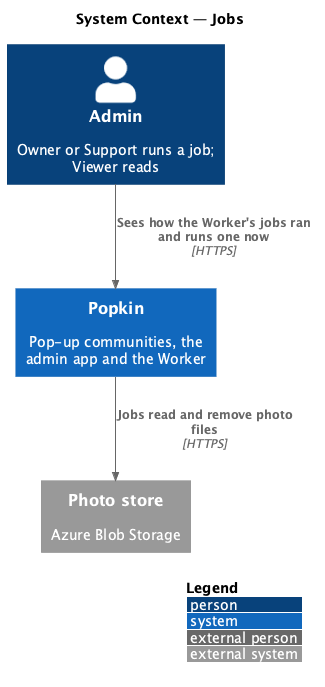
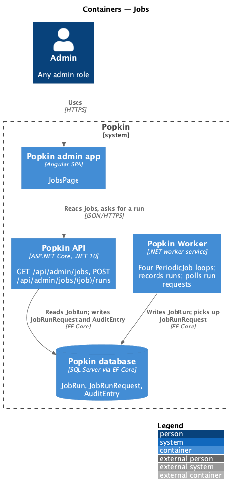
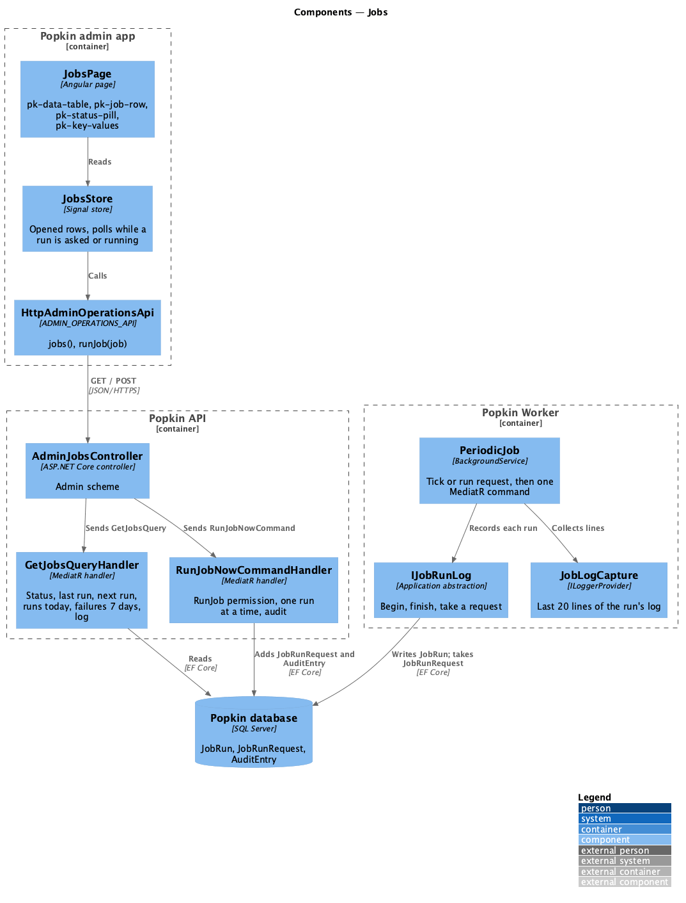
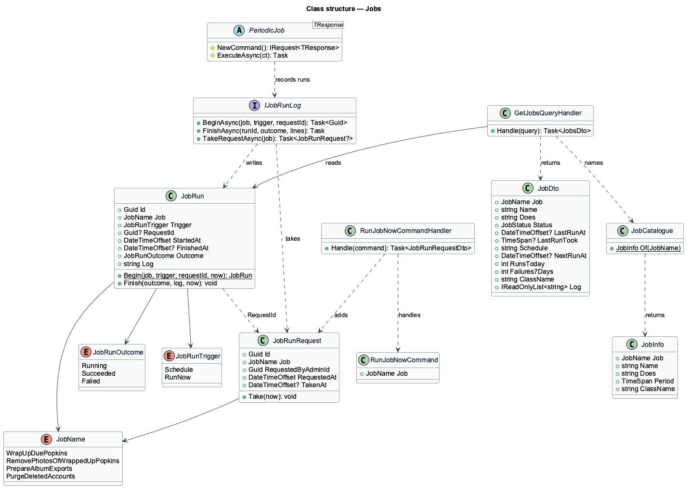
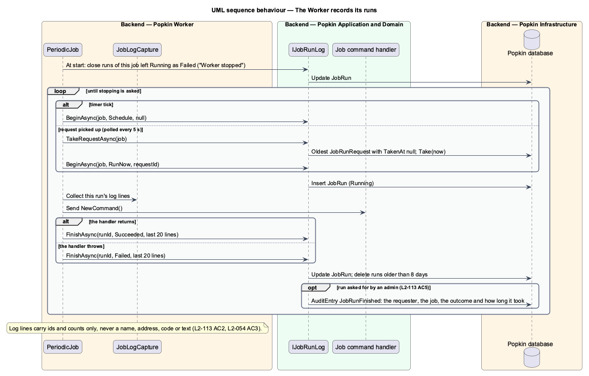
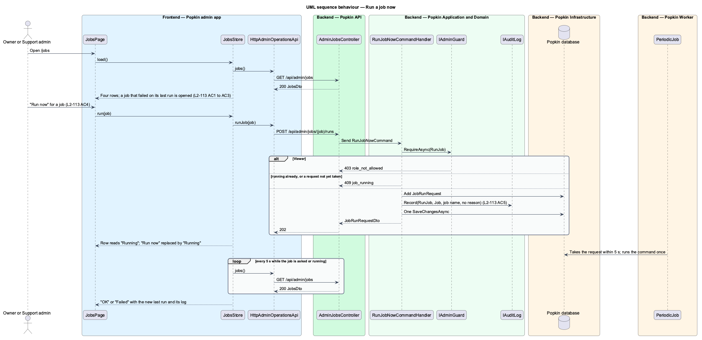

# Jobs

## Overview

*Jobs* is the admin page at `/jobs` that shows the Popkin Worker's jobs, how each last ran, and
lets an Owner or Support admin run one now. The Worker (`Popkin.Worker`) is a separate .NET
process with no HTTP surface and no hub connection (ADR 0015); it hosts four jobs today, each a
`PeriodicJob` loop that sends one MediatR command per tick.

- **job** — one loop the Worker hosts, named for what it does: Wrap up due Popkins, Remove photos
  of wrapped-up Popkins, Prepare album exports, Purge deleted accounts
- **run** — one execution of a job's command, from its start to its outcome
- **job run** — the stored record of a run: the job, what started it, when, how long, the outcome
  and the last lines of its log
- **run request** — an admin's ask that a job run once now, stored for the Worker to take

The API cannot call the Worker and the Worker cannot call the API. The database is the one thing
both share, so it carries both directions: the Worker writes a `JobRun` row for every run, which
the API reads; the API writes a `JobRunRequest` row for "Run now", which the Worker polls for and
takes. No backplane and no new channel are added, and ADR 0015 stands.

## Description

### Screens and states

- `docs/mocks/admin/pages/jobs/default.html` — "Jobs", "4 Worker jobs · 1 failed on its last
  run"; a `data-table` with the columns Job, Status, Last run, Schedule, Action; each row a
  `job__toggle` (`aria-expanded`, `aria-controls`), `job__name`, `job__does` ("Wraps up Popkins
  whose time is up", "Removes albums that weren't kept", "Zips albums for download", "Erases
  accounts 30 days after deletion"), a `status` pill ("OK", "Failed"), the last run ("10:40 · 1 m
  12 s"), the schedule ("Every minute", "Hourly", "Every 5 min", "Daily, 03:00") and "Run now".
  The failed job is open: `job-detail` with `kv` "Next run", "Runs today", "Failures, 7 days",
  "Class" (`PrepareAlbumExportsJob`) and `job-detail__log`, three log lines (L2-113 AC2, AC3).
- `collapsed.html` — every row closed.
- `running.html` — "4 Worker jobs · all healthy"; Prepare album exports reads "Running" (`status
  --info status--busy`), last run "Now · —", and its action "Running" in place of "Run now"
  (L2-113 AC4).
- `viewer.html` — every "Run now" `disabled` with "Viewer admins can't do this".
- `loading.html`, `error.html` — L2-089 AC7. No empty state: the Worker always hosts its jobs.
- The mock's log names an album ("export of Ellie & Walt's Wedding"). L2-113 AC2 says the log
  carries no personal data, and a Popkin's name is something a member typed. The design's log
  lines carry ids and counts only; the mock should change.

### Conflicts

- **More jobs than four.** L2-113 names four jobs. Other admin features need Worker work: the data
  export of a person (`AdminAction.ExportPersonData`, designed in the admin people subsystem) and the
  purge of audit entries older than two years (L2-120). If either becomes a Worker job, Jobs
  lists it too. The design keeps the job list in one place, `JobCatalogue`, so a fifth row costs
  one entry; the requirement and its mock name four, and the requirement stands until it is
  changed.
- **The schedules in the mock are not the code's.** `WrapUpDuePopkinsJob` runs every 30 seconds
  (mock: "Every minute"); `PrepareAlbumExportsJob` every 2 seconds (mock and L2-114 AC1: "Every 5
  min"); `PurgeDeletedAccountsJob` every day from the Worker's start (mock: "Daily, 03:00"). The
  page shows each job's real period from `JobCatalogue`. Following L2-114, Prepare album exports
  moves to every 5 minutes; that conflicts with L2-046 AC4 ("Save the album" begins almost at
  once) and `docs/deployment.md` ("every 2 seconds"), and the choice is the owner's. A run at a
  fixed time of day ("03:00") is not something `PeriodicJob` does; it is `<TO SUPPLY>`.
- **No reason for "Run now".** The shared admin rule gives every write a reason. L2-087 AC1 lists
  the dialogs that take one, and "Run now" is not among them; the mock runs a job with no dialog.
  The design follows the requirement: no reason, and the audit entry's `Reason` is empty.
- **Runs every 2 seconds.** At its present period Prepare album exports would write 43,200 runs a
  day. At 5 minutes it writes 288. Should the 2-second period stay, the design records only the
  ticks that found work.

### API

- `GET /api/admin/jobs` → `200` `JobsDto`: `failed` (how many jobs failed on their last run) and
  `jobs[]` of `JobDto` in the order of L2-113 AC1: `job` (`JobName`), `name`, `does`, `status`
  (`Ok`, `Running`, `Failed`, `NeverRun`), `lastRunAt`, `lastRunTook`, `schedule` (the period in
  words), `nextRunAt`, `runsToday` (London day), `failures7Days`, `className`, `log` (the last
  run's lines), `requested` (a run request not yet taken). Admin scheme; any role.
- `POST /api/admin/jobs/{job}/runs` → `202` `JobRunRequestDto` (`requestId`, `job`, `requestedAt`).
  No body. Failures: `403` `role_not_allowed` (Viewer); `404` `job_not_found`; `409` `job_running`
  when the job's last run is `Running` or a request for it is not yet taken (L2-113 AC4).

### Backend: Domain and Application

- **`JobName`** (Domain) — `WrapUpDuePopkins`, `RemovePhotosOfWrappedUpPopkins`,
  `PrepareAlbumExports`, `PurgeDeletedAccounts`.
- **`JobRun`** (Domain) — `Id`, `Job`, `Trigger` (`JobRunTrigger`: `Schedule`, `RunNow`),
  `RequestId?`, `StartedAt`, `FinishedAt?`, `Outcome` (`JobRunOutcome`: `Running`, `Succeeded`,
  `Failed`), `Log` (at most 20 lines of at most 200 characters). `Begin(…)` and `Finish(outcome,
  log, now)`. Index on (`Job`, `StartedAt`). Migration `AddJobRuns`.
- **`JobRunRequest`** (Domain) — `Id`, `Job`, `RequestedByAdminId`, `RequestedAt`, `TakenAt?`;
  `Take(now)`. A unique filtered index on `Job` where `TakenAt` is null keeps one open request per
  job, so two admins choosing "Run now" together get one run and one `409`.
- **`JobCatalogue`** (Application) — per `JobName`: the name, the sentence of what it does, the
  period and the class name. The Worker's jobs read their period from it, so the page and the
  loop cannot disagree.
- **`IJobRunLog`** (Application; implemented in Infrastructure on `IAppDbContext`) —
  `BeginAsync(job, trigger, requestId)`, `FinishAsync(runId, outcome, lines)`,
  `TakeRequestAsync(job)` and `CloseAbandonedAsync(job)`. Each call uses its own scope and save,
  so a run's record survives its command's failure.
- **`GetJobsQueryHandler`** (`Popkin.Application/Admin/Operations/`) —
  `IAdminGuard.CurrentAdminAsync()`, then per job the newest run, the newest scheduled run (next
  run = its start plus the period), today's count, the failures over 7 days and any open request.
- **`RunJobNowCommand`** / **`RunJobNowCommandHandler`** —
  `IAdminGuard.RequireAsync(AdminAction.RunJob)`; refuse `409` `job_running` as above; add the
  `JobRunRequest`; `IAuditLog.Record` with `AuditAction.RunJob`, `TargetKind` `Job`, `TargetId`
  and `TargetName` the job's name; one `SaveChangesAsync`.

### Backend: Worker

- **`PeriodicJob<TResponse>`** (changed) — the loop waits for whichever comes first: its timer's
  tick, or a run request, polled every 5 seconds (a proposal; the figure is `<TO SUPPLY>`). Both
  wait on `TimeProvider`, so a test advances `FakeTimeProvider` (ADR 0010). Each run: `BeginAsync`,
  send `NewCommand()`, then `FinishAsync` with `Succeeded` or, when the command throws, `Failed`.
  A tick that throws is still logged and the next one runs, as today. At start it calls
  `CloseAbandonedAsync`, which finishes runs left `Running` by a Worker that stopped as `Failed`
  with the line "Worker stopped". A requested run does not move the next scheduled tick. The job
  stays the loop alone; what a run does stays in its command's handler.
- **`JobLogCapture`** (`Popkin.Worker`, an `ILoggerProvider`) — while a run is in hand, keeps the
  rendered lines its job and command handler log, the last 20, each cut to 200 characters. The
  Worker's handlers already log ids and counts only (L2-054 AC3); the capture adds no names.
- **The outcome in the audit log (L2-113 AC5).** An audit entry is never updated, so the outcome
  is a second entry: when a run that came from a request finishes, `IJobRunLog.FinishAsync` adds
  an `AuditEntry` with `AuditAction.JobRunFinished` (new), the requesting admin as `AdminId` and
  `AdminName`, `TargetKind` `Job`, and `Details { outcome, tookMs, requestId }`.
- **Retention** — `FinishAsync` deletes runs older than 8 days, enough for "Failures, 7 days".
  Requests taken more than 8 days ago go too.
- The Worker's `Program.cs` registers `IJobRunLog`, `JobLogCapture` and `IAuditLog`; it still
  registers `SilentPopkinNotifier`.

### Frontend (Popkin admin app)

- **`JobsPage`** (`frontend/projects/admin/src/app/pages/jobs/`), route `/jobs`, route data
  `page: 'jobs'`. It composes `pk-page-head` ("{n} Worker jobs · {n} failed on its last run" or
  "· all healthy"), `pk-panel` with `pk-data-table` of `pk-job-row`s. Each row has its toggle
  (`aria-expanded`), `pk-status-pill` (`ok` "OK", `info` busy "Running", `bad` "Failed"), the last
  run, the schedule and `pk-button` "Run now", or "Running" while running; open, `pk-key-values`
  for "Next run", "Runs today", "Failures, 7 days" and "Class", and the log in a monospaced block.
- A job that failed on its last run is open when the page loads (L2-113 AC3); the admin's own
  opening and closing is kept across refreshes.
- "Run now" is disabled for a role whose `allowed` lacks `RunJob`, with "Viewer admins can't do
  this"; `409` `job_running` shows the row as "Running" with no error.
- **`JobsStore`** (`frontend/projects/api/src/lib/admin/operations/jobs.store.ts`) — the list, the
  open rows and the load state. It reads once on open, then every 5 seconds while any job is
  requested or `Running`, and stops when none is (L2-113 AC4). On a run's finish it announces the
  outcome through the shell's polite live region ("Prepare album exports finished: OK"). Unit
  tested.
- **`jobs-text.ts`** — the summary, "{time} · {took}" ("10:40 · 1 m 12 s", "Today, 03:00"), the
  schedule in words ("Every 30 seconds", "Hourly", "Every 5 min", "Daily") and "Running". Unit
  tested.
- **`HttpAdminOperationsApi`** gains `jobs()` and `runJob(job)`.

## Requirements

| L2 ID | Refines (L1) | Requirement |
|-------|--------------|-------------|
| `L2-113` | `L1-025` | Jobs: The Worker's four jobs (ADR 0015), how they ran, and running one now. (AC1–AC5) |
| `L2-090` | `L1-021` | Dashboard: The dashboard says how Popkin is doing and what is waiting. (AC3, a failed job) |
| `L2-089` | `L1-028` | The admin shell: Every page of the console shares one frame, on every screen size. (AC3, AC7) |

## Diagrams

### System context

An admin sees how the Worker's jobs ran and asks for one to run now; the jobs act on Popkin's data
and photo store.

### Containers

The database carries both directions between the API and the Worker: `JobRun` rows up from the
Worker, `JobRunRequest` rows down from the API.

### Components

`PeriodicJob` records every run through `IJobRunLog` and collects its log lines; the API's two
handlers read runs and add requests.

### Class structure

`JobRun` and `JobRunRequest` are the two records; `JobCatalogue` holds each job's name, sentence,
period and class.

### Behaviour — the Worker records its runs

Each tick or taken request becomes a `JobRun`, finished with its outcome and log; a requested run
adds an audit entry with its outcome.

### Behaviour — run a job now

The API stores a request and its audit entry; the Worker takes it within 5 seconds; the page reads
"Running" until the outcome arrives.

