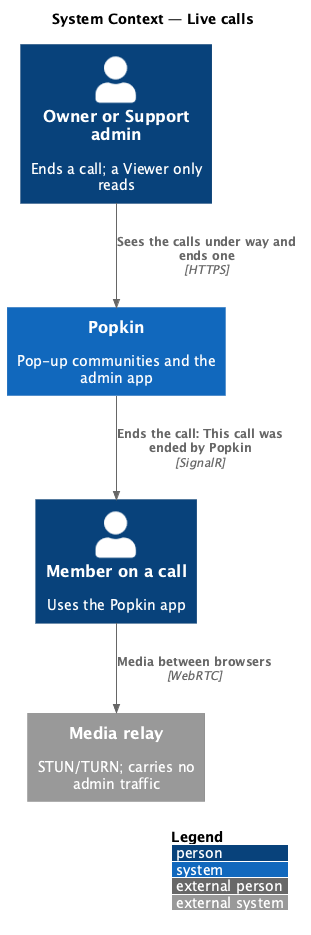
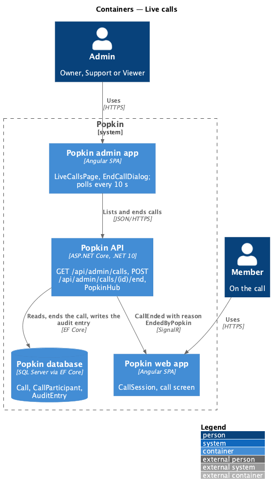
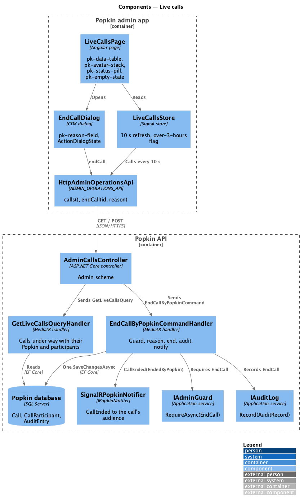
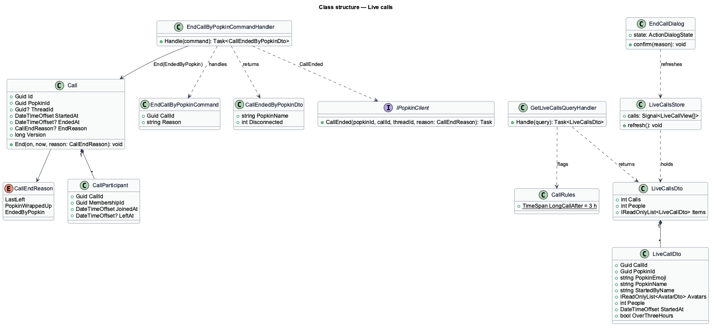
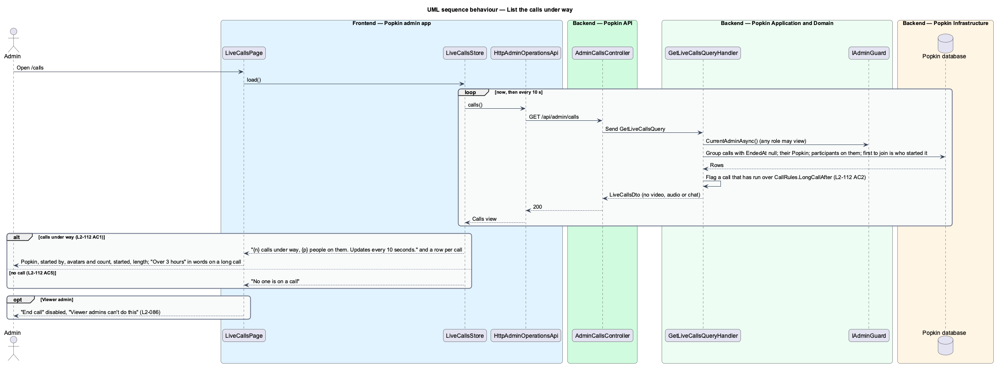
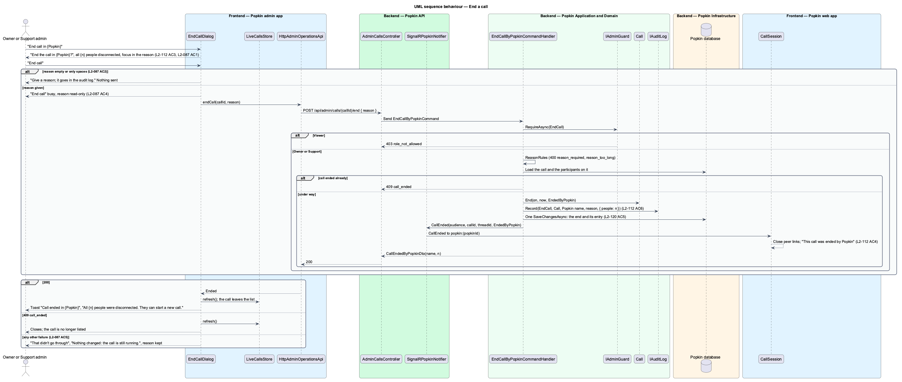

# Live calls

## Overview

*Live calls* is the admin page at `/calls` that lists the calls under way across every Popkin and
lets an Owner or Support admin end one. It shows who is on each call and for how long, never its
video, audio or chat: Popkin's API never carries a call's media (ADR 0014), and the page shows
only what the API already keeps, the `Call` and its `CallParticipant` rows.

- **call under way** — a `Call` whose `EndedAt` is empty
- **long call** — a call that has run over 3 hours; the page flags it, since most are "a phone
  left on the table"
- **end reason** — why a call ended: its last participant left, its Popkin wrapped up, or Popkin
  ended it
- **ended by Popkin** — the end of a call by an admin, which disconnects every participant and
  shows them "This call was ended by Popkin"

Ending a call is an admin write with a reason (L2-087) and an entry in the audit log (L2-120).
The members on the call are not punished: they can start a new call at once. The page refreshes
every 10 seconds by polling; the admin app has no hub. The call's own design is
[Group call](../../calls/group-call/README.md); this design adds one end reason to it and one
argument to its `CallEnded` event.

## Description

### Screens and states

- `docs/mocks/admin/pages/calls/default.html` — "Live calls", "4 calls under way, 24 people on
  them. Updates every 10 seconds."; a `data-table` with the columns Popkin, On the call, Started,
  Length; each row a `popkin-tile` with the emoji, the Popkin's name and `who__sub` "Started by
  {name} · {region}", an `avatar-stack` with `avatar-stack__more` and "{n} people", the start
  time, the length (a `status--warn` pill on "3 h 44 min") and the button "End call" with the
  visually hidden "in {Popkin}"; the caption "Calls running over 3 hours are flagged; most are a
  phone left on the table."
- `viewer.html` — every "End call" `disabled` with `title="Viewer admins can't do this"` (L2-086).
- `ended.html` — the call gone from the list and the success `toast` "Call ended in Class of 2015
  Reunion", "All 14 people were disconnected. They can start a new call." (L2-112 AC4).
- `empty.html` — "No calls under way", `empty` "No one is on a call", "Calls appear here the
  moment a member starts one." (L2-112 AC5).
- `loading.html`, `error.html` — L2-089 AC7.
- `docs/mocks/admin/dialogs/call-end/default.html` — "End the call in Class of 2015 Reunion?",
  "All 14 people are disconnected and see "This call was ended by Popkin". They can start a new
  call afterwards.", the field "Reason, for the audit log", "End call" and "Cancel" (L2-112 AC3).
  `busy.html`, `invalid.html` ("Give a reason; it goes in the audit log.") and `failed.html`
  ("That didn't go through", "Nothing changed: the call is still running. Check your connection
  and try again.").
- The region in "Started by Dev Patel · eu-west" is not data Popkin keeps; it is `<TO SUPPLY>`
  and the design shows "Started by {name}" alone.
- The long call is flagged by the pill's tone only in the mock. L2-112 AC2 asks for words: the
  design adds "Over 3 hours" as the pill's visually hidden text, and the mock should show it.
- **No mock** draws what members see: "This call was ended by Popkin" on the call screen. The
  design expects `docs/mocks/pages/video-call/ended-by-popkin.html`.

### API

- `GET /api/admin/calls` → `200` `LiveCallsDto`: `calls` and `people` counts and `items[]` of
  `LiveCallDto` (`callId`, `popkinId`, `popkinEmoji`, `popkinName`, `startedByName`, `avatars`
  (the first three participants' `AvatarDto`), `people`, `startedAt`, `overThreeHours`), oldest
  first. Admin scheme; any role (viewing needs no action).
- `POST /api/admin/calls/{callId}/end` — body `{ reason }`; `200` `CallEndedByPopkinDto`
  (`popkinName`, `disconnected`). Failures: `400` `reason_required`, `reason_too_long`; `403`
  `role_not_allowed` (Viewer); `404` `call_not_found`; `409` `call_ended` when the call ended
  before the request (its last participant left or its Popkin wrapped up).
- Real time (Popkin app): `CallEnded(popkinId, callId, threadId, reason)` to the call's audience,
  `popkin:{popkinId}` for a group call.

### Which calls are listed

- The list holds group calls (`Call.ThreadId` empty). A direct call is the call of a direct
  message, whose existence an admin sees only when one of its two members reports it (the
  owner's moderation decision of 15 November 2026). Whether direct calls are listed, and how,
  is `<TO SUPPLY>`; until settled they are neither listed nor counted.
- "Started by" is the participant with the earliest `JoinedAt`: `Call.Start` adds nobody and
  whoever starts a call joins it next (`Call.Start`). No new field is needed.
- A call under way in a wrapped-up Popkin cannot exist: the wrap-up ends every call
  (`PopkinWrapUpService`).

### Backend

- **`CallEndReason`** (Domain, new) — `LastLeft`, `PopkinWrappedUp`, `EndedByPopkin`.
- **`Call`** (changed) — gains `EndReason` (`CallEndReason?`, saved as text; migration
  `AddCallEndReason`, existing ended calls `LastLeft`). `Call.Leave` sets `LastLeft` when the
  last participant leaves; `Call.End(on, now, reason)` takes the reason, `PopkinWrapUpService`
  passing `PopkinWrappedUp`. `Version` stays the concurrency token, so an end that meets a leave
  or a wrap-up at the same time saves once and the other answers `409` `call_ended`.
- **`CallRules.LongCallAfter`** (Domain, new) — 3 hours (L2-112 AC2).
- **`GetLiveCallsQuery`** / **`GetLiveCallsQueryHandler`** (`Popkin.Application/Admin/Operations/`)
  — `IAdminGuard.CurrentAdminAsync()`, then the group calls under way joined to `PopkinSpace` and
  to the participants with `LeftAt` empty, with their `Membership` names and avatars.
- **`EndCallByPopkinCommand`** (`CallId`, `Reason`) / **`EndCallByPopkinCommandHandler`** —
  in order: `IAdminGuard.RequireAsync(AdminAction.EndCall)` (`403` `role_not_allowed`);
  `ReasonRules`; load the call with its participants on it (`404`, `409`); `Call.End(on, now,
  EndedByPopkin)`; `IAuditLog.Record` with `AuditAction.EndCall`, `TargetKind` `Call`, `TargetId`
  the call, `TargetName` the Popkin's name, the reason and `Details { popkinId, people }`; one
  `SaveChangesAsync`, so the end and its entry are written together (L2-112 AC6, L2-120 AC5);
  then `IPopkinNotifier.CallEnded(audience, callId, threadId, EndedByPopkin)`, awaited, to the
  call's audience as the shared real-time rules require.
- **`IPopkinNotifier.CallEnded`** and **`IPopkinClient.CallEnded`** (changed) — gain `reason`.
  `CallEnded` stays a fact event; its recovery read, `GET /api/popkins/{popkinId}/calls/current`, answers no call.
- **`AdminCallsController`** — the two endpoints, admin scheme.

### Frontend (Popkin admin app)

- **`LiveCallsPage`** (`frontend/projects/admin/src/app/pages/calls/`), route `/calls`, route
  data `page: 'calls'`. It composes `pk-page-head` with the summary sentence, `pk-panel` with
  `pk-data-table` (a table from 768 px, stacked records below, L2-089 AC3): `pk-popkin-tile`,
  `pk-avatar-stack`, the start time, the length with `pk-status-pill` (tone `warn`, "Over 3 hours")
  on a long call, and `pk-button` "End call" with "in {Popkin}" visually hidden. The caption under
  the table; `pk-empty-state` when no call is under way.
- "End call" is disabled for a role whose `AdminMeDto.allowed` lacks `EndCall`, with "Viewer
  admins can't do this" (`AdminSessionStore`).
- **`EndCallDialog`** (`frontend/projects/admin/src/app/dialogs/call-end/`) — CDK dialog in
  `pk-dialog`, titled "End the call in {Popkin}?", the description with {n}, `pk-reason-field`
  holding focus (L2-087 AC1), "End call" (danger) and "Cancel"; `ActionDialogState` makes it busy
  with the reason read-only while sending, keeps the reason on failure with `pk-alert`, and
  closes on success (L2-087 AC2 to AC5). A bottom sheet under 640 px (L2-089 AC4).
- **`LiveCallsStore`** (`frontend/projects/api/src/lib/admin/operations/live-calls.store.ts`) —
  the list and its load state, read now and every 10 seconds while open (L2-112 AC1); the length
  of each call is computed from `startedAt` and the clock at each read, so it moves between reads
  too. After an end, it reads at once. Unit tested.
- **`calls-text.ts`** — "{n} calls under way, {p} people on them.", "{h} h {m} min", "Started by
  {name}", the toast text. Unit tested.
- **`AdminOperationsApi`** / **`ADMIN_OPERATIONS_API`** / **`HttpAdminOperationsApi`** — `calls()`
  and `endCall(callId, reason)`; Jobs and Album exports add theirs.
- On success, `pk-toast` "Call ended in {Popkin}", "All {n} people were disconnected. They can
  start a new call." (L2-112 AC4, L2-087 AC7).

### Frontend (Popkin web app)

- **`CallSession`** (`frontend/projects/api/src/lib/api/calls/call-session.ts`) — on
  `CallEnded` with `reason: 'EndedByPopkin'` for the call it is on, closes its peer links and
  local media and ends in a new state `endedByPopkin`, which the call screen shows as "This call
  was ended by Popkin" with a way back to the Popkin. `CallBannerStore` removes the banner as for
  any `CallEnded`. The screen's copy beyond that sentence is `<TO SUPPLY>`, with the mock.

## Requirements

| L2 ID | Refines (L1) | Requirement |
|-------|--------------|-------------|
| `L2-112` | `L1-025` | Live calls: The calls under way, and the way to end one. (AC1–AC6) |
| `L2-087` | `L1-028` | A reason for every change: An admin says why they change something, and the audit log keeps it. (AC1, AC2, AC4, AC5, AC7) |
| `L2-089` | `L1-028` | The admin shell: Every page of the console shares one frame, on every screen size. (AC3, AC4, AC7) |

## Diagrams

### System context

An admin ends a call in Popkin; the members on it are disconnected and told why. The media relay
carries the call's media and is untouched.

### Containers

The admin app polls the API and asks it to end a call; the API ends it in the database and sends
`CallEnded` to the Popkin web app over the hub.

### Components

One handler lists calls; another guards, ends, audits and notifies in that order.

### Class structure

`Call` gains `EndReason`; `EndCallByPopkinCommandHandler` ends it with `EndedByPopkin` and sends
the reason with `CallEnded`.

### Behaviour — list the calls under way

The store reads every 10 seconds; a long call is flagged in words; a Viewer sees "End call"
disabled.

### Behaviour — end a call

The admin gives a reason; the API ends the call and writes its audit entry in one save, then every
participant sees "This call was ended by Popkin".

