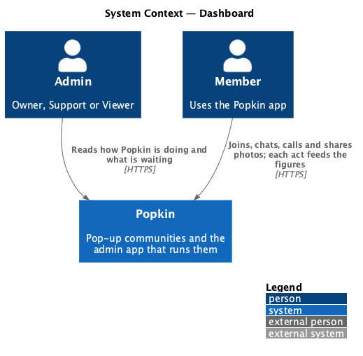
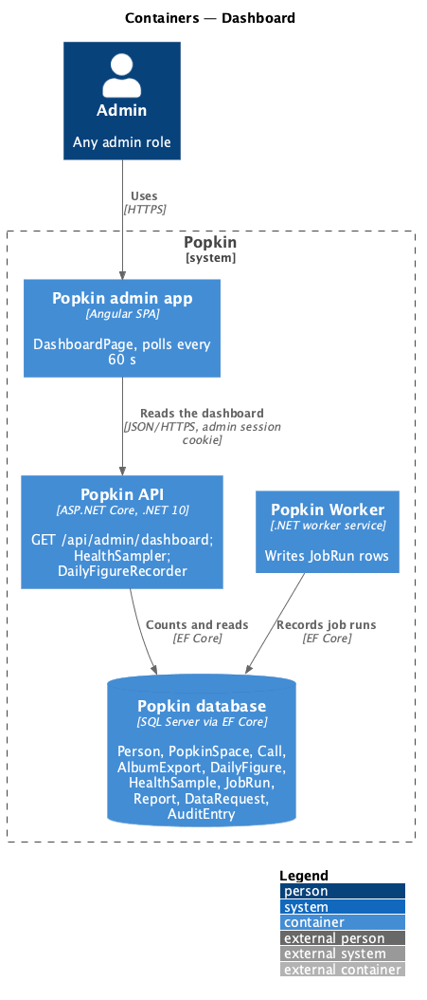
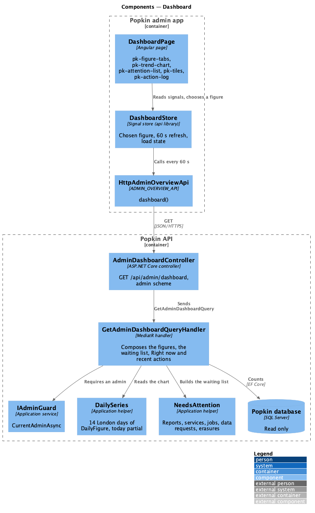
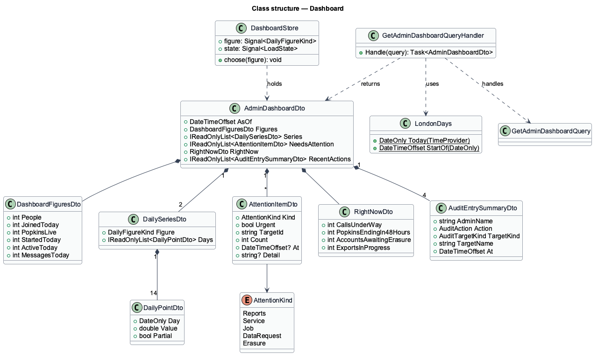
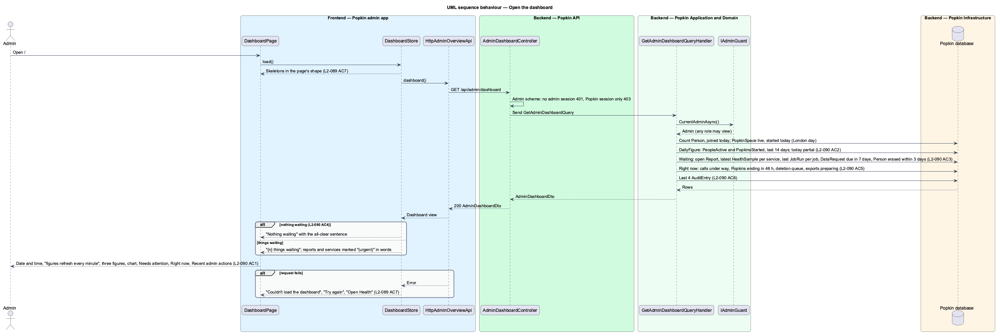
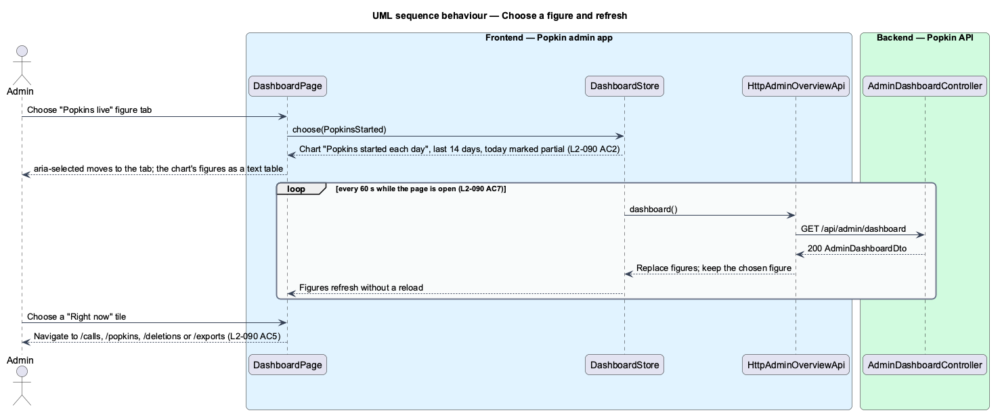

# Dashboard

## Overview

The *dashboard* is the first page of the admin app, at `/` on `https://admin.popkin.community`.
It answers two questions for an admin who has just signed in: how Popkin is doing, and what is
waiting for an admin. Every admin role, Owner, Support and Viewer, may read it; it changes
nothing, so it needs no `AdminAction`.

- **figure** — one count shown large: "People", "Popkins live" or "Active today", each with a
  smaller count for today beneath it
- **London day** — a calendar day in the Europe/London time zone, the unit of every daily figure
  of the admin app (L2-091 AC1)
- **partial day** — today, counted up to the time the page was read
- **Needs attention** — the list of things an admin should act on, each with a link to its page
- **Right now** — four counts of what is under way at this moment, each a link to its list

The page sits in the subsystem *Admin overview* beside [Metrics](../metrics/README.md), which
draws the same daily series over 7 or 14 days, and [Health](../health/README.md), whose
latest samples feed the services in "Needs attention". The dashboard owns no data of its own: it
reads what other admin features keep (reports, data requests, the deletion queue, job runs,
album exports, the audit log) and counts what the Popkin app keeps (people, Popkins, messages,
calls). It refreshes its figures every 60 seconds by polling; the admin app has no hub.

## Description

### Screens and states

- `docs/mocks/admin/pages/dashboard/default.html` — "Dashboard", "Mon 14 Jul, 10:42 · figures
  refresh every minute"; three `figure-tab` buttons (`role="tab"`, `aria-selected`) for
  "People" ("+312 joined today"), "Popkins live" ("174 started today") and "Active today" ("48k
  messages so far"); the chart "People active each day", "Last 14 days", with "Today is partial,
  up to 10:42."; "Needs attention" with "5 things waiting" and its `attention__item` rows, two
  marked "(urgent)"; "Right now" with four `tile` links; "Recent admin actions" with four `log__item`
  rows and the "Audit log" `text-btn`.
- `metric-popkins.html` — the second tab chosen; the chart reads "Popkins started each day".
- `all-clear.html` — "Nothing waiting" and "No reports, failed jobs or due requests. Everything
  is running normally." (L2-090 AC4).
- `loading.html` — skeletons in the page's shape (L2-089 AC7).
- `error.html` — "Couldn't load the dashboard", "The admin API didn't answer. Nothing has
  changed; try again, or check Health if it keeps happening.", "Try again" and "Open Health".
- The mock has no empty state: the manifest states a running platform always has something to
  count, and a quiet day is `all-clear`.
- The sentence "Weekends run about 30% higher." under the chart is commentary nobody computes.
  The design shows "Today is partial, up to {time}." alone; a computed weekday comparison is
  `<TO SUPPLY>`.
- The trend chart's `aria-label` names only the latest value. The design adds a visually hidden
  table of the 14 days under each chart, as Metrics does for L2-091 AC4; the mock should show it.

### API

- `GET /api/admin/dashboard` → `200` `AdminDashboardDto`. Admin scheme: no admin session `401`,
  a Popkin app session only `403` (L2-078 AC3). Any role.
- `AdminDashboardDto`:
  - `asOf` — the server's time of the read, which the page shows as the date and time.
  - `figures` — `people` (every `Person` not erased), `joinedToday` (`Person.CreatedAt` within
    today's London day), `popkinsLive` (`PopkinSpace.Status == Active`), `startedToday`
    (`PopkinSpace.CreatedAt` within today), `activeToday` (today's `DailyFigure` of
    `PeopleActive`) and `messagesToday` (today's `DailyFigure` of `MessagesSent`).
  - `series` — two `DailySeriesDto`, `PeopleActive` and `PopkinsStarted`, each 14
    `DailyPointDto` (`day`, `value`, `partial`), today last and `partial: true` (L2-090 AC2).
    The series are read from `DailyFigure` exactly as Metrics reads them, so the two pages
    never disagree.
  - `needsAttention` — `AttentionItemDto` (`kind`, `urgent`, `targetId`, `count`, `at`, `detail`),
    in this order (L2-090 AC3):
    - `Reports` — the count of reports waiting, the oldest one's time and its reason and Popkin's
      name; `urgent: true`; links to `/reports`.
    - `Service` — one per service whose latest `HealthSample` is `Degraded` or `Down`, with its
      note; `urgent: true`; links to `/health`.
    - `Job` — one per job whose last `JobRun` failed, with that run's time; links to `/jobs`. For
      Prepare album exports the detail counts the failed album exports ("2 exports stuck").
    - `DataRequest` — one per data request due within 7 days and not sent, with the person's
      name and its state; links to `/data-requests/…` as that feature defines.
    - `Erasure` — one per account whose erasure is due within 3 days, with the person's name and
      the date; links to `/deletions`.
  - `rightNow` — `callsUnderWay` (group calls with `EndedAt` empty, as [Live
    calls](../../admin-operations/live-calls/README.md) counts them), `popkinsEndingIn48Hours`
    (`Active` and `EndsAt` within 48 hours), `accountsAwaitingErasure` (`Person.DeletedAt` set
    and `ErasedAt` empty) and `exportsInProgress` (`AlbumExport.Status == Preparing`) (L2-090
    AC5).
  - `recentActions` — the last four `AuditEntry` rows, newest first, as `AuditEntrySummaryDto`
    (`adminName`, `action`, `targetKind`, `targetName`, `at`) (L2-090 AC6). The reason is not
    in the summary.
- The tables of reports, data requests and the deletion queue belong to the subsystems that
  design them. This design reads them by the names `Report`, `DataRequest` and the existing
  `Person.DeletedAt`; where those subsystems name them otherwise, theirs stand.

### Frontend (Popkin admin app)

- **`DashboardPage`** (`frontend/projects/admin/src/app/pages/dashboard/dashboard.page.ts` and
  `.html`), route `/`, route data `page: 'dashboard'`, inside `pk-admin-shell`. It composes:
  - `pk-page-head` — "Dashboard" and the subtitle "{date and time} · figures refresh every
    minute".
  - `pk-figure-tabs` — the three figures as tabs; choosing one sets the store's figure. "People"
    and "Active today" both draw "People active each day"; "Popkins live" draws "Popkins started
    each day" (L2-090 AC2). Which series "People" draws, people active or people joined, is
    `<TO SUPPLY>`: the mock draws people active under "People".
  - `pk-trend-chart` — the chosen series, today drawn as partial, with a visually hidden table of
    its days.
  - `pk-attention-list` — "Needs attention" with "{n} things waiting", each item's dot, title,
    "(urgent)" in words where `urgent`, detail and a link; or "Nothing waiting" (L2-090 AC3, AC4).
  - `pk-tiles` — "Right now", "Choose a figure to open its list", four tiles linking to
    `/calls`, `/popkins?ending=48h`, `/deletions` and `/exports` (L2-090 AC5).
  - `pk-action-log` — "Recent admin actions", each "{admin} {action words} {target}" and the
    time, with "Audit log" linking to `/audit` (L2-090 AC6).
  - `pk-empty-state` with "Try again" and "Open Health" on failure; `pk-skeleton` while loading.
- **`DashboardStore`** (`frontend/projects/api/src/lib/admin/overview/dashboard.store.ts`) —
  signals for the dashboard view, the chosen figure and the load state (`loading`, `ready`,
  `failed`). It loads on creation and again every 60 seconds while the page is open (L2-090
  AC7); a refresh keeps the chosen figure and keeps the last view on screen if it fails. Unit
  tested (ADR 0011).
- **`dashboard-text.ts`** — pure helpers: the subtitle, "+{n} joined today", "48k messages so
  far" (compact thousands), "{n} things waiting", the item titles ("{n} reports to review",
  "{Service} degraded", "{Job} failed", "Data request due in {n} days", "{name} erased in {n}
  days") and the action words of each `AuditAction` ("removed content", "suspended person").
  Unit tested.
- **`AdminOverviewApi`** / **`ADMIN_OVERVIEW_API`** / **`HttpAdminOverviewApi`** —
  `dashboard()`; Metrics and Health add theirs to the same contract.

### Backend

- **`AdminDashboardController`** (`Popkin.Api/Controllers/Admin/`) —
  `[Authorize(AuthenticationSchemes = AdminSessionCookie.Scheme)]`; sends
  `GetAdminDashboardQuery` and returns its result.
- **`GetAdminDashboardQuery`** / **`GetAdminDashboardQueryHandler`**
  (`Popkin.Application/Admin/Overview/`) — calls `IAdminGuard.CurrentAdminAsync()`, then reads
  each part with `AsNoTracking` counts. It has no write and records no audit entry.
- **`LondonDays`** (`Popkin.Application/Admin/LondonDays.cs`) — `Today(TimeProvider)` and
  `StartOf(DateOnly)` in Europe/London, shared with Metrics and Health, so a day boundary is
  computed in one place.
- **`DailySeries`** — reads `DailyFigure` rows for a figure and a range and fills missing days
  with zero; shared with Metrics ([Metrics](../metrics/README.md)).
- **`NeedsAttention`** — builds the waiting list from the five sources above in one place, so
  the shell's counts (`GET /api/admin/waiting`) and this list agree on what "waiting" means.

### Decisions

- Polling, not a hub: one read each minute per open dashboard is cheaper than a hub group for
  admins, and the shared architecture gives the admin app no hub.
- The figures that come from the Popkin app's own tables (people, Popkins) are counted from the
  database; the daily activity figures come from `DailyFigure`, which the `Popkin` meter fills
  ([Metrics](../metrics/README.md)). How `DailyFigure` is filled is an open decision there.
- "Active today" counts people, and "48k messages so far" counts messages; the requirement
  names "the messages sent so far today" as the figure's own line (L2-090 AC1).

## Requirements

| L2 ID | Refines (L1) | Requirement |
|-------|--------------|-------------|
| `L2-090` | `L1-021` | Dashboard: The dashboard says how Popkin is doing and what is waiting. (AC1–AC8) |
| `L2-089` | `L1-028` | The admin shell: Every page of the console shares one frame, on every screen size. (AC7) |

## Diagrams

### System context

An admin reads the dashboard in Popkin; the figures come from what members do in the same
system.

### Containers

The admin app polls the API every 60 seconds; the API counts rows the Popkin app, the Worker,
the health sampler and the figure recorder write to the database.

### Components

`DashboardPage` reads `DashboardStore`, which calls `ADMIN_OVERVIEW_API`; one handler composes
the figures, `DailySeries` and `NeedsAttention`.

### Class structure

`AdminDashboardDto` gathers five parts: figures, two daily series, the waiting list, Right now
and four recent actions.

### Behaviour — open the dashboard

The page shows skeletons, reads every part in one request, and shows either the waiting list or
the all-clear; a failure offers "Try again" and "Open Health".

### Behaviour — choose a figure and refresh

Choosing a figure swaps the chart without a request; every 60 seconds the store reads again and
keeps the chosen figure.

