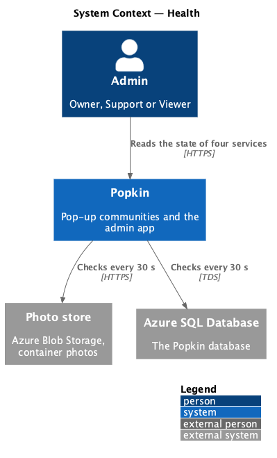
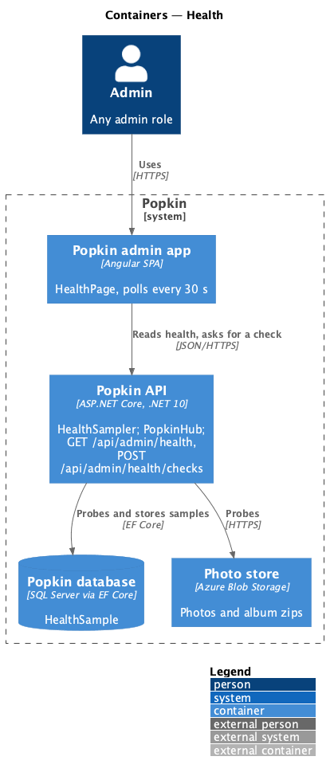
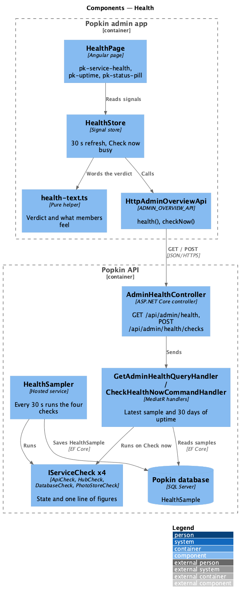
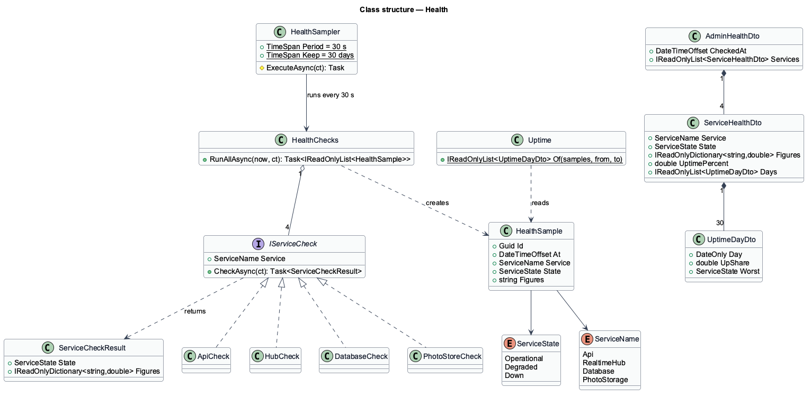
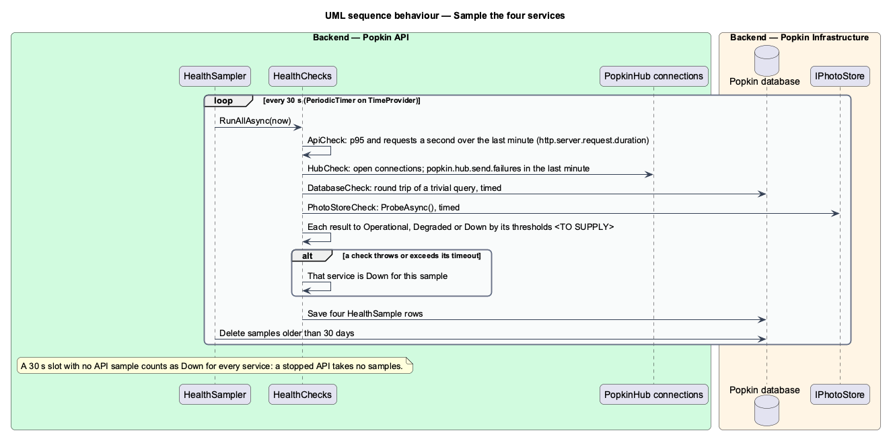
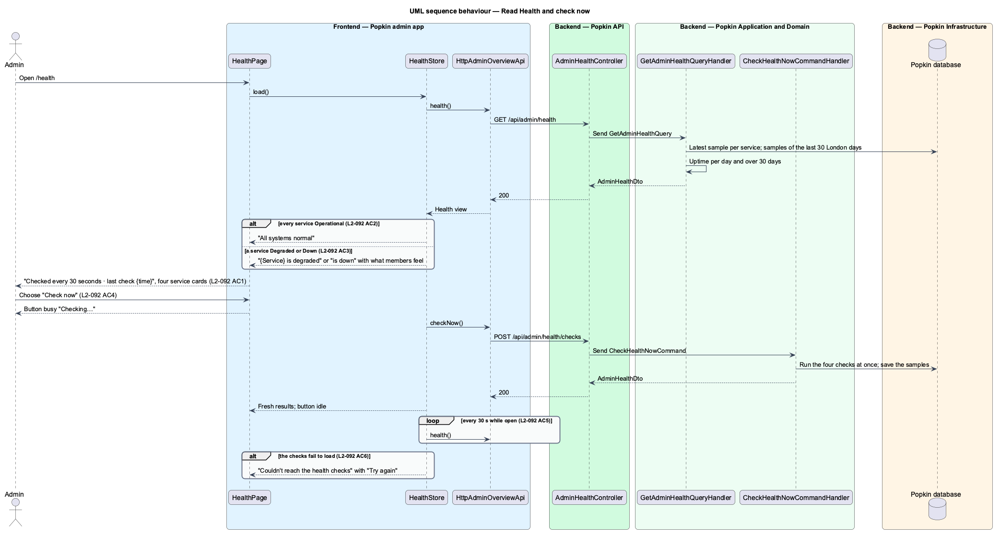

# Health

## Overview

*Health* is the admin page at `/health` that says how the four services Popkin runs on are
doing: the API, the realtime hub, the database and photo storage. Each service reads
"Operational", "Degraded" or "Down" in words, with one line of figures and its last 30 days of
uptime. A verdict above the services says what members feel. Every admin role may read it.

- **service** — one of four parts of Popkin checked on its own: API (`Popkin.Api`), Realtime hub
  (`PopkinHub` at `/hubs/popkin`), Database (Azure SQL Database `popkin`) and Photo storage
  (the private Blob container `photos`)
- **check** — one timed probe of one service, ending in a state and figures
- **health sample** — stored result of one check: the time, the service, its state and its
  figures
- **uptime** — share of a day's 30-second slots in which a service was up

Today Popkin has one probe, `GET /api/health` (`HealthController`), which answers `200 { status:
"ok" }` to say the process runs; the readiness probe `GET /api/health/ready` of
`docs/deployment.md` is not built. Neither keeps a history, and 30 days of uptime needs one.
This design adds a sampler inside the API that checks the four services every 30 seconds and
stores each result, so Health, the [Dashboard](../dashboard/README.md)'s "Needs attention" and
the uptime bars all read the same samples.

## Description

### Screens and states

- `docs/mocks/admin/pages/health/default.html` — "Health", "Checked every 30 seconds · last check
  10:42:18", the button "Check now"; `health-summary` "Realtime hub is degraded" with "Messages
  still arrive, a few seconds late for some people on eu-west-2. On-call is watching."; four
  `service` cards, each `service__name`, a `status` pill, `service__note` with figures ("p95 182 ms
  · 1,240 requests a second", "3,912 connections · Reconnects up 4× since 10:10 on eu-west-2",
  "41% CPU · Replica lag 0.3 s", "18.4 TB used · Photos and album exports"), and `uptime` with
  30 `uptime__bar`s between "30 days ago" and "Today", and "{n}% up".
- `all-good.html` — "All systems normal", "API, hub, database and photo storage are all answering
  within their targets." (L2-092 AC2).
- `down.html` — "Realtime hub is down", "Members can't send messages or join calls. On-call
  (Kwame Mensah) has been paged." (L2-092 AC3).
- `checking.html` — "Check now" reads "Checking…" and is busy (L2-092 AC4).
- `loading.html`; `error.html` — "Couldn't reach the health checks", "The admin API didn't answer,
  which may itself be the problem. Try again; if it keeps failing, page on-call.", "Try again"
  (L2-092 AC6).
- Mock copy the design cannot produce, each `<TO SUPPLY>`:
  - the region ("eu-west-2"): Popkin runs in East US 2 and the API records no region per
    connection;
  - "On-call is watching" and the on-call person's name: Popkin keeps no on-call rota;
  - "41% CPU · Replica lag 0.3 s" and "18.4 TB used": Azure Monitor metrics of the SQL database
    and the storage account, which the API does not read. The Basic tier has no replica. Until
    a source is chosen, the database line shows the probe's round trip and the photo storage line
    the probe's time;
  - "Reconnects up 4× since 10:10": the hub records no reconnect rate; the design shows the
    count of open connections and the hub's send failures in the last minute.
- The verdict and member-impact copy exists for the hub only. The sentences for the API, the
  database and photo storage, degraded and down, are `<TO SUPPLY>`.
- The uptime bars are `aria-hidden`; "{n}% up" carries the figure as text, and each day's state is
  added to a visually hidden list.

### API

- `GET /api/admin/health` → `200` `AdminHealthDto`: `checkedAt` (the time of the newest sample)
  and four `ServiceHealthDto` in the order API, Realtime hub, Database, Photo storage:
  `service`, `state`, `figures` (a small map of named numbers: `p95Ms`, `requestsPerSecond`,
  `connections`, `sendFailures`, `roundTripMs`), `uptimePercent` over 30 days, and `days[30]`
  (`day`, `upShare`, `worst`). Admin scheme; any role.
- `POST /api/admin/health/checks` → `200` `AdminHealthDto` after running the four checks at once
  and saving their samples (L2-092 AC4). Any role; it changes nothing an admin could undo, so it
  is not an `AdminAction` and records no audit entry. Rate limit: `<TO SUPPLY>`.

### Backend

- **`ServiceName`** (`Api`, `RealtimeHub`, `Database`, `PhotoStorage`) and **`ServiceState`**
  (`Operational`, `Degraded`, `Down`) — Domain enums.
- **`HealthSample`** (Domain) — `Id`, `At`, `Service`, `State`, `Figures` (JSON text of the named
  numbers; never a name, address or key). Index on (`Service`, `At`). Migration
  `AddHealthSamples`.
- **`IServiceCheck`** (Application) — `Service` and `CheckAsync(ct)` → `ServiceCheckResult`
  (`State`, `Figures`). Each check has a timeout of `<TO SUPPLY>`; a timeout or an exception is
  `Down`.
  - **`ApiCheck`** — p95 of `http.server.request.duration` and requests a second over the last
    minute, read from a rolling window the API's `MeterListener` keeps
    ([Metrics](../metrics/README.md)). `Degraded` when the p95 exceeds 300 ms, the read target of
    L2-055 AC3; the threshold for `Down` is `<TO SUPPLY>`.
  - **`HubCheck`** — open `PopkinHub` connections (a new count on `PopkinHub`'s connection
    tracking) and `popkin.hub.send.failures` in the last minute. Thresholds `<TO SUPPLY>`.
  - **`DatabaseCheck`** — `IAppDbContext.Database.CanConnectAsync` and one trivial query, timed.
    Thresholds `<TO SUPPLY>`. A database that cannot be reached also cannot store the sample: the
    sampler keeps that sample in memory and writes it with the next one that succeeds.
  - **`PhotoStoreCheck`** — `IPhotoStore.ProbeAsync` (new: reads the container's properties, or the
    `Photos:Root` folder in Development), timed. Thresholds `<TO SUPPLY>`.
- **`HealthChecks`** — runs the four checks in parallel and returns four `HealthSample`s; used by
  the sampler and by "Check now".
- **`HealthSampler`** (`Popkin.Api`, `BackgroundService`) — a `PeriodicTimer` built from
  `TimeProvider` with a period of 30 seconds (L2-092 AC1), so a test advances
  `FakeTimeProvider` instead of waiting (ADR 0010). Each tick saves the four samples and deletes
  samples older than 30 days. It runs in the API because the API is the one process with the
  hub's connections and the request instruments; the Worker sends nothing and has no HTTP
  surface (ADR 0015).
- **`Uptime`** — pure: from the samples of a service over 30 London days, each day's `upShare`
  is the slots up divided by the day's 2,880 slots (fewer for today), and `worst` the worst
  state seen. A slot with no sample counts as down: a stopped API takes no samples, and its
  silence is the outage. Whether `Degraded` counts as up is `<TO SUPPLY>`; the design counts it
  as up and colours the day by `worst`.
- **`GetAdminHealthQueryHandler`** and **`CheckHealthNowCommandHandler`**
  (`Popkin.Application/Admin/Overview/`) — `IAdminGuard.CurrentAdminAsync()`, then the latest
  sample per service and `Uptime`; the command first runs `HealthChecks`.
- **`AdminHealthController`** — the two endpoints, admin scheme.
- `GET /api/health` and `/api/health/ready` stay as they are: anonymous probes for the platform,
  not for admins.

### Frontend (Popkin admin app)

- **`HealthPage`** (`frontend/projects/admin/src/app/pages/health/`), route `/health`, route data
  `page: 'health'`. It composes `pk-page-head` ("Checked every 30 seconds · last check {time}" and
  `pk-button` "Check now"), and `pk-service-health` with its summary and four service cards,
  each with `pk-status-pill` and `pk-uptime`. On failure, `pk-empty-state` with "Try again".
- **`HealthStore`** (`frontend/projects/api/src/lib/admin/overview/health.store.ts`) — the view,
  the load state and `checking`; reads every 30 seconds while open (L2-092 AC5); `checkNow()`
  sets `checking` until the answer returns (L2-092 AC4). Unit tested.
- **`health-text.ts`** — the verdict from the worst service ("All systems normal", "{Service} is
  degraded", "{Service} is down"), the member-impact sentence per service and state, and the
  figures line. Unit tested.

## Requirements

| L2 ID | Refines (L1) | Requirement |
|-------|--------------|-------------|
| `L2-092` | `L1-021` | Health: The state of the four services Popkin runs on. (AC1–AC6) |
| `L2-090` | `L1-021` | Dashboard: The dashboard says how Popkin is doing and what is waiting. (AC3, a degraded or down service) |

## Diagrams

### System context

An admin reads the state of the services; Popkin checks the database and the photo store every
30 seconds.

### Containers

The API samples itself, its hub, the database and the photo store, and stores each sample; the
admin app reads them and can ask for a check now.

### Components

`HealthSampler` and "Check now" share `HealthChecks` and its four `IServiceCheck`s; the query
handler turns samples into 30 days of uptime.

### Class structure

A `HealthSample` is one check of one service; `Uptime` derives each day's share from the samples.

### Behaviour — sample the four services

Every 30 seconds the four checks run in parallel; a failed or slow check is `Down`, and samples
older than 30 days are removed.

### Behaviour — read Health and check now

The page shows the verdict and the four services, reads again every 30 seconds, and "Check now"
is busy until fresh samples return.

