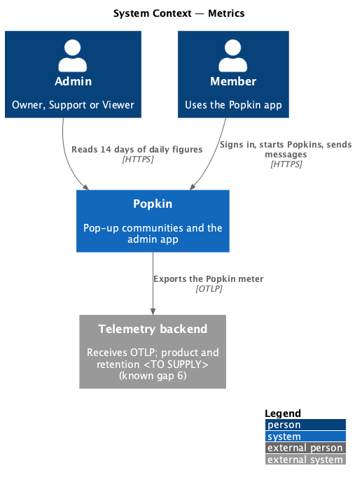
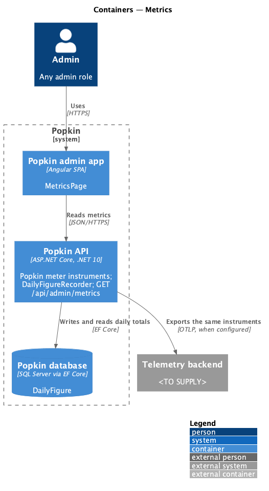
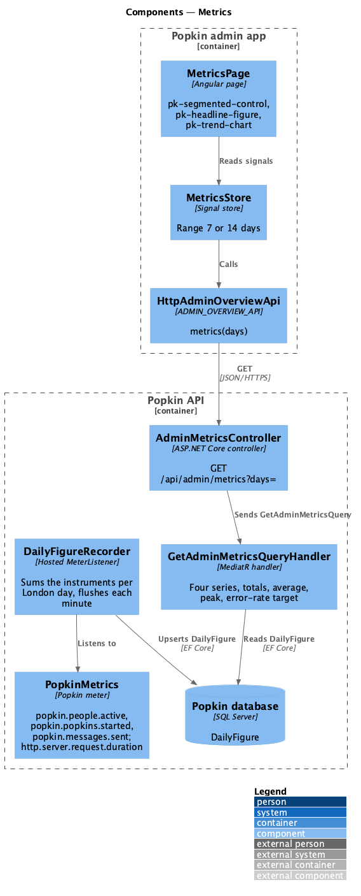
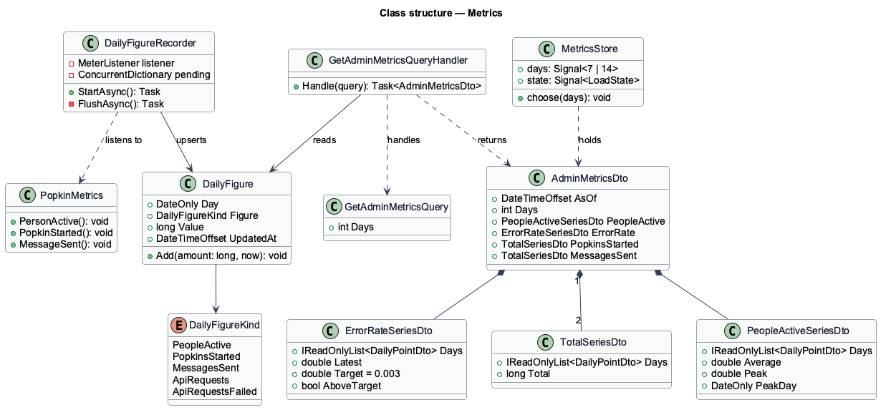
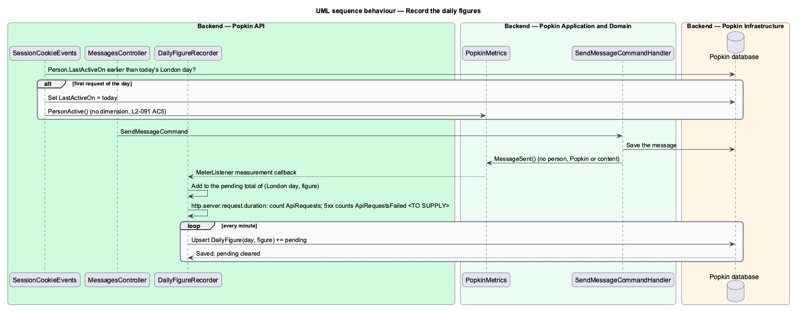
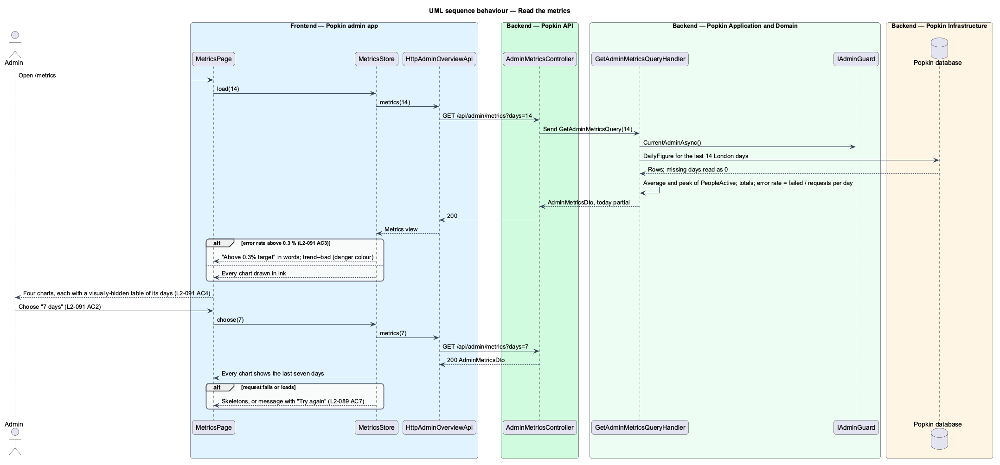

# Metrics

## Overview

*Metrics* is the admin page at `/metrics` that draws how Popkin's daily figures have moved over
the last 14 days, or the last 7. It shows four charts: people active each day, the error rate of
the API, Popkins started and messages sent. Every admin role may read it.

- **daily figure** — total of one measurement over one London day (Europe/London), with today
  partial
- **people active** — distinct people who made at least one signed-in request during the day
- **error rate** — share of the API's requests in a day that failed, against a target of 0.3 %
- **instrument** — a `System.Diagnostics.Metrics` counter or histogram on the `Popkin` meter
  (ADR 0012)

L2-091 AC5 asks that the figures come from the `Popkin` meter's instruments and carry no person,
Popkin or content. ADR 0012 sends those instruments to a telemetry backend through OTLP, and that
backend, with its retention, is not chosen (known gap 6). The admin app cannot read figures back
from a backend that does not exist, so this design adds a reader inside the API that turns the
instruments into one row per figure per day in the Popkin database. Whether to keep that reader
or to query the telemetry backend once one is chosen is an open decision, marked below.

The page sits in *Admin overview* beside the [Dashboard](../dashboard/README.md), which draws two
of the same series, and [Health](../health/README.md), which reads the API's recent requests from
the same listener.

## Description

### Screens and states

- `docs/mocks/admin/pages/metrics/default.html` — "Metrics", "Daily totals, Europe/London. Today
  is partial."; a `segmented` control "7 days" / "14 days" with 14 chosen; four panels:
  - "People active each day", `headline-figure` "9,847" "a day on average", "Peak 13,020 on Sun
    13 Jul".
  - "Error rate", "Share of API requests that failed", "0.42%", the `status--bad` pill "Above 0.3%
    target", and the chart `trend--bad`.
  - "Popkins started", "3,867 in 14 days".
  - "Messages sent", "1.07M in 14 days".
- `7-days.html` — every chart over seven days ("2,034 in 7 days", "0.56M in 7 days").
- `loading.html` and `error.html` — L2-089 AC7.
- The sentence under the error rate ("Rising since 10:10 with the hub reconnects; 71% are 502s
  from the hub's negotiate request.") is an analyst's note; nothing in this design computes it,
  and the page leaves it out. A computed cause is `<TO SUPPLY>`.
- Each chart's `aria-label` names only its latest value. L2-091 AC4 asks for every figure as
  text: the design adds a visually hidden table under each chart (day, value), which the mock
  should show.

### API

- `GET /api/admin/metrics?days=14` (or `7`; any other value `400` `days_not_allowed`) → `200`
  `AdminMetricsDto`. Admin scheme; any role.
- `AdminMetricsDto` — `asOf`, `days`, and:
  - `peopleActive` — `days[]` (`day`, `value`, `partial`), `average` (mean of the complete days
    in the range, today left out), `peak` and `peakDay`.
  - `errorRate` — `days[]` with each day's share (`ApiRequestsFailed / ApiRequests`, zero when
    there were no requests), `latest` (today's share), `target` `0.003`, `aboveTarget`
    (`latest > target`). Whether `aboveTarget` reads today's partial share or the last complete
    day's is `<TO SUPPLY>`; the mock reads today's.
  - `popkinsStarted` and `messagesSent` — `days[]` and `total` over the range.

### Instruments (new, on the `Popkin` meter)

| Instrument | Kind | Added where | Counts |
|---|---|---|---|
| `popkin.people.active` | Counter | `SessionCookieEvents.ValidatePrincipal` (`Popkin.Api/Auth`) | 1 the first time a person's session is validated in a London day |
| `popkin.popkins.started` | Counter | `CreatePopkinCommandHandler`, after the save | 1 per Popkin started |
| `popkin.messages.sent` | Counter | `SendMessageCommandHandler`, after the save | 1 per message, Everyone and direct messages alike |
| `http.server.request.duration` | Histogram (ASP.NET Core, exists) | — | One measurement per request; its `http.response.status_code` tells a failure |

- None of the new counters has a dimension: no person, Popkin, thread or content (L2-091 AC5,
  L2-054 AC3).
- `popkin.people.active` counts each person once a day through `Person.LastActiveOn`
  (`DateOnly?`, new, with the migration `AddPersonLastActiveOn`): the session check sets it to
  today's London day when it is earlier, and only then adds 1. The admin app's own session does
  not count.
- Which responses count as failed is `<TO SUPPLY>`. The design counts `5xx` as failed and every
  other status as served; a `4xx` is a refusal the API meant to give.

### Daily figures (new; open decision)

- **`DailyFigure`** (Domain) — `Day` (`DateOnly`, London), `Figure` (`DailyFigureKind`:
  `PeopleActive`, `PopkinsStarted`, `MessagesSent`, `ApiRequests`, `ApiRequestsFailed`), `Value`
  (`long`), `UpdatedAt`. Key (`Day`, `Figure`). Migration `AddDailyFigures`. Kept for
  `<TO SUPPLY>` days; the design needs 14.
- **`DailyFigureRecorder`** (`Popkin.Infrastructure/Telemetry/`, hosted by the API) — a
  `MeterListener` that subscribes to the four instruments above, adds each measurement to an
  in-memory total keyed by (London day, figure), and once a minute upserts those totals into
  `DailyFigure` in a new scope. One API instance (ADR 0009) makes one writer. On shutdown it
  flushes what it holds; a crash loses at most one minute of counts.
- **The open decision** (`<TO SUPPLY>`, extends known gap 6): ADR 0012 says "no hand-rolled
  counters and no periodic log lines of totals". The recorder reads the instruments rather than
  counting beside them, but it does store totals. The alternative is a query from the API to the
  telemetry backend's API for 14 days of each instrument, which needs the backend, its query
  interface and its retention chosen. Either choice needs an ADR. The rest of this design, the
  endpoint and the page, holds for both.

### Frontend (Popkin admin app)

- **`MetricsPage`** (`frontend/projects/admin/src/app/pages/metrics/`), route `/metrics`, route
  data `page: 'metrics'`. It composes `pk-page-head` with `pk-segmented-control` ("7 days", "14
  days") in its actions, and four `pk-panel`s, each with `pk-headline-figure` and
  `pk-trend-chart`. The error-rate panel adds `pk-status-pill` (tone `bad`, "Above 0.3% target")
  when `aboveTarget`, and draws its chart with the `bad` tone; every other chart is drawn in ink
  (L2-091 AC3). Colour is never alone: the pill says it in words.
- **`pk-trend-chart`** — input `points` (day, value, partial), `tone` (`ink` | `bad`), `label`;
  draws the line and area as SVG with `role="img"` and renders a visually hidden `<table>` of
  every point beneath it (L2-091 AC4).
- **`MetricsStore`** (`frontend/projects/api/src/lib/admin/overview/metrics.store.ts`) — `days`
  (`7 | 14`, default 14), the view and the load state; `choose(days)` reads again. No polling: the
  figures move by the minute and the page says "Today is partial." Unit tested.
- **`metrics-text.ts`** — "{n} a day on average", "Peak {n} on {Sun 13 Jul}", "{n} in {days}
  days" with compact millions ("1.07M"), percentages to two places ("0.42%"). Unit tested.

### Backend

- **`AdminMetricsController`** — `GET /api/admin/metrics`, admin scheme, sends
  `GetAdminMetricsQuery(days)`.
- **`GetAdminMetricsQueryHandler`** (`Popkin.Application/Admin/Overview/`) —
  `IAdminGuard.CurrentAdminAsync()`, then `DailySeries` for each figure over the range ending
  today (`LondonDays.Today`), then the averages, peak, totals and the error-rate share.
- **`PopkinMetrics`** gains `PersonActive()`, `PopkinStarted()` and `MessageSent()`.

## Requirements

| L2 ID | Refines (L1) | Requirement |
|-------|--------------|-------------|
| `L2-091` | `L1-021` | Metrics: Daily figures, with today partial. (AC1–AC6) |
| `L2-089` | `L1-028` | The admin shell: Every page of the console shares one frame, on every screen size. (AC7) |

## Diagrams

### System context

Members' activity becomes figures inside Popkin; an admin reads them, and the same instruments go
to a telemetry backend that is not chosen yet.

### Containers

The API both measures and records: its instruments feed `DailyFigure` rows in the database, which
the admin app reads through `/api/admin/metrics`.

### Components

`DailyFigureRecorder` listens to `PopkinMetrics` and upserts daily rows; the query handler reads
them back as four series.

### Class structure

`DailyFigure` is one row per London day and figure; `AdminMetricsDto` carries the four series with
their headline numbers.

### Behaviour — record the daily figures

The first request of a person's day, a Popkin started and a message sent each add to a counter;
the recorder sums them by day and writes once a minute.

### Behaviour — read the metrics

The page reads 14 days, words the error rate against its target, and reads again for 7 days when
asked.

