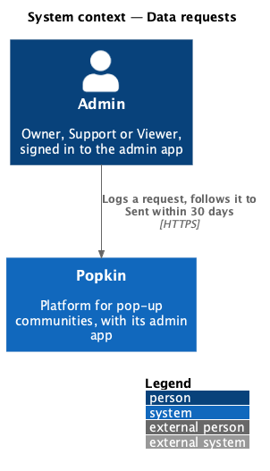
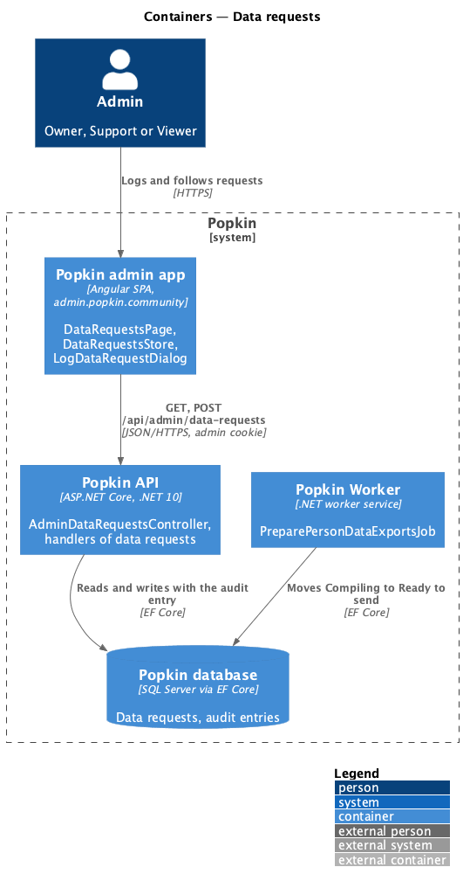
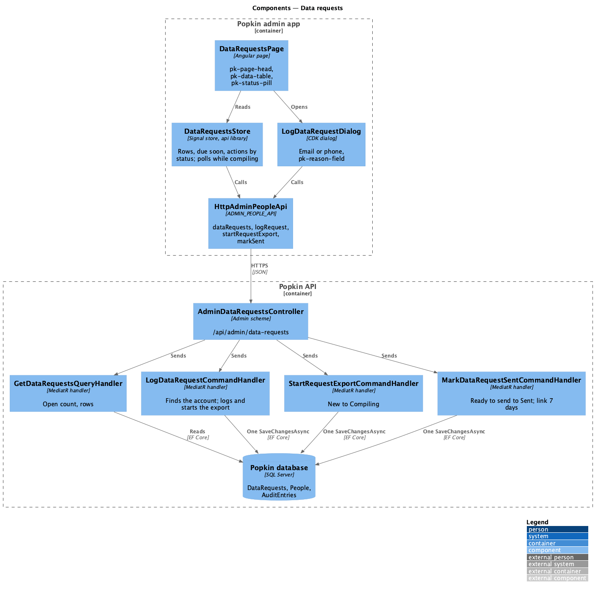
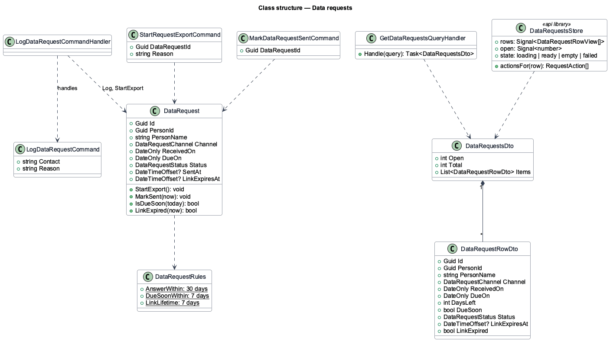
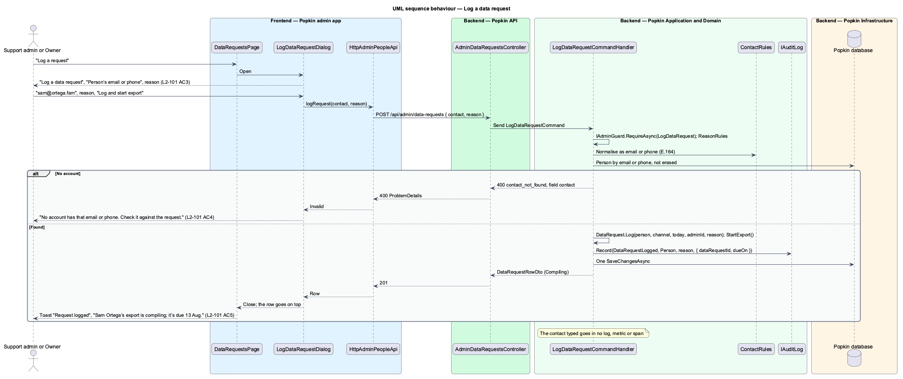
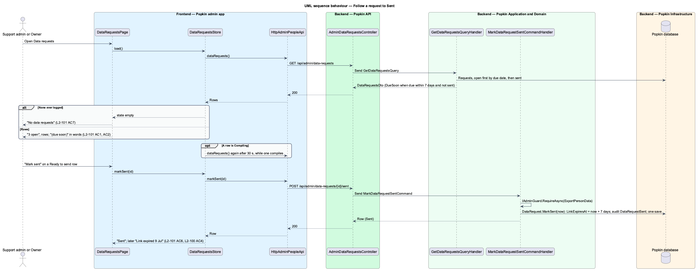

# Data requests

## Overview

The law gives a person 30 days from their request to receive a copy of their data. *Data
requests* is the admin app's register of those requests: each one with its person, how it
arrived, when it was received, when it is due, and how far it has got, from New to Sent. An admin
logs a request that came by email, starts its export, downloads the zip when it is ready and
marks it sent (L1-022).

- **data request** — `DataRequest` row: one subject access request ([Export a person's data](../export-person-data/README.md))
- **received** — the date Popkin received the request; the 30-day clock starts from it (L2-101 AC3)
- **due** — the received date plus 30 days
- **due soon** — a request due within 7 days and not sent (L2-101 AC2)
- **open request** — a request that is not Sent

Owners and Support admins log requests, start exports, download and mark sent; a Viewer sees the
register with every action disabled (L2-086). A request due soon is also listed on the dashboard
(L2-090 AC3), designed in the dashboard's own subsystem.

## Description

### Screens and states

The page is `docs/mocks/admin/pages/data-requests/`, route `/data-requests`, route data
`page: 'data-requests'`.

- `default.html` — `pk-page-head` "Data requests", "3 open. Each must be answered within 30 days
  of receipt." and "Log a request" (`btn--primary btn--sm`); `pk-data-table` "Data requests" with
  Person (`pk-who`: name as a link, how it arrived: "Email to privacy@" or "In-app request"),
  Received, Due (date with days left, "29d", and "(due soon)" as hidden text), Status
  (`pk-status-pill`: `status--info` "New", `status--warn status--busy` "Compiling", `status--ok`
  "Ready to send", plain "Sent") and the action (L2-101 AC1):
  - New — "Start export";
  - Compiling — "About 10 min";
  - Ready to send — the download button ("Download Dev Patel’s export") and "Mark sent";
  - Sent — "Link expired 9 Jul" once the link has expired (L2-101 AC6).
- `viewer.html` — "Log a request", "Start export", the download and "Mark sent" disabled, "Viewer
  admins can’t do this".
- `logged.html` — the new row on top, Compiling; the toast "Request logged", "Sam Ortega’s export
  is compiling; it’s due 13 Aug." (L2-101 AC5).
- `empty.html` — "No data requests", "When someone asks for a copy of their data, in the app or by
  email to privacy@, log it here; the 30-day clock starts on the day it was received." and "Log a
  request" (L2-101 AC7).
- `loading.html`, `error.html` — "Try again" and "Open Health".
- `docs/mocks/admin/dialogs/data-request-new/` — `pk-dialog` "Log a data request", "The 30-day
  clock starts from the day you received it, not today.", `pk-text-field` "Person’s email or
  phone", `pk-reason-field` ("e.g. Email to privacy@ on 14 Jul, ref SAR-0420"), "Log and start
  export" and "Cancel" (L2-101 AC3); `invalid.html` — "No account has that email or phone. Check
  it against the request." on the contact field (L2-101 AC4); `busy`, `failed`.

**Gaps in the mocks and specs.**
- The dialog says the clock starts from the day the request was received, "not today", but it has
  no field for that date or for how the request arrived. The design takes both as fields of the
  dialog, "Received on" (a date, today by default, not in the future) and "How it arrived" (Email,
  In-app), and marks their mock `<TO SUPPLY>`. Until the mock gains them, the request is received
  today and arrives by `Email`.
- "In-app request" names a way for a person to ask from the Popkin app. No requirement, mock or
  code of the Popkin app offers it. A request in status New, logged without starting an export,
  only arises from it. Both are `<TO SUPPLY>`: the design keeps the status and the channel and
  creates neither until the Popkin app's side is specified.

### API

- **`DataRequest`** (Domain, new) — `Id`, `PersonId`, `PersonName` (copied at logging),
  `Channel` (`DataRequestChannel`: `Email`, `InApp`, `Admin`), `ReceivedOn` (`DateOnly`), `DueOn`
  (`ReceivedOn` + 30 days), `Status` (`DataRequestStatus`: `New`, `Compiling`, `ReadyToSend`,
  `Sent`, `Failed`), `LoggedByAdminId`, `LoggedAt`, `Reason`, `StorageKey?`, `ReadyAt?`, `SentAt?`,
  `LinkExpiresAt?` (`SentAt` + 7 days). Methods: `Log`, `StartExport` (New or Failed → Compiling),
  `Ready`, `Fail`, `MarkSent` (ReadyToSend → Sent), `IsDueSoon(today)` and `LinkExpired(now)`.
  `DataRequestRules` holds the 30, 7 and 7 days. A Failed request shows as "New" with "Start
  export" again; a status of its own is `<TO SUPPLY>` for the mock.
- **`GET /api/admin/data-requests`** — `GetDataRequestsQuery`, any admin. 200 `DataRequestsDto
  { open, total, items: DataRequestRowDto[] }`, open requests first by `DueOn`, then sent ones by
  `SentAt` descending. `DataRequestRowDto`: `id`, `personId`, `personName`, `channel`,
  `receivedOn`, `dueOn`, `daysLeft`, `dueSoon`, `status`, `linkExpiresAt`, `linkExpired`. Paging
  of the sent history is `<TO SUPPLY>`; the manifest notes that open requests are few.
- **`POST /api/admin/data-requests`** `{ contact, receivedOn?, channel?, reason }` —
  `LogDataRequestCommand`. `IAdminGuard.RequireAsync(AdminAction.LogDataRequest)`; `ReasonRules`;
  `ContactRules.Normalise` reads the contact as an email (trimmed, lower case) or a phone number
  (E.164); the `Person` with that email or phone, not erased. None: `400` `contact_not_found` on
  field `contact` and nothing is logged (L2-101 AC4). Found: `DataRequest.Log(…)`, `StartExport()`,
  `IAuditLog.Record` with `AuditAction.DataRequestLogged`, target `Person`, the reason and
  `Details { dataRequestId, dueOn }`; one save. 201 `DataRequestRowDto`.
- **`POST /api/admin/data-requests/{id}/export`** `{ reason }` — `StartRequestExportCommand`:
  `RequireAsync(ExportPersonData)`, New or Failed → Compiling, `AuditAction.DataExportStarted`.
  "Start export" on a row opens the same reason dialog as on the person's page.
- **`POST /api/admin/data-requests/{id}/sent`** — `MarkDataRequestSentCommand`:
  `RequireAsync(ExportPersonData)`, `MarkSent(now)`, `AuditAction.DataRequestSent`; 200 the row.
  L2-087 AC1 does not list marking sent among the dialogs with a reason, and the mock's "Mark sent"
  opens no dialog, so it takes none. The brief rule that every admin write carries a reason
  conflicts with that; the design follows L2-087 and the mock and reports it.
- **Download** — `GET /api/admin/data-requests/{id}/download`, in
  [Export a person's data](../export-person-data/README.md#api).

### Frontend

- **`DataRequestsPage`** (`frontend/projects/admin/src/app/pages/data-requests/`) — composes
  `pk-page-head`, `pk-data-table`, `pk-who`, `pk-status-pill`, `pk-button`, `pk-empty-state`,
  `pk-skeleton`; opens `LogDataRequestDialog` and `ExportPersonDataDialog`.
- **`DataRequestsStore`** (`frontend/projects/api/src/lib/admin/people/data-requests.store.ts`) —
  signals `rows`, `open`, `state` (`loading`, `ready`, `empty`, `failed`); `actionsFor(row)` gives
  the actions of each status (L2-101 AC6); it reads again every 30 seconds while a row is
  Compiling, since the Worker sends no event (ADR 0015). `data-request-text.ts` gives "29d",
  "(due soon)", "Link expired 9 Jul". Unit tests cover each status, the due-soon edge at 7 and 8
  days and the polling's start and stop.
- **`LogDataRequestDialog`** (`frontend/projects/admin/src/app/dialogs/log-data-request/`) — CDK
  dialog: the contact field focused first, then `pk-reason-field`; `contact_not_found` marks the
  contact field invalid with the message and keeps both values (L2-101 AC4).

### Telemetry

The contact typed is in the request body only. No log line, metric or span carries it, the
person's name or the reason.

### Decisions

- A data request names the person by id and by the name copied at logging. After an erasure the
  register still shows whom it answered; how long a sent request is kept is `<TO SUPPLY>`.
- The due date counts calendar days from `ReceivedOn`, UTC.

## Requirements

| L2 ID | Refines (L1) | Requirement |
|-------|--------------|-------------|
| `L2-101` | `L1-022` | Data requests: Every request for a person's data, answered within 30 days. (AC1–AC7) |
| `L2-100` | `L1-022` | Export a person's data: A copy of everything a person has posted, for a subject access request. (AC4) |
| `L2-087` | `L1-028` | A reason for every change: An admin says why they change something, and the audit log keeps it. (AC1, AC2, AC4, AC5, AC7) |
| `L2-086` | `L1-028` | Admin roles: Every admin has one role, and the API, not the screen, decides what it allows. (AC1, AC2) |
| `L2-120` | `L1-028` | Audit log: Every action in the console, with who did it and why. (AC5, AC7) |

## Diagrams

An admin logs requests and follows each to Sent within 30 days.

The Popkin API keeps the register; the Worker moves a compiling request to ready.

The page, its store and dialog, and the four handlers.

`DataRequest`, its rules and the register's DTOs.

Logging a request, with a contact that matches no account.

Reading the register, polling while an export compiles, and marking a request sent.

