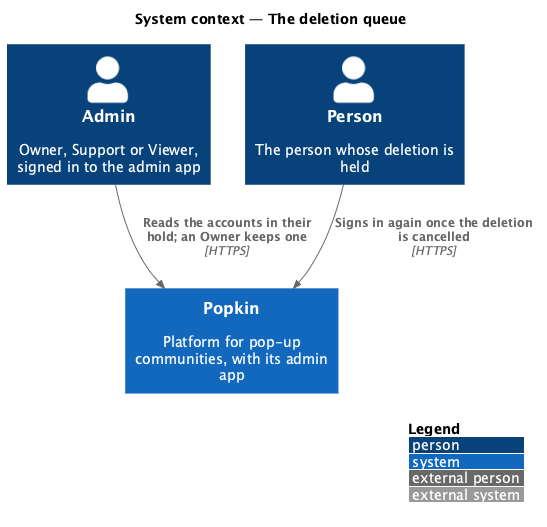
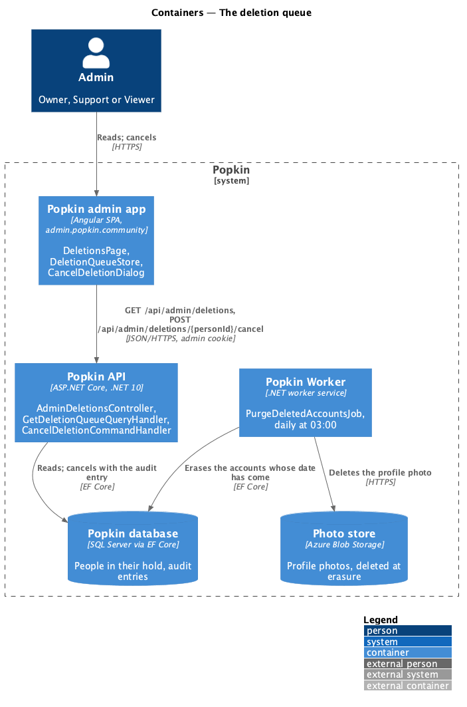
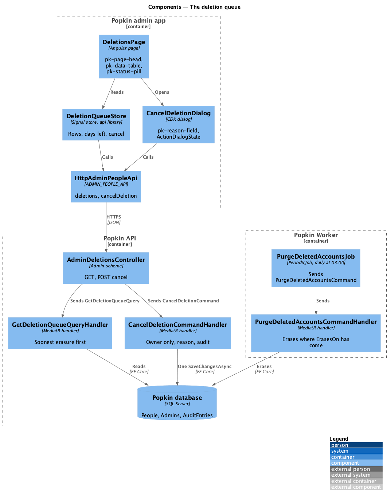
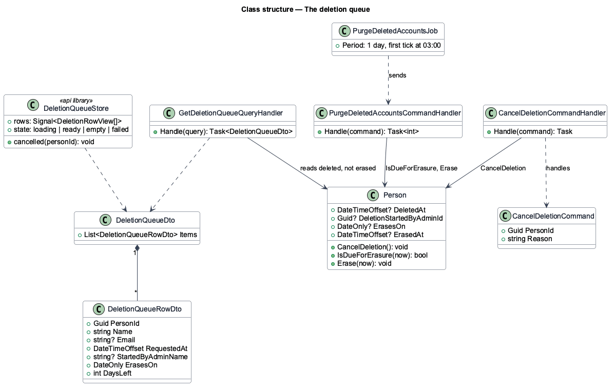
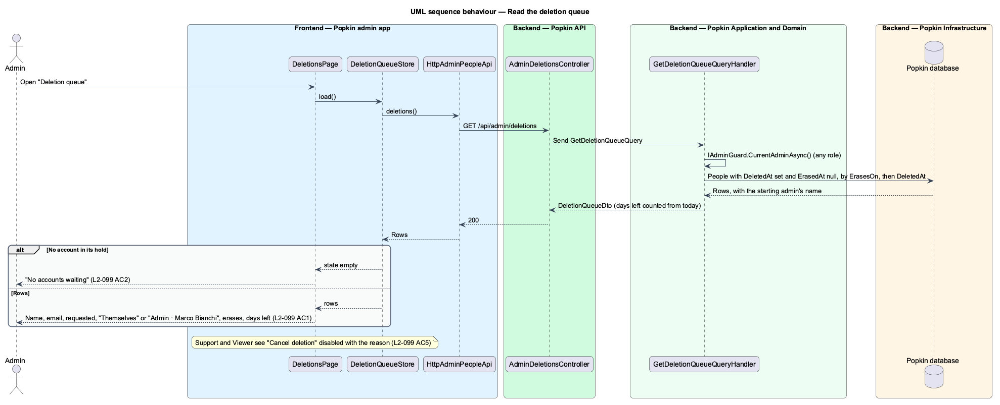
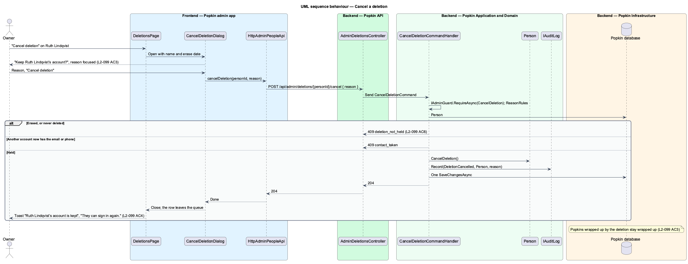
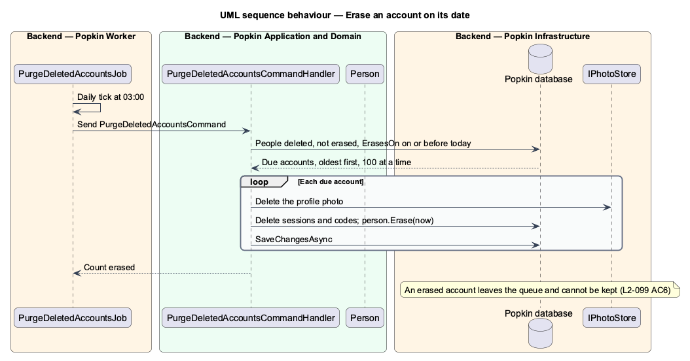

# The deletion queue

## Overview

A deleted account is not erased at once. It waits 30 days, its *hold*, so a person who changes
their mind, or an account deleted by mistake, can be kept. *The deletion queue* lists every
account in its hold, soonest erasure first, and lets an Owner cancel a deletion. On the erase
date the Worker's job Purge deleted accounts erases the account, and it leaves the queue for good
(L1-022).

- **hold** — the 30 days between a deletion and its erasure (L2-099)
- **erase date** — `Person.ErasesOn`, the deletion's date plus 30 days
- **erasure** — removal of the name, phone number, email, profile photo, sessions and codes of a deleted account (L2-049 AC4)
- **cancel a deletion** — the Owner's action that ends a hold and makes the account active again

An account enters the queue when the person deletes it in the Popkin app
([Delete the account](../../accounts/delete-account/README.md)) or an Owner starts its deletion
([Start a deletion](../start-deletion/README.md)). Any admin may read the queue; only an Owner
cancels (L2-086).

## Description

### Screens and states

The page is `docs/mocks/admin/pages/deletions/`, route `/deletions`, route data
`page: 'deletions'`.

- `default.html` — `pk-page-head` "Deletion queue", "Accounts in their 30-day hold. The Purge
  deleted accounts job erases each one at 03:00 on its date."; `pk-data-table` "Deletion queue"
  with Person (`pk-who`: name as a link to the person, email), Requested ("16 Jun"), Started by
  ("Themselves" or "Admin · Marco Bianchi"), Erases ("16 Jul" with days left: `pk-status-pill`
  `status--bad` "2 days" within 7 days, else "in 14 days" as caption) and "Cancel deletion"
  (`btn--quiet btn--sm`) (L2-099 AC1).
- `viewer.html` — "Cancel deletion" disabled, "Viewer admins can’t do this" (L2-099 AC5); a
  Support admin sees "Only Owners can do this" ([Admin roles](../../admin-access/admin-roles/README.md));
  `docs/mocks/admin/pages/person/support.html` draws "Support admins can’t do this".
- `cancelled.html` — the row gone; the toast "Ruth Lindqvist’s account is kept", "They can sign in
  again." (L2-099 AC4).
- `empty.html` — "No accounts waiting", "When someone deletes their account, or an admin starts a
  deletion from a person’s page, it waits here for 30 days before it’s erased." (L2-099 AC2).
- `loading.html`, `error.html` — "Couldn’t load the deletion queue", "Try again", "Open Health".
- `docs/mocks/admin/dialogs/deletion-cancel/` — `pk-dialog` "Keep Ruth Lindqvist’s account?", "The
  erase on 16 Jul is called off and they can sign in again. Popkins they hosted are not handed
  back.", `pk-reason-field` ("e.g. Person changed their mind by email"), "Cancel deletion"
  (`btn--primary`) and "Cancel"; `default`, `invalid`, `busy`, `failed` (L2-099 AC3).

The dialog's last sentence differs from L2-099 AC3, which says "Popkins wrapped up by the
deletion are not reopened". The requirement's meaning stands; the mock's wording is to be
aligned (`<TO SUPPLY>`).

The threshold at which days left turn `status--bad` is not in the requirement; the design uses 7
days, as the mock suggests, and marks it `<TO SUPPLY>`.

### API

- **`GET /api/admin/deletions`** — `AdminDeletionsController.List` sends `GetDeletionQueueQuery`.
  200 `DeletionQueueDto { items: DeletionQueueRowDto[] }`. Any admin.
- **`GetDeletionQueueQueryHandler`** (new) — `People` where `DeletedAt` is set and `ErasedAt` is
  null, ordered by `ErasesOn`, then `DeletedAt`, joined to `Admins` for the starting admin's name.
  `DeletionQueueRowDto`: `personId`, `name`, `email` (or `phone` when there is no email),
  `requestedAt` (`DeletedAt`), `startedByAdminName` (null for "Themselves"), `erasesOn` and
  `daysLeft` (whole days from today, UTC). No page is needed: the manifest notes "four to a few
  dozen rows fit on one page".
- **`POST /api/admin/deletions/{personId}/cancel`** `{ reason }` — `CancelDeletionCommand`. 204.
  `403` `role_not_allowed` for Support and Viewer; `400` reason codes; `409` `deletion_not_held`
  for an account not in its hold or already erased (L2-099 AC6); `409` `contact_taken` (see
  below).
- **`CancelDeletionCommandHandler`** (new) — `IAdminGuard.RequireAsync(AdminAction.CancelDeletion)`;
  `ReasonRules`; loads the `Person`; `Person.CancelDeletion()` clears `DeletedAt`,
  `DeletionStartedByAdminId` and `ErasesOn`; `IAuditLog.Record` with
  `AuditAction.DeletionCancelled`, target `Person` and the reason; one `SaveChangesAsync`.
  - **A contact taken in the meantime.** The unique indexes on `Person.Phone` and `Person.Email`
    apply only where `DeletedAt` is null, so the same phone number or email may sign up again
    during the hold. When another live account now has it, cancelling would break the index; the
    handler answers `409` `contact_taken` and changes nothing. The dialog's copy for that case is
    `<TO SUPPLY>`; no mock draws it.
  - **What the account gets back.** The deletion wrapped up the Popkins the person hosted and
    anonymised every membership ("Former member", `LeftAt` set). Cancelling makes the account
    active and able to sign in (L2-099 AC4); it reopens no Popkin (L2-099 AC3). Whether the
    person's other memberships return, which would need their name and photo restored, is
    `<TO SUPPLY>`; until settled they stay left, and the person returns to no Popkin.
- **`PurgeDeletedAccountsJob`** (changed) — today it ticks every 24 hours from the Worker's start
  and erases every deleted account not yet erased, within a day of deletion. With the hold:
  - Its first tick is at the next 03:00 UTC and then every 24 hours. The time zone of "03:00" is
    `<TO SUPPLY>`; the design uses UTC.
  - `PurgeDeletedAccountsCommandHandler` erases only the accounts where
    `Person.IsDueForErasure(now)`: `DeletedAt` set, `ErasedAt` null and `ErasesOn` on or before
    today. An account deleted before the hold existed has no `ErasesOn`; the migration that adds
    the column sets it to the UTC date of `DeletedAt` plus 30 days.
  - Once erased, the account leaves the queue and cannot be kept (L2-099 AC6).
  - This is the conflict with journey 19's erasure within a day, reported in
    [Start a deletion](../start-deletion/README.md#the-hold-changes-the-popkin-apps-deletion).
- **Copy of the Popkin app** — the toast after a person deletes their own account reads "Your
  personal data is erased within 30 days." That stays true with the hold.

### Frontend

- **`DeletionsPage`** (`frontend/projects/admin/src/app/pages/deletions/`) — composes
  `pk-page-head`, `pk-data-table`, `pk-who`, `pk-status-pill`, `pk-button`, `pk-empty-state`,
  `pk-skeleton`; opens `CancelDeletionDialog`.
- **`DeletionQueueStore`** (`frontend/projects/api/src/lib/admin/people/deletion-queue.store.ts`)
  — signals `rows`, `state` (`loading`, `ready`, `empty`, `failed`); `cancelled(personId)` removes
  the row. Days-left text and tone come from `deletion-text.ts`; unit tests cover 0, 1, 7, 8 and 30
  days.
- **`CancelDeletionDialog`** (`frontend/projects/admin/src/app/dialogs/cancel-deletion/`) — CDK
  dialog with `pk-reason-field` and `ActionDialogState`.

### Decisions

- The queue reads the `Person` rows themselves; there is no separate queue table, so a deletion
  and its place in the queue cannot disagree.
- Cancelling writes the audit entry; the original deletion's entry stays, so the log tells both.

## Requirements

| L2 ID | Refines (L1) | Requirement |
|-------|--------------|-------------|
| `L2-099` | `L1-022` | The deletion queue: The accounts in their 30-day hold, and the way to keep one. (AC1–AC6) |
| `L2-049` | `L1-002` | Delete an account: A person removes themselves from Popkin. (AC4, erasure within 30 days) |
| `L2-087` | `L1-028` | A reason for every change: An admin says why they change something, and the audit log keeps it. (AC1, AC2, AC4, AC5, AC7) |
| `L2-086` | `L1-028` | Admin roles: Every admin has one role, and the API, not the screen, decides what it allows. (AC1, AC2, AC3) |
| `L2-120` | `L1-028` | Audit log: Every action in the console, with who did it and why. (AC5) |

## Diagrams

Admins read the queue; an Owner keeps an account, whose person may then sign in again.

The Popkin API reads and cancels; the Worker erases each account on its date.

The page and its store, the two handlers, and the job with its handler.

The hold's fields and methods on `Person`, and the queue's DTOs.

Reading the queue, with its empty state.

Cancelling a deletion, with an account no longer held and a contact taken in the meantime.

The daily job erases only the accounts whose erase date has come.

