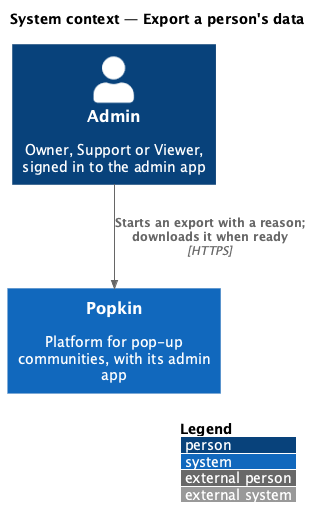
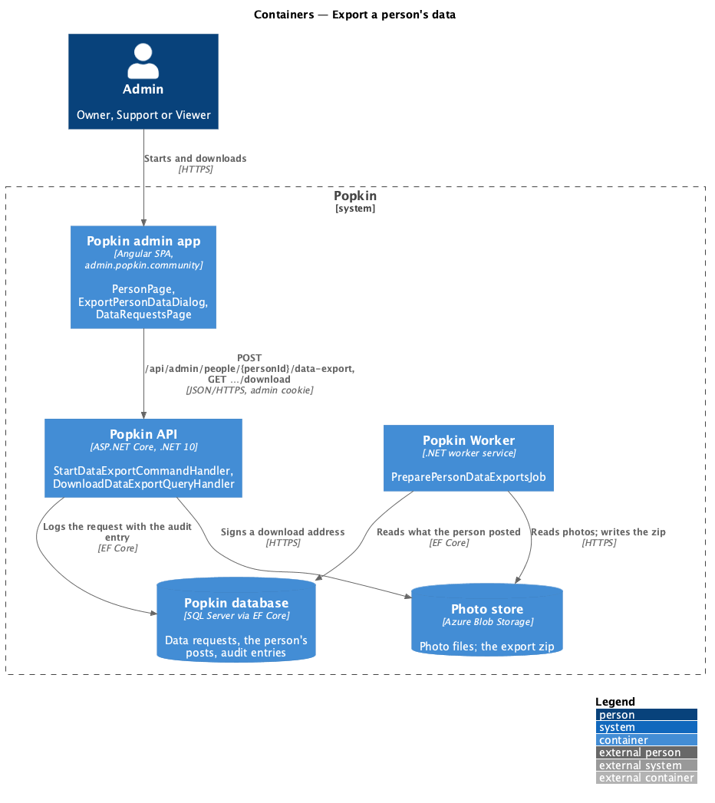
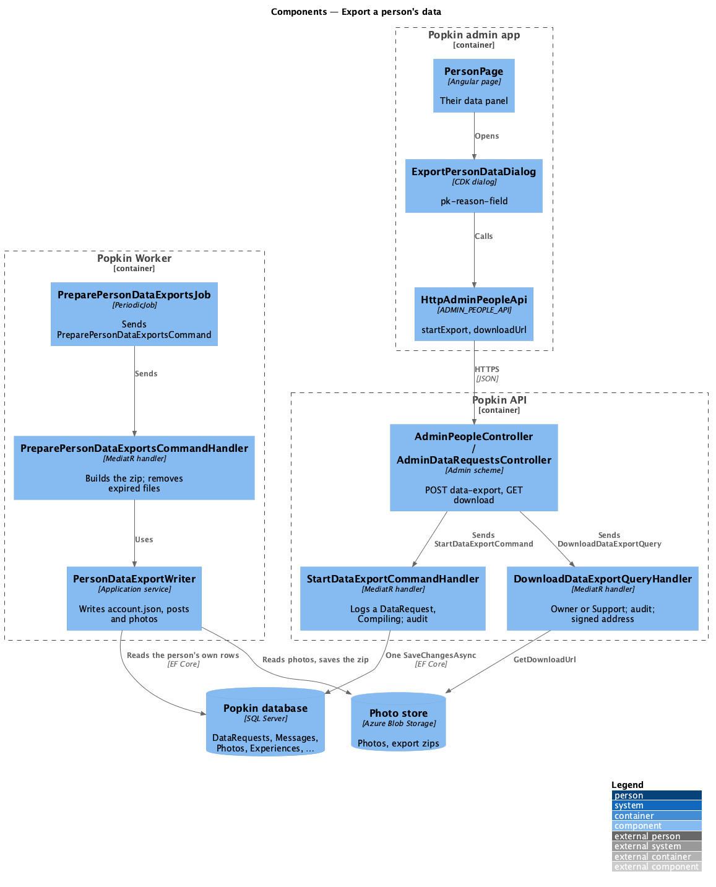
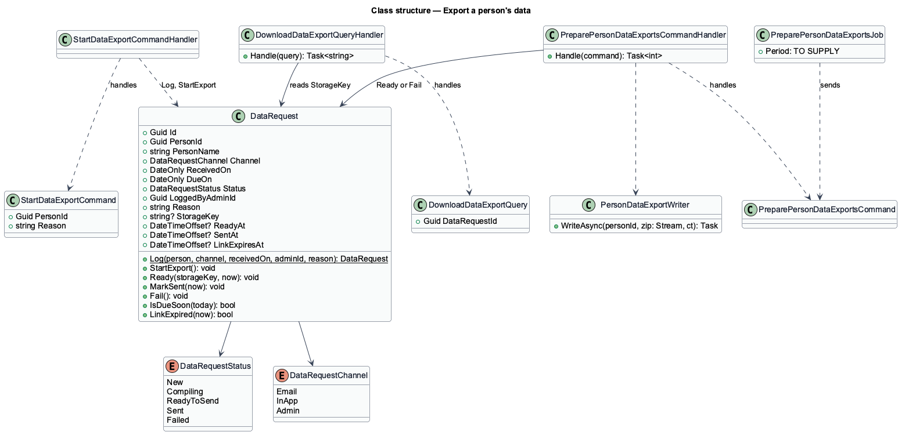
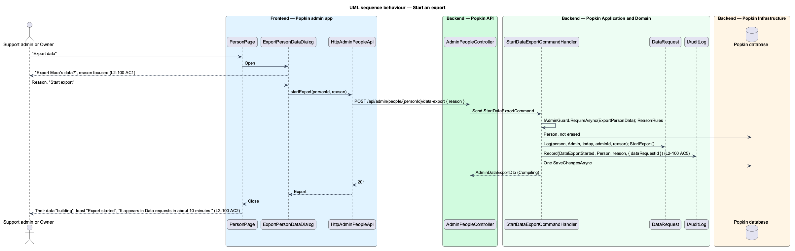
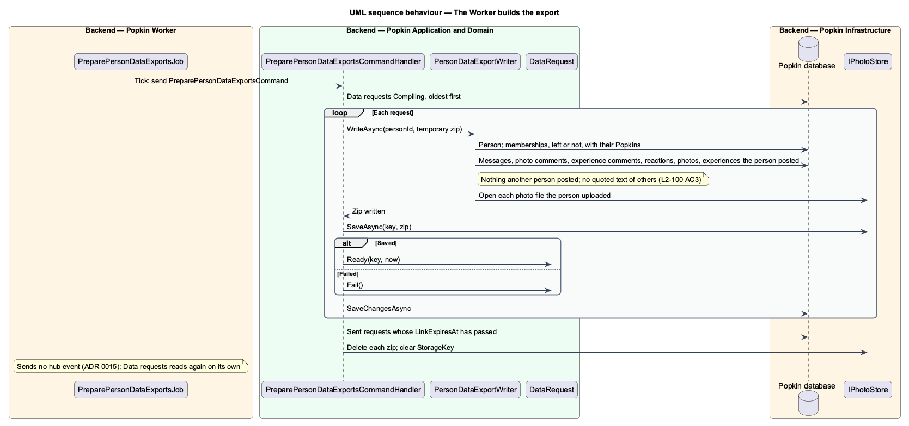
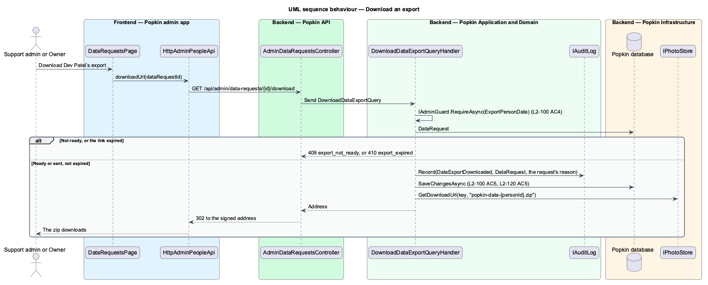

# Export a person's data

## Overview

A person may ask Popkin for a copy of everything it holds about them: a subject access request,
answered within 30 days. *Export a person's data* starts that copy from the person's page. The
Worker builds a zip of the person's account, what they posted and the Popkins they belong or
belonged to, and nothing anyone else posted. The zip appears under
[Data requests](../data-requests/README.md), where an Owner or Support admin downloads it and
sends it on (L1-022).

- **subject access request** — a person's request for a copy of their personal data
- **data request** — `DataRequest` row: one subject access request with its person, how it arrived, its receipt date, its due date and its status
- **data export** — the zip a data request produces, kept in the photo store
- **export link** — the download of a data export, which expires 7 days after the request is marked sent (L2-100 AC4)

Starting an export logs a data request for the person, received today (L2-100 AC2). Logging a
request from an email or phone number is [Data requests](../data-requests/README.md); both start
the same build. Owners and Support admins export; a Viewer sees "Export data" disabled (L2-086).

## Description

### Screens and states

- `docs/mocks/admin/pages/person/default.html` — Their data: "Build a download of everything Mara
  has posted, for a subject access request." and "Export data".
- `docs/mocks/admin/dialogs/person-export/` — `pk-dialog` "Export Mara’s data?", "Builds a zip of
  their profile, messages, photos and Popkin history. It appears under Data requests when ready.",
  `pk-reason-field` ("e.g. Subject access request, ref SAR-0419"), "Start export" and "Cancel"
  (L2-100 AC1); `default`, `invalid`, `busy`, `failed`.
- `docs/mocks/admin/pages/person/export-started.html` — the toast "Export started", "It appears in
  Data requests in about 10 minutes." with the link (L2-100 AC2).
- `docs/mocks/admin/pages/data-requests/default.html` — a "Ready to send" row with the download
  button ("Download Dev Patel’s export") and "Mark sent" (L2-100 AC4).

L2-100 AC2 says "the page says the export is building". `export-started.html` says so in the
toast only; Their data keeps its sentence. The design adds a line under Their data while a request
of the person is New or Compiling, "Export building; it appears in Data requests when ready."
Its wording is `<TO SUPPLY>` for the mock.

### API

- **`POST /api/admin/people/{personId}/data-export`** `{ reason }` —
  `AdminPeopleController.StartExport` sends `StartDataExportCommand`. 201 `AdminDataExportDto
  { dataRequestId, status }`. `403` `role_not_allowed` for a Viewer; `400` reason codes; `404`
  `person_not_found`; `409` `export_in_progress` when a request of the person is already compiling.
- **`StartDataExportCommandHandler`** (new) — `IAdminGuard.RequireAsync(AdminAction.ExportPersonData)`;
  `ReasonRules`; `DataRequest.Log(person, DataRequestChannel.Admin, today, adminId, reason)` and
  `StartExport()` (status `Compiling`); `IAuditLog.Record` with `AuditAction.DataExportStarted`,
  target `Person`, the reason and `Details { dataRequestId }` (L2-100 AC5); one save.
- **`DataRequest`** (Domain, new) — see [Data requests](../data-requests/README.md#api) for its
  fields and states. `PersonName` is copied at logging, so the row still names the person after an
  erasure.
- **`PreparePersonDataExportsJob`** (`Popkin.Worker`, new) — a `PeriodicJob` that sends
  `PreparePersonDataExportsCommand` on each tick. Its period is `<TO SUPPLY>`; the toast's "about
  10 minutes" bounds it. It sends no hub event (ADR 0015).
- **`PreparePersonDataExportsCommandHandler`** (new) — for each `Compiling` request, oldest first:
  writes the zip to a temporary stream with `PersonDataExportWriter`, saves it through
  `IPhotoStore.SaveAsync(key, stream, "application/zip")` and calls `DataRequest.Ready(key, now)`
  (status `ReadyToSend`); on failure `DataRequest.Fail()`. It also deletes the zip of each `Sent`
  request whose `LinkExpiresAt` has passed and clears its `StorageKey`. A request cut short by a
  stop is begun again on the next tick, as `PrepareAlbumExportsCommand` does.
- **`PersonDataExportWriter`** (Application, new) — what the zip holds (L2-100 AC3):

  | File | Holds |
  |---|---|
  | `account.json` | name, email, phone number, joined, how they sign in, sessions (device, client, since) |
  | `popkins.json` | each Popkin the person belongs or belonged to: name, emoji, Host or Member, joined, left |
  | `messages.json` | each message the person posted, in Everyone or a direct message, with its Popkin and time; a reply's quote is left out |
  | `comments.json` | each photo comment and experience comment the person posted |
  | `reactions.json` | each reaction the person added to a message or a photo, with what it was on by id |
  | `experiences.json` | each experience the person shared, with their own rating and keen |
  | `photos/` | each photo the person uploaded, at the size stored, with its caption in `photos.json` |

  It reads by the person's own `Membership` ids and `Person.Id` only, so nothing another person
  posted is in the zip. The file format (JSON, CSV or both) and the names are `<TO SUPPLY>`; L2-100
  names the contents, not the form. Time off and working hours are personal data the person
  entered; whether they belong in the export is `<TO SUPPLY>`.
- **Download** — `GET /api/admin/data-requests/{dataRequestId}/download`,
  `DownloadDataExportQuery`. `IAdminGuard.RequireAsync(AdminAction.ExportPersonData)` (Owner or
  Support, L2-100 AC4); `409` `export_not_ready`; `410` `export_expired` when `LinkExpiresAt` has
  passed. It records `AuditAction.DataExportDownloaded` with target `DataRequest` and saves, then
  answers `302` to `IPhotoStore.GetDownloadUrl(key, "popkin-data-{personId}.zip")`, a signed address
  that expires (L2-051 AC2).
  - L2-100 AC5 asks that the download be recorded "with its reason". No mock gives a download a
    reason field, so the entry carries the reason the request was logged with. Whether the admin
    gives a fresh reason for each download is `<TO SUPPLY>`.

### Conflict with L2-113

L2-113 and ADR 0015 describe the Worker's four jobs (Wrap up due Popkins, Remove photos of
wrapped-up Popkins, Prepare album exports, Purge deleted accounts), and the Jobs page lists those
four. `PreparePersonDataExportsJob` is a fifth. The design follows L2-100 AC3 ("when the Worker
builds it") and reports the conflict: L2-113, the Jobs mock and the Worker's description in
`docs/detailed-designs/README.md` lack the fifth job, its sentence and its schedule. Building the
zip in the API instead would hold a request open for minutes, against ADR 0009's one instance.

### Frontend

- **`ExportPersonDataDialog`** (`frontend/projects/admin/src/app/dialogs/export-person-data/`) —
  CDK dialog with `pk-reason-field` and `ActionDialogState`; on success `PersonPage` shows the toast
  with a link to `/data-requests`.
- **`PersonStore`** — `export` from `AdminPersonDto` drives the "building" line.

### Telemetry

The writer logs counts only (files, photos, bytes) and the request id. No log line, metric or span
carries the person's name, contact, message text or a photo key.

### Decisions

- The zip lives in the photo store beside album exports, under its own key prefix
  (`exports/people/`), so the same signed downloads and deletion apply.
- A ready export that is never marked sent has no expiry in L2-100; how long it is kept is
  `<TO SUPPLY>`.

## Requirements

| L2 ID | Refines (L1) | Requirement |
|-------|--------------|-------------|
| `L2-100` | `L1-022` | Export a person's data: A copy of everything a person has posted, for a subject access request. (AC1–AC5) |
| `L2-087` | `L1-028` | A reason for every change: An admin says why they change something, and the audit log keeps it. (AC1, AC2, AC4, AC5, AC7) |
| `L2-086` | `L1-028` | Admin roles: Every admin has one role, and the API, not the screen, decides what it allows. (AC1, AC2) |
| `L2-120` | `L1-028` | Audit log: Every action in the console, with who did it and why. (AC5, AC7) |

## Diagrams

An admin starts an export and later downloads it.

The Popkin API logs the request; the Worker reads the person's rows and photos and writes the zip
to the photo store.

The two API handlers, the new job, its handler and the writer.

`DataRequest`, its status and channel, and the types around the build and the download.

Starting an export logs a data request, compiling, with its audit entry.

The Worker builds each compiling export and removes the zips whose link has expired.

A download is audited and answered with a signed address.

