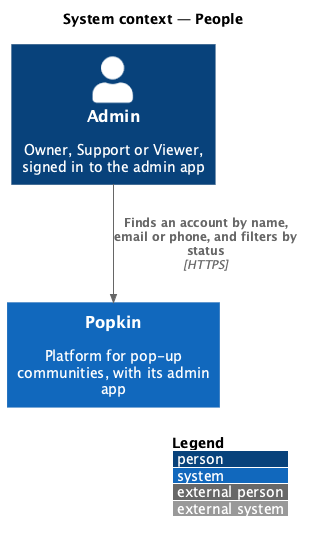
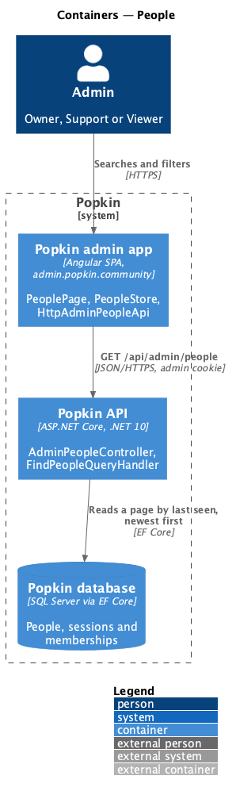
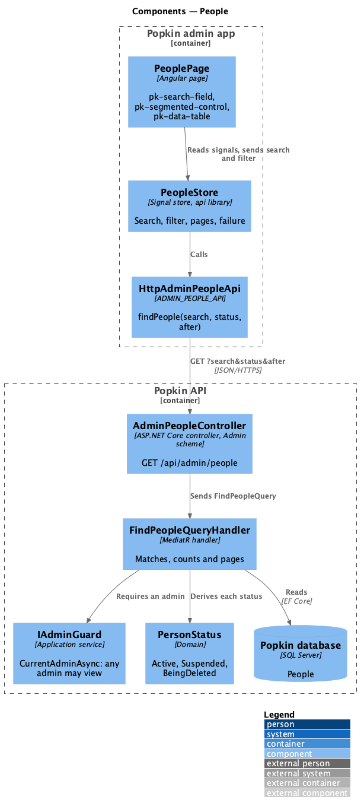
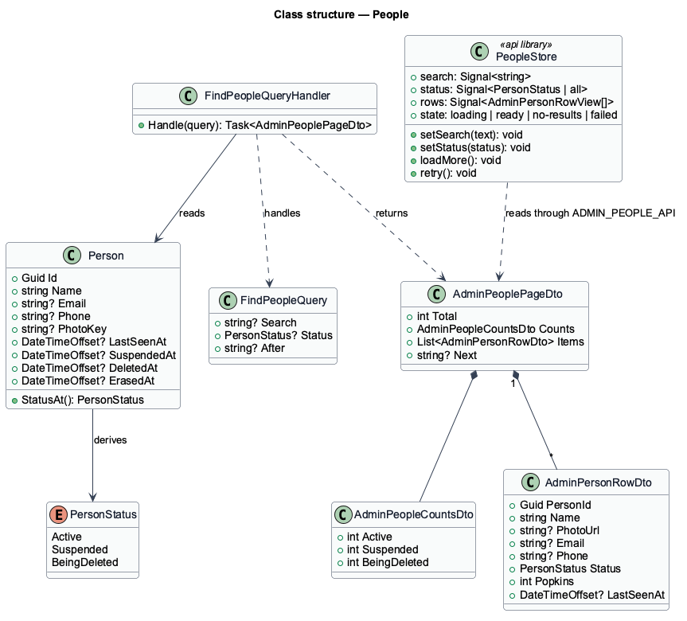
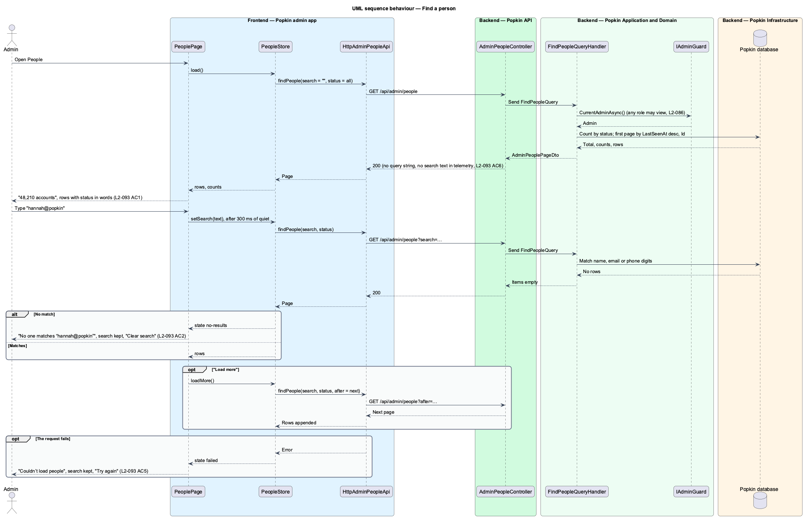

# People

## Overview

Popkin is a platform for pop-up communities. Its admin app, a separate application at
`https://admin.popkin.community` (L1-019, L1-021 to L1-028), lets the people who run Popkin help
a person who writes in and protect others from someone who causes harm. Every one of those tasks
starts by finding the account. *People* is the admin app's list of every account, newest
activity first, with a search and a status filter (L1-022).

- **admin** — person who runs Popkin from the admin app, with one role: Owner, Support or Viewer (`docs/specs/L1.md`, Roles)
- **account** — `Person` row of the Popkin database: someone who signed up with a phone number or an email
- **person status** — one of "Active", "Suspended" and "Being deleted", derived from the account's suspension and deletion
- **last seen** — the most recent time a live session of the person made a request to the Popkin API

People belongs to the subsystem *Admin people*. Choosing a row opens the person's page
([A person](../view-person/README.md)). Any admin may view people (L2-086): the list has no
action, so it looks the same for every role. Inside the Popkin app an admin is an ordinary
person; nothing here reads an admin's own account.

## Description

### Screens and states

The page is `docs/mocks/admin/pages/people/`, route `/people`, route data `page: 'people'`.

- `default.html` — `pk-page-head` "People" with "48,210 accounts. Search by name, email or phone
  number."; a toolbar of `pk-search-field` ("Name, email or phone", label visually hidden) and
  `pk-segmented-control` "Show" with All, Active, Suspended and Being deleted, the last two with
  their counts; `pk-data-table` "People" with the columns Person (`pk-who`: avatar, name as the
  row's link, email), Phone, Status (`pk-status-pill`: `status--ok` "Active", `status--bad`
  "Suspended", `status--warn` "Being deleted"), Popkins and Last seen; `panel__foot` "Showing 13
  of 48,210" with "Load more" (L2-093 AC1).
- `suspended.html` — "Suspended" chosen: only suspended accounts (L2-093 AC3).
- `no-results.html` — the search "hannah@popkin" stays; `pk-empty-state` (compact) "No one matches
  “hannah@popkin”", "Try part of an email address, or a phone number without the country code."
  and "Clear search" (L2-093 AC2).
- `loading.html` — the head and toolbar with skeleton rows.
- `error.html` — the search and filter stay; "Couldn’t load people", "The admin API didn’t answer.
  Nothing has changed; try again, or check Health if it keeps happening.", "Try again" and "Open
  Health" (L2-093 AC5).

The mock has no `empty` state: Popkin always has accounts, so an empty list is only a search with
no match. The counts drawn on the filter cover Suspended and Being deleted; the count of Active
and All is the head's total. A count on Active as well, as L2-093 AC3 reads ("each choice counts
its accounts"), is `<TO SUPPLY>` for the mock.

### API

- **`GET /api/admin/people?search=&status=&after=`** — `AdminPeopleController.Find` sends
  `FindPeopleQuery`. 200 `AdminPeoplePageDto { total, counts { active, suspended, beingDeleted },
  items: AdminPersonRowDto[], next }`. Without an admin session `401`; with a Popkin app session
  only `403` (L2-078 AC3).
- **`FindPeopleQueryHandler`** (`Popkin.Application.Admin.People`, new) — calls
  `IAdminGuard.CurrentAdminAsync()`: any admin may view. It reads `People` where `ErasedAt` is
  null. An erased account has no name, contact or status to show and is left out.
  - **Search** — trimmed; matched case-insensitively against `Name` and `Email` (contains) and,
    for a text with digits, against the digits of `Phone` (contains), so a number without its
    country code matches. Fewer than 2 characters search nothing. The index that keeps this
    fast at the size of the mock (48,210 accounts) is `<TO SUPPLY>`.
  - **Status** — `PersonStatus` (Domain, new) derived by `Person.StatusAt()`: `BeingDeleted`
    when `DeletedAt` is set, else `Suspended` when `SuspendedAt` is set, else `Active`.
  - **Order and pages** — `LastSeenAt` descending, nulls last, then `Id`; keyset paging through
    an opaque `after` cursor. The page size is `<TO SUPPLY>` (the mock shows 13).
  - **Counts** — `total` counts every account not erased; `counts` counts each status, whatever
    the search, so the filter's numbers do not move while typing.
  - **Popkins** — memberships not left (`Membership.LeftAt` null).
- **`AdminPersonRowDto`** — `personId`, `name`, `photoUrl` (read address of `Person.PhotoKey`),
  `email`, `phone`, `status`, `popkins`, `lastSeenAt`.
- **`Person.LastSeenAt`** — new, written by `RecordSessionActivityCommand`
  ([A person](../view-person/README.md#api)).

### Frontend

- **`PeoplePage`** (`frontend/projects/admin/src/app/pages/people/people.ts` + `.html`) — a
  container composing `pk-page-head`, `pk-search-field`, `pk-segmented-control`, `pk-data-table`,
  `pk-who`, `pk-status-pill`, `pk-empty-state` and `pk-skeleton`. Search and filter live in the
  query string (`?q=&show=`), so a link or a reload keeps them.
- **`PeopleStore`** (`frontend/projects/api/src/lib/admin/people/people.store.ts`) — signals
  `search`, `status`, `rows`, `total`, `counts`, `next`, `state` (`loading`, `ready`,
  `no-results`, `failed`). A search is sent 300 ms after the last key; a newer search cancels the
  older request, so a late answer never replaces a newer list. `loadMore()` appends the next page;
  `retry()` repeats the last request. Unit tests cover the debounce, the cancelling, the
  appending and each state (ADR 0011).
- **`AdminPeopleApi`** / **`ADMIN_PEOPLE_API`** / **`HttpAdminPeopleApi`** — `findPeople(search,
  status, after)`; view model `AdminPersonRowView` with the last seen as text ("4 min ago",
  "Yesterday", "16 Jun") from `person-text.ts`.

### Telemetry

The search is a query-string value. The API records each admin request by its route template
(ADR 0012), so no log line, metric or span carries the search text, an email, a phone number or
a name (L2-093 AC6).

### Decisions

- The search is a read, so it carries no reason and writes no audit entry; L2-120 AC5 audits
  changes and the reads it names, and a search is not one of them.
- An erased account leaves the list; the deletion queue and the audit log keep its name.

## Requirements

| L2 ID | Refines (L1) | Requirement |
|-------|--------------|-------------|
| `L2-093` | `L1-022` | People: Every account, newest activity first. (AC1–AC6) |
| `L2-086` | `L1-028` | Admin roles: Every admin has one role, and the API, not the screen, decides what it allows. (Find and view people: every role) |
| `L2-078` | `L1-012` | Admin access: Only admins reach the admin app. (AC3) |

## Diagrams

An admin finds an account in Popkin through the admin app.

The admin app asks the Popkin API, which reads the Popkin database.

`PeopleStore` owns the search, the filter and the pages; `FindPeopleQueryHandler` matches,
counts and pages.

The page DTO, the row DTO and the status derived from `Person`.

A search with no match keeps the search on the page; "Load more" appends the next page; a failure
offers "Try again" (L2-093 AC2, AC5).

