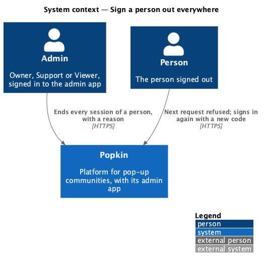
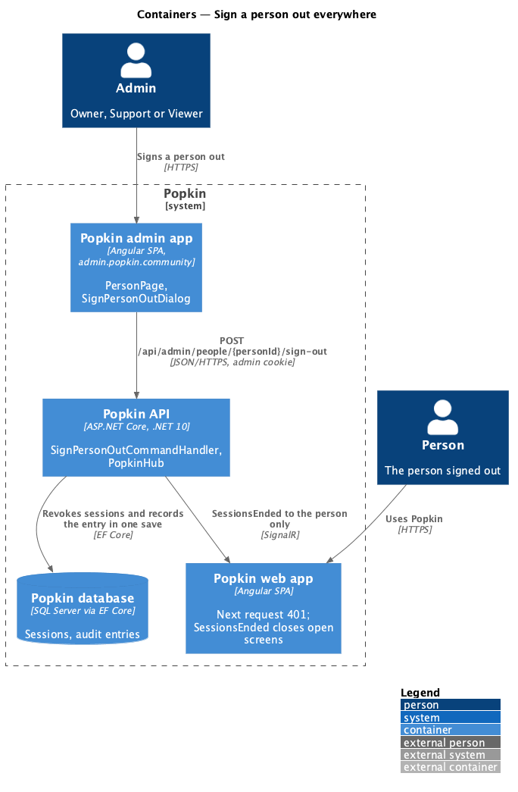
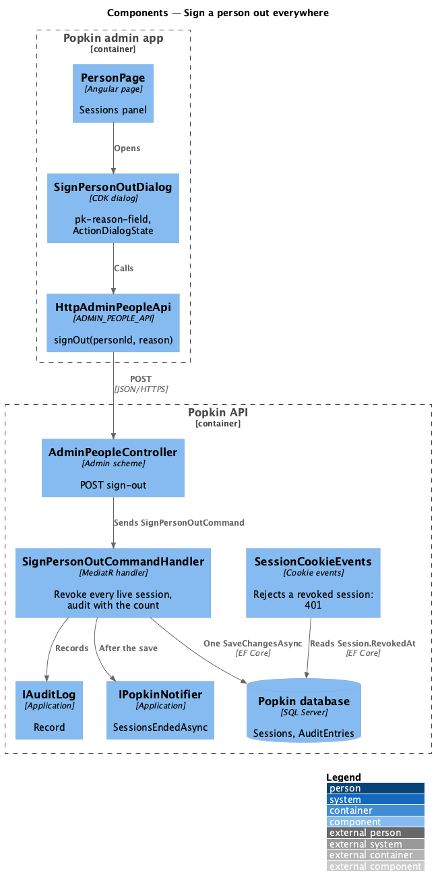
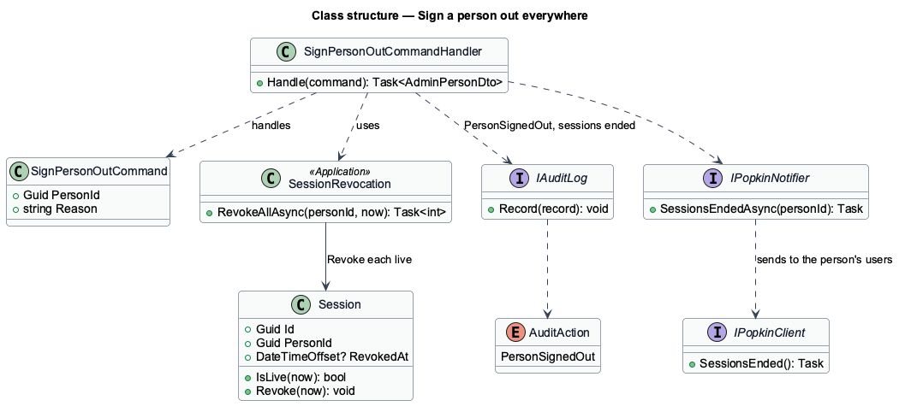
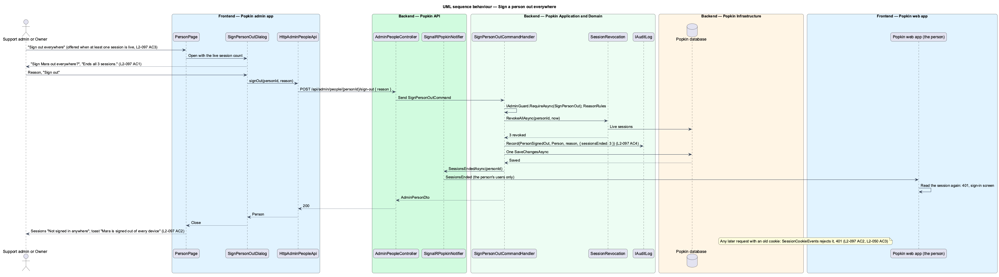

# Sign a person out everywhere

## Overview

A person who loses their phone, or sees a session they do not recognise, writes to Popkin.
*Sign a person out everywhere* ends every session the person holds, on every device, so the
next request from any of them is refused. The person signs back in with a new code; nothing else
about their account changes (L1-022).

- **sign out everywhere** — revocation of every live session of one person by an admin, with a reason
- **revoked session** — session whose `RevokedAt` is set; `SessionCookieEvents` rejects its cookie on the next request (L2-050 AC3)

A Support admin or an Owner signs a person out; a Viewer sees the action disabled (L2-086). The
action is in the Sessions panel of [A person](../view-person/README.md) and is offered only
while the person has at least one live session. Its revocation step, `SessionRevocation`, is
shared with [Suspend a person and lift it](../suspend-person/README.md).

## Description

### Screens and states

- `docs/mocks/admin/pages/person/default.html` — Sessions: "Signed in on 3 devices", "Sign out
  everywhere" (`btn--secondary btn--sm`) and the three sessions.
- `docs/mocks/admin/dialogs/person-sign-out/` — `pk-dialog` "Sign Mara out everywhere?", "Ends all
  3 sessions. They can sign back in with a new code.", `pk-reason-field` (placeholder "e.g. Lost
  phone, asked by email"), "Sign out" (`btn--primary`) and "Cancel" (L2-097 AC1); `default.html`,
  `invalid.html`, `busy.html` and `failed.html` as for every reason dialog (L2-087).
- `docs/mocks/admin/pages/person/signed-out.html` — Sessions "Not signed in anywhere", "Mara will
  need a new code to sign back in." with no "Sign out everywhere" (L2-097 AC3); the toast "Mara is
  signed out of every device", "They’ll need a new code to sign back in." (L2-097 AC2).
- `docs/mocks/admin/pages/person/viewer.html` — "Sign out everywhere" disabled, "Viewer admins
  can’t do this".

### API

- **`POST /api/admin/people/{personId}/sign-out`** `{ reason }` — `AdminPeopleController.SignOut`
  sends `SignPersonOutCommand`. 200 `AdminPersonDto`. `403` `role_not_allowed`; `400`
  `reason_required` / `reason_too_long`; `404` `person_not_found`; `409` `no_live_sessions` when
  nothing is live, so a stale page cannot write an entry that ended nothing.
- **`SignPersonOutCommandHandler`** (new):
  1. `IAdminGuard.RequireAsync(AdminAction.SignPersonOut)`; `ReasonRules`.
  2. `SessionRevocation.RevokeAllAsync(personId, now)` (Application, new) revokes each live
     `Session` with `Session.Revoke(now)` and returns the count.
  3. `IAuditLog.Record` with `AuditAction.PersonSignedOut`, target `Person`, the reason and
     `Details { sessionsEnded }` (L2-097 AC4).
  4. One `SaveChangesAsync`.
  5. After the save, `IPopkinNotifier.SessionsEndedAsync(personId)`.
- **The next request** — `SessionCookieEvents.ValidatePrincipal` sends `ValidateSessionQuery`,
  which finds the session revoked; the cookie is rejected and the request answers `401`
  (L2-097 AC2). No new code is needed for this; it is the rule of L2-050 AC3.
- **`SessionsEnded`** (new hub event) — `IPopkinClient.SessionsEnded()`, a fact event with no
  payload, sent through `Clients.User(personId)` to the person's own connections only, never to a
  Popkin's group. It is a hint (shared real-time rules): the web app's `SessionStore` reads
  `GET /api/auth/session`, meets `401` and opens the sign-in screen. Its recovery read is any
  request, which answers `401`. The hub connection of a revoked session is then stopped by the
  client; the server does not abort it.

### Frontend

- **`SignPersonOutDialog`** (`frontend/projects/admin/src/app/dialogs/sign-person-out/`) — CDK
  dialog on `pk-dialog` with `pk-reason-field` and `ActionDialogState`. Data in: the person's id,
  name and live session count. "Ends all {n} sessions." reads "Ends the 1 session." for one;
  that wording is `<TO SUPPLY>`.
- **`PersonStore.offers`** — "Sign out everywhere" only while `sessions` is not empty
  (L2-097 AC3).
- **Web app** — `PopkinRealtime` maps `SessionsEnded`; `SessionStore` clears itself and the router
  opens `/sign-in`. The copy the person sees, if any, is `<TO SUPPLY>`; no mock draws it.

### Decisions

- A person's sessions are their own; signing out everywhere does not touch their memberships,
  their calls in the database or their suspension.
- The count of sessions ended goes in the entry's `Details`, not in its reason, so the audit log
  can show it in its own words.

## Requirements

| L2 ID | Refines (L1) | Requirement |
|-------|--------------|-------------|
| `L2-097` | `L1-022` | Sign a person out everywhere: For a lost phone or a session that should not be there. (AC1–AC4) |
| `L2-087` | `L1-028` | A reason for every change: An admin says why they change something, and the audit log keeps it. (AC1, AC2, AC4, AC5, AC7) |
| `L2-086` | `L1-028` | Admin roles: Every admin has one role, and the API, not the screen, decides what it allows. (AC1, AC2) |
| `L2-120` | `L1-028` | Audit log: Every action in the console, with who did it and why. (AC5) |

## Diagrams

An admin ends the person's sessions; the person signs in again with a new code.

The Popkin API revokes the sessions and records the entry in one save, then tells the person's
own connections.

`SignPersonOutCommandHandler`, `SessionRevocation`, the audit log and `SessionCookieEvents`.

The command, the shared revocation and the new hub event.

Signing out everywhere, from the dialog to the person's screen.

