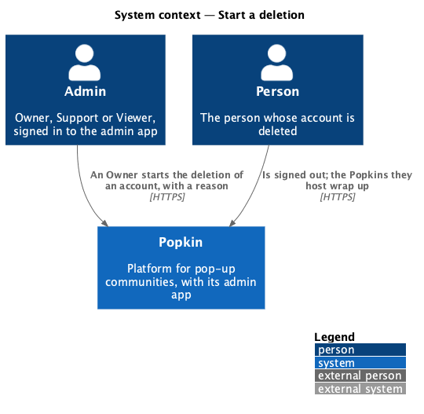
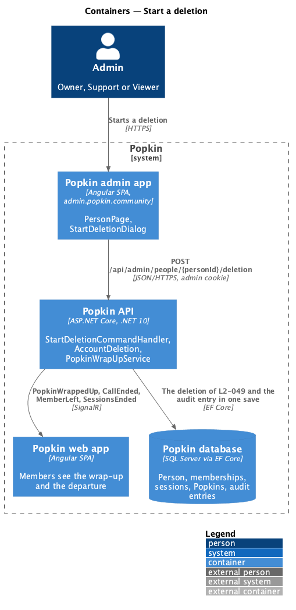
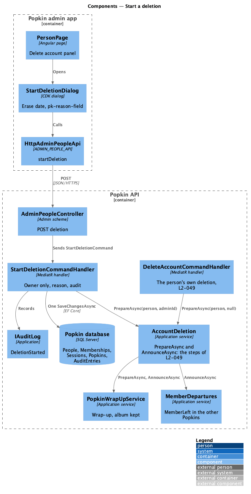
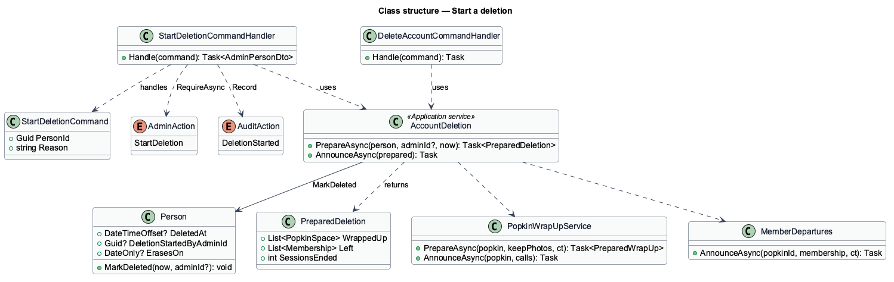
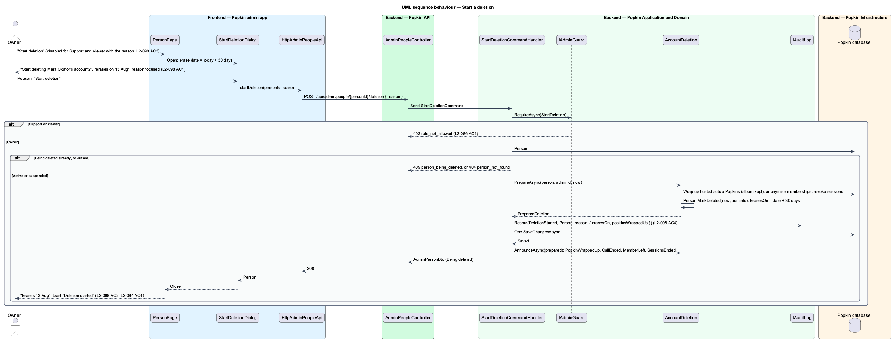

# Start a deletion

## Overview

A person may ask Popkin, by email or by letter, to delete their account rather than doing it in
the app. *Start a deletion* lets an Owner do for them exactly what the person could do
themselves under L2-049 ([Delete the account](../../accounts/delete-account/README.md)): their
sessions end, the active Popkins they host wrap up, and their personal data is erased on a named
date, 30 days from today. Until then the deletion waits in the
[deletion queue](../deletion-queue/README.md), where an Owner can cancel it (L1-022).

- **deletion** — the request of L2-049 that marks a `Person` deleted, wraps up the active Popkins they host, anonymises their memberships and revokes their sessions in one unit of work
- **hold** — the 30 days between a deletion and the erasure, during which an Owner may cancel it (L2-099)
- **erase date** — the date the account erases, `ErasesOn`: the deletion's date plus 30 days
- **started by** — who asked for the deletion: "Themselves" or "Admin · {admin}"

Only an Owner starts a deletion (L2-086). The action is the Delete account panel of
[A person](../view-person/README.md).

## Description

### Screens and states

- `docs/mocks/admin/pages/person/default.html` — Delete account: "Starts the 30-day hold, then
  erases the account. Popkins they host pass to the longest-standing member." and "Start
  deletion" (`btn--danger-text`).
- `docs/mocks/admin/pages/person/support.html`, `viewer.html` — "Start deletion" disabled, "Support
  admins can’t do this" / "Viewer admins can’t do this" (L2-098 AC3).
- `docs/mocks/admin/dialogs/person-delete/` — `pk-dialog` "Start deleting Mara Okafor’s account?",
  "They’re signed out now. The account erases on 13 Aug, 30 days from today; until then you can
  cancel it from the deletion queue.", `pk-reason-field` ("e.g. Requested by email on 12 Jul"),
  "Start deletion" (`btn--danger`) and "Cancel" (L2-098 AC1); `default`, `invalid`, `busy`,
  `failed`.
- `docs/mocks/admin/pages/person/deletion-started.html` — the status "Erases 13 Aug"
  (`status--warn`); Sessions "Not signed in anywhere", "Mara can’t sign in while the account waits
  to be erased."; Access "Deletion started. The account erases on 13 Aug, in 30 days. Until then it
  can’t sign in; cancel it from the deletion queue." with the link; no Delete account panel; the
  toast "Deletion started", "Mara Okafor’s account erases on 13 Aug." (L2-098 AC2, L2-094 AC4).
- `docs/mocks/admin/pages/person/deleting.html` — the same person later: Popkins "None".

**Conflict with the mock.** The panel's text and `deleting.html` say the Popkins the person hosts
"pass to the longest-standing member". L2-098 AC2 and L2-049 AC3 say they are wrapped up, and the
Notes of `docs/specs/L1.md` settle that the requirement stands and the mock changes. The design
wraps them up; the mock's sentence is to be rewritten (`<TO SUPPLY>` wording). The same holds for
`deletion-started.html`, which still lists 6 Popkins after the deletion: the memberships are
anonymised at once, so the panel reads "None".

### API

- **`POST /api/admin/people/{personId}/deletion`** `{ reason }` —
  `AdminPeopleController.StartDeletion` sends `StartDeletionCommand`. 200 `AdminPersonDto` with
  `status: BeingDeleted` and `deletion`. `403` `role_not_allowed` for Support and Viewer; `400`
  reason codes; `404` `person_not_found` for an erased account; `409` `person_being_deleted`.
- **`AccountDeletion`** (`Popkin.Application.Account`, new) — the body of today's
  `DeleteAccountCommandHandler`, moved into one service so both paths run the same steps:
  - `PrepareAsync(person, adminId?, now)` — for each hosted active Popkin,
    `PopkinWrapUpService.PrepareAsync(popkin, keepPhotos: true)`; `Membership.Anonymise(now)` on
    each membership not left ("Former member"); `MemberSchedules.RemoveAsync`; `Session.Revoke` on
    each live session; `Person.MarkDeleted(now, adminId)`. Returns `PreparedDeletion`.
  - `AnnounceAsync(prepared)` — after the save: deletes the anonymised avatar files,
    `PopkinWrapUpService.AnnounceAsync` (`CallEnded`, `PopkinWrappedUp`),
    `MemberDepartures.AnnounceAsync` (`MemberLeft`) in the other Popkins, and
    `IPopkinNotifier.SessionsEndedAsync(personId)`.
  - `DeleteAccountCommandHandler` keeps its contract and calls `PrepareAsync(person, null, now)`,
    one `SaveChangesAsync`, then `AnnounceAsync`.
- **`StartDeletionCommandHandler`** (new) — `IAdminGuard.RequireAsync(AdminAction.StartDeletion)`;
  `ReasonRules`; loads the `Person`; `AccountDeletion.PrepareAsync(person, adminId, now)`;
  `IAuditLog.Record` with `AuditAction.DeletionStarted`, target `Person`, the reason and
  `Details { erasesOn, popkinsWrappedUp }` (L2-098 AC4); one `SaveChangesAsync`; then
  `AnnounceAsync`. A suspended person may be deleted; the deletion's status wins.
- **`Person`** (changed) — `MarkDeleted(now, adminId?)` sets `DeletedAt`,
  `DeletionStartedByAdminId` and `ErasesOn` (`DateOnly`, the UTC date of `now` plus 30 days).
  `ErasesOn` is stored, not computed, so the queue sorts on it and a later change of the hold does
  not move a date already promised.

### The hold changes the Popkin app's deletion

Journey 19 built `PurgeDeletedAccountsJob` to erase a deleted account within a day of deletion,
"well inside the 30 days of L2-049 AC4". L2-098 and L2-099 put every deletion, the person's own
included ("Themselves"), in a 30-day hold that an Owner can cancel. The hold is designed in
[The deletion queue](../deletion-queue/README.md): the job erases an account only once its
`ErasesOn` has come. This changes built behaviour and is reported as a conflict between L2-049
AC4 as built and L2-099. Erasing at 03:00 on the erase date can fall up to 3 hours after 30 full
days for a deletion made just after midnight; whether that meets "within 30 days" (L2-049 AC4) is
`<TO SUPPLY>`.

### Frontend

- **`StartDeletionDialog`** (`frontend/projects/admin/src/app/dialogs/start-deletion/`) — CDK
  dialog on `pk-dialog` with `pk-reason-field` and `ActionDialogState`. It shows the erase date
  computed in the browser as today plus 30 days ("13 Aug"); the date the page then shows is the
  server's `erasesOn`.
- **`PersonStore.offers`** — "Start deletion" for an active or suspended person, enabled only when
  `AdminSessionStore.allowed` holds `StartDeletion`; not offered to a person being deleted
  (L2-094 AC4).

### Decisions

- An admin's deletion and a person's own deletion are one code path, so the effect of L2-049 is
  the same whoever starts it (L2-098 AC2).
- The person is not emailed that their account is being deleted. Whether Popkin tells them, and
  how, is `<TO SUPPLY>`; no requirement or mock asks for it.

## Requirements

| L2 ID | Refines (L1) | Requirement |
|-------|--------------|-------------|
| `L2-098` | `L1-022` | Start a deletion: An Owner deletes an account for a person who asked, as the person could themselves. (AC1–AC4) |
| `L2-049` | `L1-002` | Delete an account: A person removes themselves from Popkin. (AC3, AC4, through `AccountDeletion`) |
| `L2-094` | `L1-022` | A person: One person's account, Popkins and sessions, and what an admin can do for them. (AC4) |
| `L2-087` | `L1-028` | A reason for every change: An admin says why they change something, and the audit log keeps it. (AC1, AC2, AC4, AC5, AC7) |
| `L2-086` | `L1-028` | Admin roles: Every admin has one role, and the API, not the screen, decides what it allows. (AC1, AC3) |
| `L2-120` | `L1-028` | Audit log: Every action in the console, with who did it and why. (AC5) |

## Diagrams

An Owner starts the deletion; the person is signed out and their hosted Popkins wrap up.

The Popkin API runs the deletion of L2-049 and the audit entry in one save, then sends the
events of a wrap-up and a departure.

`AccountDeletion` is shared by `StartDeletionCommandHandler` and `DeleteAccountCommandHandler`.

The new fields of `Person`, the shared service and its result.

Starting a deletion, with the role refusal and an account already held.

