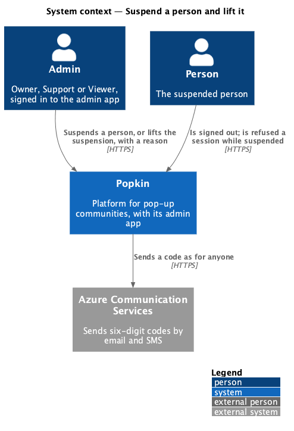
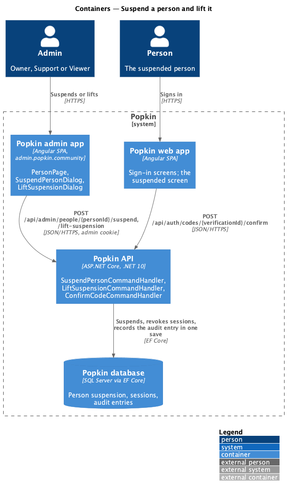
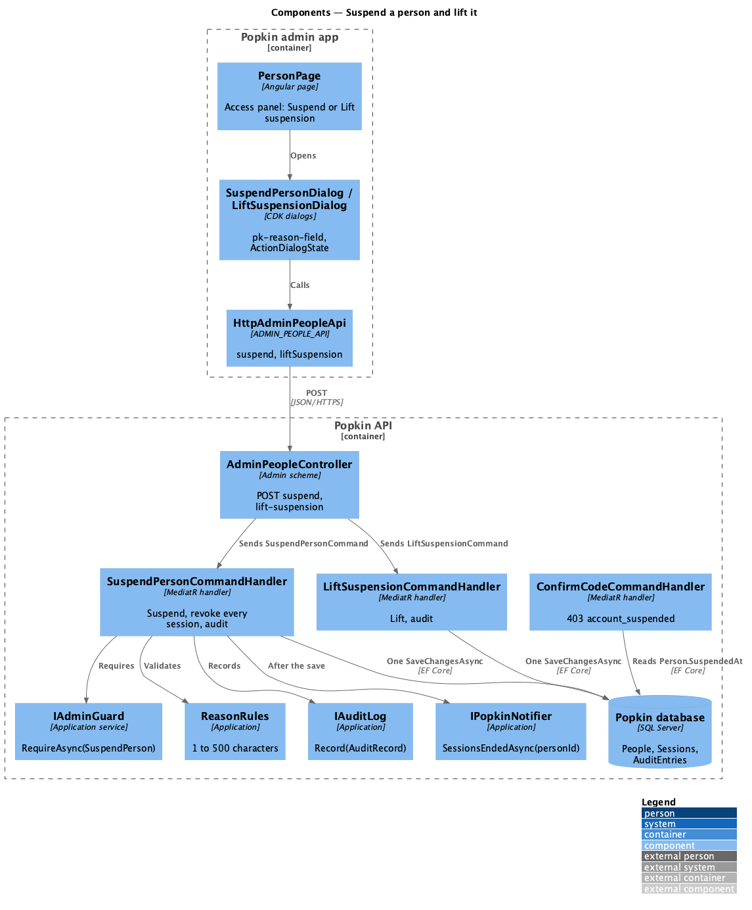
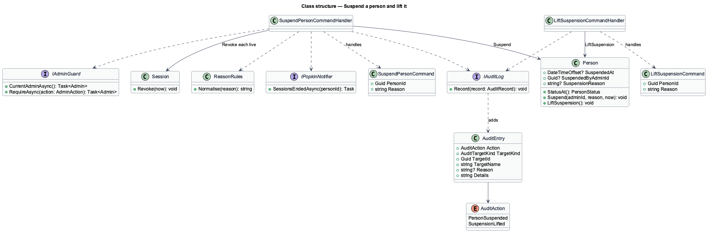
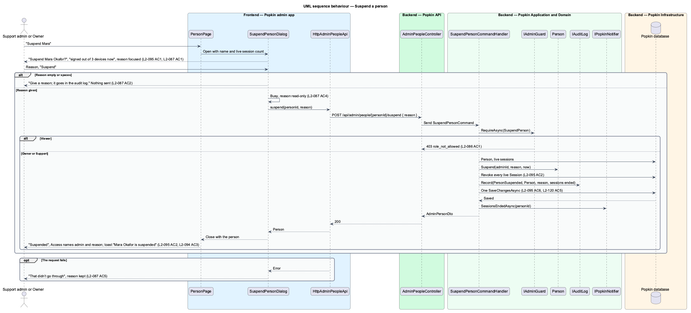
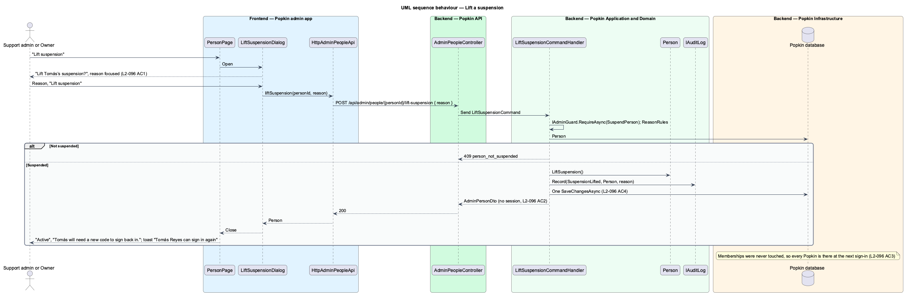
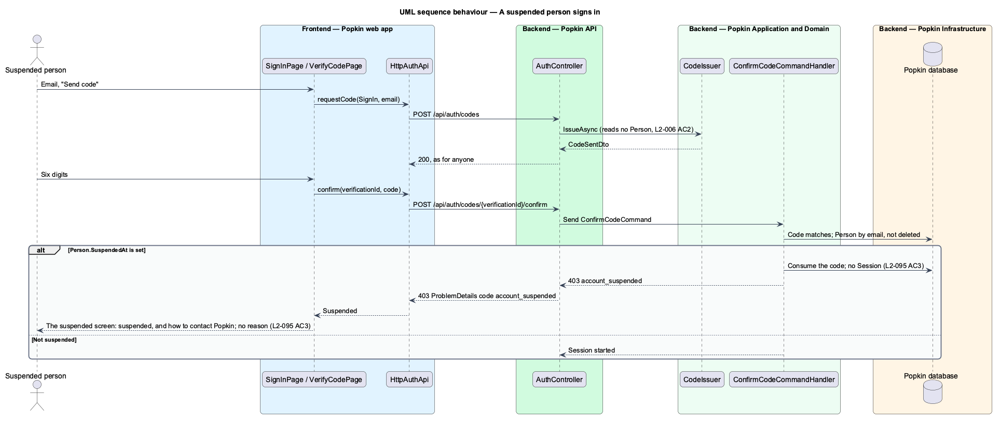

# Suspend a person and lift it

## Overview

A member who harasses others after a warning can be kept out of Popkin without erasing what the
group shared. *Suspend a person* signs the person out of every device at once and refuses them
a new session until an admin lifts the suspension. Their messages, photos and experiences stay,
under their name, and they stay a member of each Popkin (L1-022).

- **suspension** — state of an account whose person cannot sign in, set by an admin with a reason and kept until lifted
- **lift** — the admin action that ends a suspension; the person may sign in again at once

A Support admin or an Owner suspends and lifts; a Viewer sees both actions disabled (L2-086).
Each change carries a reason that the audit log keeps (L2-087, L2-120). The action sits in the
Access panel of [A person](../view-person/README.md). The Popkin app's side of this feature is
the refusal of a suspended person's sign-in.

## Description

### Screens and states

- `docs/mocks/admin/pages/person/default.html` — Access: "Suspending blocks sign-in and ends their
  sessions. Their messages, photos and Popkins stay as they are." and "Suspend Mara".
- `docs/mocks/admin/dialogs/person-suspend/` — `pk-dialog` "Suspend Mara Okafor?", "They’ll be
  signed out of 3 devices now and can’t sign back in until you lift it. Other members still see
  what they posted.", `pk-reason-field` (placeholder "e.g. Repeated harassment after a warning"),
  "Suspend" (`btn--danger`) and "Cancel" (L2-095 AC1).
  - `default.html`; `invalid.html` — "Give a reason; it goes in the audit log." (L2-087 AC2);
    `busy.html` — "Suspend" busy, the reason read-only (L2-087 AC4); `failed.html` — the alert
    "That didn’t go through", "Nothing has changed. Your reason is kept; try again." (L2-087 AC5).
- `docs/mocks/admin/pages/person/suspended-toast.html` — the status "Suspended"; Sessions "Not
  signed in anywhere", "Mara can’t sign in while suspended."; Access "Suspended just now by Lena
  Fischer: “Repeated harassment after a warning.”" and "Lift suspension"; the toast "Mara Okafor is
  suspended", "They’re signed out and can’t sign in; their data is kept." (L2-095 AC2).
- `docs/mocks/admin/pages/person/suspended.html` — the same page later: "Suspended today at 09:58
  by Aiko Tanaka: …" (L2-094 AC3).
- `docs/mocks/admin/dialogs/person-restore/` — "Lift Tomás’s suspension?", "They can sign in
  straight away and return to their Popkins.", the reason ("e.g. Appeal accepted"), "Lift
  suspension" (`btn--primary`) and "Cancel"; the same four states (L2-096 AC1).
- `docs/mocks/admin/pages/person/restored.html` — "Active"; Sessions "Not signed in anywhere",
  "Tomás will need a new code to sign back in."; Access offers "Suspend Tomás" again; the toast
  "Tomás Reyes can sign in again" (L2-096 AC2).
- `docs/mocks/admin/pages/people/suspended.html` — the person under "Suspended" in People.
- **The Popkin app's suspended screen** — no mock exists. L2-095 AC3 has the screen say that the
  account is suspended and how to contact Popkin, and nothing more about why. The design expects
  `docs/mocks/pages/account-suspended/default.html`, a full-page state of the code screen
  (`verify-code`) with its copy and the contact address, both `<TO SUPPLY>`.

### API

- **`POST /api/admin/people/{personId}/suspend`** `{ reason }` — `SuspendPersonCommand`. 200
  `AdminPersonDto`. `403` `role_not_allowed` for a Viewer; `400` `reason_required` /
  `reason_too_long` (`ReasonRules`); `404` `person_not_found`; `409` `person_not_active` when the
  person is already suspended or being deleted.
- **`POST /api/admin/people/{personId}/lift-suspension`** `{ reason }` —
  `LiftSuspensionCommand`. 200 `AdminPersonDto`; `409` `person_not_suspended`.
- **`SuspendPersonCommandHandler`** (new) — in this order:
  1. `IAdminGuard.RequireAsync(AdminAction.SuspendPerson)`; `ReasonRules` normalises the reason.
  2. Loads the `Person` and calls `Person.Suspend(adminId, reason, now)`, which sets
     `SuspendedAt`, `SuspendedByAdminId` and `SuspensionReason`.
  3. `SessionRevocation.RevokeAllAsync(personId, now)` (shared with
     [Sign a person out everywhere](../sign-person-out/README.md)) calls `Session.Revoke(now)` on
     each live session (L2-095 AC2).
  4. `IAuditLog.Record` with `AuditAction.PersonSuspended`, target `Person` (id and name), the
     reason and `Details { sessionsEnded }` (L2-095 AC6).
  5. One `SaveChangesAsync`, so the suspension and its entry are written together (L2-120 AC5).
  6. After the save, `IPopkinNotifier.SessionsEndedAsync(personId)` sends `SessionsEnded` to the
     person's own users (see [Sign a person out everywhere](../sign-person-out/README.md#api)).
- **`LiftSuspensionCommandHandler`** (new) — `RequireAsync(SuspendPerson)` (L2-086 puts lifting
  with suspending), `Person.LiftSuspension()` clears the three fields, `AuditAction.SuspensionLifted`
  with the reason, one save (L2-096 AC4). No session is made: the person is signed in nowhere
  until they sign in (L2-096 AC2).
- **What a suspension leaves alone** — `Membership`, `Message`, `Photo` and `Experience` rows are
  not touched, so other members keep seeing what the person posted, under their name, and the
  person as a member (L2-095 AC4); lifting therefore returns the person to every Popkin they still
  belong to (L2-096 AC3). A Popkin the person hosts wraps up when its time is up, as any other
  (L2-095 AC5): `WrapUpDuePopkinsJob` does not read the Host's status.
- **The Popkin app's refusal** (L2-095 AC3):
  - `ConfirmCodeCommandHandler` finds the person by the code's destination as now; when
    `SuspendedAt` is set it consumes the code, makes no `Session` and answers `403`
    `account_suspended` ("This account is suspended."). The ProblemDetails carries no reason, no
    date and no admin.
  - `ValidateSessionQueryHandler` also refuses a session whose person is suspended, so no session
    survives a suspension even if one were missed.
  - Asking for a code is answered as for anyone. `CodeIssuer` reads no `Person`, so nobody learns
    who has an account (L2-006 AC2); refusing the request would tell anyone who types an email
    that its account exists and is suspended. The person learns of the suspension only once they
    have proved the address is theirs. L2-095 AC3 names both the request and the confirmation;
    this is a conflict between L2-095 AC3 and L2-006 AC2, reported for the owner to settle.
  - The web app's `VerifyCodePage` shows the suspended screen on `403` `account_suspended`.

### Frontend

- **`SuspendPersonDialog`** and **`LiftSuspensionDialog`**
  (`frontend/projects/admin/src/app/dialogs/suspend-person/`, `lift-suspension/`) — CDK dialogs on
  `pk-dialog`, each with `pk-reason-field` focused on open and `ActionDialogState` (idle, busy,
  failed with the reason kept). Data in: the person's id, name, full name and live session count.
  On success each closes with the `AdminPersonDto`, and `PersonPage` shows the toast through the
  admin app's `Toaster`.
- **Copy** — "Suspend {full name}?" uses the full name; "Lift {name}'s suspension?" and the
  button "Suspend {name}" use the first word of the name, as the mocks do. The plural "3 devices"
  for one device ("1 device") and the sentence for a person signed in nowhere (0 devices) are
  `<TO SUPPLY>`.

### Decisions

- The reason is stored on `Person` as well as in the audit entry, because the Access panel shows
  it for as long as the suspension lasts (L2-094 AC3). Lifting clears it from `Person`; the audit
  log keeps it.
- A suspension does not end the person's memberships or calls in progress beyond what revoking
  their sessions does. Whether an open call drops the person at once is `<TO SUPPLY>`; today a
  revoked session's hub connection stays open until it reconnects, which `SessionsEnded` closes.

## Requirements

| L2 ID | Refines (L1) | Requirement |
|-------|--------------|-------------|
| `L2-095` | `L1-022` | Suspend a person: A Support admin or an Owner stops a person signing in. (AC1–AC6) |
| `L2-096` | `L1-022` | Lift a suspension: The person can come back. (AC1–AC4) |
| `L2-094` | `L1-022` | A person: One person's account, Popkins and sessions, and what an admin can do for them. (AC3) |
| `L2-087` | `L1-028` | A reason for every change: An admin says why they change something, and the audit log keeps it. (AC1, AC2, AC4, AC5, AC7) |
| `L2-086` | `L1-028` | Admin roles: Every admin has one role, and the API, not the screen, decides what it allows. (AC1, AC2) |
| `L2-120` | `L1-028` | Audit log: Every action in the console, with who did it and why. (AC5, AC7) |

## Diagrams

An admin suspends a person; the person is signed out and refused a session.

The admin app asks the Popkin API, which suspends, revokes and records in one save; the web app
meets the refusal at sign-in.

The two handlers, the guard, the reason rules, the audit log and the refusal in
`ConfirmCodeCommandHandler`.

The new fields and methods of `Person`, the commands and the audit actions.

Suspending, with the empty reason, the Viewer and the failure paths.

Lifting a suspension leaves the person signed in nowhere and every membership in place.

A suspended person proves their address and is refused a session with `account_suspended`.

