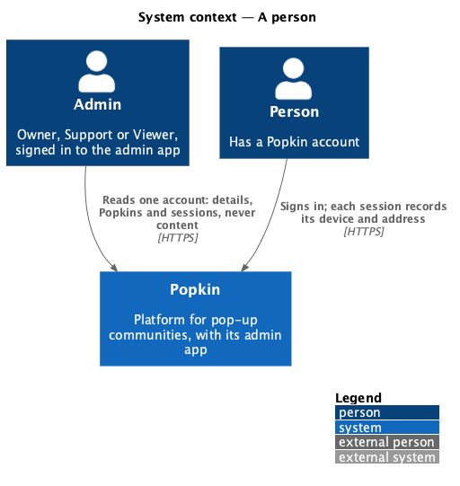
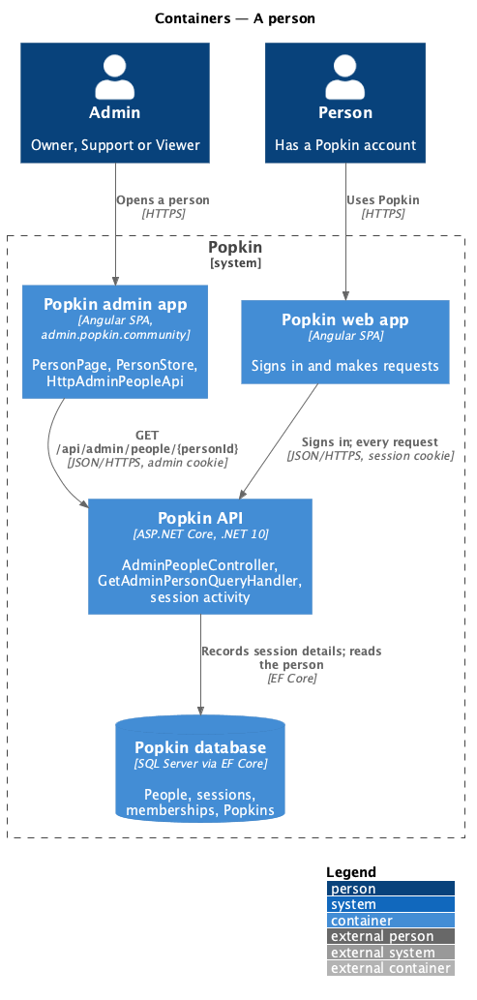
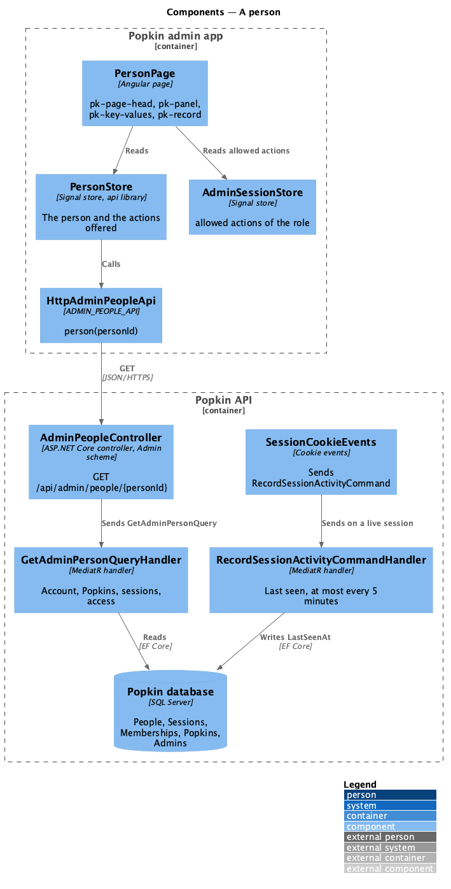
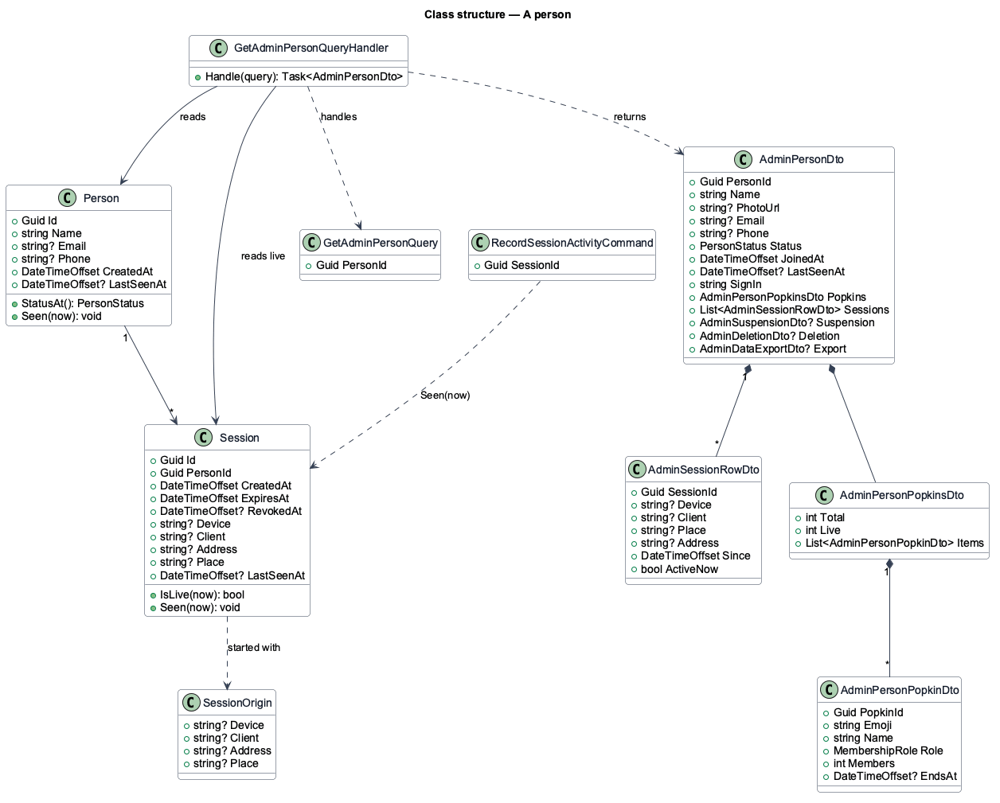
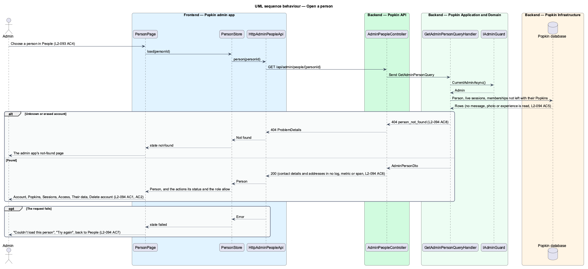
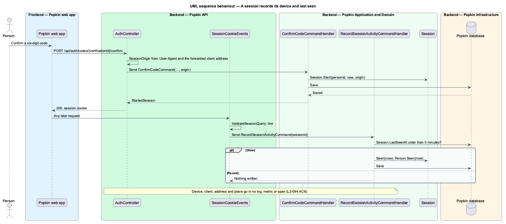

# A person

## Overview

Popkin promises its members a private space. When a person writes to Popkin for help, or another
member reports them, an admin needs to see who the person is, which Popkins they are in and
where they are signed in, and nothing they shared. *A person* is the admin app's page for one
account: its details, its Popkins, its sessions, and the actions an admin can take for it
(L1-022).

- **session** — `Session` row: one device's sign-in, 30 days long unless revoked (L2-007)
- **session origin** — what a session records when it starts: the device, the browser or app, the client's address and the place that address is in
- **live session** — session neither revoked nor expired (`Session.IsLive`)
- **active now** — live session that made a request within the last 5 minutes

The page opens from [People](../find-people/README.md). Its actions are designed in their own
features: [Suspend a person and lift it](../suspend-person/README.md),
[Sign a person out everywhere](../sign-person-out/README.md),
[Start a deletion](../start-deletion/README.md) and
[Export a person's data](../export-person-data/README.md). The page shows no message, photo,
comment, reaction or experience of the person (L2-078 AC4, L2-094 AC5).

## Description

### Screens and states

The page is `docs/mocks/admin/pages/person/`, route `/people/:personId`, route data
`page: 'person'`.

- `default.html` (an Owner, an active person) — `pk-page-head` with the back link "People", the
  avatar, "Mara Okafor", "mara@okafor.me · +44 7700 900 412" and `pk-status-pill` "Active". A
  main-and-aside grid of `pk-panel`s:
  - **Account** — `pk-key-values`: Joined, Last seen, Sign-in ("Email code" or "Phone code"),
    Account id, App version, Region.
  - **Popkins** — "6 in total, 4 live"; one `pk-record` per Popkin: `pk-popkin-tile` with the
    emoji, the name, "Host · 10 members · Ends 28 Jul", each a link to the Popkin's admin page.
  - **Sessions** — "Signed in on 3 devices", "Sign out everywhere"; one `pk-record` per live
    session: "iPhone 15 · Popkin iOS 3.4.1", "London, UK · 81.2.69.142 · since Today, 10:38", and
    `pk-status-pill` "Active now" on the session active now.
  - **Access** — "Suspending blocks sign-in and ends their sessions. Their messages, photos and
    Popkins stay as they are." and "Suspend Mara".
  - **Their data** — "Build a download of everything Mara has posted, for a subject access
    request." and "Export data".
  - **Delete account** — the hold and "Start deletion" (`btn--danger-text`).
- `support.html` — a Support admin: "Start deletion" switched off with a reason as its tooltip
  and description (L2-098 AC3, L2-086 AC3). The mock writes "Support admins can’t do this"; the
  console says "Only Owners can do this" ([Admin roles](../../admin-access/admin-roles/README.md)).
- `viewer.html` — a Viewer: every action disabled with "Viewer admins can’t do this" (L2-086 AC2).
- `suspended.html`, `suspended-toast.html`, `restored.html` — see
  [Suspend a person and lift it](../suspend-person/README.md).
- `signed-out.html` — see [Sign a person out everywhere](../sign-person-out/README.md).
- `deleting.html`, `deletion-started.html` — see [Start a deletion](../start-deletion/README.md).
- `export-started.html` — see [Export a person's data](../export-person-data/README.md).
- `loading.html` — the page head and panels as skeletons.
- `error.html` — the head "Person" with the back link, "Couldn’t load this person", "Try again"
  and "Open Health" (L2-094 AC7).

An erased account, or an id that names none, opens the admin app's not-found page,
`docs/mocks/admin/pages/not-found/default.html` (L2-094 AC8, L2-089 AC5).

### API

- **`GET /api/admin/people/{personId}`** — `AdminPeopleController.Get` sends
  `GetAdminPersonQuery`. 200 `AdminPersonDto`; `404` `person_not_found` for an unknown or erased
  account (`ErasedAt` set).
- **`GetAdminPersonQueryHandler`** (new) — calls `IAdminGuard.CurrentAdminAsync()` (any role).
  It reads the `Person`, the person's live `Session` rows, their memberships not left with each
  `PopkinSpace` and its member count, the suspending admin's name and the latest data request. It
  reads no `Message`, `Photo`, `PhotoComment`, `Experience` or reaction.
- **`AdminPersonDto`** — `personId`, `name`, `photoUrl`, `email`, `phone`, `status`
  (`PersonStatus`), `joinedAt` (`Person.CreatedAt`), `lastSeenAt`, `signIn` (`Email` when
  `Person.Email` is set, else `Phone`), `popkins { total, live, items: AdminPersonPopkinDto[] }`,
  `sessions: AdminSessionRowDto[]`, `suspension` (`AdminSuspensionDto`: `at`, `adminName`,
  `reason`), `deletion` (`AdminDeletionDto`: `requestedAt`, `erasesOn`, `startedByAdminName`) and
  `export` (`AdminDataExportDto`: `dataRequestId`, `status`).
  - `popkins.total` counts the memberships not left; `live` those whose Popkin is `Active`. The
    items are ordered live first, then by `EndsAt`. How many items the panel shows before a "more"
    link is `<TO SUPPLY>` (the mock lists 4 of 6).
  - `AdminSessionRowDto` — `sessionId`, `device`, `client`, `place`, `address`, `since`
    (`CreatedAt`), `activeNow`.
- **Session origin** (new, the Popkin app's side) — `ConfirmCodeCommand` gains `SessionOrigin`
  (`Device`, `Client`, `Address`, `Place`). `AuthController.Confirm` builds it from the
  `User-Agent` header and `HttpContext.Connection.RemoteIpAddress`, which the forwarded-headers
  middleware sets from the trusted proxy only. `Session.Start(personId, now, origin)` stores it.
  - The library that turns a `User-Agent` into "iPhone 15" and "Safari 18" is `<TO SUPPLY>`.
  - The place, "London, UK", needs a lookup from address to city; Popkin has no such service, so
    its provider is `<TO SUPPLY>`. Until it is chosen `Place` is null and the record shows the
    address alone.
  - How long a session's address is kept is `<TO SUPPLY>`; it is personal data (L2-054).
- **Last seen** (new) — `SessionCookieEvents.ValidatePrincipal` sends
  `RecordSessionActivityCommand(sessionId)` after a live session is validated. Its handler writes
  `Session.LastSeenAt` and `Person.LastSeenAt` only when the stored value is older than 5
  minutes, so a busy person causes one write per 5 minutes, not one per request. A hub connection
  counts at its start. The 5 minutes are `<TO SUPPLY>`; "Active now" uses the same window.
- **App version** and **Region** — the Account panel of the mock shows "iOS 3.4.1" and
  "eu-west". Popkin is a web app with no native client and records neither, and L2-094 AC1 names
  "app version" without saying what it is. Both are `<TO SUPPLY>`; until settled the panel shows
  the client of the latest session as the app and leaves Region out.
- **Account id** — the mock shows `usr_mara7f3a91`. The design shows `Person.Id`, a GUID; a
  shorter public form is `<TO SUPPLY>`.

### Frontend

- **`PersonPage`** (`frontend/projects/admin/src/app/pages/person/person.ts` + `.html`) — composes
  `pk-page-head`, `pk-panel`, `pk-key-values`, `pk-record`, `pk-popkin-tile`, `pk-status-pill`,
  `pk-button`, `pk-empty-state` and `pk-skeleton`. It opens each action's dialog with the CDK
  `Dialog` and replaces the person with the `AdminPersonDto` the dialog closes with, so the page
  follows the action without a second read.
- **`PersonStore`** (`frontend/projects/api/src/lib/admin/people/person.store.ts`) — signals
  `person`, `state` (`loading`, `ready`, `not-found`, `failed`) and `offers`: which of "Suspend
  {name}", "Lift suspension", "Sign out everywhere", "Export data" and "Start deletion" the page
  shows for the person's status (L2-094 AC2 to AC4, L2-097 AC3), each enabled or disabled with its
  reason from `AdminSessionStore.allowed`. Unit tests cover every status against every role.
- **`person-text.ts`** — the sentences of each panel: "6 in total, 4 live", "Signed in on 3
  devices", "Not signed in anywhere", "Suspended {when} by {admin}: “{reason}”", the last seen.

### Telemetry

The page's contact details and session addresses are in the response body only. No log line,
metric or span carries an email, a phone number, an address or a name (L2-094 AC6, L2-054 AC3).

### Decisions

- Opening a person is a read that L2-120 AC5 does not name, so it writes no audit entry.
- The page shows the Popkins the person is in now. A Popkin they left is not listed; an export
  ([Export a person's data](../export-person-data/README.md)) covers those.

## Requirements

| L2 ID | Refines (L1) | Requirement |
|-------|--------------|-------------|
| `L2-094` | `L1-022` | A person: One person's account, Popkins and sessions, and what an admin can do for them. (AC1–AC8) |
| `L2-078` | `L1-012` | Admin access: The admin app reaches a Popkin's content only as moderation allows. (AC4) |
| `L2-086` | `L1-028` | Admin roles: Every admin has one role, and the API, not the screen, decides what it allows. (AC2, AC3) |

## Diagrams

An admin reads one account; the person's own sign-ins supply its sessions.

The admin app reads the person from the Popkin API; the web app's requests keep the sessions'
last seen.

`GetAdminPersonQueryHandler` builds the page; `RecordSessionActivityCommandHandler` keeps last
seen.

`AdminPersonDto` and its parts; the new fields of `Session` and `Person`.

Opening a person, with the not-found and failure paths (L2-094 AC7, AC8).

A session records its origin at sign-in and its last seen at most every 5 minutes.

