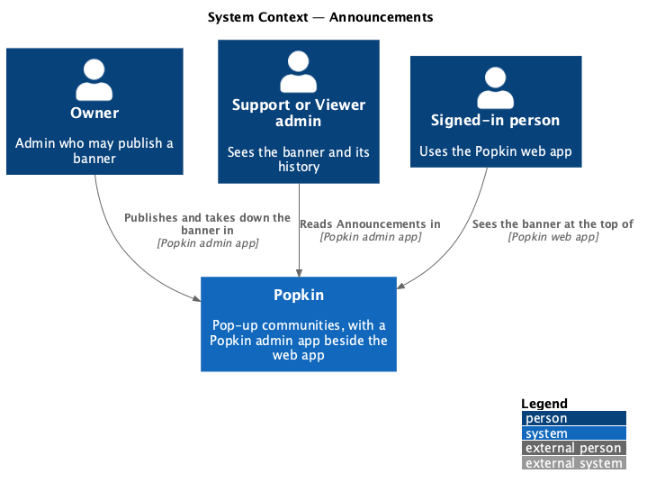
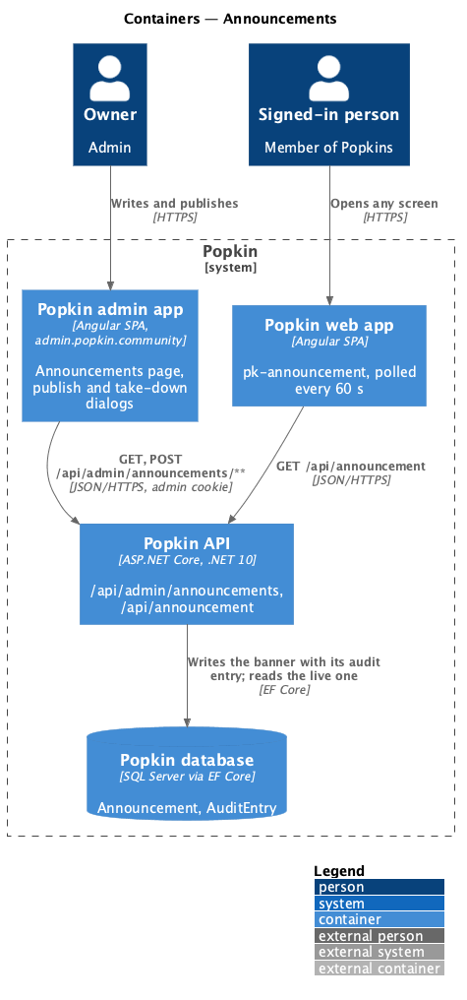
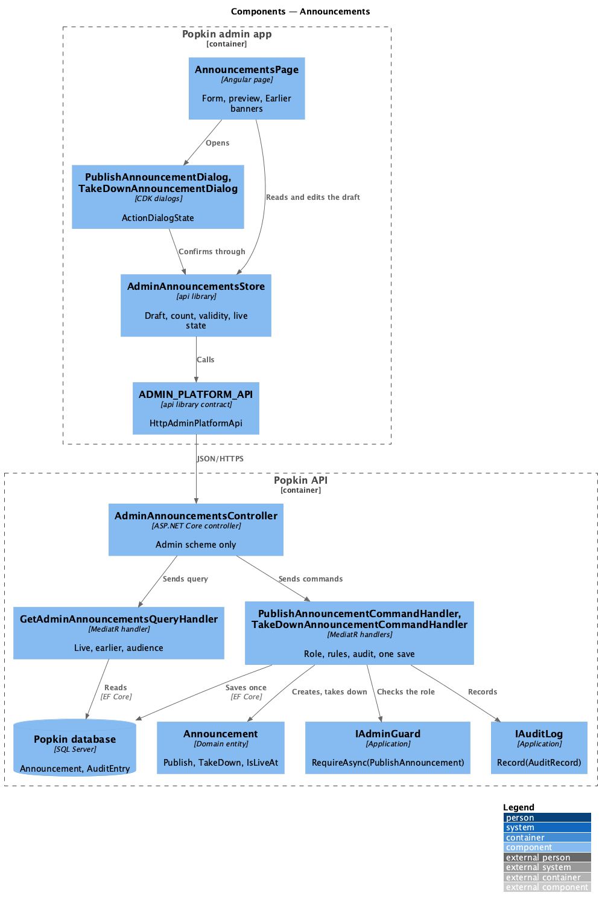
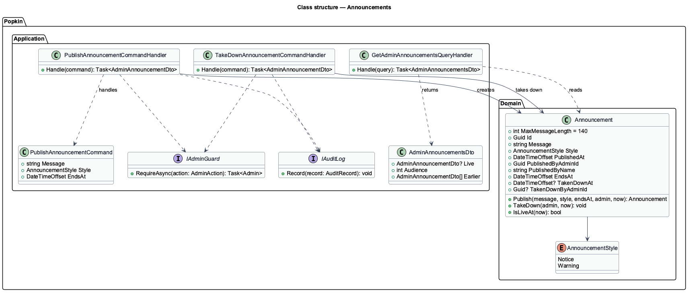
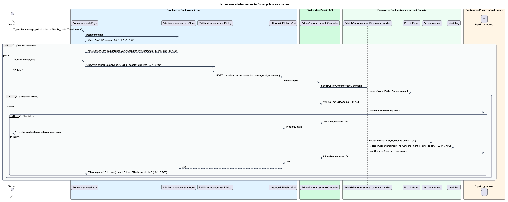
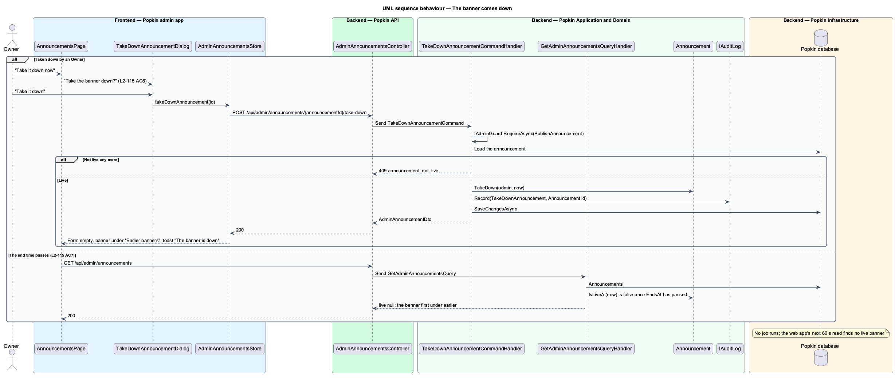

# Announcements

## Overview

Popkin sometimes has something to tell everyone at once: calls may drop during an upgrade, or
the app has reached a new platform. An *announcement* is one short banner shown at the top of the
Popkin web app to every signed-in person. An Owner writes it, chooses its style, sets when it
comes down by itself, and publishes it from the Announcements page of the Popkin admin app
(`/announcements`, L1-026). This design covers the admin's side; the member's side is
[See an announcement](../see-announcement/README.md).

- **announcement** — message of at most 140 characters, in the style Notice or Warning, published by an Owner
- **live** — state of an announcement that is published, not taken down and whose end time has not passed
- **end time** — moment an announcement comes down by itself ("Take it down" on the form)
- **earlier banner** — announcement that is no longer live, kept and listed under "Earlier banners"
- **audience** — number of people the banner reaches: every person with an account that is not deleted

One announcement at most is live at a time. A live announcement cannot be edited: it is taken
down and a new one published. An announcement is never deleted.

## Description

### Screens and states

Admin app, `docs/mocks/admin/pages/announcements/`:

- `default.html` — page head "Announcements", "One banner at a time, shown at the top of the app
  to every signed-in person."; the panel "New banner" with "Message" and its count "90/140",
  "Style" ("Notice", "Warning"), "Take it down" (a date and time), "Publish to everyone"; the
  aside "How it looks in the app" (`pk-announcement-preview`); and "Earlier banners", each with
  its message, its dates and who published it (L2-115 AC1).
- `warning.html` — Warning chosen; the preview shows the louder banner (L2-115 AC3).
- `invalid.html` — 170 characters: the summary "The banner can't be published yet" / "The message
  is 30 characters too long", the field's "Keep it to 140 characters; it's 170.", and "Publish to
  everyone" waits (L2-115 AC2).
- `published.html` — "Showing now", "Live to 48,210 people", "Take it down now", and the toast
  "The banner is live" / "It shows to everyone the next time they open Popkin, until Wed 16 Jul at
  03:00." (L2-115 AC5).
- `live.html` — the same page later, without the toast.
- `taken-down.html` — the form empty again, the banner first under "Earlier banners", and the
  toast "The banner is down" / "It disappears from the app within a minute." (L2-115 AC6).
- `viewer.html` — the form and history shown, "Publish to everyone" disabled with "Viewer admins
  can't do this" (L2-115 AC8). A Support admin sees "Only Owners can do this"; no mock draws it.
- `empty.html` — no banner yet: "No banners yet" under "Earlier banners".
- `loading.html`, `error.html` — skeletons; "Couldn't load the announcements" with "Try again"
  (L2-089 AC7).

Admin app dialogs:

- `docs/mocks/admin/dialogs/announcement-publish/` (`default`, `busy`, `failed`) — "Show this
  banner to everyone?", "It appears for all 48,210 people the next time they open Popkin, and
  comes down by itself on Wed 16 Jul at 03:00.", "Publish" and "Cancel" (L2-115 AC4).
- `docs/mocks/admin/dialogs/announcement-end/` (`default`, `busy`, `failed`) — "Take the banner
  down?", "It disappears from the app within a minute. It stays under Earlier banners.", "Take it
  down" and "Cancel" (L2-115 AC6).

### Conflicts and gaps

- **No reason.** Neither dialog has a reason field, and L2-087 AC1 does not list publishing or
  taking down a banner among the dialogs that ask for one. The design follows the mock and
  L2-087: the requests carry no `reason`, and the audit entry's `Reason` is null. The shared
  admin rule that every write carries a reason does not hold here.
- **Failed copy.** The dialogs' failed alert reads "The change didn't save" / "Nothing has changed
  for anyone. Try again in a moment." No requirement words it for these dialogs, so the mock's
  copy stands.
- **The end time.** The form always holds one. Its default, whether it may be left empty, and the
  latest end time allowed are `<TO SUPPLY>`; the design requires an end time later than now.
- **Earlier banners.** How many are listed, and whether the list pages, is `<TO SUPPLY>`.
- **The audience.** "{n} people" counts every person whose account is not deleted
  (`Person.DeletedAt` is null). Whether suspended people count is `<TO SUPPLY>`.

### API

Every endpoint is on `AdminAnnouncementsController`, under
`[Authorize(AuthenticationSchemes = AdminSessionCookie.Scheme)]`.

- `GET /api/admin/announcements` — any admin. `200` `AdminAnnouncementsDto`: `live`
  (`AdminAnnouncementDto` or null), `audience`, `earlier` (`AdminAnnouncementDto[]`, newest
  first). `AdminAnnouncementDto` holds `id`, `message`, `style`, `publishedAt`, `publishedByName`,
  `endsAt` and `takenDownAt`.
- `POST /api/admin/announcements` — body `{ message, style, endsAt }`. `201`
  `AdminAnnouncementDto`. Refusals: `400` `message_required`, `message_too_long` (over 140
  characters after trimming), `style_not_allowed`, `ends_at_in_past`; `403` `role_not_allowed`
  for Support and Viewer (L2-086 AC1); `409` `announcement_live` while another is live.
- `POST /api/admin/announcements/{announcementId}/take-down` — no body. `200`
  `AdminAnnouncementDto`. Refusals: `403` `role_not_allowed`; `404` `announcement_not_found`;
  `409` `announcement_not_live`.

### Backend

- **`AnnouncementStyle`** (Domain) — `Notice`, `Warning`.
- **`Announcement`** (Domain, new table) — `Id`, `Message`, `Style`, `PublishedAt`,
  `PublishedByAdminId`, `PublishedByName`, `EndsAt`, `TakenDownAt?`, `TakenDownByAdminId?`.
  `Announcement.MaxMessageLength = 140`. `Publish(message, style, endsAt, admin, now)` checks the
  rules; `TakeDown(admin, now)` sets `TakenDownAt`; `IsLiveAt(now)` is
  `TakenDownAt == null && EndsAt > now`.
- **Coming down by itself** — no job runs. Every read asks `IsLiveAt(now)` with `TimeProvider`, so
  an announcement past its end time is no longer live from that moment (L2-115 AC7), and the
  Worker gains no work ([ADR 0015](../../../adr/0015-the-worker-sends-no-hub-events.md)).
- **`GetAdminAnnouncementsQueryHandler`** — the live one, the earlier ones and the audience.
- **`PublishAnnouncementCommand`** / **`PublishAnnouncementCommandValidator`** /
  **`PublishAnnouncementCommandHandler`** — `IAdminGuard.RequireAsync(AdminAction.PublishAnnouncement)`
  first; the validator applies the length and end-time rules; the handler refuses `409`
  `announcement_live` when one is live, adds the `Announcement`, calls `IAuditLog.Record` with
  `AuditAction.PublishAnnouncement`, `TargetKind.Announcement`, and `Details` `{ style, endsAt,
  length }`, and saves once (L2-115 AC9, L2-120 AC5). The message text is the announcement's own
  and is shown in the history; the audit entry names the announcement by its id.
- **`TakeDownAnnouncementCommandHandler`** — the same guard (`AdminAction.PublishAnnouncement`
  covers both), `TakeDown`, `AuditAction.TakeDownAnnouncement`, one save.
- **Concurrency** — the handler checks for a live announcement before it adds one. Two Owners
  publishing in the same instant could both pass that check; how the database prevents it (a
  filtered unique index or a serialisable check) is `<TO SUPPLY>`.
- No hub event is sent: the web app polls (shared real-time rules,
  [ADR 0024](../../../adr/0024-admins-moderation-and-switches-in-the-database.md)).

### Frontend (Popkin admin app)

- **`AnnouncementsPage`** (`frontend/projects/admin/src/app/pages/announcements/announcements.page.ts`,
  route `/announcements`, `page: 'announcements'`) — composes `pk-page-head`, `pk-panel` "New
  banner" with `pk-textarea` and its count, `pk-segmented-control` for "Style", `pk-text-field`
  of type `datetime-local` for "Take it down", `pk-form-summary` for the invalid state,
  `pk-button`; the aside `pk-panel` with `pk-announcement-preview`; and `pk-activity-list` for
  "Earlier banners". While a banner is live, the panel reads "Showing now" and "Live to {n}
  people", its fields are read-only and its one action is "Take it down now" (L2-115 AC5).
- **`PublishAnnouncementDialog`**, **`TakeDownAnnouncementDialog`**
  (`frontend/projects/admin/src/app/dialogs/`) — CDK dialogs in `pk-dialog` with
  `ActionDialogState` (busy, then failed with `pk-alert`); no reason field.
- **`AdminAnnouncementsStore`** (`frontend/projects/api/src/lib/admin/platform/`) — the page's
  state (`loading | ready | failed`), the draft (message, style, end time), its count and
  validity ("Keep it to 140 characters; it's {n}."), publish and take down. Unit tested
  (ADR 0011).
- **`announcement-text.ts`** (api library) — "Live to {n} people", "all {n} people", the dates of
  an earlier banner ("1–8 Jul", "22 Jun", "Today, 10:42"), and the toasts. Unit tested.
- **`ADMIN_PLATFORM_API`** — `announcements()`, `publishAnnouncement(draft)`,
  `takeDownAnnouncement(id)`.
- "Publish to everyone" is disabled from `AdminSessionStore.allowed` with "Viewer admins can't do
  this" or "Only Owners can do this" (L2-115 AC8).

### Tests

- API acceptance tests (InMemory): an Owner publishes and the web app's read returns it; a second
  publish is `409` `announcement_live`; a message of 141 characters is `400`
  `message_too_long`; after `FakeTimeProvider` passes the end time the announcement is no longer
  live and shows under the earlier ones; Support and Viewer are `403`; each publish and take-down
  writes one audit entry in the same save.
- A direct test of `Announcement.IsLiveAt`, one case per row: before the end, at the end, after,
  taken down.
- Playwright (admin project): each page state and both dialogs through `AdminAnnouncementsPage`.

## Requirements

| L2 ID | Refines (L1) | Requirement |
|-------|--------------|-------------|
| `L2-115` | `L1-026` | Announcements: An Owner shows one banner at the top of the Popkin app. (AC1–AC9) |

## Diagrams

### System context

An Owner publishes the banner from the admin app; every signed-in person sees it in the web app.

### Containers

The admin app writes the announcement through the API into the database; the web app reads it.

### Components

The admin controller sends publish and take-down commands; the handlers write the announcement
and its audit entry in one save.

### Class structure

`Announcement` owns its rules and its live state; the handlers depend on the guard and the audit
log.

### Behaviour — an Owner publishes a banner

The draft is checked on the page and again by the API; the confirmed banner is saved with its
audit entry.

### Behaviour — the banner comes down

An Owner takes the live banner down, or its end time passes; either way it moves to Earlier
banners.

