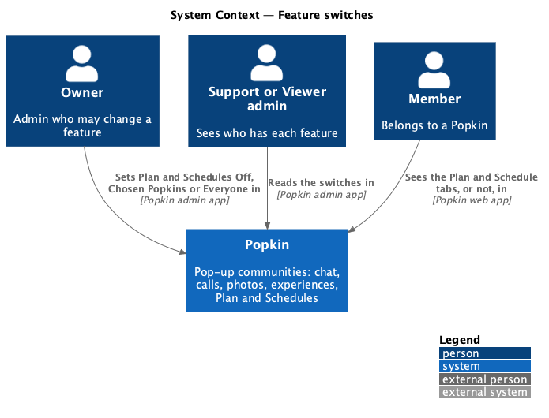
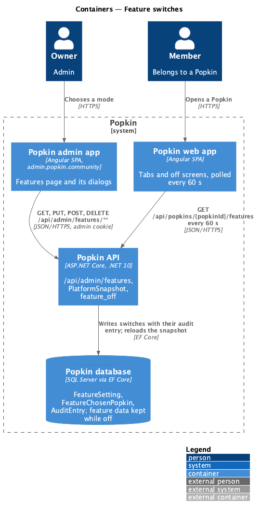
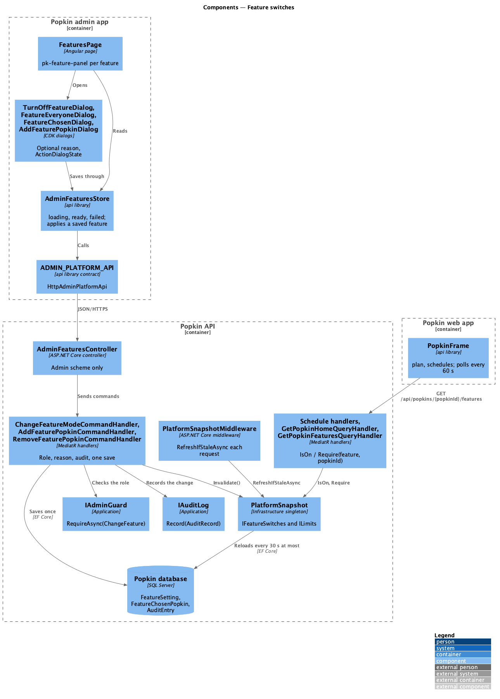
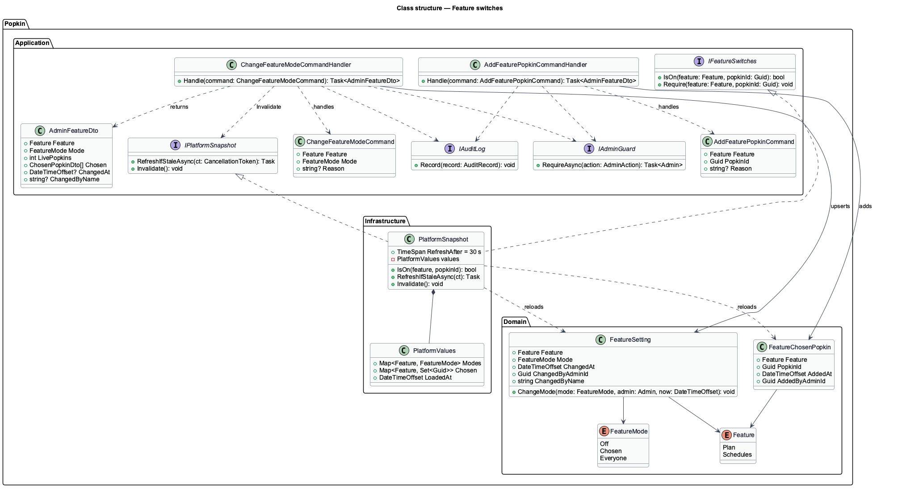
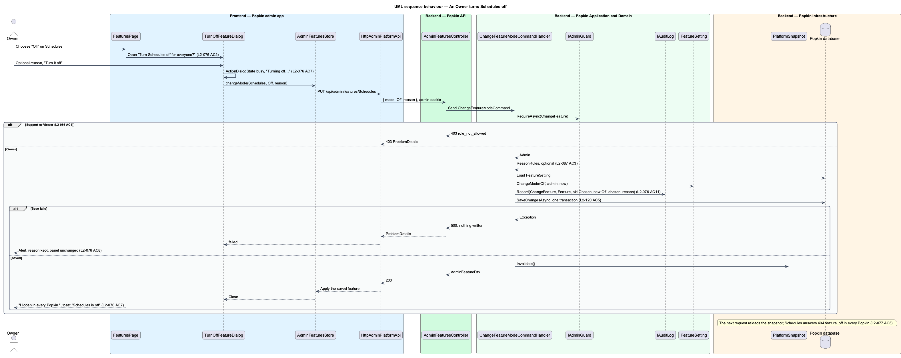
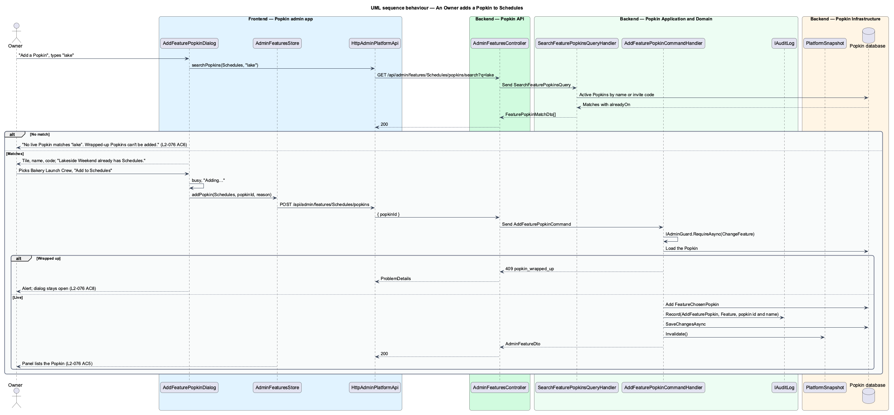
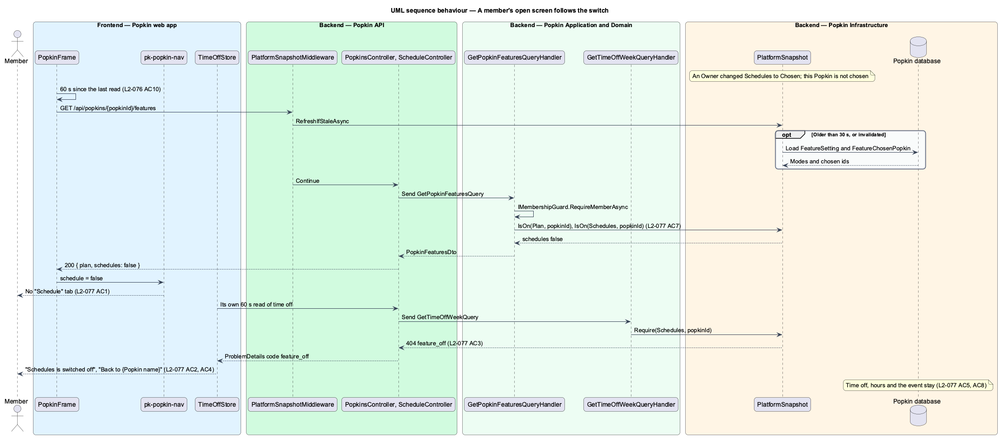

# Feature switches

## Overview

Popkin is a platform for pop-up communities. Two of its features, Plan and Schedules, can be
switched off, rolled out to chosen Popkins or turned on for everyone. An Owner sets them from the
Features page of the Popkin admin app (`/features`, L1-019). The change reaches every Popkin, the
API and every open screen of the Popkin web app within a minute, with no release and no restart.

- **feature switch** — setting that decides, per Popkin, whether one feature is there
- **mode** — one of three settings of a switch: `Off`, `Chosen` (on for the chosen Popkins only) or `Everyone`
- **chosen Popkin** — live Popkin named on a switch, which has the feature while the mode is `Chosen`
- **live Popkin** — Popkin whose status is `Active`, not wrapped up
- **snapshot** — copy of every switch and limit that the API holds in memory and refreshes from the database

Today Schedules is switched by the API setting `Features:Schedules`, read at each request by
`SettingsFeatureSwitches` ([ADR 0023](../../../adr/0023-features-switched-on-by-a-setting.md),
[Schedules switch](../../schedules/schedules-switch/README.md)). The switch is on or off for every
Popkin at once. This design moves Plan and Schedules into the database with the three modes,
behind the same `IFeatureSwitches` interface, now asked per Popkin
([ADR 0024](../../../adr/0024-admins-moderation-and-switches-in-the-database.md), proposed). Phone sign-in
(`Features:PhoneSignIn`) stays an API setting under ADR 0023: it waits on a verified phone
number, not on an admin's decision, and is not a per-Popkin feature.

What a member sees of a switched-off feature is unchanged from the Schedules switch: no tab, an
off screen at the feature's address, `404` `feature_off` from the API, and every entry kept
(L2-077). The only change on the member's side is that the answer depends on the Popkin.

## Description

### Screens and states

Admin app, `docs/mocks/admin/pages/features/`:

- `default.html` — the page head "Features" with its subtitle, then one `pk-feature-panel` per
  feature: Plan on for everyone ("On in all 3,112 live Popkins.", "On for everyone since 1 Jul by
  Lena Fischer") and Schedules on for chosen Popkins ("On in 3 chosen Popkins only.", "Chosen
  Popkins since 14 Jul, 10:21 by Lena Fischer"), each with the radio group "Who has {feature}" of
  "Off", "Chosen Popkins" and "Everyone" (L2-076 AC1). Under a `Chosen` switch, the list "Popkins
  with {feature}" holds each Popkin's tile, name and "Remove {Popkin}", then "Add a Popkin"
  (L2-076 AC5).
- `off.html` — Schedules "Hidden in every Popkin.", "Off since 14 Jul, 10:44 by Lena Fischer", and
  the toast "Schedules is off" / "The Schedule tab is gone from every Popkin. Nothing was
  deleted." (L2-076 AC7).
- `everyone.html` — Schedules on for everyone and the toast "Schedules is on for everyone" /
  "Every live Popkin gets the Schedule tab within a minute."
- `loading.html` — skeleton panels, "Loading the features…" (L2-076 AC9).
- `error.html` — "Couldn't load the features", "Try again" and "Open Health" (L2-076 AC9).
- `viewer.html` — the same panels, every option and every "Remove" disabled with "Viewer admins
  can't do this" (L2-076 AC12, L2-086 AC2). A Support admin sees the options disabled with "Only
  Owners can do this" (L2-086 AC3); no mock draws that state.

Admin app dialogs, `docs/mocks/admin/dialogs/`:

- `turn-off-feature/` (`default`, `busy`, `failed`) — "Turn Schedules off for everyone?", "The
  Schedule tab disappears from every Popkin within a minute. Nothing is deleted: …", the optional
  "Reason, for the audit log", "Turn it off" (danger) and "Keep it on"; busy reads "Turning off…"
  (L2-076 AC2, AC7).
- `feature-everyone/` (`default`, `busy`, `failed`) — "Turn Schedules on for everyone?", "Every
  live Popkin gets the Schedule tab within a minute.", optional reason, "Apply" and "Cancel"
  (L2-076 AC3).
- `feature-chosen/` (`default`, `busy`, `failed`) — "Limit Plan to chosen Popkins?", "Only the 2
  Popkins you pick keep Plan: Lakeside Weekend and U10 Hornets Parents. Everyone else stops
  seeing the Plan tab within a minute; nothing is deleted.", optional reason, "Apply" and
  "Cancel" (L2-076 AC4).
- `feature-add-popkin/` (`default`, `results`, `no-results`, `busy`, `failed`) — "Add a Popkin to
  Schedules", "Only live Popkins can be added. It gets the Schedule tab within a minute.", the
  search "Name or code", the list "Live Popkins" of tile, name and invite code, "Lakeside Weekend
  already has Schedules.", "No live Popkin matches “zzz”. Wrapped-up Popkins can't be added.",
  "Add to Schedules" and busy "Adding…" (L2-076 AC6).
- Every failed state keeps the dialog open with its alert and the reason as typed, and the panel
  is unchanged (L2-076 AC8).

Popkin web app: the tabs, the off screens and the home's section are those of the
[Schedules switch](../../schedules/schedules-switch/README.md) (`docs/mocks/pages/time-off/off.html`),
now decided per Popkin (L2-077 AC1 to AC8). Plan is not built; its tab and its off screen follow
the same rules when it is.

### Conflicts and gaps

- **Copy.** The mocks' failed alert reads "We couldn't save that. Nothing changed. Check your
  connection and try again."; L2-087 AC5 asks for "That didn't go through" and "Nothing has
  changed. Your reason is kept; try again." The requirement stands and the mock changes.
- **"Chosen Popkins" with none chosen.** `feature-chosen` names the Popkins that keep the
  feature. When the chosen list is empty, the dialog's copy is `<TO SUPPLY>`; the API accepts the
  change and the feature is then on in no Popkin.
- **Removing a chosen Popkin.** "Remove {Popkin}" has no dialog in the mocks, so it takes no
  reason and asks nothing. Whether it confirms first is `<TO SUPPLY>`.
- **A switch never changed.** Before an Owner first sets a switch, it has no "{Setting} since
  {date} by {admin}" line; that line's copy for a switch with no history is `<TO SUPPLY>`.
- **ADR 0016.** ADR 0016 has `PopkinHub` send `FeatureSwitched` to every connection so open
  screens change. The shared real-time rules send nothing to all connections (L2-051). This
  design follows the rule: open screens read the switch by polling every 60 seconds, and no hub
  event is added. [ADR 0024](../../../adr/0024-admins-moderation-and-switches-in-the-database.md)
  (proposed) records the same answer and replaces ADR 0016's on/off `FeatureSwitch` and
  `FeatureSwitchChange` with `FeatureSetting`, `FeatureChosenPopkin` and the shared audit log.

### API (admin)

Every endpoint is on `AdminFeaturesController`, under
`[Authorize(AuthenticationSchemes = AdminSessionCookie.Scheme)]` (L2-078 AC3).

- `GET /api/admin/features` — any admin. `200` `AdminFeaturesDto`: one `AdminFeatureDto` per
  `Feature`, in the order Plan, Schedules, with `feature`, `mode`, `livePopkins` (the count of
  live Popkins, for "On in all {n} live Popkins."), `chosen` (`ChosenPopkinDto[]`: `popkinId`,
  `name`, `emoji`, `colour`), `changedAt` and `changedByName` (both null for a switch never
  changed). It returns no content of any Popkin (L2-078 AC4).
- `PUT /api/admin/features/{feature}` — body `{ mode, reason? }`. `200` `AdminFeatureDto`.
  Refusals: `400` `mode_not_allowed`, `reason_too_long`; `403` `role_not_allowed` for Support and
  Viewer (L2-086 AC1); `404` `feature_not_found`. Choosing the mode a switch already has is a
  `200` that changes nothing and records nothing.
- `POST /api/admin/features/{feature}/popkins` — body `{ popkinId, reason? }`. `200`
  `AdminFeatureDto`. Refusals: `403` `role_not_allowed`; `404` `popkin_not_found`; `409`
  `popkin_wrapped_up` (only a live Popkin can be added, L2-076 AC6); `409`
  `feature_popkin_already_chosen`.
- `DELETE /api/admin/features/{feature}/popkins/{popkinId}` — `200` `AdminFeatureDto`; `403`
  `role_not_allowed`; `404` `feature_popkin_not_chosen`. Data of the Popkin is kept (L2-077 AC8).
- `GET /api/admin/features/{feature}/popkins/search?q={text}` — any admin. Live Popkins whose
  name contains the text or whose invite code equals it, ignoring case: `FeaturePopkinMatchDto[]`
  (`popkinId`, `name`, `emoji`, `colour`, `inviteCode`, `alreadyOn`). At most `<TO SUPPLY>`
  matches. An empty list is "No live Popkin matches" (L2-076 AC6).

### API (Popkin web app)

- `GET /api/popkins/{popkinId}` (`PopkinHomeDto`) — `schedules` is now `IsOn(Schedules,
  popkinId)` and gains `plan` (bool), so the tabs are right on first paint (L2-077 AC1).
- `GET /api/popkins/{popkinId}/features` — new; a member only (`IMembershipGuard`, `404` for
  anyone else). `200` `PopkinFeaturesDto` `{ plan, schedules }`. `PopkinFrame` reads it every 60
  seconds while a screen of the Popkin is open, so the tabs follow a switch within a minute
  (L2-076 AC10).
- Every Schedules endpoint calls `features.Require(Feature.Schedules, popkinId)` first, before
  membership, as today; every Plan endpoint, once built, calls `Require(Feature.Plan, popkinId)`
  (L2-077 AC3, AC7).

### Backend

- **`Feature`** (moved from `Popkin.Application.Abstractions` to `Popkin.Domain`) — `Plan`,
  `Schedules`. The entities below need it in the Domain.
- **`FeatureMode`** (Domain) — `Off`, `Chosen`, `Everyone`.
- **`FeatureSetting`** (Domain, new table) — `Feature` (key), `Mode`, `ChangedAt`,
  `ChangedByAdminId`, `ChangedByName`. `ChangeMode(mode, admin, now)`. A feature without a row
  is `Off`, the safe answer of ADR 0023.
- **`FeatureChosenPopkin`** (Domain, new table) — `Feature`, `PopkinId` (key together),
  `AddedAt`, `AddedByAdminId`. The chosen list is kept whatever the mode, so moving to `Everyone`
  and back to `Chosen` keeps the Popkins chosen before.
- **`IFeatureSwitches`** (Application, changed) — `IsOn(Feature, Guid popkinId)` and
  `Require(Feature, Guid popkinId)`, which throws `404` `feature_off`. `IsOn` is true for
  `Everyone`, false for `Off`, and for `Chosen` true only when the Popkin is chosen (L2-077 AC7).
- **`PlatformSnapshot`** (Infrastructure, singleton, new) — implements `IFeatureSwitches` and
  `ILimits` ([Limits](../limits/README.md)) over one immutable `PlatformValues` record: each
  feature's mode, the set of chosen Popkin ids per feature, and every limit. It replaces
  `SettingsFeatureSwitches`. `RefreshIfStaleAsync` reloads the record through a new scope's
  `IAppDbContext` when it is older than `PlatformSnapshot.RefreshAfter` (30 seconds, by
  `TimeProvider`), one load at a time. `Invalidate()` marks it stale.
- **`IPlatformSnapshot`** (Application, new) — `RefreshIfStaleAsync(CancellationToken)` and
  `Invalidate()`.
- **`PlatformSnapshotMiddleware`** (Api, new) — runs after routing and before the rate limiter
  and the controllers, and awaits `RefreshIfStaleAsync` on each request. Every later reader asks
  the snapshot synchronously. A change is honoured by the API within 30 seconds, and at the next
  request after a change made through this API (L2-076 AC10). One API instance holds the one
  snapshot ([ADR 0009](../../../adr/0009-one-api-instance.md)).
- **`GetAdminFeaturesQueryHandler`** — reads every `FeatureSetting`, the chosen Popkins with their
  look, and the count of live Popkins.
- **`ChangeFeatureModeCommand`** / **`ChangeFeatureModeCommandHandler`** — calls
  `IAdminGuard.RequireAsync(AdminAction.ChangeFeature)` (`403` `role_not_allowed`), validates the
  optional reason with `ReasonRules`, upserts `FeatureSetting`, calls `IAuditLog.Record` with
  `AuditAction.ChangeFeature`, `TargetKind.Feature`, the reason and `Details` `{ old, new, chosen:
  [{ id, name }] }`, saves once, then calls `IPlatformSnapshot.Invalidate()` (L2-076 AC11).
- **`AddFeaturePopkinCommandHandler`**, **`RemoveFeaturePopkinCommandHandler`** — the same guard,
  reason rules and single save; audit actions `AuditAction.AddFeaturePopkin` and
  `AuditAction.RemoveFeaturePopkin`, `Details` `{ feature, popkin: { id, name } }`. Adding refuses
  a Popkin that is not `Active`.
- **`SearchFeaturePopkinsQueryHandler`** — the live-Popkin search of the add dialog.
- **What happens to `Features:Schedules`** — the setting is retired with this design. A feature
  with no `FeatureSetting` row is off, which is what the deployed system has now (`schedules` is
  `false` in `infra/main.bicep`). The same change removes `Features__Schedules` from
  `infra/main.bicep`, the parameter `schedules`, the row of `docs/deployment.md`,
  `Features__Schedules` in `eng/Start-E2eApi.ps1`, and `builder.UseSetting("Features:Schedules",
  …)` in `ApiFactory`. `ApiFactory` seeds a `FeatureSetting` of `Everyone` for Schedules instead,
  and the local seed (`popkin seed`) does the same, idempotently, so the recording still covers
  the feature. ADR 0023 still governs `Features:PhoneSignIn`.
- Data is never deleted by a switch (L2-077 AC5).

### Frontend (Popkin admin app)

- **`FeaturesPage`** (`frontend/projects/admin/src/app/pages/features/features.page.ts`, route
  `/features`, `page: 'features'`) — composes `pk-page-head`, one `pk-feature-panel` per feature,
  `pk-skeleton` while loading and `pk-empty-state` with "Try again" on failure. Choosing an option
  opens its dialog; it never saves without one.
- **`pk-feature-panel`** (components) — inputs `name`, `about`, `reach`, `since`, `mode`,
  `chosen`, `disabledReason`; outputs `modeChosen`, `removeChosen`, `addChosen`. Its options are
  `pk-segmented-control` as a radio group named "Who has {feature}"; the reach line says the mode
  in words, so the mode is never told by the selected option's colour alone.
- **Dialogs** (`frontend/projects/admin/src/app/dialogs/`) — `TurnOffFeatureDialog`,
  `FeatureEveryoneDialog`, `FeatureChosenDialog` and `AddFeaturePopkinDialog`, each a CDK dialog in
  `pk-dialog` with `pk-reason-field` marked optional (L2-087 AC3) and `ActionDialogState` (idle →
  busy → failed, the reason kept). `AddFeaturePopkinDialog` composes `pk-search-field` and a pick
  list of live Popkins; a Popkin with `alreadyOn` is marked and cannot be picked.
- **`AdminFeaturesStore`** (`frontend/projects/api/src/lib/admin/platform/`) — loads, holds
  `loading | ready | failed`, applies a saved `AdminFeatureDto` in place, and reports the toast.
  Unit tested (ADR 0011).
- **`features-text.ts`** (api library) — "On in all {n} live Popkins.", "On in {n} chosen Popkins
  only.", "Hidden in every Popkin.", "{Setting} since {date} by {admin}", and the toasts ("{Feature}
  is off", "The {feature} tab is gone from every Popkin. Nothing was deleted."). The tab of
  Schedules is "Schedule". Unit tested.
- **`ADMIN_PLATFORM_API`** — `features()`, `changeMode(feature, mode, reason)`,
  `addPopkin(feature, popkinId, reason)`, `removePopkin(feature, popkinId)`,
  `searchPopkins(feature, text)`. `HttpAdminPlatformApi` implements it.
- The options are disabled from `AdminSessionStore.allowed` with "Viewer admins can't do this" or
  "Only Owners can do this" (L2-076 AC12); the API refuses them anyway (L2-086 AC1).

### Frontend (Popkin web app)

- **`PopkinFrame`** — gains `plan` and reads `PopkinFeaturesDto` every 60 seconds while open; a
  failed read keeps the last answer.
- **`pk-popkin-nav`** — gains the input `plan`, with the order of L2-068 when Plan is built.
- **`TimeOffStore`, `ThisWeekStore`** — unchanged: a `404` `feature_off` is the state `off`
  within a minute (L2-077 AC4).

### Tests

- API acceptance tests (InMemory, [ADR 0005](../../../adr/0005-tests-without-a-backend-or-database.md)):
  an Owner's mode change is honoured by a Schedules request at once; a `Chosen` switch answers a
  chosen Popkin and refuses another with `404` `feature_off`; Support and Viewer are refused
  `403` `role_not_allowed`; each change writes one audit entry in the same save; a wrapped-up
  Popkin cannot be added.
- A direct test of `PlatformSnapshot`, one case per row: no row is off; each mode; chosen and not
  chosen; stale after 30 seconds of `FakeTimeProvider`, fresh before.
- Playwright (admin project): the page's states and each dialog's default, busy and failed path,
  through `AdminFeaturesPage` and its dialog page objects; the web app's off screen spec stays.

## Requirements

| L2 ID | Refines (L1) | Requirement |
|-------|--------------|-------------|
| `L2-076` | `L1-019` | Feature switches: The admin app has one page of switches. Each feature is Off, on for chosen Popkins, or on for everyone. (AC1–AC12) |
| `L2-077` | `L1-019` | A feature that is off: A feature that is off is not there. A feature on for chosen Popkins is off for every other Popkin. (AC1–AC8) |

## Diagrams

### System context

An Owner sets each switch in the admin app; members see the feature in their Popkin, or not.

### Containers

The admin app writes the switches through the API; the API keeps them in the database and holds
a snapshot in memory; the web app reads them per Popkin by polling.

### Components

The admin handlers write `FeatureSetting` and `FeatureChosenPopkin` with their audit entry;
`PlatformSnapshot` answers every reader of `IFeatureSwitches`.

### Class structure

`FeatureSetting` holds a feature's mode, `FeatureChosenPopkin` its chosen Popkins, and
`PlatformSnapshot` turns both into the per-Popkin answer of `IFeatureSwitches`.

### Behaviour — an Owner turns a feature off

The Owner confirms the dialog; the handler checks the role, saves the setting and its audit entry
together, and the API's next request honours it.

### Behaviour — a chosen Popkin is added

The add dialog searches live Popkins, and the chosen Popkin gets the feature; a wrapped-up Popkin
is refused.

### Behaviour — a member's screen follows the switch

The web app's frame polls the Popkin's features every 60 seconds; the snapshot refreshes from the
database at most 30 seconds after a change.

