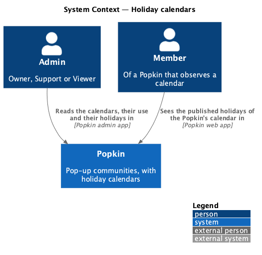
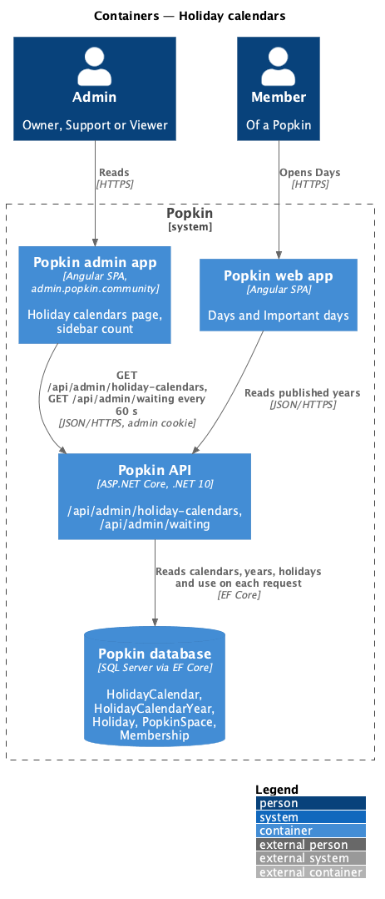
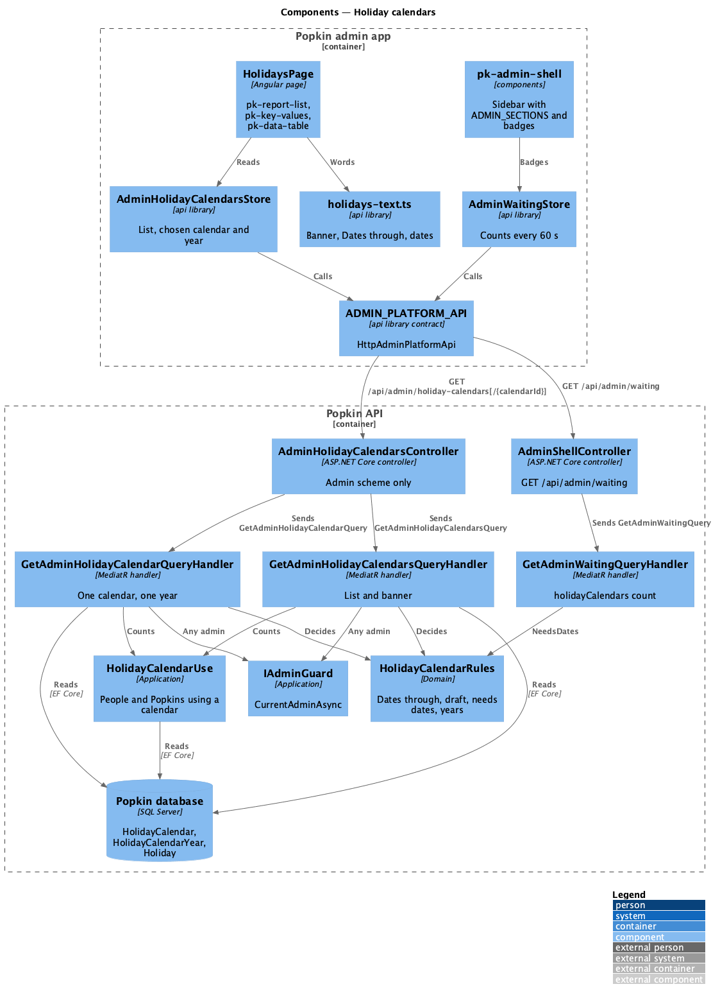
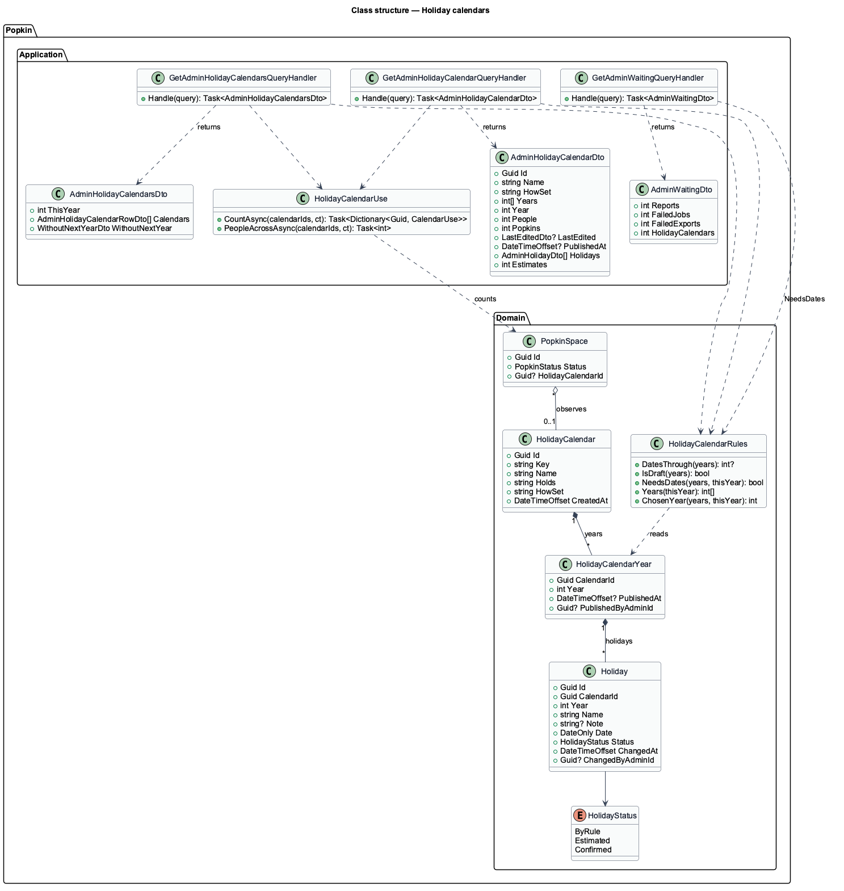
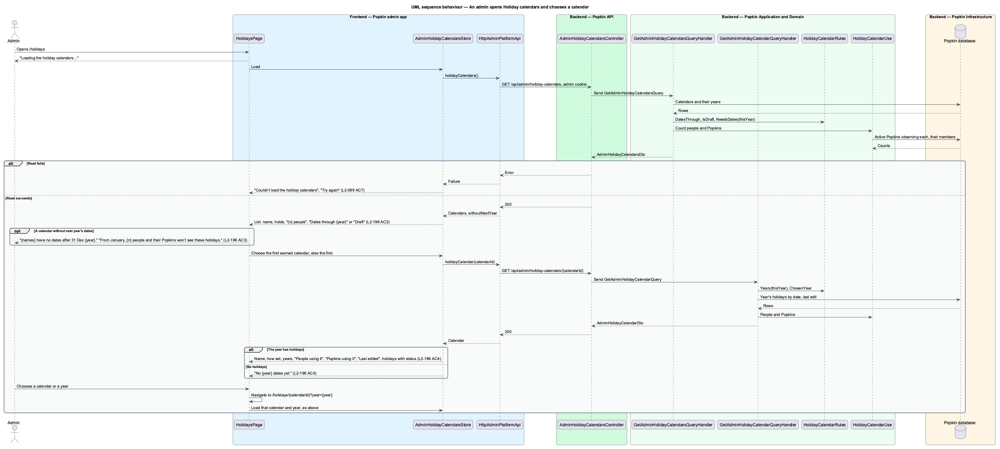
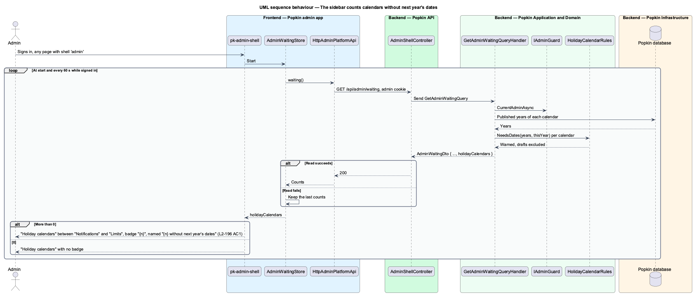

# Holiday calendars

## Overview

A Popkin can observe a holiday calendar, so its members see the holidays of that calendar on Days
and on Important days (L2-192). The dates of a calendar change from year to year, and some depend
on the moon, so an admin keeps them. *Holiday calendars* is the page of the Popkin admin app
(`/holidays`) where an admin sees every calendar, how many people use it, how far ahead its dates
are published, and the holidays of one calendar in one year (L1-045, L2-196). Changing a date and
publishing a year are the next slice, [Confirm and publish holiday dates](../publish-holiday-dates/README.md).

- **holiday calendar** — named set of holidays a Popkin observes, such as "United States" or
  "Islamic holidays", with what it holds ("Federal and widely observed") and how its dates are set
  ("Moon sighting, confirmed by hand")
- **holiday** — one named day of a calendar in one year, with its date, an optional note ("Could
  be 19 Feb") and a status
- **status** — how a holiday's date is known: "By rule" (fixed or computed, nothing to confirm),
  "Estimated" (expected, not yet confirmed) or "Confirmed" (confirmed by an admin)
- **published year** — year of a calendar that people and Popkins see; a year not published is
  seen by admins alone
- **Dates through** — last year of a calendar that is published
- **draft calendar** — calendar with no published year, read as "Draft"
- **calendar without next year's dates** — published calendar whose Dates through is this year or
  earlier, so from January its holidays reach nobody
- **this year** — year of the API's clock (`TimeProvider`) in UTC

The page sits in the Platform group of the console, between Notifications and Limits, and shares
the architecture of the admin app and the holiday model of
[the shared section](../../README.md#important-days-and-holiday-calendars): `HolidayCalendar`,
`HolidayCalendarYear` and `Holiday`, read through `AdminHolidayCalendarsController` under
`/api/admin/holiday-calendars`. People and Popkins read only published years, from the database
on each request, so a published change reaches them at their next read, well inside the hour the
page promises (L2-196 AC2).

## Description

### Screens and states

Admin app, `docs/mocks/admin/pages/holidays/` (in PR #103, known gap 148):

- `default.html` — the sidebar's "Holiday calendars" between "Notifications" and "Limits" with the
  badge "2", named "2 without next year’s dates" (L2-196 AC1). The page head "Holiday calendars",
  "Calendars people turn on for their own Important days or for a Popkin. Changes reach everyone
  within an hour." (L2-196 AC2). The warning banner "Islamic holidays and Hindu festivals have no
  dates after 31 Dec 2025." with "From January, 108,770 people and their Popkins won’t see these
  holidays." (L2-196 AC3). The list of calendars, each its name, what it holds, "{n} people" and
  "Dates through {year}", the warned ones in a warning pill, a draft "Draft" with "Nobody yet"
  (L2-196 AC2). The chosen calendar beside the list: its name and how its dates are set, the
  years 2025, 2026 and 2027 as tabs, "People using it", "Popkins using it", "Last edited" ("14 Jan
  · Kwame"), and a table of the year's holidays with name, note, date ("Wed 18 Feb") and status
  (L2-196 AC4).
- `rule.html` — "United States", "Fixed dates and rules", every holiday "By rule", a note such as
  "Observed Fri 3 Jul" under a holiday.
- `loading.html` — "Loading the holiday calendars…" over skeletons.
- `error.html` — "Couldn’t load the holiday calendars", "The admin API didn’t answer. Nothing has
  changed; try again, or check Health if it keeps happening.", "Try again" and "Open Health".
- `changing.html`, `published.html`, `viewer.html` and the dialog `holidays-publish` belong to
  [Confirm and publish holiday dates](../publish-holiday-dates/README.md).

A year with no holidays reads "No {year} dates yet." in place of the table (L2-196 AC4); no mock
draws it.

### What the page shows

| Item | Source | Words |
|---|---|---|
| A calendar's people | Distinct members (`Membership.LeftAt` null) of the active Popkins that observe it (known gap 144) | "{n} people", "Nobody yet" for 0 |
| A calendar's Popkins | Active Popkins with `PopkinSpace.HolidayCalendarId` the calendar | "Popkins using it" |
| Dates through | Largest `HolidayCalendarYear.Year` with `PublishedAt` set | "Dates through {year}"; "Draft" when none |
| Warning | Published, and Dates through is this year or earlier | The pill `status--warn` on "Dates through {year}" |
| Last edited | Latest of `Holiday.ChangedAt` and `HolidayCalendarYear.PublishedAt` of the calendar, with the first word of that admin's `Admin.Name` | "{d MMM} · {first name}" |
| Years | This year and the two after it | Tabs, the chosen one `aria-selected` |
| A holiday | `Holiday` of the calendar and the year, by `Date` | Name, note, "{EEE d MMM}", "By rule", "Estimated" or "Confirmed" |

The banner names every calendar without next year's dates, in the list's order, joined as "A",
"A and B" or "A, B and C", and counts the distinct people using any of them. It is not drawn when
there is none. A draft calendar reaches nobody, so it is neither warned nor counted.

When the page opens at `/holidays`, the chosen calendar is the first one warned, else the first
in the list. The chosen year is the first year after this year that is not published, else this
year. Choosing a calendar or a year navigates to `/holidays/:calendarId?year={year}`, so each
choice has its own address and the browser's back returns to the one before.

### Conflicts and gaps

- **People using a calendar.** L2-196 AC2 says people turn calendars on for their own Important
  days, but no requirement of the web app offers it. Until one does, "People using it" counts the
  members of the Popkins observing the calendar (known gap 144).
- **Where the dates come from.** The calendars, their holidays "By rule" and the first estimates
  are seeded or computed by a means not yet decided, and what "New calendar" asks is not
  specified (known gap 145). Until then the calendars and their holidays come from the seed of
  `popkin seed` `<TO SUPPLY>`.
- **The list's order.** The mock's order is neither by name nor by people. The design lists by
  `HolidayCalendar.CreatedAt`, the seed's order; the intended order is `<TO SUPPLY>`.
- **The banner for one calendar.** The mock's `published.html` reads "Hindu festivals has no
  dates", where L2-196 AC3 writes "{names} have". The requirement stands.
- **The banner's people.** The mock's 108,770 is the sum of the two calendars' people; the design
  counts distinct people, so a person in Popkins of both is counted once.
- **The badge's name.** The admin shell names a badge "{n} waiting"; the mock names this one "{n}
  without next year’s dates". The design follows the mock, since nothing here waits for an admin's
  decision.
- **"Open Health".** The Health page is not built; the link leads to `/health` once it is, and is
  not drawn until then.
- **"New calendar"** is drawn by the mock with no design behind it (known gap 145). The page does
  not draw it until it is specified.

### API

Every endpoint is on `AdminHolidayCalendarsController`, under
`[Authorize(AuthenticationSchemes = AdminSessionCookie.Scheme)]` (`AdminControllerBase`), and any
admin may read.

- `GET /api/admin/holiday-calendars` — `200` `AdminHolidayCalendarsDto`: `thisYear`, `calendars`
  (`AdminHolidayCalendarRowDto[]`: `id`, `name`, `holds`, `people`, `datesThrough?`, `draft`,
  `needsDates`) in the list's order, and `withoutNextYear` (`names`, `people`), empty names when
  none.
- `GET /api/admin/holiday-calendars/{calendarId}?year={yyyy}` — `200` `AdminHolidayCalendarDto`:
  `id`, `name`, `howSet`, `years`, `year`, `people`, `popkins`, `lastEdited?` (`at`,
  `adminName`), `publishedAt?`, `holidays` (`AdminHolidayDto[]`: `id`, `name`, `note?`, `date`,
  `status`), `estimates`. Refusals: `404` `holiday_calendar_not_found`; `400` `invalid_year` for a
  year outside the three of the tabs. Without `year`, the chosen year above.
- `GET /api/admin/waiting` (`AdminShellController`, changed) — `AdminWaitingDto` gains
  `holidayCalendars`, the number of calendars without next year's dates.

### Backend

- **`HolidayCalendar`**, **`HolidayCalendarYear`**, **`Holiday`**, **`HolidayStatus`** (Domain,
  new tables) — as the shared section defines them. A unique index on (`CalendarId`, `Year`) of
  `HolidayCalendarYear`. `PopkinSpace.HolidayCalendarId?` is added by
  [A Popkin's holidays](../../important-days/popkin-holidays/README.md).
- **`HolidayCalendarRules`** (Domain, new, static) — `DatesThrough(years)`, `IsDraft(years)`,
  `NeedsDates(years, thisYear)`, `Years(thisYear)` and `ChosenYear(years, thisYear)`. Pure, tested
  one case per row.
- **`HolidayCalendarUse`** (Application, new) — counts the people and the Popkins using each
  calendar in one query over `Popkins` and `Memberships`, for the list, the detail and the banner.
- **`GetAdminHolidayCalendarsQuery`** / **`GetAdminHolidayCalendarsQueryHandler`** —
  `IAdminGuard.CurrentAdminAsync`; every calendar with its years and use, and the banner.
- **`GetAdminHolidayCalendarQuery`** / **`GetAdminHolidayCalendarQueryHandler`** — one calendar
  and one year with its holidays, use, last edit and estimate count.
- **`GetAdminWaitingQueryHandler`** (changed) — counts the calendars without next year's dates
  with `HolidayCalendarRules.NeedsDates`.
- No log, metric dimension or span carries a holiday's name (the shared section).

### Frontend (Popkin admin app)

- **`HolidaysPage`** (`frontend/projects/admin/src/app/pages/holidays/holidays.page.ts`, routes
  `/holidays` and `/holidays/:calendarId`, `shell: 'admin'`, `page: 'holidays'`, title "Holiday
  calendars · Popkin Admin") — `pk-page-head`, `pk-banner` (`warning`) while a calendar needs
  dates, and the list-detail grid: the list of calendars and a `pk-panel` with
  `pk-segmented-control` (tabs) for the years, `pk-key-values` and `pk-data-table`. While loading
  it says "Loading the holiday calendars…" over skeletons; on a failed read the error panel with
  "Try again" (L2-089 AC7).
- **`ADMIN_SECTIONS`** (changed) — "Holiday calendars", route `/holidays`, page `holidays`, icon
  `calendar`, between "Notifications" and "Limits" (L2-196 AC1), with the waiting key
  `holidayCalendars`; `AdminNavItem.icon` gains `calendar`. Its badge is named "{n} without next
  year’s dates"; 0 shows none.
- **`AdminWaitingStore`** — read every 60 seconds, as the [admin shell](../../admin-access/admin-shell/README.md)
  designs it; this slice adds it if the shell's counts have not.
- **`pk-report-list`** (components, new, part of "Report review", backlog item 3) — the list-detail
  rows of the mock (`report-list`, `report-item`, `__reason`, `__where`, `__meta`), each a link
  with `aria-current` on the chosen one, and a status pill in its meta.
- **`pk-key-values`** (components, new, backlog item 2) — the `kv` description list.
- **`pk-data-table`** (changed) — a `status` cell takes a `tone` (`neutral`, `warn`, `ok`), and a
  `note` cell draws the holiday's name with its note under it (`kind-name`, `kind-about`).
- **`AdminHolidayCalendarsStore`** (`frontend/projects/api/src/lib/api/admin/platform/`, new) —
  the list, the chosen calendar and year, loading and failure. Unit tested (ADR 0011).
- **`holidays-text.ts`** (api library, new) — the banner ("{names} have no dates after 31 Dec
  {year}.", the names joined, "From January, {n} people and their Popkins won’t see these
  holidays."), "{n} people", "Nobody yet", "Dates through {year}", "Draft", "{d MMM} · {name}",
  the date "{EEE d MMM}", the statuses and "No {year} dates yet.". Unit tested.
- **`ADMIN_PLATFORM_API`** (changed) — `holidayCalendars()`, `holidayCalendar(calendarId, year?)`.

### Tests

- API acceptance tests (`Popkin.Api.Tests/Admin/AdminHolidayCalendarsTests`, InMemory): the list
  with people, Dates through, a draft and a warned calendar; the banner's names and distinct
  people; a chosen calendar and year with its holidays in date order and "Last edited"; a year with
  no holidays; `404` `holiday_calendar_not_found`; `400` `invalid_year`; a Popkin app session is
  `403`; `GET /api/admin/waiting` counts the warned calendars and not a draft.
- A direct test of `HolidayCalendarRules`, one case per row: no published year (draft); last
  published this year (needs dates); last published next year (not); the chosen year with next
  year unpublished, and with every year published.
- Unit tests (frontend): `holidays-text.ts` for one, two and three names and 0 people;
  `AdminHolidayCalendarsStore`.
- Playwright (admin project, page object `e2e/pages/admin/holidays.page.ts`): the sidebar item
  and its badge; each state of `default`, `rule`, `loading` and `error`; choosing a calendar and a
  year; "No {year} dates yet.". Each state gets its `routes.ts` entry, and `responses.json` is
  re-recorded with the new endpoints.

### Build order

The first slice is the list with its sidebar item, its count and the banner; the second the
chosen calendar with its years and holidays. Changing and publishing follow in
[Confirm and publish holiday dates](../publish-holiday-dates/README.md).

## Requirements

| L2 ID | Refines (L1) | Requirement |
|-------|--------------|-------------|
| `L2-196` | `L1-045` | Holiday calendars: Holiday calendars is a page in the Platform group of the admin app. (AC1–AC4) |

## Diagrams

### System context

An admin reads the holiday calendars in the admin app; the people and Popkins using a calendar see
its published years.

### Containers

The admin app reads the calendars and their use from the API, which reads the database on each
request; the web app reads the same published years.

### Components

`AdminHolidayCalendarsController` sends one query per read; `HolidayCalendarRules` decides Dates
through, draft and warning, and `HolidayCalendarUse` counts the people and Popkins.

### Class structure

A `HolidayCalendar` has its years and their holidays; a Popkin observes one calendar or none.

### Behaviour — an admin opens Holiday calendars and chooses a calendar

The page reads the list with its banner, then the chosen calendar and year with its holidays.

### Behaviour — the sidebar counts calendars without next year's dates

The shell's 60-second read of the waiting counts carries the number beside "Holiday calendars".

