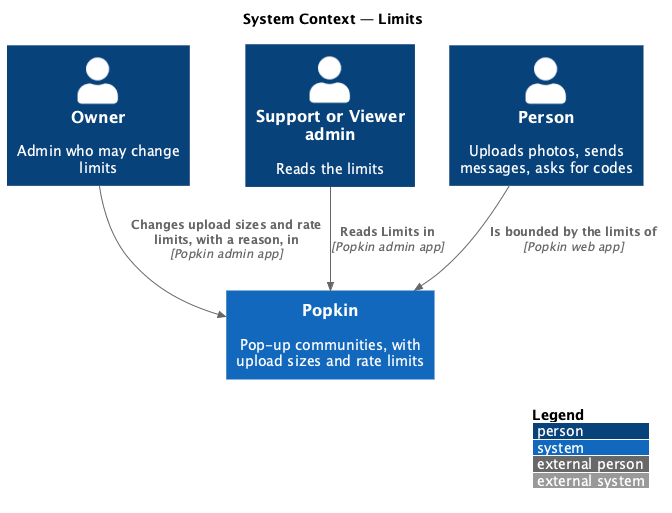
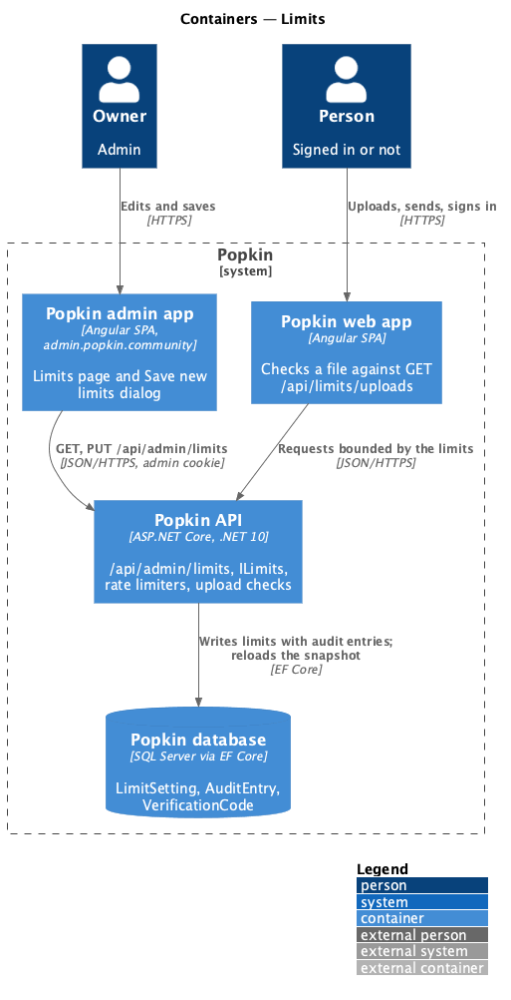
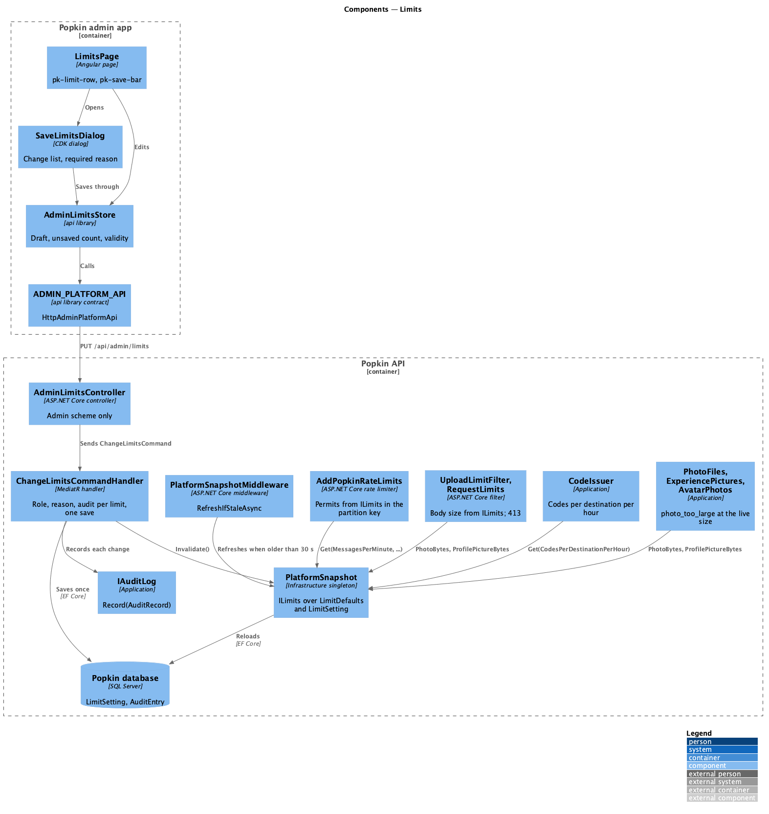
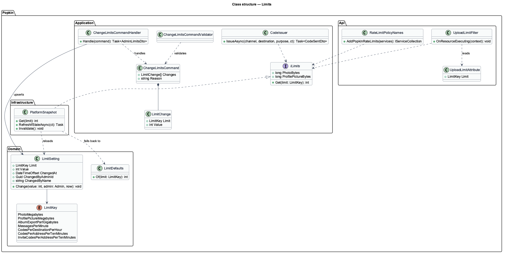
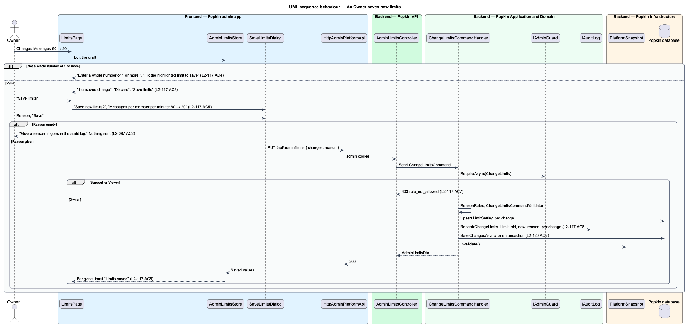
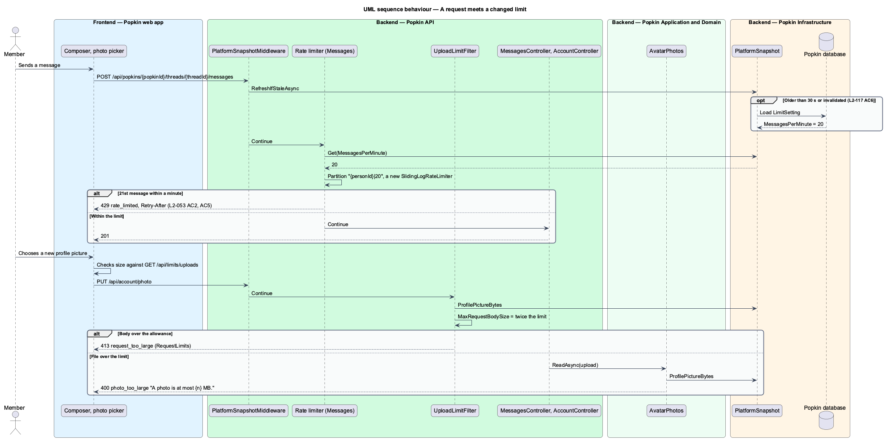

# Limits

## Overview

Popkin refuses a file that is too large and a request that comes too often. Until now each of
those numbers is a constant in the code, so changing one takes a release. *Limits* is the page of
the Popkin admin app (`/limits`) where an Owner changes the upload sizes and the rate limits, with
a reason, and the API honours the new values within a minute, with no release and no restart
(L1-027).

- **limit** — whole number of 1 or more that bounds a file's size or a request's rate
- **upload size** — largest file one upload may carry, per file: Photo, Profile picture, Album export part
- **rate limit** — most requests of one kind that one member, destination or address may make in a window
- **default** — value a limit holds until an Owner changes it, the value the code has today
- **unsaved change** — limit edited on the page and not yet saved

Limits are kept in the database and read through `ILimits`, which the API's in-memory snapshot
answers and refreshes at most 30 seconds after a change (the same `PlatformSnapshot` as
[Feature switches](../feature-switches/README.md)). The rate limiters
(`backend/src/Popkin.Api/RateLimiting`), the code issuer and the upload checks, with the body-size
rule of `backend/src/Popkin.Api/Problems/RequestLimits.cs`, read it in place of their constants.

## Description

### The limits and their defaults

| Limit (as the page names it) | `LimitKey` | Unit | Default | Where the default is today |
|---|---|---|---|---|
| Photo | `PhotoMegabytes` | MB per file | 10 (L2-031 AC2) | `Photo.MaxFileBytes` (Domain), read by `PhotoFiles`, `ExperiencePictures` and the `[RequestSizeLimit]` of `PhotosController`, `ThreadsController`, `ExperiencesController` |
| Profile picture | `ProfilePictureMegabytes` | MB per file | 10 | `AvatarPhotos.MaxBytes` (Application), also `JoinPopkinCommandHandler.MaxPhotoBytes`, and the `[RequestSizeLimit]` of `AccountController` and `InvitesController` |
| Album export part | `AlbumExportPartGigabytes` | GB per file | `<TO SUPPLY>` | None: `PrepareAlbumExportsCommandHandler` writes one zip per album and has no part size |
| Messages per member per minute | `MessagesPerMinute` | per minute | 60 (L2-053 AC2) | `RateLimitPolicyNames.Messages`, a `SlidingLogRateLimiter` of 60 per person per minute; ratings, comments and Schedules writes count with messages |
| Sign-in codes per email or phone per hour | `CodesPerDestinationPerHour` | per hour | 5 (L2-005 AC4) | `VerificationCode.MaxPerWindow`, read by `CodeIssuer` |
| Sign-in codes per address per 10 minutes | `CodesPerAddressPerTenMinutes` | per 10 minutes | 10 (L2-053 AC1) | `RateLimitPolicyNames.CodesPerAddress`, a fixed window of 10 |
| Invite codes tried per address per 10 minutes | `InviteCodesPerAddressPerTenMinutes` | per 10 minutes | 20 (L2-053 AC3) | `RateLimitPolicyNames.InviteCodes`, a fixed window of 20 |

A megabyte is 1,048,576 bytes, as `10 * 1024 * 1024` is in the code. The photos policy
(`RateLimitPolicyNames.Photos`, 60 photos per person per minute) and the call-signal limit
(`SignalRateLimitFilter`, 600 a minute) are not on the page and stay constants.

### Screens and states

Admin app, `docs/mocks/admin/pages/limits/`:

- `default.html` — page head "Limits", "Changes apply to every person within a minute of saving.";
  the panel "Upload sizes" ("Per file. A larger file is refused before its upload starts.") and
  the panel "Rate limits", each limit a `pk-limit-row` with its name, what it guards, its value
  and its unit, and its default beside it (L2-117 AC1).
- `edited.html` — changed rows show "· default {n}", and `pk-save-bar` reads "{n} unsaved changes"
  with "Discard" and "Save limits" (L2-117 AC3).
- `invalid.html` — an empty value: "Enter a whole number of 1 or more." under the row, and the bar
  "Fix the highlighted limit to save" (L2-117 AC4).
- `saved.html` — the toast "Limits saved", "{limits} change for everyone within a minute."
  (L2-117 AC5).
- `viewer.html` — "Only Owners can change limits.", every field read-only (L2-117 AC7).
- `loading.html`, `error.html` — skeletons; "Couldn't load the limits" with "Try again"
  (L2-089 AC7).

Admin app dialog, `docs/mocks/admin/dialogs/limit-save/` (`default`, `busy`, `invalid`,
`failed`) — "Save new limits?", "These apply to everyone within a minute:", the list of changes
"{limit}: {old} → {new} {unit}", the required `pk-reason-field`, "Save" and "Cancel" (L2-117 AC5,
L2-087 AC1).

### Conflicts and gaps

- **The mock's rows and values.** The mocks show a photo of 25 MB with a default of 15 MB, a
  profile picture of 5 MB, an album export part of 5 GB, messages at 30, and the rows "Joins by
  invite per Popkin", "Photo uploads per person per hour" and "API requests per device", while
  they lack the two per-address code limits. L2-117 AC1 and AC2 name the rows and the defaults.
  The requirement stands and the mock changes (L1 notes: where the designs contradict a
  requirement already written, the requirement stands).
- **Album export part.** L2-117 AC2 keeps "the values the API has now", but the API splits no
  album: an export is one zip. The part's default, and the change to Save the album (L2-046) that
  splits a large album into parts, are `<TO SUPPLY>`. Until then the row is saved and audited and
  no reader uses it.
- **Dialog copy.** `limit-save` reads "Say why, for the audit log." and "Other admins see it
  beside the change.", and its failed alert "The change didn't save" / "Nothing has changed for
  anyone. Try again in a moment." L2-087 AC1, AC2 and AC5 ask for "Other admins see it in the
  audit log.", "Give a reason; it goes in the audit log." and "That didn't go through" / "Nothing
  has changed. Your reason is kept; try again." The requirement stands.
- **Maximums.** L2-117 sets only a minimum of 1. The largest value of each limit is `<TO SUPPLY>`.
  An upload size is also bounded by the reverse proxy's body limit (`infra/web/Caddyfile`) and by
  what the photo processor can hold in memory.

### API

Every endpoint is on `AdminLimitsController`, under
`[Authorize(AuthenticationSchemes = AdminSessionCookie.Scheme)]`.

- `GET /api/admin/limits` — any admin. `200` `AdminLimitsDto`: `uploads` and `rates`, each an
  `AdminLimitDto[]` (`limit`, `value`, `defaultValue`, `unit`, `changedAt`, `changedByName`), in
  the order of the table above.
- `PUT /api/admin/limits` — body `{ changes: [{ limit, value }], reason }`. `200`
  `AdminLimitsDto`. Refusals: `400` `reason_required`, `reason_too_long` (`ReasonRules`); `400`
  `limit_not_allowed` naming `changes[i].value` for a value that is not a whole number of 1 or
  more; `400` `limit_unknown`; `403` `role_not_allowed` for Support and Viewer (L2-086 AC1). A
  change to the value a limit already has is dropped; a body with no change left is `400`
  `no_change`.
- `GET /api/limits/uploads` — new, for the Popkin web app, any signed-in person. `200`
  `UploadLimitsDto` `{ photoMegabytes, profilePictureMegabytes }`, so the web app refuses a file
  before its upload with the value the API honours.

### Backend

- **`LimitKey`** (Domain) — the seven keys of the table.
- **`LimitDefaults`** (Domain) — the one home of the defaults. `Photo.MaxFileBytes`,
  `AvatarPhotos.MaxBytes`, `JoinPopkinCommandHandler.MaxPhotoBytes` and
  `VerificationCode.MaxPerWindow` are removed in its favour, and the numbers in
  `RateLimitPolicyNames` with them.
- **`LimitSetting`** (Domain, new table) — `Limit` (key), `Value`, `ChangedAt`,
  `ChangedByAdminId`, `ChangedByName`. A limit without a row holds its default (L2-117 AC2).
- **`ILimits`** (Application, new) — `Get(LimitKey): int`, `PhotoBytes`, `ProfilePictureBytes`.
  Synchronous, so a rate-limiter partition can read it. `PlatformSnapshot` implements it from its
  `PlatformValues`, refreshed by `PlatformSnapshotMiddleware` when older than 30 seconds
  ([Feature switches](../feature-switches/README.md)), so a saved limit is honoured within a minute
  (L2-117 AC6) and at the next request after a change made through this API.
- **`ChangeLimitsCommand`** / **`ChangeLimitsCommandValidator`** /
  **`ChangeLimitsCommandHandler`** — `IAdminGuard.RequireAsync(AdminAction.ChangeLimits)`;
  `ReasonRules` (required); upserts each `LimitSetting`; one `IAuditLog.Record` per changed limit
  with `AuditAction.ChangeLimits`, `TargetKind.Limit`, `TargetId` the key, the reason and
  `Details` `{ old, new, unit }` (L2-117 AC8); one `SaveChangesAsync` (L2-120 AC5); then
  `IPlatformSnapshot.Invalidate()`.
- **`GetAdminLimitsQueryHandler`** — every limit with its value, default and last change.
- **Rate limiters** (`RateLimitPolicyNames.AddPopkinRateLimits`, changed) — `PerAddress` and
  `PerPerson` read the permit count from `ILimits` (`context.RequestServices`) on each request and
  put it in the partition key (`{address}|{permits}`, `{personId}|{permits}`). ASP.NET Core keeps
  one limiter per partition key, so a changed value starts a new limiter and its count starts
  afresh; the old limiter is discarded once idle. `SlidingLogRateLimiter` is unchanged.
- **`CodeIssuer`** (changed) — counts against `ILimits.Get(CodesPerDestinationPerHour)` in the
  hour of `VerificationCode.LimitWindow`; the count is in the database, so a change applies at the
  next request without a fresh start.
- **`UploadLimitAttribute`** (Api, new) — `[UploadLimit(LimitKey.PhotoMegabytes)]` in place of
  each `[RequestSizeLimit]` and `[RequestFormLimits]` of the upload actions. It keeps each
  action's present allowance over the file: twice the limit, or for a message's photo the limit
  plus `ThreadsController.MultipartOverheadBytes`.
- **`UploadLimitFilter`** (Api, new resource filter) — before model binding, reads the action's
  `UploadLimitAttribute` and `ILimits`, and sets `IHttpMaxRequestBodySizeFeature.MaxRequestBodySize`
  and the form's `MultipartBodyLengthLimit` for the request.
- **`RequestLimits.BodyTooLarge`** (changed) — reads the request's limit from
  `IHttpMaxRequestBodySizeFeature` instead of the endpoint's `IRequestSizeLimitMetadata`, so a body
  over the live limit is still `413` `request_too_large`.
- **`PhotoFiles`, `ExperiencePictures`, `AvatarPhotos`** (changed) — compare `upload.Length` with
  `ILimits.PhotoBytes` or `ProfilePictureBytes`, and say the live value in `photo_too_large` ("A
  photo is at most {n} MB.").

### Frontend (Popkin admin app)

- **`LimitsPage`** (`frontend/projects/admin/src/app/pages/limits/limits.page.ts`, route
  `/limits`, `page: 'limits'`) — `pk-page-head`, two `pk-panel`s of `pk-limit-row`, and
  `pk-save-bar` while there are unsaved changes; "Save limits" opens `SaveLimitsDialog`.
- **`pk-limit-row`** (components) — inputs `name`, `help`, `unit`, `value`, `defaultValue`,
  `changed`, `error`, `readonly`; output `valueChange`. Its field is labelled by the name and
  described by the help and the error, with `aria-invalid` on error.
- **`pk-save-bar`** (components) — inputs `count`, `invalid`; outputs `discard`, `save`. It reads
  "{n} unsaved changes" or "Fix the highlighted limit to save".
- **`SaveLimitsDialog`** (`frontend/projects/admin/src/app/dialogs/save-limits/`) — the change list
  and the required `pk-reason-field`, with focus in it on open (L2-087 AC1); an empty reason sends
  nothing and says "Give a reason; it goes in the audit log." (L2-087 AC2); `ActionDialogState`
  for busy and failed.
- **`AdminLimitsStore`** (`frontend/projects/api/src/lib/admin/platform/`) — the saved values, the
  draft, the unsaved count, each row's validity ("Enter a whole number of 1 or more."), the list
  of changes, discard and save. Unit tested (ADR 0011).
- **`limits-text.ts`** (api library) — "{n} unsaved changes", "{limit}: {old} → {new} {unit}",
  "· default {n} {unit}", the toast "{limits} change for everyone within a minute." Unit tested.
- **`ADMIN_PLATFORM_API`** — `limits()`, `changeLimits(changes, reason)`.
- The fields are read-only from `AdminSessionStore.allowed` for Support and Viewer, with "Only
  Owners can change limits." (L2-117 AC7).

### Frontend (Popkin web app)

- **`UPLOAD_LIMITS_API`** (api library, new) — `uploads()`, read when a photo picker opens.
- **`photo-rules.ts`**, **`profile-photo.ts`**, **`photo-uploads.ts`** (changed) — take the limit
  in megabytes as a parameter in place of the fixed 10 MB, and say it in their refusals ("Photos
  can be up to {n} MB."). The default stands when the read fails.

### Tests

- API acceptance tests (InMemory): an Owner saves Messages at 2 and the third message within a
  minute is `429`; a profile picture over a lowered limit is `400` `photo_too_large` and a body
  over it `413`; a sixth code within the hour is refused at 5 and accepted after the limit is
  raised; an empty reason is `400` `reason_required`; Support and Viewer are `403`; each changed
  limit writes one audit entry in the same save.
- A direct test of `PlatformSnapshot`'s limits, one case per row: no row is the default; a row's
  value; stale after 30 seconds of `FakeTimeProvider`.
- A direct test of `ChangeLimitsCommandValidator`, one case per row: 0, -1, 1.5, empty, 1, a
  value equal to the saved one.
- Playwright (admin project): each page state and the dialog's default, busy, invalid and failed
  paths through `AdminLimitsPage`.

## Requirements

| L2 ID | Refines (L1) | Requirement |
|-------|--------------|-------------|
| `L2-117` | `L1-027` | Limits: An Owner changes the upload sizes and rate limits without a release. (AC1–AC8) |

## Diagrams

### System context

An Owner changes the limits in the admin app; every person's uploads and requests are bounded by
them.

### Containers

The admin app saves the limits through the API into the database; the API reads them back into
its snapshot and applies them to every request.

### Components

`ChangeLimitsCommandHandler` writes `LimitSetting` with one audit entry per change;
`PlatformSnapshot` answers `ILimits` for the rate limiters, the code issuer and the upload checks.

### Class structure

`LimitSetting` overrides a `LimitDefaults` value; `ILimits` is the one read of both.

### Behaviour — an Owner saves new limits

The page gathers the unsaved changes; the dialog takes the reason; the handler saves the limits
and their audit entries together.

### Behaviour — a request meets a changed limit

After the snapshot refreshes, a rate-limited request and an upload are each measured against the
new value.

