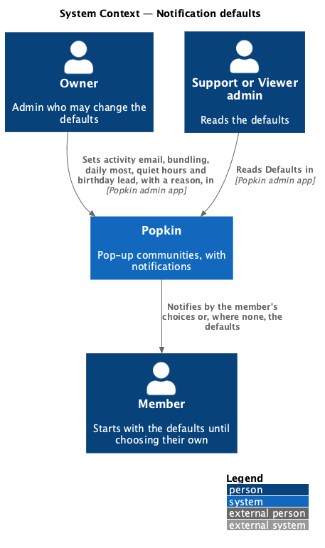
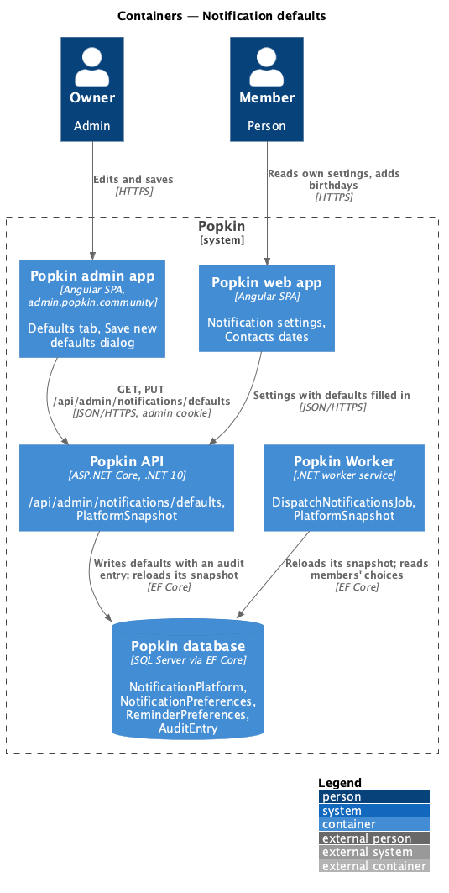
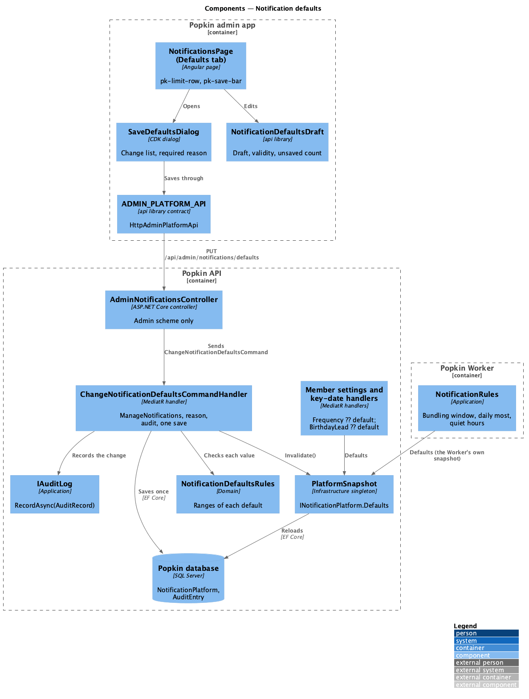
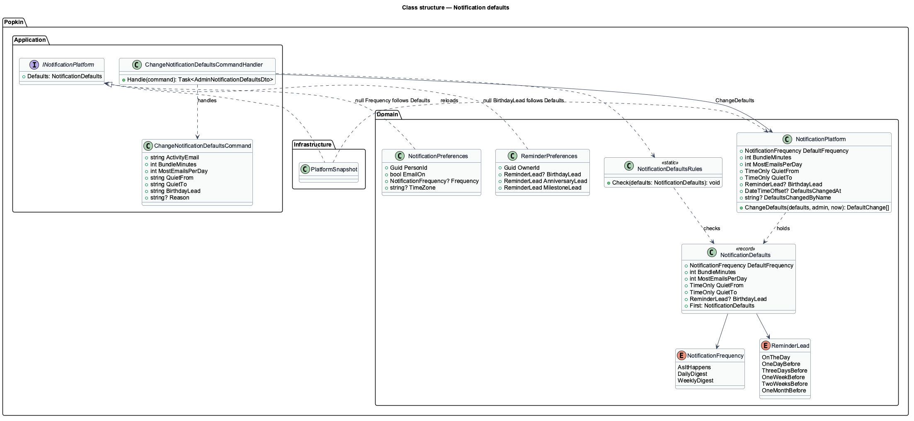
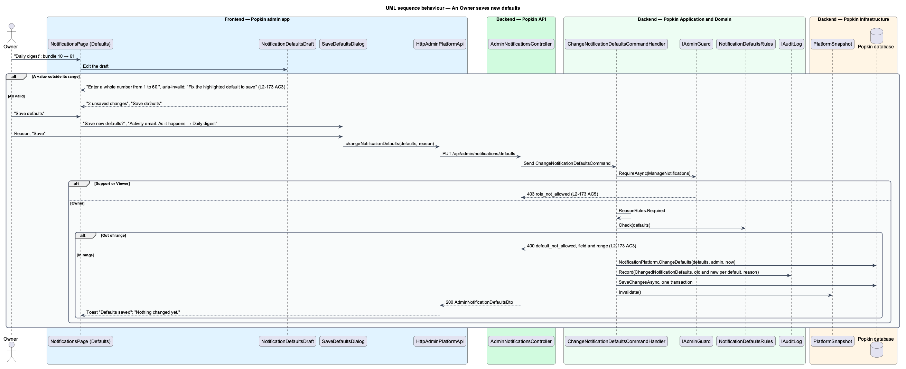
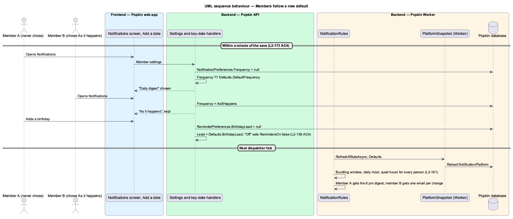

# Notification defaults

## Overview

Every member starts with notification settings they have not chosen: how often activity email
arrives, and how early a birthday reminds them. A few rules apply to everyone and no member
changes them: how long a burst of changes is bundled into one email, how many activity emails one
person gets in a day, and the quiet hours. *Defaults* is the tab of the Notifications page of the
Popkin admin app (`/notifications?tab=defaults`) where an Owner sets all five, with a reason
(L1-042).

- **default** — value a member's setting holds until the member changes it
- **member's own choice** — setting the member changed; a new default never overwrites it
- **bundling window** — minutes after a first change in which later changes join the same email
- **daily most** — the most activity emails one person gets in a day before the rest wait for
  the 6 pm digest; reminders and sign-in codes do not count
- **quiet hours** — the part of each night, in the member's own time zone, when activity email
  and phone alerts wait
- **birthday lead** — how early a new birthday reminds, or "Off"

A default is stored once, on the `NotificationPlatform` row. A member who has not chosen holds a
null, not a copy of the default, so a new default reaches every such member at once, and a
member who has chosen keeps that choice (L2-173 AC4). The page, its sending status and its
"Kinds" tab are [Member email and notification kinds](../notifications/README.md). The member's
side is [Notification settings](../../notifications/notification-settings/README.md) and
[Birthday reminders by person](../../notifications/birthday-reminders-by-person/README.md).

> **Built.** The admin app's side was built first, on the fake of
> [ADR 0030](../../../adr/0030-admin-notifications-on-a-fake-backend.md), which is now deleted: the
> API, Domain and Worker parts below are built, with these differences. `NotificationPlatform`
> keeps the names its dispatcher already read: `BundlingMinutes`, `DailyMost` and `QuietUntil`
> hold "Bundle changes within", "Most emails per person per day" and the end of quiet hours, and
> `CurrentDefaults` gives the five as a `NotificationDefaults`. Every reader reads the one row as
> it is now (`NotificationPlatformRow`) rather than through `INotificationPlatform.Defaults`, so a
> change applies at the next request or tick. There is no separate validator:
> `NotificationDefaultsRules.Check` gives the field and the words. `ReminderPreferences.BirthdayLead`
> became nullable in this change; saving the reminder preferences keeps it null while the
> birthday lead sent is the default shown. The dialogs take the reason with `pk-textarea` and
> `ActionDialogState`, as Features does; `pk-reason-field` is not built. "Save new defaults?" is
> the one `NotificationActionDialog` of the page, given the change list (`pk-change-list`), not a
> dialog of its own. `pk-limit-row` draws the text fields and the select itself, as the mock's
> bare `input` and pill `select`, and takes `pk-segmented-control` as a projected control.

## Description

### The defaults

| Default (as the page names it) | Field on `NotificationPlatform` | Allowed values | First value | Whose is it |
|---|---|---|---|---|
| Activity email | `DefaultFrequency` | "As it happens", "Daily digest", "Weekly digest" | "As it happens" | Each member, until they choose (`NotificationPreferences.Frequency` null) |
| Bundle changes within | `BundleMinutes` | whole number from 1 to 60, minutes | 10 | Everyone |
| Most emails per person per day | `MostEmailsPerDay` | whole number from 1 to 100 | 12 | Everyone |
| Quiet hours | `QuietFrom`, `QuietTo` | a time on the hour or half hour, each | 21:00 to 08:00 | Everyone, in their own zone |
| Birthday reminders | `BirthdayLead` | "Off", "On the day", "1 day before", "3 days before", "1 week before" | "1 week before" | Each person, until they change "Birthdays: remind me" (L2-139 AC4) |

The first values are those of L2-161 and L2-173 AC2. The migration seeds them on the one
`NotificationPlatform` row.

### Screens and states

Admin app, `docs/mocks/admin/pages/notifications/defaults.html` — `pk-panel` "For new members",
"What a member starts with. Anyone who has changed a setting keeps theirs.", one `limit` row per
default with its name, its help and its control:

- "Activity email": a `segmented` control of the three frequencies, with the chosen one's help
  ("One email per change, bundled if several land within 10 minutes.");
- "Bundle changes within" ("Changes inside this window ride in one email.") with "minutes";
- "Most emails per person per day" ("After this, the rest wait for the 6 pm digest. Reminders
  don’t count.") with "emails";
- "Quiet hours" ("In each member’s own time zone. Nothing sends; it waits until morning."), two
  fields, "Quiet hours start" and "Quiet hours end", joined by "to";
- "Birthday reminders" ("New contacts with a birthday get a reminder this early.") as a `select`.

The panel's foot reads "Nothing changed yet." until a value changes, and offers "Save defaults"
(L2-173 AC1). For Support and Viewer every field is read-only and "Save defaults" is disabled with
its reason (L2-173 AC5).

### Conflicts and gaps

- **Saving asks for a reason.** L2-173 AC4 saves the defaults "with a reason"; the mock saves at
  once. "Save defaults" opens `SaveDefaultsDialog`, as Limits opens "Save new limits?"
  ([Limits](../limits/README.md)): "Save new defaults?", "These apply within a minute to every
  member who hasn’t chosen their own:", the list "{default}: {old} → {new}", the required reason,
  "Save" and "Cancel". Its mock, `docs/mocks/admin/dialogs/notification-defaults-save/`, is
  `<TO SUPPLY>`, as are the panel's states for unsaved changes, an invalid value and a saved
  toast, and the `loading` and `error` states of the tab.
- **Words for an invalid value.** L2-173 AC3 says the field "says which and the range". The words
  are `<TO SUPPLY>`; until a mock gives them the design uses "Enter a whole number from 1 to 60.",
  "Enter a whole number from 1 to 100." and "Enter a time on the hour or half hour, such as
  21:00.".
- **Equal quiet hours.** A start equal to its end is either no quiet hours or a whole day of
  them. Which, or whether it is refused, is `<TO SUPPLY>`; until settled it is refused as
  invalid, on the end field: "Quiet hours can’t start and end at the same time.".
- **Who changed them.** The foot reads "Last changed today by {admin}." or "Last changed {Sun 12
  Jul} by {admin}." once an Owner has saved, from `changedAt` and `changedByName`, as
  `defaults-saved.html` draws it, and "Nothing changed yet." before.
- **Birthday leads.** The defaults offer five values, without "2 weeks before" or "1 month
  before", which a person can choose for a date (L2-139, L2-159). The narrower list is the
  requirement's and stands.
- **Kinds have no default here.** The Defaults tab sets no kind's email or phone default; each
  kind starts at `NotificationCatalogue`'s default (L2-154 AC1, as amended 2026-11-17).
- **Activity email for an account without an email.** The frequency default applies to every
  member; an account without an email address gets no email whatever it holds (L2-156 AC5).

### API

On `AdminNotificationsController` ([Member email and notification kinds](../notifications/README.md)),
admin scheme only.

- `GET /api/admin/notifications/defaults` — any admin. `200` `AdminNotificationDefaultsDto`:
  `activityEmail` (`AsItHappens` | `DailyDigest` | `WeeklyDigest`), `bundleMinutes`,
  `mostEmailsPerDay`, `quietFrom` and `quietTo` (`"HH:mm"`), `birthdayLead` (`Off` or a
  `ReminderLead` name), `changedAt?`, `changedByName?`.
- `PUT /api/admin/notifications/defaults` — body: the five values and `reason`. `200`
  `AdminNotificationDefaultsDto`. Refusals: `400` `reason_required`, `reason_too_long`; `400`
  `default_not_allowed` with the field (`bundleMinutes`, `mostEmailsPerDay`, `quietFrom`,
  `quietTo`, `activityEmail`, `birthdayLead`) and the range in its message, for each value outside
  the table; `400` `no_change` when nothing differs from what is saved; `403` `role_not_allowed`
  for Support and Viewer.

### Backend

- **`NotificationPlatform`** (Domain) gains `DefaultFrequency` (`NotificationFrequency`),
  `BundleMinutes`, `MostEmailsPerDay`, `QuietFrom`, `QuietTo` (`TimeOnly`), `BirthdayLead`
  (`ReminderLead?`, null for "Off"), `DefaultsChangedAt?` and `DefaultsChangedByName?`.
  `ChangeDefaults(NotificationDefaults, admin, now)` returns what changed.
- **`NotificationDefaults`** (Domain, record) — the five values together, with
  `NotificationDefaults.First` holding the first values of the table.
- **`NotificationDefaultsRules`** (Domain, static) — each value's range: 1 to 60, 1 to 100, a time
  whose minutes are 0 or 30, start not equal to end, a birthday lead of the five allowed. Tested
  one case per row.
- **`ChangeNotificationDefaultsCommand`** / **`ChangeNotificationDefaultsCommandValidator`** /
  handler — `RequireAsync(AdminAction.ManageNotifications)`; `ReasonRules.Required`;
  `NotificationDefaultsRules`; `NotificationPlatform.ChangeDefaults`; one
  `IAuditLog.RecordAsync` (`ChangedNotificationDefaults`, target `NotificationDefaults`, reason,
  `Details` `{ default: { old, new } }` for each change); one `SaveChangesAsync`; then
  `IPlatformSnapshot.Invalidate()`.
- **`AuditAction.ChangedNotificationDefaults`**, **`AuditTargetKind.NotificationDefaults`** (target
  id `notification-defaults`, name "Notification defaults").
- **`INotificationPlatform.Defaults`** — `NotificationDefaults`, answered by `PlatformSnapshot`
  and honoured within a minute by the API and the Worker
  ([Member email and notification kinds](../notifications/README.md)).
- **Following the default** — who reads each default:
  - `NotificationPreferences.Frequency` is null until the member chooses; the member's settings
    and the dispatcher read `Frequency ?? Defaults.DefaultFrequency`
    ([Notification settings](../../notifications/notification-settings/README.md));
  - `NotificationRules` reads `BundleMinutes`, `MostEmailsPerDay`, `QuietFrom` and `QuietTo` for
    every person ([Deliver notifications](../../notifications/deliver-notifications/README.md));
  - `ReminderPreferences.BirthdayLead` becomes nullable: null until the person changes "Birthdays:
    remind me", and a new birthday then starts at `Defaults.BirthdayLead`, with
    `KeyDate.RemindersOn` false when it is "Off" (L2-139 AC4). A person who changed it keeps it.
    The column change and its migration belong to
    [Birthday reminders by person](../../notifications/birthday-reminders-by-person/README.md).
- **Telemetry** — a change is logged with the admin's id and the names of the defaults changed,
  never the reason's text.

### Frontend (Popkin admin app)

- **Defaults tab** of `NotificationsPage` — `pk-panel` "For new members" with one `pk-limit-row`
  per default. `pk-limit-row` gains a projected control for a value that is not one number:
  `pk-segmented-control` for "Activity email", two `pk-text-field`s (a numeric keypad lacks the colon, so no
  `inputmode`) with the accessible names "Quiet hours start" and "Quiet hours end", and `pk-select-field` for
  "Birthday reminders". Each field is labelled by its row's name and described by its help and its
  error, with `aria-invalid` on error.
- **The foot** — "Nothing changed yet." or `pk-save-bar` with "{n} unsaved changes", "Discard" and
  "Save defaults", or "Fix the highlighted default to save" while a value is invalid.
- **`SaveDefaultsDialog`** (`frontend/projects/admin/src/app/dialogs/save-defaults/`) — the change
  list and the required `pk-reason-field`, focus in it on open; `ActionDialogState` for busy and
  failed; on success the toast "Defaults saved", "They apply within a minute to members who
  haven’t chosen their own.".
- **`NotificationDefaultsDraft`** (`frontend/projects/api/src/lib/api/admin/platform/`, pure) — the
  saved values, the draft, each value's validity with its message, the unsaved count and the
  change list. Unit tested one case per row of `NotificationDefaultsRules` (ADR 0011).
  `AdminNotificationsStore` holds it.
- **`ADMIN_PLATFORM_API`** gains `notificationDefaults()` and
  `changeNotificationDefaults(defaults, reason)`.
- **Roles** — `blockedReason(ManageNotifications)` makes every field read-only and disables "Save
  defaults" for Support and Viewer, with "Only Owners can do this" or "Viewer admins can’t do
  this".

### Tests

- API acceptance tests (InMemory): the defaults read the first values; an Owner saves "Daily
  digest" and 20 minutes with a reason, and the change and its audit entry are saved together; a
  member who never chose reads "Daily digest" afterwards, and one who chose "As it happens" keeps
  it; a bundle of 0 and of 61 are `400` `default_not_allowed` naming `bundleMinutes`; no reason is
  `400`; Support and Viewer are `403`.
- A direct test of `NotificationDefaultsRules`, one case per row: 0, 1, 60, 61, 1.5, empty; 0, 1,
  100, 101; "21:00", "21:30", "21:15", "25:00", start equal to end; each birthday lead.
- A direct test of the follow-the-default reads: a null frequency follows a changed default; a
  null birthday lead starts a new birthday at the default, and "Off" starts it with reminders off.
- Unit tests (`api` library): `NotificationDefaultsDraft`.
- Playwright (admin project, `AdminNotificationsPage`): the defaults state, an invalid value, the
  save dialog's default, busy, invalid and failed paths, and the read-only Viewer.

## Requirements

| L2 ID | Refines (L1) | Requirement |
|-------|--------------|-------------|
| `L2-173` | `L1-042` | Defaults for new members: An Owner sets what a new member starts with and the limits on sending. (AC1–AC5) |
| `L2-139` | `L1-033` | Reminder defaults: Each date has its own reminder, starting from a default for its kind. (AC4, the birthday lead from the admin app) |
| `L2-086` | `L1-028` | Admin roles: Every admin has one role, and the API, not the screen, decides what it allows. (the row "Pause and resume member email, switch a notification kind for everyone, change notification defaults") |

## Diagrams

### System context

An Owner sets the defaults in the admin app; every member who has not chosen their own, and the
sending rules for everyone, follow them.

### Containers

The admin app saves the defaults through the API; the API and the Worker read them back through
their snapshots.

### Components

`ChangeNotificationDefaultsCommandHandler` checks each value with `NotificationDefaultsRules` and
writes `NotificationPlatform` with its audit entry; `PlatformSnapshot` answers
`INotificationPlatform.Defaults`.

### Class structure

The defaults live on `NotificationPlatform`; a member's null `Frequency` and a person's null
`BirthdayLead` follow them.

### Behaviour — an Owner saves new defaults

The tab gathers the unsaved changes and checks each value; the dialog takes the reason; the
handler saves the defaults and their audit entry together.

### Behaviour — members follow a new default

Within a minute the snapshot holds the new defaults: a member who has not chosen follows the new
frequency, a member who has chosen keeps theirs, and a new birthday starts at the new lead.

