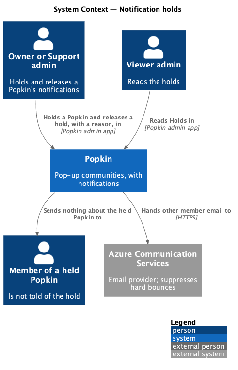
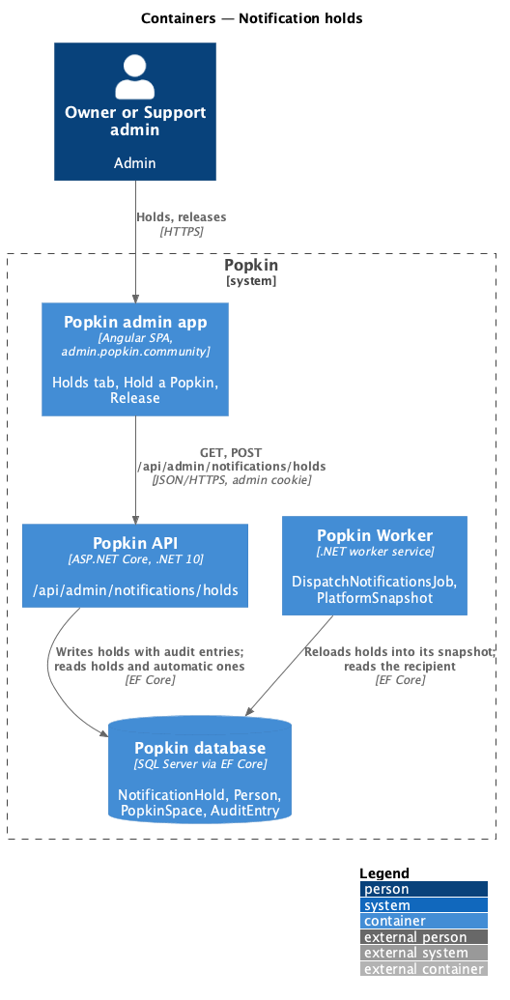
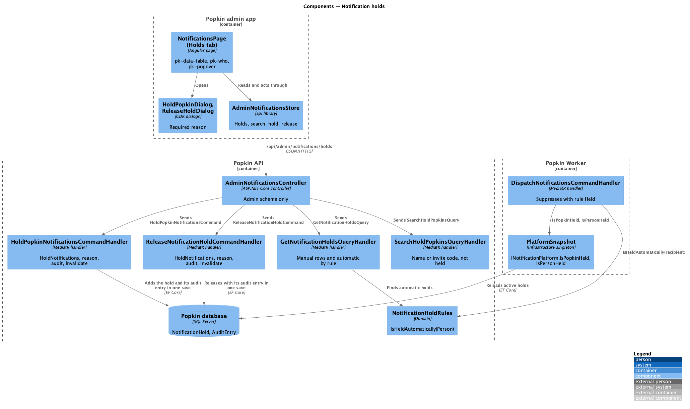
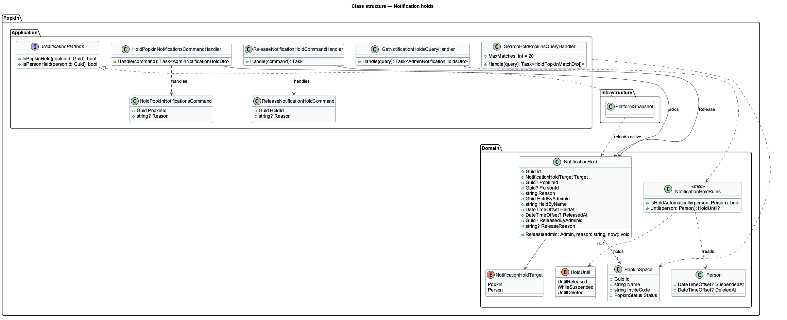
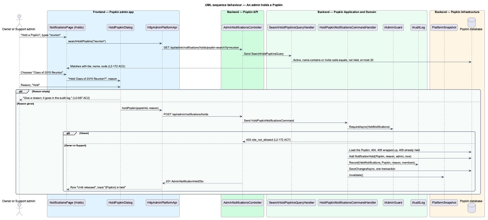
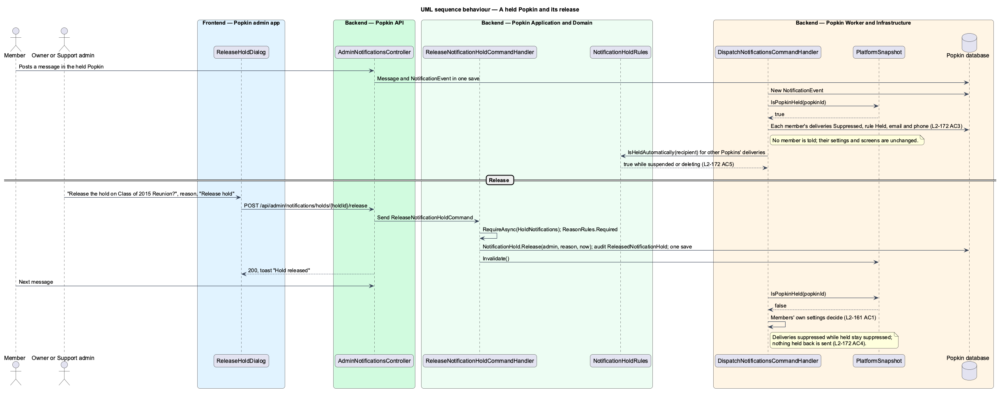

# Notification holds

## Overview

Sometimes one Popkin, not all of Popkin, should stop receiving mail. A Popkin reported for spam
invites, for example, should send its members nothing while it is reviewed. A *hold* is an
admin's stop on every email and phone alert to one Popkin's members about that Popkin, whatever
each member's own settings say, until an admin releases it (L1-042). Members are not told.

- **hold** — admin's stop on every notification about one Popkin, or to one person, until released
- **manual hold** — hold an Owner or Support admin adds, with a reason, and releases, with a reason
- **automatic hold** — hold Popkin applies by rule to an account that is suspended or being
  deleted; it ends with the suspension or the deletion and no admin releases it
- **hard bounce** — address the mail provider reports as undeliverable for good; the provider
  suppresses it, so Popkin's holds list does not show it

Holds are the "Holds" tab of the Notifications page of the Popkin admin app
(`/notifications?tab=holds`). The page, its sending status and its "Kinds" tab are
[Member email and notification kinds](../notifications/README.md). A hold is a
`NotificationHold` row, read through the cached `PlatformSnapshot` and honoured within a minute,
as a kind switched off is. The dispatcher applies it at fan-out and again at send time, in the
place L2-161 AC1 gives it: after a pause and a kind off for everyone, before every member's own
choices ([Deliver notifications](../../notifications/deliver-notifications/README.md)).

An admin holds a Popkin. The designs also list holds on one person added by hand ("Asked support
to stop all mail while travelling"), but draw no way to add one. That is gap 125; the table can
hold such a row, and no endpoint adds one.

> **Built against a fake backend.** The admin app's side is built first, on the fake of
> [ADR 0030](../../../adr/0030-admin-notifications-on-a-fake-backend.md); the API, Domain and Worker
> parts below are not built yet. The dialogs take the reason with `pk-textarea` and
> `ActionDialogState`, as Features does; `pk-reason-field` is not built.

## Description

### Screens and states

Admin app, `docs/mocks/admin/pages/notifications/`:

- `holds.html` — `pk-panel` "Held", "No email or phone alerts go to these, whatever their own
  settings say. Members aren’t told.", with "Hold a Popkin". The `data-table` lists each hold:
  - for a Popkin, `who` with its `popkin-tile`, its name and "Popkin · {n} members · {code}";
  - for a person, `who` with the avatar, the name and the email;
  - "Why", with who held it and since when beneath ("Aiko Tanaka · Sat 12 Jul"), and "Until";
  - "Release", named "Release the hold on {name}", or for an automatic hold the `badge`
    "Automatic" with "System" as who held it (L2-172 AC1, AC5).

  Below the table: "Suspended and deleting accounts are held automatically. {n} addresses that
  hard-bounced are suppressed by the mail provider and don’t appear here." (L2-172 AC6).
- `hold-adding.html` — "Hold a Popkin" opens a `popover` with the search "Name or code" and a
  `pick-list` of active Popkins not already held, each with its tile, name and invite code
  (L2-172 AC2).
- `support.html` — a Support admin's "Hold a Popkin" and "Release" are enabled; `viewer.html` —
  both disabled with "Viewer admins can’t do this" (L2-172 AC7, L2-086).

Admin app dialog, `docs/mocks/admin/dialogs/notification-hold-release/` (`default`, `busy`,
`failed`) — "Release the hold on {name}?", "Members here start getting email again, by their own
settings, from the next change. Nothing held back is sent late.", the reason field, "Release
hold" and "Keep it held" (L2-172 AC4).

### Conflicts and gaps

- **Choosing a Popkin asks for a reason.** L2-172 AC2 says choosing a Popkin from the search
  "asks for a reason (L2-087) and adds the hold". In `hold-adding.html` a choice adds the hold at
  once, with "Held from the console" as its reason. The design adds the dialog `HoldPopkinDialog`
  ("Hold {Popkin}?", "Its members get no email or phone alerts from it until it is released.
  They aren’t told.", the reason, "Hold" and "Cancel"). Its mock,
  `docs/mocks/admin/dialogs/notification-hold-add/`, is `<TO SUPPLY>`.
- **The reason is required.** The release dialog marks the reason optional. L2-172 AC4 asks for a
  reason, so `ReasonRules.Required` applies and the dialog gains the `invalid` state of L2-087
  AC2; the mock changes. L2-087 AC1 does not yet name the two dialogs (see
  [Member email and notification kinds](../notifications/README.md)).
- **Until.** The mocks show "Until reviewed" and "Until 28 Jul" for manual holds. L2-172 AC1 names
  "Until released", "While suspended" and "Until deleted"; a manual hold has no end date, and
  "Until released" stands.
- **A person held by hand.** `holds.html` lists Priya Nair, held by hand. No requirement and no
  mock adds such a hold (gap 125), so the list shows manual person holds only if a later design
  adds them; "Holds {n}" counts what the list shows.
- **The bounce count.** The number of suppressed addresses comes from Azure Communication
  Services' suppression list, which Popkin reads only once gap 129 is settled. Until then the
  sentence leaves the number out: "Addresses that hard-bounced are suppressed by the mail
  provider and don’t appear here."
- **Suspension is not built yet.** An automatic hold for a suspended account reads
  `Person.SuspendedAt`, designed in [Suspend a person](../../admin-people/suspend-person/README.md).
  Until it is built, only deleting accounts (`Person.DeletedAt`) are held automatically.

### API

On `AdminNotificationsController` ([Member email and notification kinds](../notifications/README.md)),
admin scheme only.

- `GET /api/admin/notifications/holds` — any admin. `200` `AdminNotificationHoldsDto`:
  - `holds` — `AdminNotificationHoldDto[]`, manual first, newest first, then automatic, newest
    first: `id?` (null for automatic), `target` (`Popkin` | `Person`), `automatic`, `popkin?`
    (`id`, `name`, `emoji`, `colour`, `members`, `inviteCode`), `person?` (`id`, `name`,
    `email`, `avatar`), `why`, `byName` ("System" for automatic), `since`, `until`
    (`UntilReleased`, `WhileSuspended`, `UntilDeleted`);
  - `suppressedAddresses?` — the provider's count, null until gap 129 is settled.
- `GET /api/admin/notifications/holds/popkin-search?q=` — any admin. `200`
  `HoldPopkinMatchDto[]`: active Popkins whose name contains the text or whose invite code is the
  text, ignoring case, not already held, at most 20, ordered by name.
- `POST /api/admin/notifications/holds` — body `{ popkinId, reason }`. `201`
  `AdminNotificationHoldDto`. Refusals: `400` `reason_required`, `reason_too_long`; `403`
  `role_not_allowed` for a Viewer; `404` `popkin_not_found`; `409` `popkin_wrapped_up`; `409`
  `popkin_already_held`.
- `POST /api/admin/notifications/holds/{holdId}/release` — body `{ reason }`. `200`. Refusals:
  `400` `reason_required`; `403` `role_not_allowed` for a Viewer; `404` `hold_not_found` for an
  unknown or already released hold. An automatic hold has no id and cannot be released here
  (L2-172 AC5).

### Backend

- **`AdminAction.HoldNotifications`** (Domain) — in the row `NotificationHolds` of
  `AdminPermissions`: Owner and Support ([Admin roles](../../admin-access/admin-roles/README.md)).
- **`NotificationHold`** (Domain, new table) — `Id`, `Target` (`NotificationHoldTarget`:
  `Popkin`, `Person`), `PopkinId?`, `PersonId?`, `Reason`, `HeldByAdminId`, `HeldByName`,
  `HeldAt`, `ReleasedAt?`, `ReleasedByAdminId?`, `ReleaseReason?`. `Release(admin, reason, now)`
  throws `404` `hold_not_found` when already released. A filtered unique index on (`PopkinId`)
  where `ReleasedAt` is null keeps one active hold per Popkin. Released rows stay, with the audit
  log, as the history.
- **`NotificationHoldRules`** (Domain, static) — `IsHeldAutomatically(Person)`: true while
  `SuspendedAt` is set or `DeletedAt` is set, with `Until` `WhileSuspended` or `UntilDeleted`.
  The rule reads the person; no row is written, so lifting a suspension or cancelling a deletion
  ends the hold at once (L2-172 AC5). Tested one case per row.
- **`AuditAction`** gains `HeldNotifications` and `ReleasedNotificationHold`, target `Popkin`
  (its id and name), with the reason; `Details` carry the member count.
- **`GetNotificationHoldsQuery`** / handler — `IAdminGuard.CurrentAdminAsync`; active
  `NotificationHold` rows joined to their Popkin or person, then every `Person` held by
  `NotificationHoldRules`. The automatic part pages at `<TO SUPPLY>` rows once the number of
  suspended and deleting accounts grows past what one page shows; the mock lists all.
- **`SearchHoldPopkinsQuery`** / handler — the search of `SearchFeaturePopkinsQueryHandler`
  (`Popkin.Application/Administration/FeatureSwitches.cs`): `PopkinStatus.Active`, name contains
  or `InviteCode` equals, `MaxMatches` 20; it leaves out Popkins with an active hold.
- **`HoldPopkinNotificationsCommand`** / handler — `RequireAsync(HoldNotifications)`;
  `ReasonRules.Required`; loads the Popkin (`404`, `409` wrapped up, `409` already held); adds the
  `NotificationHold`; one `IAuditLog.RecordAsync`; one `SaveChangesAsync`; then
  `IPlatformSnapshot.Invalidate()`.
- **`ReleaseNotificationHoldCommand`** / handler — `RequireAsync(HoldNotifications)`;
  `ReasonRules.Required`; `NotificationHold.Release`; one audit entry; one save; `Invalidate()`.
- **`INotificationPlatform`** gains `IsPopkinHeld(popkinId)` and `IsPersonHeld(personId)` (manual
  person holds), answered by `PlatformSnapshot` from `PlatformValues`, which gains the active hold
  ids. The dispatcher checks `IsPopkinHeld` for an event about a Popkin, `IsPersonHeld` and
  `NotificationHoldRules.IsHeldAutomatically` for the recipient, at fan-out and at send time
  (L2-174 AC1). A delivery stopped by a hold is `Suppressed` with the rule `Held` and is never
  sent later, so a release sends nothing held back (L2-172 AC4).
- **Members are not told.** No member-facing read returns a hold; the member's Notifications
  screen and the Popkin's screens are unchanged (L2-172 AC3).

### Frontend (Popkin admin app)

- **Holds tab** of `NotificationsPage` — `pk-panel` "Held" with "Hold a Popkin" as its action,
  `pk-data-table` of holds, and the closing sentence. Each row's subject is `pk-who` (components,
  new, block `who`: a `pk-popkin-tile` or `pk-avatar`, a name and a line). "Release" is a
  `pk-button` with the accessible name "Release the hold on {name}"; an automatic row shows
  `pk-badge` "Automatic".
- **`pk-popover`** (components, new, block `popover`) — anchored to "Hold a Popkin", with
  `pk-search-field` ("Name or code") and `pk-pick-list`. It traps nothing: Escape and a click
  outside close it, and focus returns to the button. Arrow keys move through the matches.
- **`HoldPopkinDialog`**, **`ReleaseHoldDialog`** (`frontend/projects/admin/src/app/dialogs/`) —
  CDK dialogs with the required `pk-reason-field` and `ActionDialogState`.
- **`AdminNotificationsStore`** gains `holds()`, the search (debounced, cancelled when the text
  changes), `holdPopkin(popkinId, reason)` and `release(holdId, reason)`, with the toasts
  "{Popkin} is held" and "Hold released". Unit tested.
- **`holds-text.ts`** (api library) — "Popkin · {n} members · {code}", "{admin} · {date}",
  "Until released" / "While suspended" / "Until deleted", the closing sentence with and without
  the count. Unit tested.
- **`ADMIN_PLATFORM_API`** gains `notificationHolds()`, `searchHoldPopkins(text)`,
  `holdPopkin(popkinId, reason)` and `releaseHold(holdId, reason)`.
- **Roles** — `blockedReason(HoldNotifications)`: enabled for Owner and Support, disabled with
  "Viewer admins can’t do this" for a Viewer.

### Tests

- API acceptance tests (InMemory): a Support admin holds a Popkin with a reason, and the hold and
  its audit entry are saved together; a hold without a reason is `400`; a wrapped-up Popkin is
  `409` `popkin_wrapped_up`; a second hold is `409` `popkin_already_held`; release; a Viewer is
  `403` on both writes; the list shows a deleting account as automatic, by "System", with no id.
- Worker test with `FakeTimeProvider`: a message in a held Popkin sends no email and no phone
  alert to any member; after a release, the next message notifies and the held one is never
  sent. No test sleeps (ADR 0010).
- A direct test of `NotificationHoldRules`, one case per row: active, suspended, deleting,
  suspension lifted, deletion cancelled.
- Unit tests (`api` library): the store's search and actions, `holds-text.ts`.
- Playwright (admin project, `AdminNotificationsPage`): the holds and hold-adding states, the hold
  and release dialogs' default, busy, invalid and failed paths, and the Viewer's disabled
  actions. Parity specs for `pk-who` and `pk-popover` (ADR 0008).

## Requirements

| L2 ID | Refines (L1) | Requirement |
|-------|--------------|-------------|
| `L2-172` | `L1-042` | Holds: An admin stops every notification to one Popkin's members, whatever their settings. (AC1–AC7) |
| `L2-086` | `L1-028` | Admin roles: Every admin has one role, and the API, not the screen, decides what it allows. (the row "Hold and release notifications to a Popkin") |

## Diagrams

### System context

An Owner or Support admin holds a Popkin; its members get no notifications about it until the
hold is released.

### Containers

The admin app writes holds through the API; the Worker's dispatcher reads them through its
snapshot and suppresses the held deliveries.

### Components

Two command handlers write `NotificationHold` with their audit entries; `PlatformSnapshot`
answers `IsPopkinHeld`, and `NotificationHoldRules` answers for suspended and deleting accounts.

### Class structure

A manual hold is a `NotificationHold` row; an automatic hold is a rule over `Person`, with no row.

### Behaviour — an admin holds a Popkin

The admin searches for the Popkin, gives a reason, and the hold is saved with its audit entry.

### Behaviour — a held Popkin and its release

While held, every delivery about the Popkin is suppressed; after a release, the next change
notifies again and nothing held back is sent.

