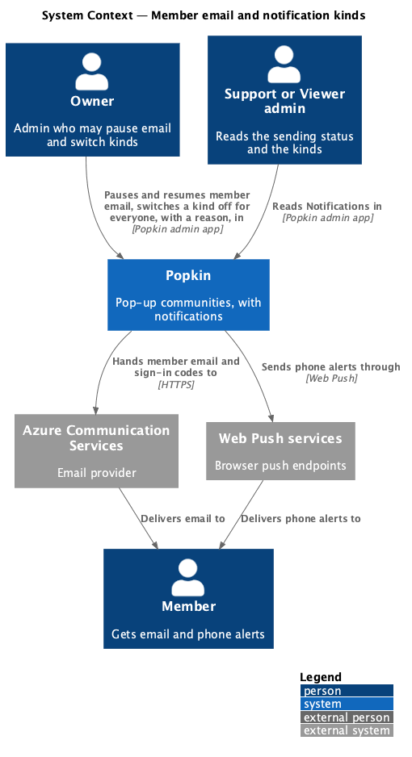
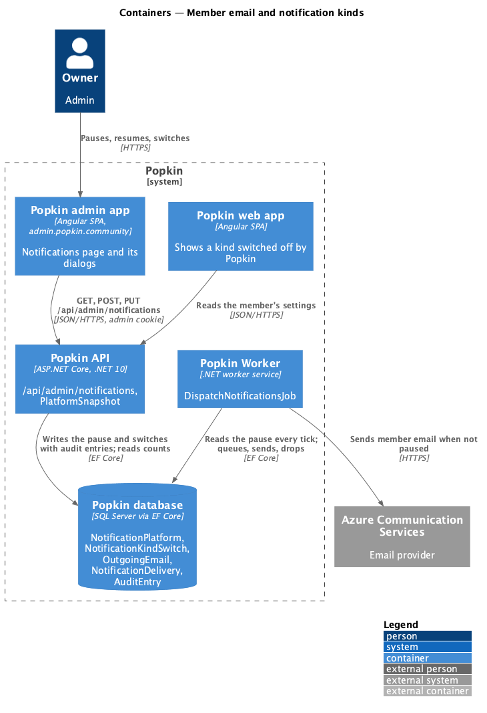
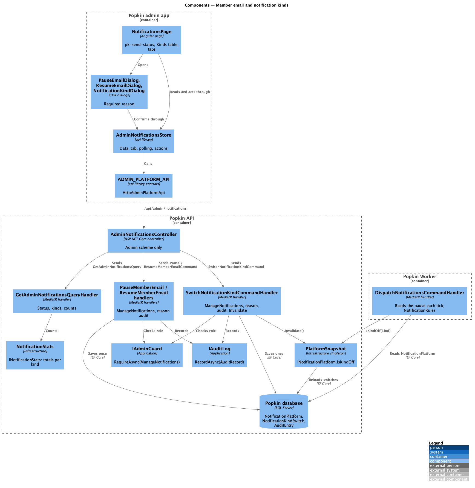
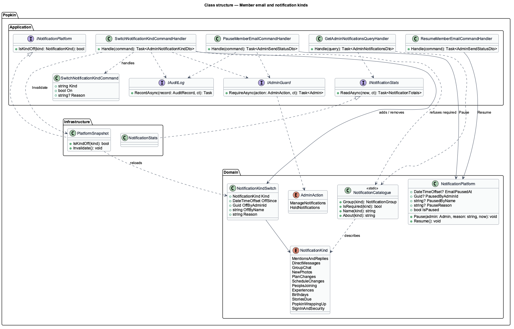
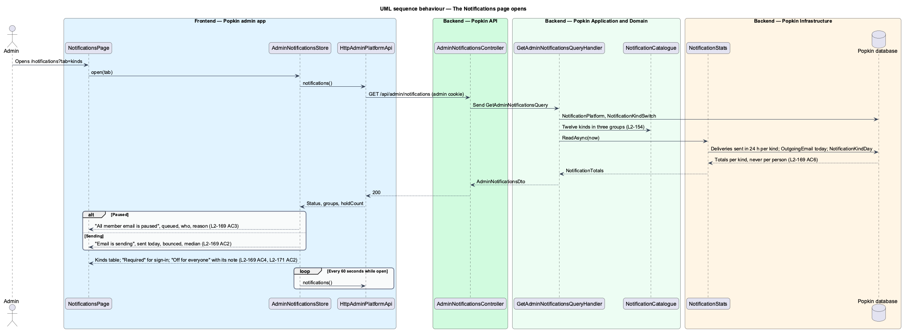
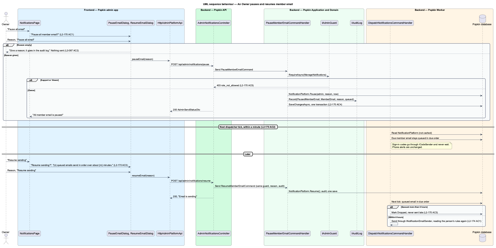
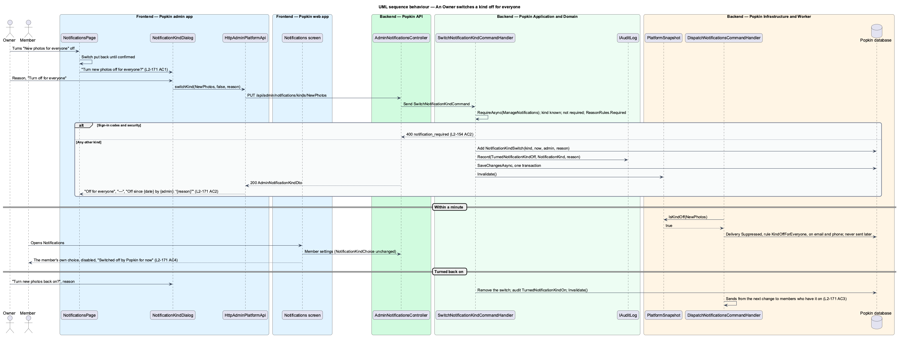

# Member email and notification kinds

## Overview

Popkin sends members email and phone alerts about their Popkins and their reminders
([Deliver notifications](../../notifications/deliver-notifications/README.md)). When a sending
goes wrong, such as a digest that sends twice or a kind that fires on every small change, the
people who run Popkin need two levers that act at once and for everyone: stop all member email,
and stop one kind of notification. *Notifications* is the page of the Popkin admin app
(`/notifications`) that shows whether member email is going out and how each kind is received,
and holds both levers (L1-042).

- **member email** — every activity and reminder email Popkin sends a member; sign-in codes are
  not member email
- **sending status** — whether member email is going out or paused, with the day's counts
- **pause** — Owner's stop on all member email: emails queue instead of going to the mail provider
- **queued email** — email due while paused, kept in the order it was due
- **kind off for everyone** — Owner's stop on one notification kind on every channel, whatever
  each member chose
- **Required** — the one kind no person and no admin can switch off: "Sign-in codes and
  security" (L2-154 AC2)

The page has three tabs. This design owns the sending status and the "Kinds" tab. "Holds" is
[Notification holds](../notification-holds/README.md) and "Defaults" is
[Notification defaults](../notification-defaults/README.md). All three share the page, the
controller and `AdminNotificationsStore`.

Two parts of the system use what an Owner sets here. The Popkin Worker's dispatcher reads the
pause from the database on every tick, so a pause stops sending within one minute (L2-170 AC2). A
kind switched off is a `NotificationKindSwitch` row, read through the cached `PlatformSnapshot`
and honoured within a minute, as feature switches are
([Feature switches](../feature-switches/README.md)). A member's own choices are never changed by
either lever. They come back as they were when the lever is released.

> **Built.** The admin app's side was built first, on the fake of
> [ADR 0030](../../../adr/0030-admin-notifications-on-a-fake-backend.md), which is now deleted: the
> API, Domain and Worker parts below are built as written, with these differences.
> `NotificationPlatform` is not seeded by the migration: a read finds its first values when the
> row is missing, and the first change adds it (`NotificationPlatformRow`). `Pause` and `Resume`
> answer whether they changed anything, and the handlers refuse with the `409`s. "About {m}
> minutes" assumes 100 queued emails a minute (`AdminNotificationPlatform.ResumeSendsPerMinute`),
> an estimate, not a limit. The median is worked out from the day's sent emails in memory. The
> snapshot's 30-second refresh is proven through the API (a switch written to the database is
> honoured after 30 seconds) rather than by a direct test of `PlatformSnapshot`, and the pause's
> Worker behaviour by the dispatcher's API tests. The dialogs take the reason with `pk-textarea` and
> `ActionDialogState`, as Features does; `pk-reason-field` is not built. One
> `NotificationActionDialog` serves the pause, the resume and a kind's switch. The kinds table
> reuses `pk-data-table` (ADR 0029): its existing group rows, and new `kind`, `switch` and `lock`
> cells that keep the classes `kind-name`, `kind-about`, `kind-totals` and `lock-note`, in place
> of `pk-table-group`, `pk-notification-kind` and `pk-lock-note`. "Off for everyone" is
> `pk-status` with the `bad` tone, as the mocks draw it.

## Description

### Screens and states

Admin app, `docs/mocks/admin/pages/notifications/`, route `admin.popkin.community/notifications`:

- `default.html` — page head "Notifications", "Email and phone alerts to members. Switch a kind
  off for everyone, or hold mail for one Popkin or person."; `send-status` reads "Email is
  sending" with a teal dot and "48,210 sent today · 0.4% bounced · median 41 s from change to
  inbox", and "Pause all email" (L2-169 AC1, AC2). Under it the `segmented` tabs "Kinds {n}",
  "Holds {n}", "Defaults", and the "Kinds" table: one `table-group` per group, each kind's
  `kind-name` and `kind-about`, "Sent, 24 h", "Opened" and a `switch` "{kind} for everyone".
  "Sign-in codes and security" shows `lock-note` "Required" in place of the switch (L2-169 AC4).
  A kind that is off shows `kind-name--off`, the `badge` "Off for everyone", "—" in both counts
  and "Off since {date} by {admin}: “{reason}”" in place of what sends it (L2-171 AC2).
- `paused.html` — `send-status` in coral: "All member email is paused", "{n} emails queued since
  {time}, paused by {admin}: “{reason}”. Sign-in codes still go out.", and "Resume sending"
  (L2-169 AC3).
- `support.html`, `viewer.html` — "Pause all email" and every switch are disabled with their
  reasons (L2-086 AC2, AC3, L2-170 AC5, L2-171 AC5).
- `loading.html`, `error.html` — skeletons; the page's load failure with "Try again" (L2-089 AC7).

Admin app dialogs, `docs/mocks/admin/dialogs/`:

- `notifications-pause/` (`default`, `busy`, `failed`) — "Pause all member email?", "Every
  activity email and reminder stops within a minute and queues. Sign-in codes keep sending.
  Anything queued longer than 6 hours is dropped when you resume.", the reason field, "Pause all
  email" (danger) and "Keep sending" (L2-170 AC1).
- `notifications-resume/` (`default`, `busy`, `failed`) — "Resume sending?", "{n} queued emails
  send in order over about {m} minutes. Changes older than 6 hours are dropped rather than sent
  late.", the reason field, "Resume sending" and "Stay paused" (L2-170 AC3).
- `notification-kind-switch/` (`default`, `turn-on`, `busy`, `failed`) — "Turn {kind} off for
  everyone?", "No member gets {kind} by email or phone, whatever their settings. Their own
  choices are kept and come back when you switch it on.", the reason field, "Turn off for
  everyone" and "Keep it on"; `turn-on` reads "Turn {kind} back on?" (L2-171 AC1, AC3).

### Conflicts and gaps

- **Twelve kinds, in the requirement's words.** The mocks list thirteen kinds ("Kinds 13"),
  including "Plans coming up", and name "To-dos due" and "To-dos added, moved, or given to you".
  L2-154 lists twelve, with "Stories due" and "Stories added, moved or given to you"; "Plans
  coming up" is gap 123. The requirement stands and the mocks change.
- **The reason is required.** The three dialogs mark "Reason, for the audit log" optional, and the
  manifest says nothing in them can be invalid. L2-170 AC1, L2-171 AC1 and L2-172 AC4 say each
  dialog "asks for a reason (L2-087)", and none of these is a change L2-087 AC3 lets go without
  one. The handlers use `ReasonRules.Required`, the dialogs gain the `invalid` state of L2-087
  AC2, and the mocks change. L2-087 AC1's list of dialogs does not yet name these three; adding
  them is a change to the requirement, `<TO SUPPLY>` by its owner.
- **The Support notice.** `support.html` shows "You’re signed in as Support. You can hold and
  release mail; switching kinds and defaults is for Owners." L2-086 asks for a notice for a
  Viewer only, and each disabled action carries its own reason (AC3). The notice is not built.
- **The Dashboard.** `paused.html` notes that a pause stays at the top of the Dashboard's "Needs
  attention" list until mail resumes. No requirement asks for it; it is left out until one does.
- **Opened and bounced** come from Azure Communication Services engagement tracking and delivery
  reports, which reach Popkin only once gap 129 is settled. Until then "Opened" and "bounced"
  read "—".
- **How long a resume takes.** The resume dialog's "about {m} minutes" divides the queue by the
  mail provider's sending rate, which is `<TO SUPPLY>` (`Notifications:EmailsPerMinute`, from the
  Azure Communication Services quota of the `popkin.community` domain).
- **"Today"** in "{n} sent today" is the UTC day. A day in the console's own zone is
  `<TO SUPPLY>`.

### API

Every endpoint is on `AdminNotificationsController` (`Popkin.Api/Controllers/Administration/`),
`[Route("api/admin/notifications")]`, an `AdminControllerBase` (admin scheme only). The
controller checks nothing and sends one MediatR request per action.

- `GET /api/admin/notifications` — any admin. `200` `AdminNotificationsDto`:
  - `status` (`AdminSendStatusDto`) — `paused`, `pausedAt?`, `pausedByName?`, `pauseReason?`,
    `queued` (emails waiting while paused), `resumeMinutes?` (estimate for the resume dialog),
    `sentToday`, `bouncedPercent?`, `medianSecondsToInbox?`;
  - `groups` — `AdminNotificationGroupDto[]` in the order of L2-154 (`group`, `name`, `kinds`),
    each kind an `AdminNotificationKindDto` (`kind`, `name`, `about`, `required`,
    `offForEveryone`, `offSince?`, `offByName?`, `offReason?`, `sent24h`, `openedPercent?`);
  - `holdCount` — the number on "Holds {n}" ([Notification holds](../notification-holds/README.md)).
- `POST /api/admin/notifications/pause` — body `{ reason }`. `200` `AdminSendStatusDto`.
  Refusals: `400` `reason_required`, `reason_too_long`; `403` `role_not_allowed` for Support and
  Viewer; `409` `email_already_paused`.
- `POST /api/admin/notifications/resume` — body `{ reason }`. `200` `AdminSendStatusDto`.
  Refusals as pause, with `409` `email_not_paused`.
- `PUT /api/admin/notifications/kinds/{kind}` — body `{ on, reason }`. `200`
  `AdminNotificationKindDto`. Refusals: `400` `notification_required` for "Sign-in codes and
  security" (L2-154 AC2); `404` `notification_kind_not_found`; `400` `reason_required`,
  `reason_too_long`; `403` `role_not_allowed`. A switch to the state the kind already has
  changes nothing, writes no audit entry and answers `200`.

### Backend

- **`AdminAction.ManageNotifications`** (Domain) — in the row `Notifications` of
  `AdminPermissions`: Owner only ([Admin roles](../../admin-access/admin-roles/README.md)).
- **`NotificationPlatform`** (Domain, new table, one row) — `EmailPausedAt?`,
  `PausedByAdminId?`, `PausedByName?`, `PauseReason?`, and the defaults of
  [Notification defaults](../notification-defaults/README.md). `Pause(admin, reason, now)`
  throws `409` `email_already_paused` when paused; `Resume()` throws `409` `email_not_paused`
  when not. `IsPaused` is `EmailPausedAt != null`. The row is created with every default by the
  migration's seed, so a read never finds it missing.
- **`NotificationKindSwitch`** (Domain, new table) — `Kind` (key, `NotificationKind`),
  `OffSince`, `OffByAdminId`, `OffByName`, `Reason`. A row means the kind is off for everyone;
  turning it back on removes the row, and the audit log keeps the history.
- **`AuditAction`** gains `PausedMemberEmail`, `ResumedMemberEmail`,
  `TurnedNotificationKindOff` and `TurnedNotificationKindOn`; **`AuditTargetKind`** gains
  `MemberEmail` (target id `member-email`, name "Member email") and `NotificationKind` (target id
  the kind, name its catalogue name). `Details` hold counts only: `{ queued }` on pause and
  resume.
- **`GetAdminNotificationsQuery`** / handler (`Popkin.Application/Administration/Notifications/`)
  — `IAdminGuard.CurrentAdminAsync`; reads `NotificationPlatform`, every `NotificationKindSwitch`
  and `NotificationCatalogue`, and asks `INotificationStats` for the counts.
- **`INotificationStats`** (Application) / **`NotificationStats`** (Infrastructure) — reads the
  totals the dispatcher keeps:
  - "Sent, 24 h" counts the deliveries of the kind sent on either channel in the last 24 hours,
    from `NotificationDelivery` ([Deliver notifications](../../notifications/deliver-notifications/README.md));
  - "{n} sent today", "Queued" and the median count `OutgoingEmail` rows sent since midnight UTC,
    or queued while paused; the median runs from the earliest change an email carries to the mail
    provider accepting it;
  - "Opened" and "bounced" read `NotificationKindDay` (`Kind`, `Day`, `EmailsSent`, `Opened`,
    `Bounced`), totals per kind and day only (L2-174 AC6), filled once gap 129 is settled.

  No query reads or returns a person (L2-169 AC6). The cost of a median over a day's emails at
  volume is `<TO SUPPLY>`; a running percentile kept by the dispatcher replaces the query if it
  is too slow.
- **`PauseMemberEmailCommand`** / handler — `RequireAsync(ManageNotifications)`;
  `ReasonRules.Required`; `NotificationPlatform.Pause`; one `IAuditLog.RecordAsync`
  (`PausedMemberEmail`, `MemberEmail`, reason, `{ queued }`); one `SaveChangesAsync` (L2-120 AC5).
  It invalidates nothing: the dispatcher reads the pause on every tick.
- **`ResumeMemberEmailCommand`** / handler — the same guard and reason; `NotificationPlatform.Resume`;
  the audit entry with the number queued. Sending the queue in order and dropping what waited more
  than 6 hours belong to the dispatcher's next tick, which treats each queued email by its own
  due time (L2-170 AC3) ([Deliver notifications](../../notifications/deliver-notifications/README.md)).
- **`SwitchNotificationKindCommand`** / **`SwitchNotificationKindCommandValidator`** / handler —
  `RequireAsync(ManageNotifications)`; parses the kind (`404`); refuses a required kind (`400`
  `notification_required`); `ReasonRules.Required`; adds or removes the `NotificationKindSwitch`
  with the admin's name and the time; one audit entry; one save; then
  `IPlatformSnapshot.Invalidate()`. It changes no `NotificationKindChoice`, so members' choices are
  kept (L2-171 AC1, AC3).
- **`INotificationPlatform`** (Application) — `IsKindOff(NotificationKind)`, `IsHeld(...)`
  ([Notification holds](../notification-holds/README.md)) and `Defaults`
  ([Notification defaults](../notification-defaults/README.md)). `PlatformSnapshot` implements it
  from `PlatformValues`, which gains the switched-off kinds, refreshed at most every 30 seconds.
  The API and the Worker each register their own `PlatformSnapshot` singleton: the API refreshes
  it in `PlatformSnapshotMiddleware`, and the dispatcher calls `RefreshIfStaleAsync` at the
  start of each tick, so a switch reaches both within a minute.
  The dispatcher reads it at fan-out and again at send time (L2-174 AC1); the member's settings
  read it to show "Switched off by Popkin for now" (L2-171 AC4,
  [Notification settings](../../notifications/notification-settings/README.md)).
- **Nothing missed is sent.** A delivery stopped by a kind off is marked `Suppressed` with the rule
  `KindOffForEveryone` and is never sent later, so turning the kind back on sends from the next change only
  (L2-171 AC3).
- **Telemetry** — a pause and a resume are logged with the admin's id and the queue count, never
  the reason's text; the metrics of the shared architecture count suppressions by `rule`
  (`paused`, `kind_off`).

### Frontend (Popkin admin app)

- **`NotificationsPage`** (`frontend/projects/admin/src/app/pages/notifications/notifications.page.ts`
  and `.html`, route `/notifications`, `page: 'notifications'`) — `pk-page-head`,
  `pk-send-status`, `pk-segmented-control` for the three tabs, kept in the query string
  (`?tab=kinds|holds|defaults`) so a tab is linkable and the e2e routes can key it, and the panel
  of the chosen tab. The admin nav gains "Notifications" between "Announcements" and "Limits"
  ([The admin shell](../../admin-access/admin-shell/README.md)). The page polls
  `GET /api/admin/notifications` every 60 seconds while open, as other admin pages do.
- **`pk-send-status`** (components, new, block `send-status`) — inputs `state`
  (`sending` | `paused`), `title`, `text`; one projected action. The dot and the coral panel
  never carry the state alone: the title says it in words.
- **Kinds table** — `pk-data-table` with one `pk-table-group` row per group (components, new,
  block `table-group`) and, per kind, `pk-notification-kind` (components, new, renders
  `kind-name`, `kind-name--off`, `kind-about` and the `pk-badge` "Off for everyone"), the two
  counts as `data-table__num`, and `pk-switch` named "{kind} for everyone" or `pk-lock-note`
  (components, new, block `lock-note`) "Required". Below 768 px each row keeps its name, its
  switch and "{sent} sent · {opened} opened" under the name, and drops the count columns
  (L2-169 AC5).
- **`PauseEmailDialog`**, **`ResumeEmailDialog`**, **`NotificationKindDialog`**
  (`frontend/projects/admin/src/app/dialogs/`) — CDK dialogs with `pk-reason-field` (focus in it on
  open), the copy above, `ActionDialogState` for busy and failed (L2-087 AC4, AC5). A switch
  turned in the table is put back until the dialog confirms, so nothing changes before it does.
- **`AdminNotificationsStore`** (`frontend/projects/api/src/lib/api/admin/platform/`) — the page's
  data, the tab, polling, the three actions and the result toasts ("Member email paused",
  "Sending resumed", "{kind} is off for everyone", "{kind} is back on"). Unit tested (ADR 0011).
- **`notifications-text.ts`** (api library) — "{n} sent today · {p}% bounced · median {t} from
  change to inbox", "{n} emails queued since {time}, paused by {admin}: “{reason}”. Sign-in codes
  still go out.", "Off since {date} by {admin}: “{reason}”", "{n} queued emails send in order over
  about {m} minutes.", the dash for a missing count. Unit tested.
- **`ADMIN_PLATFORM_API`** gains `notifications()`, `pauseEmail(reason)`, `resumeEmail(reason)`
  and `switchKind(kind, on, reason)`.
- **Roles** — `AdminSessionStore.blockedReason(ManageNotifications)` disables "Pause all email",
  "Resume sending" and every switch for Support and Viewer, focusable with the reason
  ([Admin roles](../../admin-access/admin-roles/README.md)).

### Tests

- API acceptance tests (InMemory, `Popkin.Api.Tests/Admin/AdminNotificationsTests`): the page's
  read for any admin; an Owner pauses with a reason and the status reads paused, the audit entry
  is written in the same save; a pause without a reason is `400` `reason_required`; a second pause
  is `409`; resume; an Owner turns "New photos" off and back on; "Sign-in codes and security" is
  `400` `notification_required`; Support and Viewer are `403` on every write.
- Worker test with `FakeTimeProvider`: after a pause, the next dispatcher tick hands no member
  email to a fake `INotificationEmailSender` and queues it, while a code still sends through
  `ICodeSender`; after a resume, queued emails send in order and one due more than 6 hours ago is
  dropped. No test sleeps (ADR 0010).
- A direct test of `NotificationPlatform.Pause` and `Resume`, one case per row (paused, not
  paused), and of `PlatformSnapshot.IsKindOff` (no row, a row, stale after 30 seconds).
- Unit tests (`api` library): `AdminNotificationsStore` (tab from the query, a switch put back on
  cancel, polling) and `notifications-text.ts`.
- Playwright (admin project, `e2e/tests/admin/notifications.spec.ts`, page object
  `AdminNotificationsPage`): each page state; each dialog's default, busy, invalid and failed
  paths; the Viewer's disabled actions. Parity specs for `pk-send-status`, `pk-table-group`,
  `pk-notification-kind` and `pk-lock-note` (ADR 0008).

## Requirements

| L2 ID | Refines (L1) | Requirement |
|-------|--------------|-------------|
| `L2-169` | `L1-042` | The admin Notifications page: Admins see whether member email is going out, and each kind's traffic. (AC1–AC6) |
| `L2-170` | `L1-042` | Pause and resume member email: An Owner stops every member email in an incident, and starts it again. (AC1–AC5) |
| `L2-171` | `L1-042` | A kind off for everyone: An Owner switches one kind off for every member, keeping members' own choices. (AC1–AC5) |
| `L2-086` | `L1-028` | Admin roles: Every admin has one role, and the API, not the screen, decides what it allows. (the row "Pause and resume member email, switch a notification kind for everyone, change notification defaults") |

## Diagrams

### System context

An Owner pauses member email or switches a kind off in the admin app; every member's email and
phone alerts follow, while sign-in codes keep going out.

### Containers

The admin app writes the pause and the switches through the API. The Worker's dispatcher reads
the pause from the database on every tick and the switches through its cached snapshot.

### Components

Three command handlers write `NotificationPlatform` and `NotificationKindSwitch` with their audit
entries. `INotificationStats` answers the counts, and `PlatformSnapshot` answers
`INotificationPlatform` for the dispatcher and the member's settings.

### Class structure

`NotificationPlatform` holds the pause; `NotificationKindSwitch` holds each kind that is off;
`NotificationCatalogue` names the kinds and marks the required one.

### Behaviour — the page opens

The page reads the status, the kinds and their counts, and polls every 60 seconds.

### Behaviour — an Owner pauses and resumes member email

The pause is saved with its audit entry; the dispatcher's next tick queues member email and still
sends codes. On resume, the queue goes out in order and anything older than 6 hours is dropped.

### Behaviour — an Owner switches a kind off for everyone

The switch is a row read through the snapshot; deliveries of that kind are suppressed, and the
member's own choice is kept.

