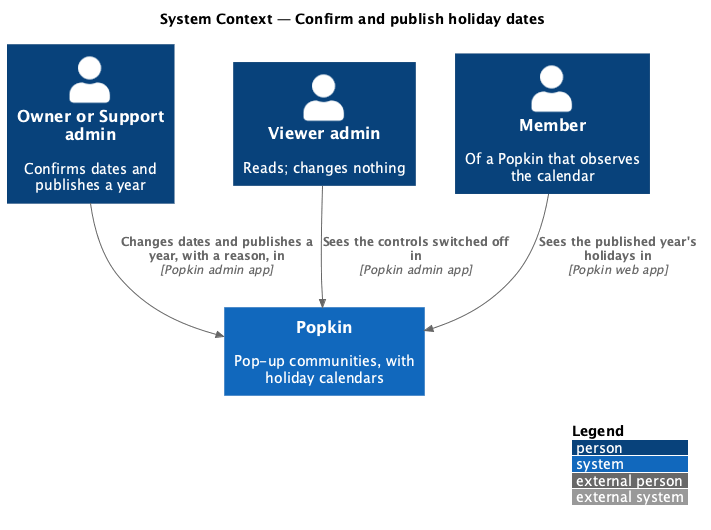
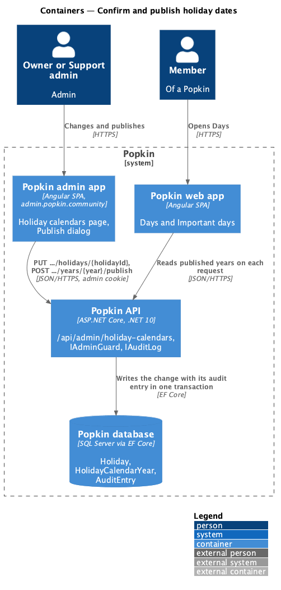
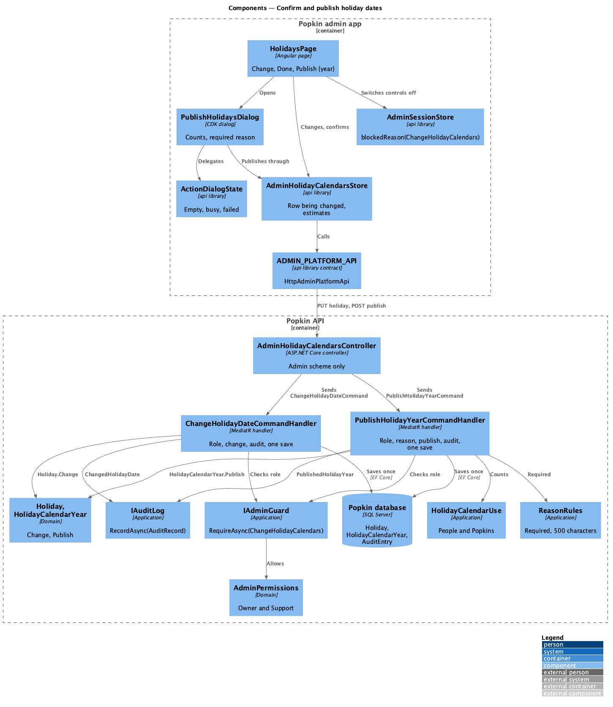
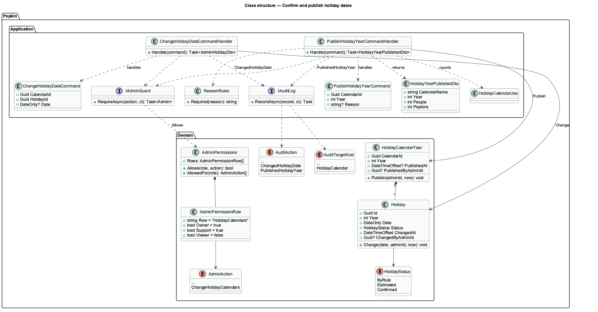
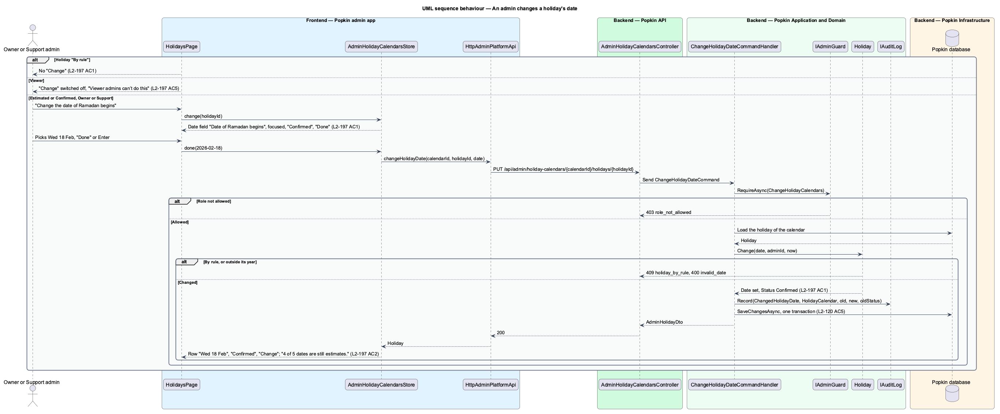
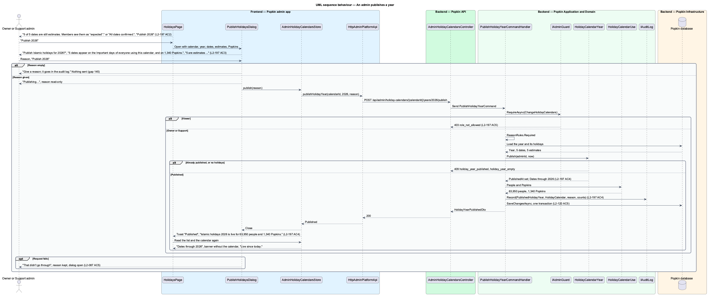

# Confirm and publish holiday dates

## Overview

The dates of some holidays are known only near the day: a festival set by moon sighting or by a
lunar calendar starts as an estimate and is confirmed later. People and Popkins see a calendar's
holidays only once its year is published. *Confirm and publish holiday dates* is the slice of the
admin app's [Holiday calendars](../holiday-calendars/README.md) page where an Owner or a Support
admin changes a holiday's date, which confirms it, and publishes a year with a reason, so that it
reaches the people and Popkins using the calendar and is kept in the audit log (L1-045, L2-197).

- **estimate** — holiday whose status is "Estimated": its date is expected, and a member sees it
  as "expected" (L2-192 AC4)
- **change** — admin's new date for an estimated or confirmed holiday, saved with "Done", which
  leaves the holiday "Confirmed"
- **publish** — admin's act of making one year of one calendar visible to the people and Popkins
  using it, with a reason
- **people and Popkins using a calendar** — as [Holiday calendars](../holiday-calendars/README.md)
  counts them: the active Popkins observing it and their members (known gap 144)

The slice follows the shared decisions of the admin app and of
[Important days and holiday calendars](../../README.md#important-days-and-holiday-calendars):
both writes are `AdminAction.ChangeHolidayCalendars`, allowed to Owners and Support (L2-197 AC5);
the handler checks the role through `IAdminGuard`; every change and every publish writes an
`AuditEntry` through `IAuditLog` in the same transaction; a publish carries a reason checked by
`ReasonRules`. Published years are read from the database on each request, so a publish or a
change to a published year reaches people at their next read.

## Description

### Screens and states

Admin app, `docs/mocks/admin/pages/holidays/` (in PR #103, known gap 148):

- `default.html` — each "Estimated" or "Confirmed" holiday has a quiet "Change", named "Change the
  date of {holiday}". Under the table of a year not yet published: "5 of 5 dates are still
  estimates. Members see them as “expected”." and "Publish 2026" (L2-197 AC2).
- `changing.html` — the row being changed holds a date field named "Date of Ramadan begins", with
  focus in it, the status "Confirmed" and "Done" in place of "Change"; the line under the table
  reads "4 of 5 dates are still estimates." (L2-197 AC1).
- `rule.html` — every holiday "By rule", with no "Change" (L2-197 AC1), and the line "Every date
  follows a rule, so there is nothing to confirm. 2026 is live."
- `published.html` — the toast "Published", "Islamic holidays 2026 is live for 63,950 people and
  1,340 Popkins."; the calendar's row reads "Dates through 2026" with no warning, the banner names
  Hindu festivals alone, "Last edited" reads "14 Jul · Lena", and the line reads "Live since today.
  5 of 5 dates are still estimates; members see them as “expected” until you confirm each one."
  (L2-197 AC4).
- `viewer.html` — every "Change" and "Publish 2026" switched off, each with "Viewer admins can’t do
  this" as its description and tooltip (L2-197 AC5, L2-086 AC2).

Admin app dialog, `docs/mocks/admin/dialogs/holidays-publish/` (`default`, `invalid`, `busy`,
`failed`) — "Publish Islamic holidays for 2026?", "5 dates appear on the Important days of
everyone using this calendar, and on 1,340 Popkins. 5 are estimates and show as “expected” until
you confirm them.", the required "Reason, for the audit log" with focus in it, "Publish 2026"
(busy "Publishing…") and "Cancel" (L2-197 AC3). Escape or × closes it and changes nothing.

The line under a year not yet published reads "{k} of {m} dates are still estimates. Members see
them as "expected"." when `k`, the estimates, is more than 0, and "All dates confirmed."
otherwise, with "Publish {year}" (L2-197 AC2). A holiday "By rule" is not an estimate. A year with
no holidays ("No {year} dates yet.") offers no "Publish {year}". A year already published offers
none either and reads the mock's lines for a live year: "Live since {d MMM}." (or "today") with the
estimate count, or "Every date follows a rule, so there is nothing to confirm. {year} is live."

### Conflicts and gaps

- **The Viewer's sub-heading.** `viewer.html` replaces the page's sub-heading with "Only Owners
  can change holiday calendars.", where L2-197 AC5 lets Support change and publish. The
  requirement stands: the sub-heading stays as L2-196 AC2 writes it, and a Viewer sees the
  shell's notice "You’re signed in as a Viewer. You can look at everything; actions are switched
  off." (L2-086 AC2).
- **The publish dialog and L2-087.** L2-087 AC1 does not list the publish dialog (known gap 145),
  while L2-197 AC3 and AC4 ask for a reason. The design gives it the shared behaviour of every
  reasoned dialog (`ActionDialogState`, `ReasonRules.Required`): the hint "Other admins see it in
  the audit log.", the refusal "Give a reason; it goes in the audit log." and the failure "That
  didn't go through" / "Nothing has changed. Your reason is kept; try again." The mock's "Say why,
  in a few words. The reason goes in the audit log." and "Nothing changed: 2026 isn’t published.
  Check your connection and try again." give way to L2-087 once it names the dialog; until then
  the dialog takes that shared copy (gap 145, settled).
- **A reason for a change of date.** No requirement asks one, and L2-087 AC1 names no holiday
  dialog (known gap 145). The design saves a change on "Done" with no reason and records the
  change in the audit log without one.
- **When a change saves.** The mock's note saves the date when the field loses focus; L2-197 AC1
  saves it with "Done". The requirement stands: "Done", or Enter in the field, saves; Escape puts
  the row back unchanged.
- **The role table.** L2-086's table has no row for holiday calendars, while L2-197 AC5 allows
  Support. `AdminPermissions` gains the row the shared section decides; L2-086 now has the row "Change a holiday
  date, publish a holiday calendar's year", Owner and Support (gap 159, settled).
- **"New calendar"** — switched off for a Viewer by L2-197 AC5, but nothing says what it asks
  (known gap 145); it is not drawn until then ([Holiday calendars](../holiday-calendars/README.md)).
- **Where the first dates come from** — the dates "By rule" and the first estimates (known gap
  145).

### API

Both endpoints are on `AdminHolidayCalendarsController`, under the admin scheme.

- `PUT /api/admin/holiday-calendars/{calendarId}/holidays/{holidayId}` — body `{ date }`
  (`yyyy-MM-dd`). `200` `AdminHolidayDto` with `status` `Confirmed` (L2-197 AC1). Refusals: `403`
  `role_not_allowed` for a Viewer (L2-197 AC5); `404` `holiday_not_found`; `409` `holiday_by_rule`
  for a holiday "By rule"; `400` `invalid_date` naming `date` for a value that is not a date or
  not in the holiday's year. The same date confirms an estimate without moving it.
- `POST /api/admin/holiday-calendars/{calendarId}/years/{year}/publish` — body `{ reason }`.
  `200` `HolidayYearPublishedDto` (`calendarName`, `year`, `people`, `popkins`) (L2-197 AC4).
  Refusals: `400` `reason_required`, `reason_too_long` (`ReasonRules`); `403` `role_not_allowed`
  for a Viewer; `404` `holiday_calendar_not_found`, `holiday_year_not_found`; `409`
  `holiday_year_published` for a year already published; `409` `holiday_year_empty` for a year
  with no holidays.

### Backend

- **`AdminAction.ChangeHolidayCalendars`** (Domain, changed) — the action of both writes.
- **`AdminPermissions`** (Domain, changed) — a row `new("HolidayCalendars",
  [AdminAction.ChangeHolidayCalendars], true, true, false)`: Owner and Support, not Viewer
  (L2-197 AC5). `AllowedFor` then lists it in `AdminMeDto.allowed`.
- **`AuditAction`** (Domain, changed) — `ChangedHolidayDate` and `PublishedHolidayYear`;
  **`AuditTargetKind`** gains `HolidayCalendar`; **`AuditActionLabels`** gains "Changed holiday
  date" and "Published holiday dates".
- **`Holiday.Change(DateOnly date, Guid adminId, DateTimeOffset now)`** (Domain) — refuses a
  holiday `ByRule` and a date outside its `Year`; sets `Date`, `Status` `Confirmed`, `ChangedAt`
  and `ChangedByAdminId`.
- **`HolidayCalendarYear.Publish(Guid adminId, DateTimeOffset now)`** (Domain) — refuses a year
  already published; sets `PublishedAt` and `PublishedByAdminId`. The calendar's Dates through
  follows from it (`HolidayCalendarRules.DatesThrough`).
- **`ChangeHolidayDateCommand`** / **`ChangeHolidayDateCommandHandler`** —
  `IAdminGuard.RequireAsync(AdminAction.ChangeHolidayCalendars)`; loads the holiday of the
  calendar; `Holiday.Change`; `IAuditLog.RecordAsync` with `ChangedHolidayDate`,
  `HolidayCalendar`, the calendar's id and name, and `Details` `{ year, holiday, old, new,
  oldStatus }`; one `SaveChangesAsync` (L2-120 AC5).
- **`PublishHolidayYearCommand`** / **`PublishHolidayYearCommandValidator`** /
  **`PublishHolidayYearCommandHandler`** — `RequireAsync(ChangeHolidayCalendars)`;
  `ReasonRules.Required`; loads the year and counts its holidays and estimates;
  `HolidayCalendarYear.Publish`; `HolidayCalendarUse` counts the people and Popkins;
  `IAuditLog.RecordAsync` with `PublishedHolidayYear`, the reason and `Details` `{ year, dates,
  estimates, people, popkins }` (L2-197 AC4); one `SaveChangesAsync`.
- No hub event and no notification: an open Days reads the published year at its next read
  (L2-196 AC2's hour). No log, metric dimension or span carries a holiday's name.

### Frontend (Popkin admin app)

- **`HolidaysPage`** (changed) — the table's last column holds "Change" (`action` cell, named
  "Change the date of {holiday}") for a holiday not "By rule", with
  `AdminSessionStore.blockedReason('ChangeHolidayCalendars')` as its `disabledReason`. The row
  being changed holds a date field and "Done". The panel's foot holds the line and "Publish
  {year}" (`pk-button`, the same `disabledReason`), which opens `PublishHolidaysDialog`. On
  success the toaster shows "Published" with the message, and the page reads the list and the
  calendar again.
- **`pk-data-table`** (changed) — a `date` cell: a `pk-text-field` of `type="date"` labelled by
  `label` ("Date of {holiday}"), focused when drawn, with Enter and Escape given back as outputs.
- **`PublishHolidaysDialog`** (`frontend/projects/admin/src/app/dialogs/holidays-publish/`, new) —
  `pk-dialog` "Publish {calendar} for {year}?" described by the counts; `pk-textarea` `reason`,
  "Reason, for the audit log", 500 characters, opened with `autoFocus: '#reason'`; "Publish
  {year}" (busy "Publishing…") and "Cancel"; `ActionDialogState` for empty, busy and failed
  (L2-087 AC2, AC4, AC5, gap 145). The counts come from the calendar already read; the dialog
  sends nothing to show them.
- **`AdminHolidayCalendarsStore`** (changed) — `change(holidayId)`, `done(date)`, `cancel()`,
  `publish(reason)`, the row being changed and the estimate count. Unit tested.
- **`holidays-text.ts`** (changed) — "{k} of {m} dates are still estimates. Members see them as
  "expected".", "All dates confirmed.", the live-year lines, "Publish {year}", "Publish {calendar}
  for {year}?", "{m} dates appear on the Important days of everyone using this calendar, and on
  {n} Popkins.", "{k} are estimates and show as "expected" until you confirm them." and "{calendar}
  {year} is live for {n} people and {m} Popkins.". Unit tested.
- **`ADMIN_PLATFORM_API`** (changed) — `changeHolidayDate(calendarId, holidayId, date)`,
  `publishHolidayYear(calendarId, year, reason)`.
- **`AdminAction`** (`api/src/lib/models/admin.ts`, changed) gains `'ChangeHolidayCalendars'`;
  **`role-table-text.ts`** gains the row `HolidayCalendars`, its words "Change holiday dates and publish a year", in Platform.

### Tests

- API acceptance tests (`Popkin.Api.Tests/Admin/AdminHolidayCalendarsTests`, InMemory): Support
  changes an estimate and it is "Confirmed" with one audit entry; the same date confirms it; a
  holiday "By rule" is `409` `holiday_by_rule`; a date in another year is `400` `invalid_date`;
  an Owner publishes 2026 with a reason, Dates through becomes 2026, the counts come back and one
  audit entry holds the reason; a published year reaches `HolidayCalendarsController` for a
  member of an observing Popkin; an empty reason is `400` `reason_required`; a second publish is
  `409` `holiday_year_published`; a Viewer is `403` on both.
- A direct test of `AdminPermissions` for `ChangeHolidayCalendars`, one case per role.
- A direct test of `Holiday.Change` and `HolidayCalendarYear.Publish`, one case per row: an
  estimate, a confirmed date, a holiday by rule, a date outside the year, a year published twice.
- Unit tests (frontend): `holidays-text.ts` with and without estimates; the store's change, done,
  cancel and publish.
- Playwright (admin project, through `AdminHolidaysPage` and the dialog's page object in
  `e2e/pages/admin/admin-dialogs.ts`): change and "Done"; no "Change" by rule; the line with and
  without estimates; the dialog's default, invalid, busy and failed paths; the toast and "Dates
  through"; the Viewer's switched-off controls. A failed publish is stubbed in
  `e2e/fixtures/stubs.ts`.

### Build order

The first slice is the change of a date, with `AdminAction.ChangeHolidayCalendars`, its row and
the audit entry; the second is the publish with its dialog and message.

## Requirements

| L2 ID | Refines (L1) | Requirement |
|-------|--------------|-------------|
| `L2-197` | `L1-045` | Confirm and publish holiday dates. (AC1–AC5) |

## Diagrams

### System context

An Owner or Support admin confirms and publishes holiday dates in the admin app; the people and
Popkins using the calendar see the published year.

### Containers

The admin app writes the change or the publish through the API, which saves it with its audit
entry; the web app reads the published year on its next request.

### Components

Two handlers guard the role, change the domain, record the audit entry and save once.

### Class structure

`Holiday.Change` confirms a date; `HolidayCalendarYear.Publish` publishes a year;
`AdminPermissions` allows both to Owners and Support.

### Behaviour — an admin changes a holiday's date

"Change" opens the date in its row; "Done" saves it as "Confirmed" with its audit entry.

### Behaviour — an admin publishes a year

The dialog takes the reason; the handler publishes the year with its audit entry, and the page
shows the message and the new Dates through.

