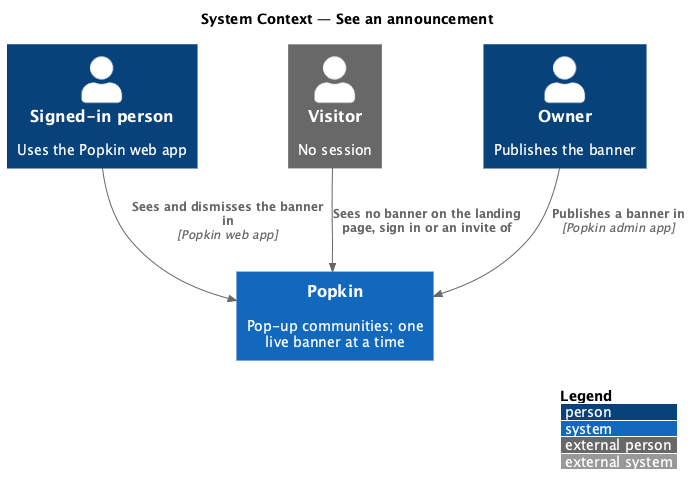
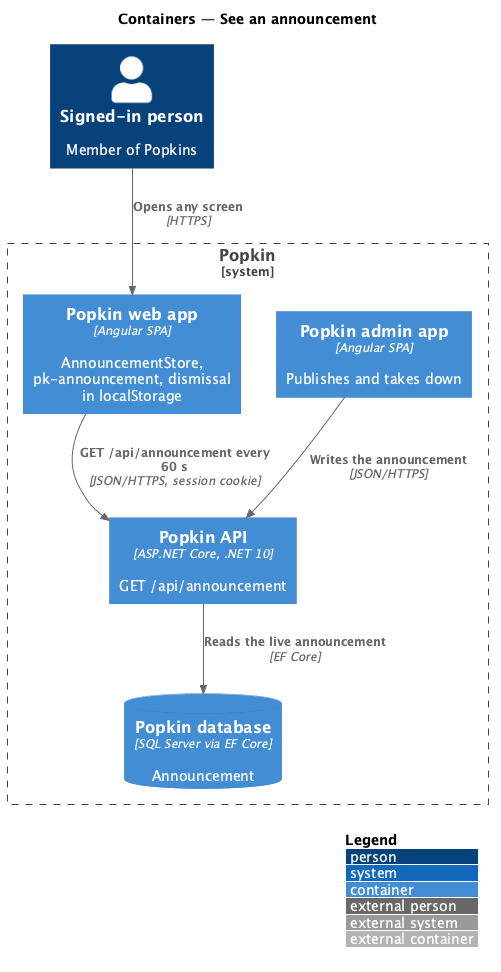
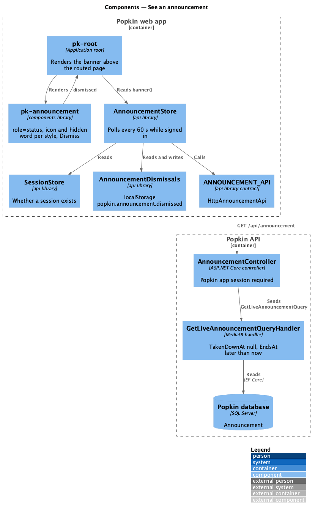
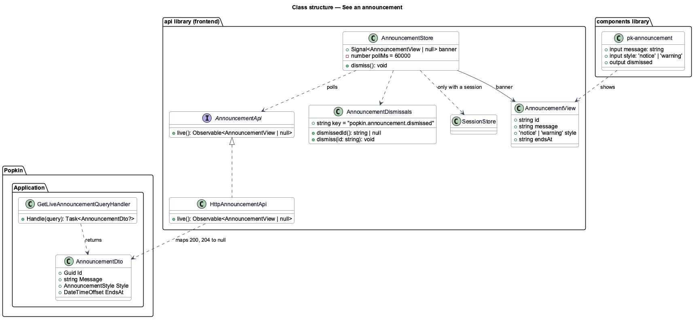
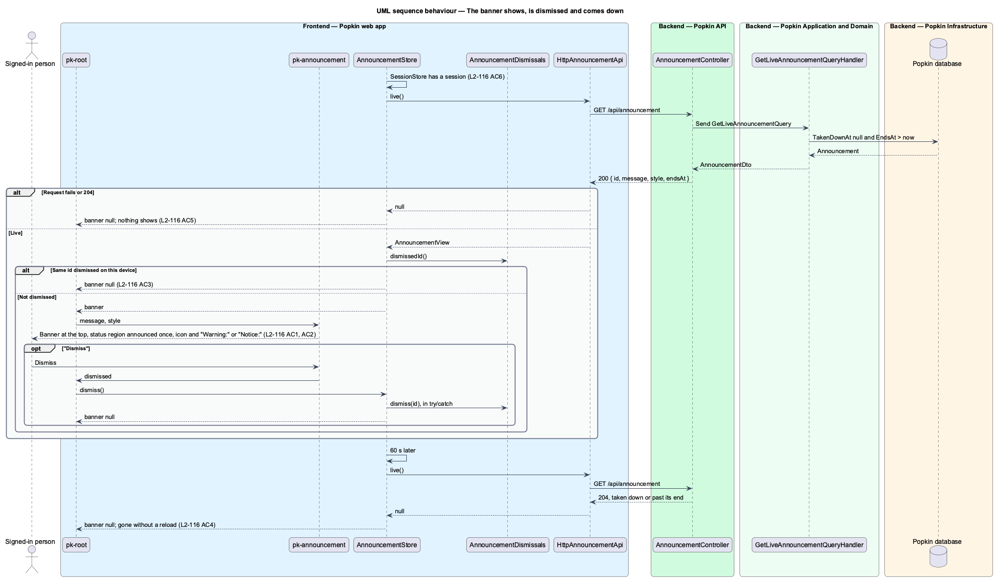

# See an announcement

## Overview

An *announcement* is the one short banner an Owner publishes from the Popkin admin app
([Announcements](../announcements/README.md)). This design covers the member's side: how the
Popkin web app (`frontend/projects/popkin`) finds the live banner, shows it at the top of every
screen for a signed-in person, lets the person dismiss it on their device, and removes it within a
minute once it comes down (L1-026).

- **announcement** — message of at most 140 characters in the style Notice or Warning
- **live banner** — announcement that is published, not taken down and whose end time has not passed
- **dismissal** — choice of "Dismiss", remembered on one device for one announcement

The web app learns the banner by polling `GET /api/announcement` every 60 seconds. No hub event
carries it: the shared real-time rules send nothing to all connections, and an announcement
concerns every person
([ADR 0024](../../../adr/0024-admins-moderation-and-switches-in-the-database.md), proposed). A
visitor without a session never asks and never sees one.

## Description

### Screens and states

No mock draws the banner in the Popkin web app. The admin app's preview
(`docs/mocks/admin/pages/announcements/default.html` and `warning.html`, the
`pk-announcement-preview` component) shows its look: a Notice in the `banner--warning` tone and a
Warning in the louder `banner--loud` tone (`--color-warning-loud`), each with an icon, the message
and a close button. The design expects these mocks, `<TO SUPPLY>`:

- `docs/mocks/notifications/announcement/notice.html` — a Notice above the Popkin home, at 360 px
  and 1280 px, light and dark.
- `docs/mocks/notifications/announcement/warning.html` — a Warning, with its own icon.
- `docs/mocks/notifications/announcement/long.html` — 140 characters wrapping at 360 px with no
  sideways scroll (L2-116 AC7).
- The banner above a full-height screen (the call screen, the photo view), whose placement is
  `<TO SUPPLY>`.

The states the design covers:

- **Shown** — a live banner that this device has not dismissed: the message at the top of the
  screen with "Dismiss" (L2-116 AC1).
- **Dismissed** — the same banner is not shown again on this device; a different banner shows
  (L2-116 AC3).
- **None** — no live banner, a failed first read, or no session: nothing shows and nothing else
  changes (L2-116 AC5, AC6).
- **Gone** — the banner was taken down or came down by itself: it leaves every open screen at the
  next read, within a minute, without a reload (L2-116 AC4).

### API

- `GET /api/announcement` — on `AnnouncementController` in `Popkin.Api`, under the default
  fallback policy, so a Popkin app session is required and a visitor's request is `401`. `200`
  `AnnouncementDto` (`id`, `message`, `style`, `endsAt`) when a banner is live; `204` when none
  is. It carries no admin's name and nothing else of the admin app.
- **`GetLiveAnnouncementQueryHandler`** (Application) — reads the newest `Announcement` with
  `TakenDownAt` null and `EndsAt` later than `TimeProvider`'s now: one indexed read. Every
  signed-in screen asks once a minute; the design adds no cache.

### Frontend (Popkin web app)

- **`ANNOUNCEMENT_API`** (api library, new contract and token) — `live(): Observable<AnnouncementView | null>`;
  `HttpAnnouncementApi` maps `204` to null. `app.config.ts` provides it.
- **`AnnouncementStore`** (`frontend/projects/api/src/lib/api/announcements/announcement-store.ts`,
  root-provided) — reads `SessionStore`; while a session exists it reads `ANNOUNCEMENT_API` at
  once and every 60 seconds (`interval(60_000)`), and stops when the session ends.
  `banner` (signal) is the live announcement unless its id is the dismissed one. A failed first
  read leaves `banner` null; a failed later read keeps the last answer until the next one.
  `dismiss()` stores the id. Unit tested (ADR 0011): dismissed id, a new id after a dismissal,
  `204` after a banner, a failure, no session.
- **`AnnouncementDismissals`** (api library) — keeps the dismissed id under the `localStorage`
  key `popkin.announcement.dismissed`. Each read and write is in `try`/`catch`; storage that
  throws or is empty means nothing is dismissed, so the banner shows again rather than the screen
  failing.
- **`pk-announcement`** (`frontend/projects/components/src/lib/announcement/`, new) — inputs
  `message` and `style` (`'notice' | 'warning'`), output `dismissed`. Block `announcement`, with
  `announcement--warning`. It sits in a `role="status"` region, so assistive technology announces
  the message once when it appears (L2-116 AC2). A Notice and a Warning differ by icon (info
  circle, warning triangle) and by a visually hidden "Notice:" or "Warning:" before the message,
  not by colour alone (L2-116 AC2). The message wraps; the component never sets a minimum width,
  so a 360 px screen does not scroll sideways (L2-116 AC7). "Dismiss" is a `pk-icon-button` with
  that accessible name, reachable by the keyboard and at least 44 px for touch. It has its parity
  spec in `e2e/tests/parity/` once its mock exists (ADR 0008).
- **`pk-root`** (`frontend/projects/popkin/src/app/app.html`) — renders `pk-announcement` between
  the skip link and the routed page when `AnnouncementStore.banner()` is set, on every screen of
  either shell. The status region stays in the root while the app runs, so a banner that replaces
  another is announced once.
- The marketing site ([ADR 0017](../../../adr/0017-marketing-site.md)) calls no API and shows no
  banner.

### Decisions

- The banner is read by polling, not pushed, under the shared real-time rules.
- Dismissal is per device, as L2-116 AC3 asks, and needs no request: nothing about the person is
  stored on the server.
- The store asks only with a session, so the landing page, sign in and an invite opened by a
  visitor make no request and show nothing (L2-116 AC6).

### Tests

- API acceptance tests (InMemory): a signed-in person reads the live banner; `204` when none is
  live, when it was taken down, and once `FakeTimeProvider` passes its end; a visitor is `401`.
- Playwright (`e2e/tests/announcement.spec.ts`, page object `e2e/pages/announcement.banner.ts`):
  the banner shows on the Popkin home; "Dismiss" hides it and it stays hidden after a reload; a
  new id shows again; a `204` after a banner removes it within the polling interval, driven by
  Playwright's clock; no banner on the landing page without a session.
- Every page now asks `/api/announcement`, so `e2e/fixtures/api/responses.json` gains its answer
  (`204`) and `e2e/fixtures/stubs.ts` gains a Notice and a Warning (ADR 0005); the recording is
  refreshed in the same change.

## Requirements

| L2 ID | Refines (L1) | Requirement |
|-------|--------------|-------------|
| `L2-116` | `L1-026` | See an announcement: A member sees the banner in the Popkin app. (AC1–AC7) |

## Diagrams

### System context

A signed-in person sees the banner an Owner published.

### Containers

The web app polls the API, which reads the live announcement from the database.

### Components

`AnnouncementStore` polls `ANNOUNCEMENT_API` while a session exists, and `pk-root` renders
`pk-announcement` from it.

### Class structure

The store depends on the session, the contract and the dismissals; the API's handler returns
`AnnouncementDto`.

### Behaviour — the banner shows, is dismissed and comes down

The first read shows the banner; a dismissal hides it on this device; a later read without a live
banner removes it from every open screen.

