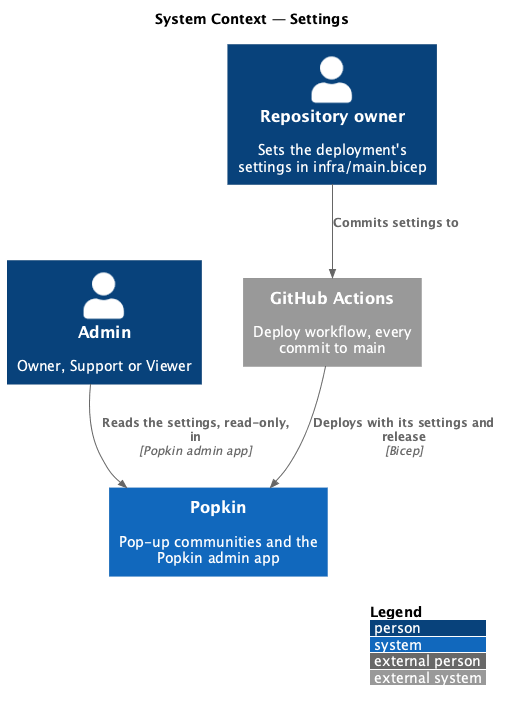
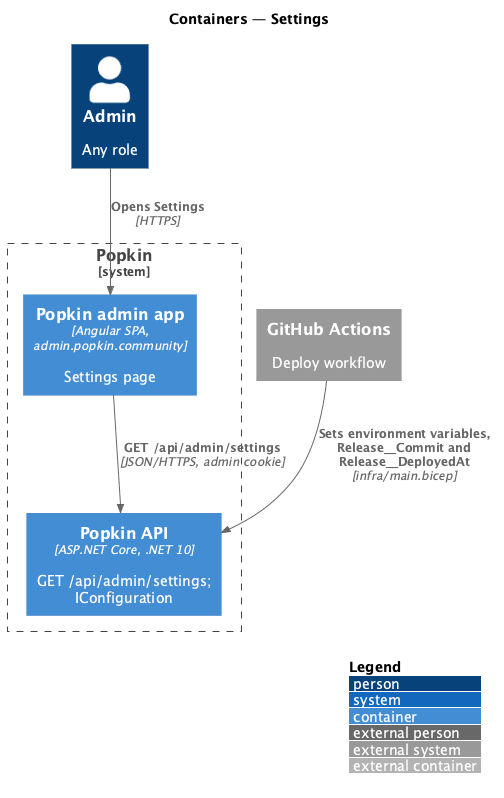
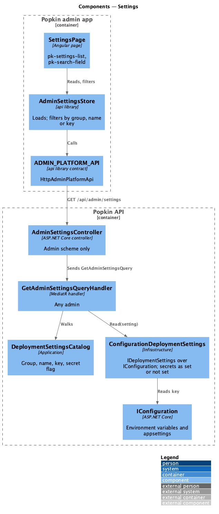
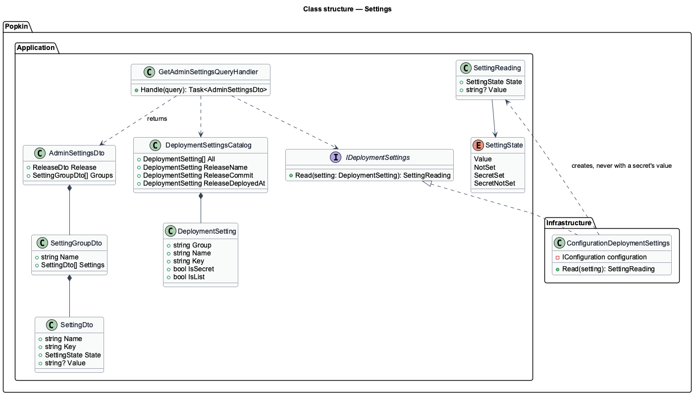
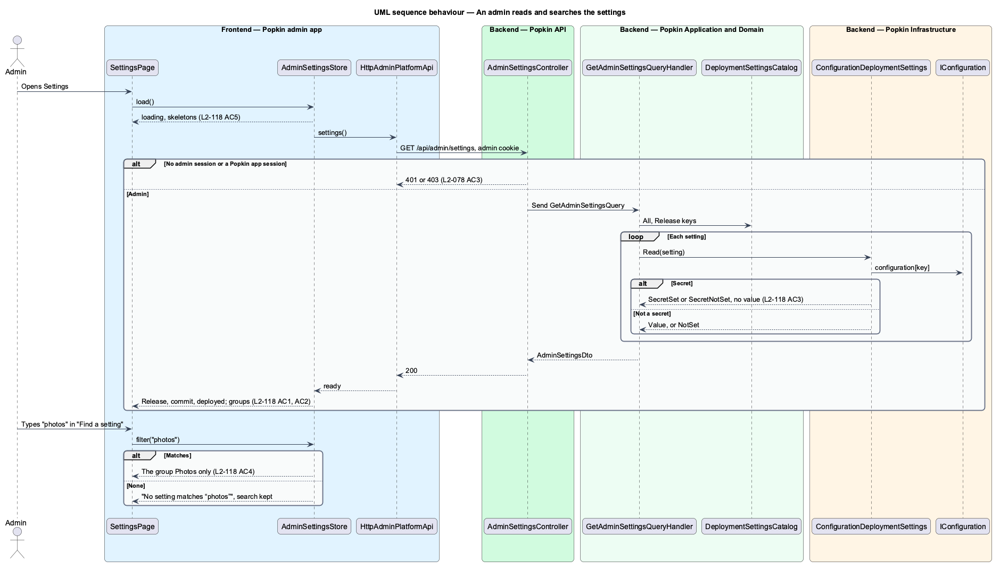

# Settings

## Overview

The Popkin API runs with settings its deployment gives it: where photos are kept, who sends the
codes, which media relay a call uses. They are listed in `docs/deployment.md` and set by
`infra/main.bicep` ([ADR 0013](../../../adr/0013-deployment-shape.md)). *Settings* is the
read-only page of the Popkin admin app (`/settings`) that shows every one of them, in its group,
with its name, its key and its value, under the release that is running (L1-027). A secret's
value never leaves the API: the page says only whether it is set.

- **setting** — configuration value the deployed API reads at start or at each request, named by a key such as `Photos:Container`
- **secret** — setting whose value grants access: a key, a signing key, a connection string, a relay secret
- **release** — the build that is running: its name, its commit and when it was deployed
- **settings catalogue** — list in the code of every setting of `docs/deployment.md`, with its group, its name and whether it is a secret

The page changes nothing. Limits and features, which an Owner changes live, have their own pages
([Limits](../limits/README.md), [Feature switches](../feature-switches/README.md)).

## Description

### Screens and states

Admin app, `docs/mocks/admin/pages/settings/`:

- `default.html` — page head "Settings", "What the deployed system is running with. Read-only.";
  the release panel ("These come from the deployment's configuration and change only with a new
  release. Limits and features you can change live are on their own pages.", "Release v2025.07.11",
  "Commit a41c9e2", "Deployed 11 Jul, 16:20"); "Find a setting"; then one panel per group, each
  setting a row of its name, its key in monospace, and its value or "Set (secret, value hidden)"
  (L2-118 AC1 to AC3). The block is `pk-settings-list` (`config`, `config__row`, `config__name`,
  `config__key`, `config__value`, `config__value--unset`) under `release`.
- `filtered.html` — "photos" typed: the group Photos alone (L2-118 AC4).
- `no-results.html` — "No setting matches “stripe”", "Try the setting's name, such as
  Photos:Container." with the search kept (L2-118 AC4).
- `loading.html`, `error.html` — skeletons; "Couldn't load the settings" with "Try again"
  (L2-118 AC5, L2-089 AC7).

### The catalogue

The groups and their settings, from `docs/deployment.md`. The names the mock gives are kept; the
other names are the design's.

| Group | Name | Key | Secret |
|---|---|---|---|
| Sign-in and codes | Code hash key | `Auth:CodeHashKey` | Yes |
| Sign-in and codes | Codes sent through | `Communication:Endpoint` | No |
| Sign-in and codes | Email codes from | `Communication:EmailSender` | No |
| Sign-in and codes | Phone codes from | `Communication:SmsSender` | No |
| Sign-in and codes | Sender identity | `Communication:ClientId` | No |
| Sign-in and codes | Phone sign-in | `Features:PhoneSignIn` | No |
| Sign-in and codes | First Owner | `Admin:FirstOwner` | No |
| Photos | Photo store | `Photos:BlobEndpoint` | No |
| Photos | Container | `Photos:Container` | No |
| Photos | Signing key | `Photos:SigningKey` | Yes |
| Photos | Store identity | `Photos:ClientId` | No |
| Photos | Local photo folder | `Photos:Root` | No |
| Calls | Media relay | `MediaRelay:Urls` | No |
| Calls | Relay secret | `MediaRelay:Secret` | Yes |
| Calls | Relay credential lasts | `MediaRelay:CredentialLifetime` | No |
| App and data | App address | `App:Origin` | No |
| App and data | Invite links | `Invites:BaseUrl` | No |
| App and data | Database | `Database:Provider` | No |
| App and data | Connection string | `ConnectionStrings:Popkin` | Yes |
| App and data | Known proxies | `Proxy:KnownProxies` | No |
| App and data | Known networks | `Proxy:KnownNetworks` | No |
| App and data | Session keys folder | `DataProtection:KeysPath` | No |
| App and data | Telemetry endpoint | `OTEL_EXPORTER_OTLP_ENDPOINT` | No |

`Admin:FirstOwner` comes from [ADR 0024](../../../adr/0024-admins-moderation-and-switches-in-the-database.md)
and the admin access design; `docs/deployment.md` gains it with the first admin feature. A list
setting (`MediaRelay:Urls:0`, `MediaRelay:Urls:1`, …) shows as its values joined by ", ". A
setting that is not set reads "Not set". The settings marked "not built" in `docs/deployment.md`
are listed and read "Not set" until they are built.

### Conflicts and gaps

- **`Features:Schedules`.** The mock lists "Schedules `Features:Schedules` true". This setting is
  retired by [Feature switches](../feature-switches/README.md); it leaves `docs/deployment.md` and
  the page. The mock changes.
- **The mock's rows.** The mock omits `Communication:ClientId`, `Photos:Root`, the `Proxy`
  settings, `DataProtection:KeysPath` and `OTEL_EXPORTER_OTLP_ENDPOINT`. L2-118 AC2 lists every
  setting of `docs/deployment.md`; the requirement stands.
- **The release.** The API knows nothing of its release today. The design adds three settings,
  set by the Deploy workflow through `infra/main.bicep`: `Release:Commit` (the `imageTag`, the
  commit), `Release:DeployedAt` (a Bicep parameter defaulting to `utcNow()`) and `Release:Name`.
  How a release is named ("v2025.07.11" in the mock) is `<TO SUPPLY>`. Each is added to
  `docs/deployment.md` in the same change (ADR 0013). Without them the release panel reads "Not
  set".
- **Keeping the catalogue true.** `docs/deployment.md` asks that a setting added to the code be
  added there and to `infra/main.bicep` in the same change; this design adds the catalogue to that
  rule. Review holds it; no test checks the shape of the catalogue (AGENTS.md).
- **Which process.** The page shows the API's configuration. The Worker reads the same database,
  photo and code-hash settings from its own configuration; a value that differs between them is
  not shown.

### API

- `GET /api/admin/settings` — on `AdminSettingsController`, under
  `[Authorize(AuthenticationSchemes = AdminSessionCookie.Scheme)]`; any admin. `200`
  `AdminSettingsDto`: `release` (`name`, `commit`, `deployedAt`, each nullable) and `groups`
  (`SettingGroupDto[]`: `name`, `settings`), each `SettingDto` holding `name`, `key`, `state`
  (`Value`, `NotSet`, `SecretSet`, `SecretNotSet`) and `value`, which is null for every state but
  `Value` (L2-118 AC3). No request changes a setting. Viewing is not audited.

### Backend

- **`DeploymentSettingsCatalog`** (Application, new) — the table above as one static list of
  `DeploymentSetting` (`Group`, `Name`, `Key`, `IsSecret`, `IsList`), in order, and the three
  `Release` keys.
- **`IDeploymentSettings`** (Application, new) — `Read(DeploymentSetting): SettingReading`.
  **`ConfigurationDeploymentSettings`** (Infrastructure) implements it over `IConfiguration`. For
  a secret it returns only whether the value is present and not blank; the value is never copied
  into the reading, so no DTO, log or exception can carry it.
- **`GetAdminSettingsQueryHandler`** — any admin (`IAdminGuard.CurrentAdminAsync`); builds
  `AdminSettingsDto` from the catalogue and the readings.
- No log line, metric or span carries a setting's value (ADR 0012).

### Frontend (Popkin admin app)

- **`SettingsPage`** (`frontend/projects/admin/src/app/pages/settings/settings.page.ts`, route
  `/settings`, `page: 'settings'`) — `pk-page-head`, `pk-settings-list` with its release panel,
  `pk-search-field` "Find a setting", `pk-skeleton` while loading and `pk-empty-state` with "Try
  again" on failure.
- **`pk-settings-list`** (components) — inputs `release`, `groups`; renders each group as a panel
  of `config__row`s, a key in `mono`, a secret's state as words ("Set (secret, value hidden)",
  "Not set"), never by colour or an icon alone.
- **`AdminSettingsStore`** (`frontend/projects/api/src/lib/admin/platform/`) — loads, and
  `filter(text)`: a group whose name contains the text shows whole; otherwise only the settings
  whose name or key contains it, ignoring case; none leaves `noMatch` with the text. Unit tested
  (ADR 0011).
- **`settings-text.ts`** (api library) — "Set (secret, value hidden)", "Not set", "No setting
  matches “{text}”", "Deployed {date}". Unit tested.
- **`ADMIN_PLATFORM_API`** — `settings()`.

### Tests

- API acceptance tests (InMemory): an admin reads every group; a secret set in the factory's
  configuration reads `SecretSet` and the response body does not contain its value; a missing
  setting reads `NotSet`; a Popkin app session is `403` and no session `401` (L2-078 AC3).
- Playwright (admin project): the default, filtered, no-results, loading and error states through
  `AdminSettingsPage`.

## Requirements

| L2 ID | Refines (L1) | Requirement |
|-------|--------------|-------------|
| `L2-118` | `L1-027` | Settings: What the deployed system runs with, read-only. (AC1–AC5) |

## Diagrams

### System context

Any admin reads the deployed settings from the admin app; the deployment sets them.

### Containers

The admin app reads the settings from the API, which reads its own configuration, set by the
Bicep and the Deploy workflow.

### Components

`GetAdminSettingsQueryHandler` walks `DeploymentSettingsCatalog` and asks
`ConfigurationDeploymentSettings` for each reading, never a secret's value.

### Class structure

The catalogue's entries, the readings and the DTO the admin app receives.

### Behaviour — an admin reads and searches the settings

The page loads once; the search filters on the page with no further request.

