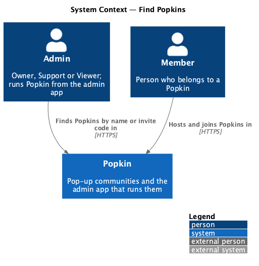
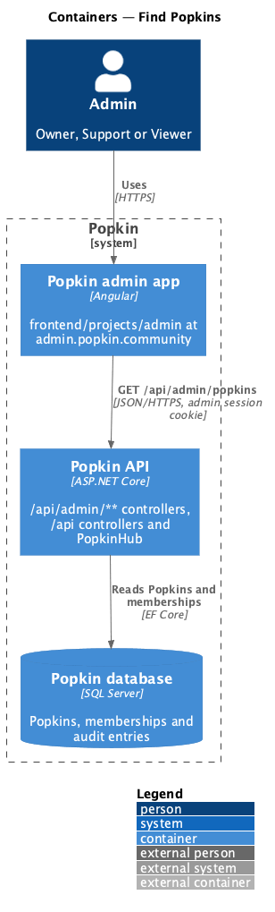
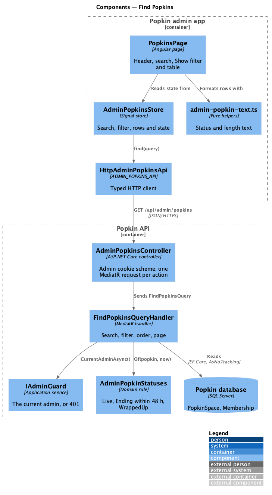
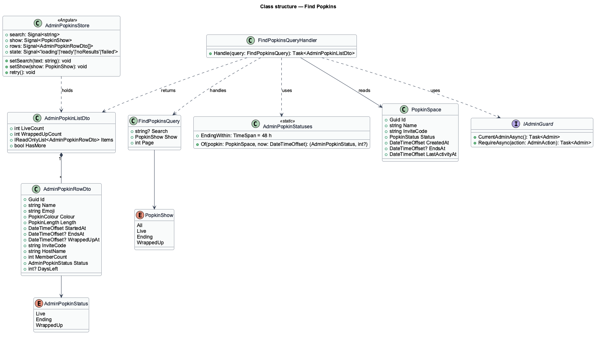
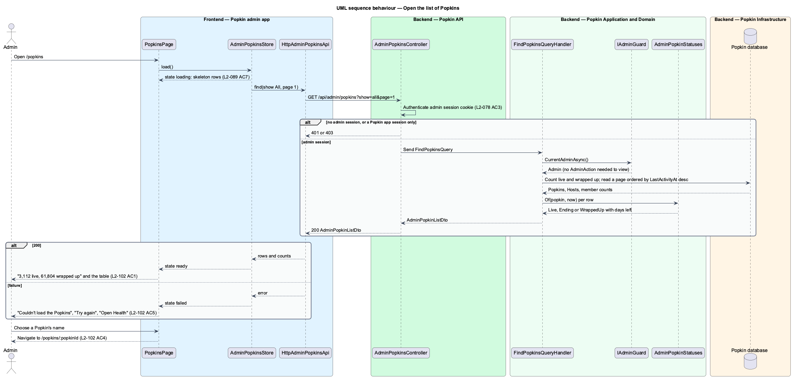
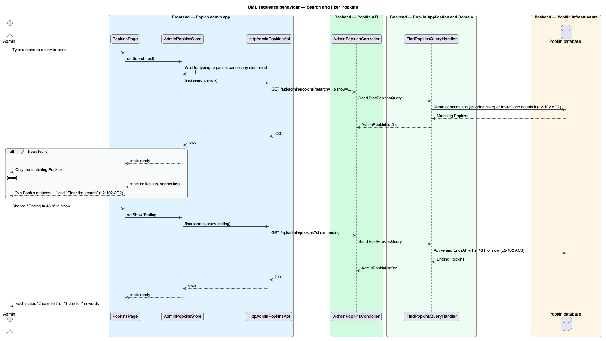

# Find Popkins

## Overview

An admin helps a Popkin only after finding it. A Host who writes to support names the Popkin, or
reads out its invite code; a code that leaked onto a public forum is pasted in as it was found.
*Popkins* is the admin app's list of every Popkin on the platform, newest activity first, with a
search by name or code and a filter by status. Choosing a row opens the Popkin's page
([A Popkin](../view-popkin/README.md)).

- **admin app** — Angular application at `https://admin.popkin.community` where admins run
  Popkin; its screens call it "the console"
- **live** — state of a Popkin that has not wrapped up (`PopkinStatus.Active`)
- **ending** — state of a live Popkin whose end falls within the next 48 hours
- **newest activity** — order by `PopkinSpace.LastActivityAt`, latest first

The list shows a Popkin's emoji, name, length, dates, invite code, Host, member count and status,
and nothing its members shared (L2-078 AC4). Every admin may read it: viewing needs no
`AdminAction` (L2-086), so the list looks the same to an Owner, a Support admin and a Viewer.

The list sits under "Popkins" in the Popkins group of the admin shell (L2-089 AC1), at the route
`/popkins`, route data `page` `popkins`.

## Description

### Screens and states

- `docs/mocks/admin/pages/popkins/default.html` — the header "Popkins" with "3,112 live, 61,804
  wrapped up. Search by name or invite code.", the toolbar (the search "Name or code, e.g.
  PINE-4821" and "Show": "All", "Live", "Ending in 48 h", "Wrapped up") and the table of
  Popkins: "Popkin" (tile, name, "28 days · 1 Jul – 28 Jul"), "Code", "Host", "Members",
  "Status".
- `ending.html` — "Ending in 48 h" chosen; each status reads "2 days left" or "1 day left" in the
  warning tone.
- `no-results.html` — the search kept, and the empty state "No Popkin matches “ZEST-1234”" with
  "Codes are four letters and four digits. Wrapped-up Popkins keep their old code." and "Clear
  the search" (L2-102 AC2).
- `loading.html` — the header and toolbar, skeleton rows in the table's shape and the status
  "Loading the Popkins…" for assistive technology (L2-089 AC7).
- `error.html` — "Couldn’t load the Popkins", "The admin API didn’t answer. Nothing has changed;
  try again, or check Health if it keeps happening.", "Try again" and "Open Health".
- The manifest marks `empty` and `viewer` not applicable: a running platform always has Popkins,
  and the list has no action.
- Below 768 px each row is a stacked record with the same fields (L2-089 AC3); the mock's
  `data-label` attributes name them.
- No mock shows how the list goes past its first page. The control that loads the next page, and
  its copy, are `<TO SUPPLY>`.

### API

- `GET /api/admin/popkins?search={text}&show={all|live|ending|wrappedUp}&page={n}` —
  `200` `AdminPopkinListDto`. `page` starts at 1; a page holds `<TO SUPPLY>` rows (50 assumed
  until the owner sets it). `search` is trimmed; an empty one matches every Popkin.
  Failures: `400` `show_not_allowed` for any other `show`; `401` with no admin session; `403`
  with a Popkin app session only (L2-078 AC3).
- `AdminPopkinListDto` — `liveCount`, `wrappedUpCount` (the header's figures, over the whole
  platform, whatever the search), `items` (`AdminPopkinRowDto[]`) and `hasMore`.
- `AdminPopkinRowDto` — `id`, `name`, `emoji`, `colour`, `length` (`PopkinLength`), `startedAt`
  (`PopkinSpace.CreatedAt`), `endsAt`, `wrappedUpAt`, `inviteCode`, `hostName`, `memberCount`,
  `status` (`AdminPopkinStatus`: `Live`, `Ending`, `WrappedUp`) and `daysLeft` (null for a
  wrapped-up Popkin or one that keeps going).

### Backend

- **`AdminPopkinsController`** (`Popkin.Api/Controllers/Admin/AdminPopkinsController.cs`, new) —
  `[Authorize(AuthenticationSchemes = AdminSessionCookie.Scheme)]`, route `api/admin/popkins`.
  Each action sends one MediatR request and checks nothing itself.
- **`FindPopkinsQuery`** / **`FindPopkinsQueryHandler`** (`Popkin.Application/Admin/Popkins/FindPopkins.cs`,
  new) — calls `IAdminGuard.CurrentAdminAsync()` so a removed admin is refused (L2-078 AC7), and
  requires no `AdminAction`. It reads `db.Popkins` with `AsNoTracking`:
  - A search matches a Popkin whose `Name` contains the text, ignoring case, or whose
    `InviteCode` equals it, ignoring case and surrounding spaces (L2-102 AC2). A wrapped-up
    Popkin keeps its code, so its code still finds it.
  - `show=live` keeps `Status == Active`; `show=ending` keeps `Active` with `EndsAt` at most
    48 hours from `TimeProvider.GetUtcNow()`; `show=wrappedUp` keeps `WrappedUp` (L2-102 AC3).
  - Rows are ordered by `LastActivityAt` descending, then `Id`, so a page boundary is stable.
  - The Host's name is the Host's `Membership.DisplayName`; the member count counts memberships
    with `LeftAt == null`, as `InviteMembers.OfAsync` does.
- **`AdminPopkinStatus`** (`Popkin.Domain`, new) with **`AdminPopkinStatuses.Of(PopkinSpace,
  DateTimeOffset now)`** — `WrappedUp` for a wrapped-up Popkin, `Ending` for a live one whose end
  is at most 48 hours away, `Live` otherwise; `DaysLeft` rounds the time to the end up to whole
  days. The 48-hour edge is one rule shared with the Popkin's page (L2-103 AC3).
- The handler reads no `Message`, `Photo`, `Experience` or schedule row (L2-078 AC4).
- **Telemetry.** The request is recorded by its route template; no log line, metric or span
  carries the search text (ADR 0012).

### Frontend (Popkin admin app)

- **`PopkinsPage`** (`frontend/projects/admin/src/app/pages/popkins/popkins.page.ts` and `.html`,
  new) — a container that composes `pk-page-head`, the toolbar of `pk-search-field` and
  `pk-segmented-control` (its `radio` kind, labelled "Show"), `pk-panel`, `pk-data-table` with
  `pk-popkin-tile` and `pk-status-pill` per row, `pk-skeleton` and `pk-empty-state`. Each name is
  a link to `/popkins/:popkinId` (L2-102 AC4).
- **`AdminPopkinsStore`** (`frontend/projects/api/src/lib/admin/popkins/admin-popkins.store.ts`,
  new) — a signal store with `search`, `show`, `rows`, `liveCount`, `wrappedUpCount`, `hasMore`
  and `state` (`loading` | `ready` | `noResults` | `failed`). Typing waits `<TO SUPPLY>` ms
  (300 ms assumed) before it reads, and a newer read cancels an older one, so a late answer
  never replaces a newer one. "Clear the search" empties the search and reads again. A failure
  keeps the search and the filter (L2-102 AC5).
- **`admin-popkin-text.ts`** (`frontend/projects/api/src/lib/admin/popkins/`, new) — pure
  helpers with unit tests (ADR 0011): `statusText` gives "Live · {n}d left", "{n} days left" or
  "1 day left" when ending, and "Wrapped up"; `lengthLine` gives "28 days · 1 Jul – 28 Jul". The
  tone is `ok`, `warn` or neutral, and the words always say the state, so colour is never its
  only carrier.
- **`AdminPopkinsApi`** behind **`ADMIN_POPKINS_API`** — `find(query)`; `HttpAdminPopkinsApi`
  calls `GET /api/admin/popkins`. The page depends on the token; `app.config.ts` of the admin app
  binds it.
- The search and the filter are kept in the address (`?search=&show=`), so "Back" from a
  Popkin's page returns to the same list.

### Decisions and conflicts

- **The invite code's shape.** The mocks and L2-102 AC2 show codes such as `PINE-4821`, and the
  no-results sentence says "Codes are four letters and four digits". The codes Popkin issues
  are ten characters from `RandomInviteCodeGenerator` (`abcdefghjkmnpqrstuvwxyz23456789`), under
  L2-011 AC5. The design matches the code as issued, ignoring case; the sentence of
  `no-results.html` is `<TO SUPPLY>` until the mock follows the real format.
- **"Show" is a radio group.** The mock marks it up as `role="tablist"`. The options filter one
  list and change no panel, so `pk-segmented-control` renders its `radio` kind (APG Radio
  Group); the mock should follow.
- **Ending for a Popkin that keeps going.** A Popkin with no end is never ending; its status reads
  "Live" with no days left. The mock does not show one; its exact status text is `<TO SUPPLY>`.

### Tests

- API: `AdminFindPopkinsTests` (`Popkin.Api.Tests`, InMemory, ADR 0005) — the search by name and
  by code, each filter, the order, no admin session `401`, a Popkin app session `403`.
- Application: `AdminPopkinStatusesTests` — one case per row of the status rule (live, ending at
  48 hours, ending at 1 hour, wrapped up, keeps going), advancing `FakeTimeProvider`.
- Frontend unit: `admin-popkin-text.spec.ts`, `admin-popkins.store.spec.ts`.
- Playwright: `e2e/tests/admin/popkins.spec.ts` with `e2e/pages/admin/popkins.page.ts`, every
  `/api/admin/**` answered from the recording.

## Requirements

| L2 ID | Refines (L1) | Requirement |
|-------|--------------|-------------|
| `L2-102` | `L1-023` | Popkins: Every Popkin, newest activity first. (AC1–AC5) |
| `L2-078` | `L1-012` | Admin access: Only admins reach the admin app, and the admin app reaches a Popkin's content only as moderation allows. (AC3, AC4) |
| `L2-089` | `L1-028` | The admin shell: Every page of the console shares one frame, on every screen size. (AC3, AC7) |

## Diagrams

### System context

An admin finds a Popkin in the admin app; the list comes from the same Popkin system that its
members use.

### Containers

The admin app reads the list from the Popkin API under `/api/admin/popkins`, which reads the
Popkin database. No hub and no Worker take part.

### Components

`PopkinsPage` reads through `AdminPopkinsStore` and `ADMIN_POPKINS_API`; the controller sends
`FindPopkinsQuery`, whose handler checks the admin and applies `AdminPopkinStatuses`.

### Class structure

The query carries the search, the filter and the page; the answer is a page of rows with the
platform's two counts.

### Behaviour — open the list

The page shows skeletons, then the rows, or the failure with "Try again" (L2-102 AC1, AC5).

### Behaviour — search and filter

A name or a code narrows the list; a search that matches nothing keeps the search and says so
(L2-102 AC2, AC3).

