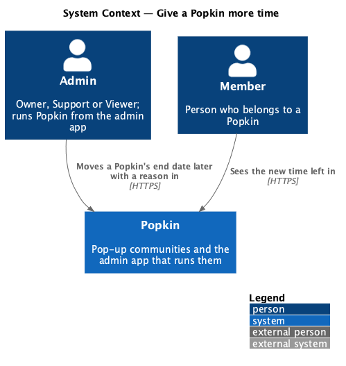
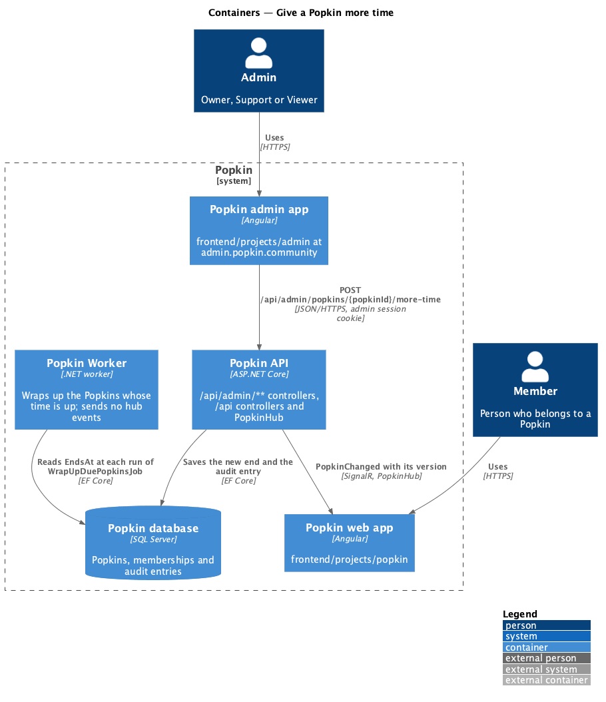
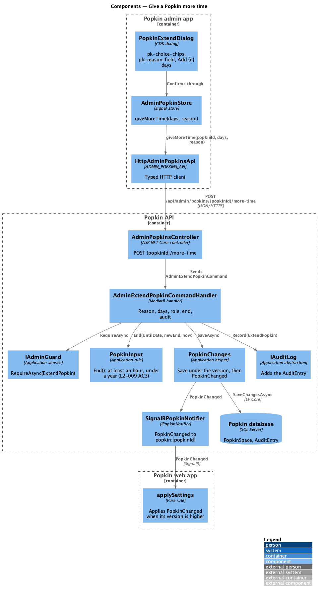
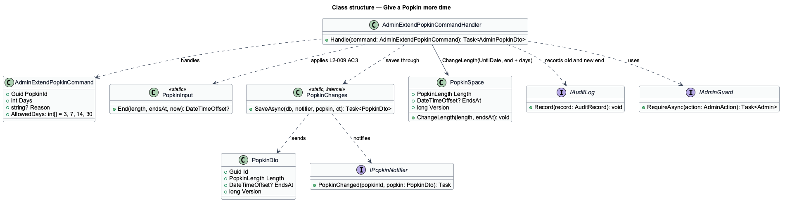
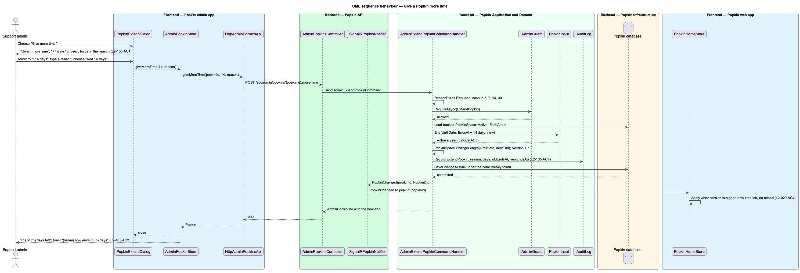
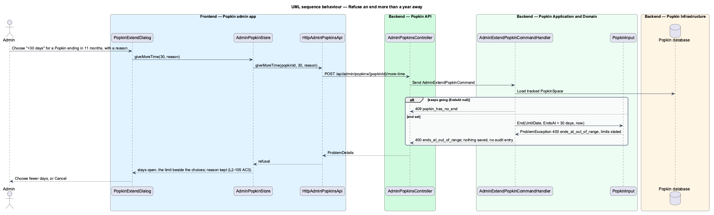

# Give a Popkin more time

## Overview

A Popkin with an end date wraps up on its own when its time is up (L2-044). When the event it
gathers for moves, or its Host asks support for a few more days, an Owner or Support admin moves
the end later from the Popkin's admin page. *Give more time* adds 3, 7, 14 or 30 days to the end
the Popkin has now.

- **end date** — moment a Popkin wraps up by itself (`PopkinSpace.EndsAt`); null for "Keep it
  going"
- **more time** — number of whole days added to the current end date, one of 3, 7, 14 or 30
- **length** — how long the Popkin was chosen to last (`PopkinSpace.Length`); after more time it
  is "Until a date"

The change is the length change of Popkin settings ([Popkin settings](../../popkins/popkin-settings/README.md)):
`PopkinSpace.ChangeLength`, the range rule of L2-009 AC3 through `PopkinInput.End`, and
`PopkinChanged` to every member, who see the new time left without a reload (L2-020 AC4). The
action is `AdminAction.ExtendPopkin`, allowed to Owner and Support (L2-086). A Popkin that keeps
going has no end to move, so the page does not offer the action for it (L2-103 AC5).

## Description

### Screens and states

- `docs/mocks/admin/dialogs/popkin-extend/default.html` — `pk-dialog` "Give it more time",
  "Members see the new end date straight away.", the choices "+3 days", "+7 days", "+14 days"
  and "+30 days" with "+7 days" chosen, the reason field (placeholder "e.g. Event postponed by a
  week"), "Add 7 days" and "Cancel" (L2-105 AC1).
- `busy.html`, `invalid.html`, `failed.html` — the shared reason dialog states (L2-087 AC2, AC4,
  AC5).
- `docs/mocks/admin/pages/popkin/extended.html` — "21 of 35 days left", "40% of its length has
  passed", "Ends in 21 days", and the toast "Lakeside Weekend now ends in 21 days" (L2-105 AC2).
- **Not drawn.** No mock shows the refusal of an end more than a year away (L2-105 AC3). The
  design expects `docs/mocks/admin/dialogs/popkin-extend/too-far.html`: the choice marked invalid
  with the limit stated, the reason kept; its copy is `<TO SUPPLY>`, from the server's
  "Pick a time at least an hour from now and less than a year away." until the owner words it.

### API

- `POST /api/admin/popkins/{popkinId}/more-time` — body `{ days, reason }`; `200`
  `AdminPopkinDto` with the new end ([A Popkin](../view-popkin/README.md)).
  Failures: `400` `reason_required`, `reason_too_long`, `days_not_allowed` (any value but 3, 7,
  14 or 30), `ends_at_out_of_range` (the new end a year or more from now, L2-009 AC3); `401`;
  `403`; `403` `role_not_allowed`; `404` `popkin_not_found`; `409` `popkin_has_no_end` (a Popkin
  that keeps going); `409` `popkin_wrapped_up`.
- Real time: `PopkinChanged(popkinId, PopkinDto)` to group `popkin:{popkinId}` after the commit,
  a state event whose `version` only rises.

### Backend

- **`AdminExtendPopkinCommand`** / **`AdminExtendPopkinCommandHandler`**
  (`Popkin.Application/Admin/Popkins/AdminExtendPopkin.cs`, new) — in order:
  1. `ReasonRules.Required(request.Reason)`; `days` in `AdminExtendPopkinCommand.AllowedDays`
     (`3, 7, 14, 30`) or `400` `days_not_allowed`.
  2. `IAdminGuard.RequireAsync(AdminAction.ExtendPopkin)` — `403` `role_not_allowed`.
  3. Load the tracked `PopkinSpace`, or `404`; `409` `popkin_wrapped_up` when wrapped up; `409`
     `popkin_has_no_end` when `EndsAt` is null.
  4. `newEnd = EndsAt + days`; `PopkinInput.End(PopkinLength.UntilDate, newEnd, now)` applies the
     rule of L2-009 AC3 and throws `ends_at_out_of_range` with its message stating the limits
     (L2-105 AC3).
  5. `PopkinSpace.ChangeLength(PopkinLength.UntilDate, newEnd)` — the length becomes "Until a
     date", so the Host's "Change how long it lasts" opens on the new date; `Version` rises.
  6. `IAuditLog.Record` — `AuditAction.ExtendPopkin`, target `Popkin`, the reason, `Details`
     `{ days, oldEndsAt, newEndsAt }` (L2-105 AC4).
  7. One `SaveChangesAsync`, under the concurrency token: a wrap-up saved first answers `409`
     `popkin_wrapped_up`, a Host's change saved first answers `409` `popkin_changed` (new), and
     nothing of the request is saved.
  8. `IPopkinNotifier.PopkinChanged(popkin.Id, PopkinDto.Of(popkin))` (L2-020 AC4).
- **One rule with Popkin settings.** The save and the notice are those of `PopkinChanges.SaveAsync`
  in `ChangePopkin.cs`, which the admin handler shares once it is opened to the audit entry
  (`internal` to `Popkin.Application`, both handlers in the same assembly).
- **The Worker.** `WrapUpDuePopkinsJob` reads `EndsAt` at each run, so the new end takes effect
  with no further work.

### Frontend (Popkin admin app)

- **`PopkinExtendDialog`** (`frontend/projects/admin/src/app/dialogs/popkin-extend/popkin-extend.dialog.ts`
  and `.html`, new) — `pk-dialog`, `pk-choice-chips` labelled "How much more time" (a radio
  group: Tab enters on "+7 days", the arrow keys move and choose), `pk-reason-field`, and
  `pk-button` whose label follows the choice: "Add {n} days". `ActionDialogState` gives the busy,
  invalid and failed states; while busy the choices are disabled too. `400`
  `ends_at_out_of_range` keeps the dialog open with the limit beside the choices and the reason
  kept.
- **`AdminPopkinStore.giveMoreTime(days, reason)`** — replaces the Popkin with the answer and
  raises the toast "{name} now ends in {n} days".
- **`ADMIN_POPKINS_API`** — `giveMoreTime(popkinId, days, reason)`.

### Frontend (Popkin web app)

- Nothing new. `PopkinChanged` reaches `PopkinHomeStore`, `PopkinFrame` and `ThreadStore`
  through `applySettings`, which applies it only when its version is higher than the one held,
  and the time left and the last-hour banner follow the new end.

### Decisions and conflicts

- **"The Host has been told."** The toast in `extended.html` says so, and no requirement tells
  the Host anything beyond what every member sees: `PopkinChanged` and the new time left. The
  toast's second line is `<TO SUPPLY>`; without a decision the toast shows its title alone.
- **Radio group, not toggle buttons.** The mock draws the choices as `aria-pressed` buttons;
  L2-105 AC1 asks for one radio group, which `pk-choice-chips` is. The requirement stands.
- **More time near the end.** A Popkin within its last hour still takes more time: the new end
  is at least 3 days away, inside the range of L2-009 AC3.

### Tests

- API: `AdminExtendPopkinTests` — `+7 days` moves the end 7 days and a hub client in the group
  receives `PopkinChanged` with a higher version; an end a year away is `400`
  `ends_at_out_of_range`, advancing `FakeTimeProvider`; `days` 5 is `400`; "Keep it going" `409`
  `popkin_has_no_end`; a Viewer `403`; the audit entry holds the old and new end.
- Playwright: `e2e/tests/admin/popkin-extend.spec.ts` with `e2e/pages/admin/popkin-extend.dialog.ts`.

## Requirements

| L2 ID | Refines (L1) | Requirement |
|-------|--------------|-------------|
| `L2-105` | `L1-023` | Give a Popkin more time: An admin moves a Popkin's end date later. (AC1–AC4) |
| `L2-020` | `L1-006` | Popkin settings: The Host changes how a Popkin looks and how long it lasts. (AC4) |
| `L2-009` | `L1-003` | Choose how long a Popkin lasts: The second step sets when the Popkin wraps up. (AC3) |
| `L2-087` | `L1-028` | A reason for every change: An admin says why they change something, and the audit log keeps it. (AC1, AC2, AC4–AC7) |
| `L2-120` | `L1-028` | Audit log: Every action in the console, with who did it and why. (AC5) |

## Diagrams

### System context

An admin moves a Popkin's end in the admin app; every member sees the new time left in Popkin.

### Containers

The admin app posts the change; the API saves it with its audit entry and sends `PopkinChanged`
through `PopkinHub` to the members' web apps. The Worker reads the new end at its next run.

### Components

`AdminExtendPopkinCommandHandler` uses the length rules of `PopkinInput` and the save and notice
of `PopkinChanges`.

### Class structure

The command carries the days and the reason; `PopkinSpace.ChangeLength` raises the version that
orders `PopkinChanged`.

### Behaviour — give more time

The admin chooses the days and a reason; the end moves, every member is told, and the page shows
the new length (L2-105 AC1, AC2, AC4).

### Behaviour — an end more than a year away

The new end is refused with the limit stated, and nothing changes (L2-105 AC3).

