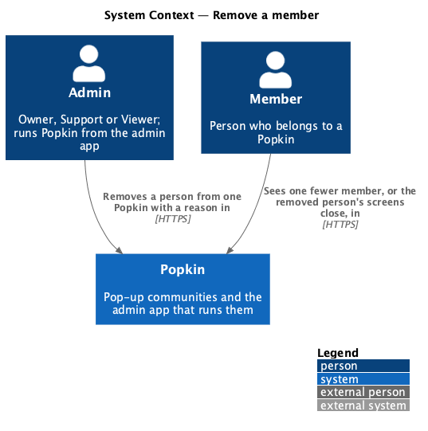
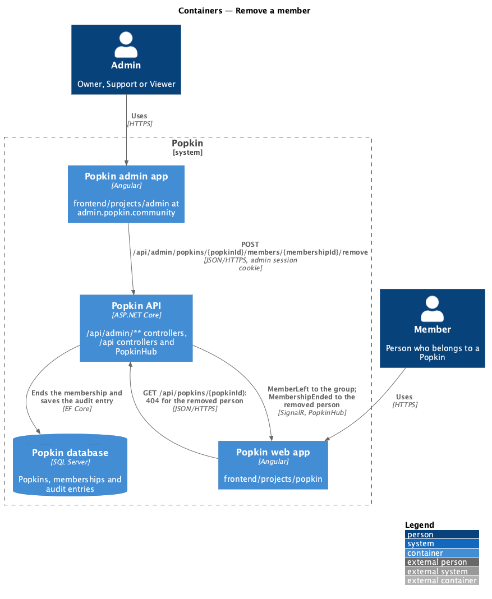
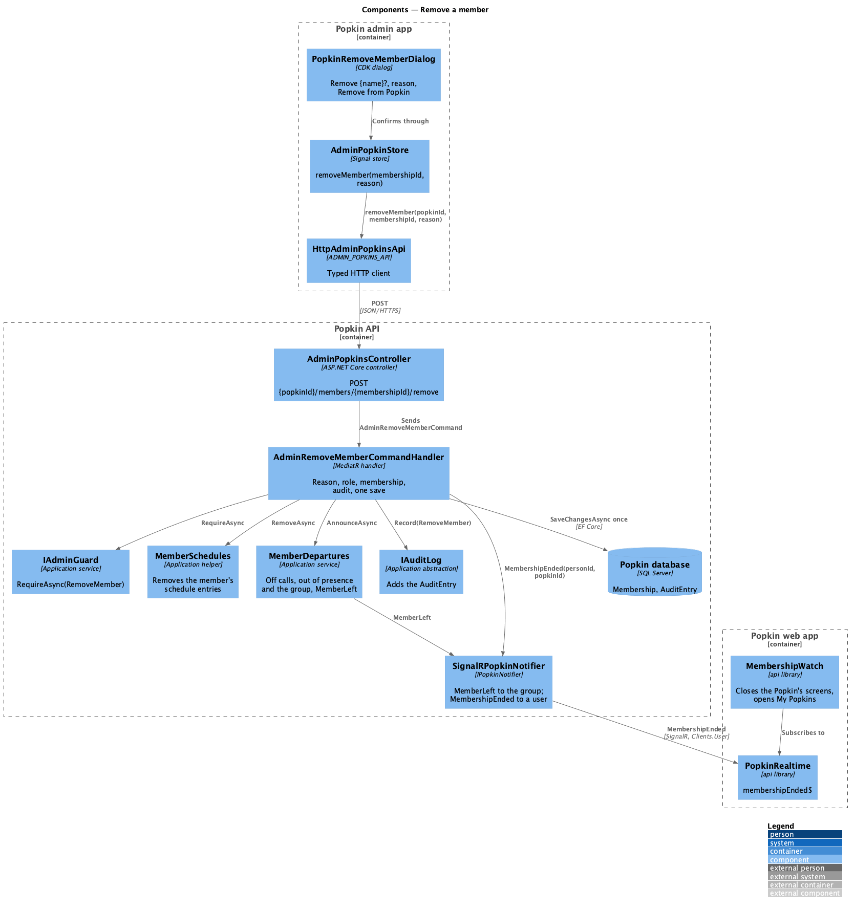
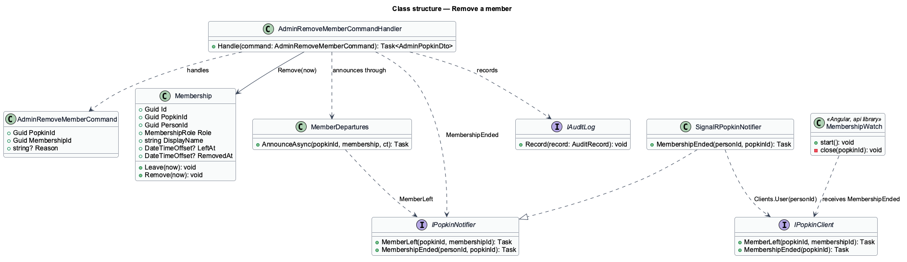
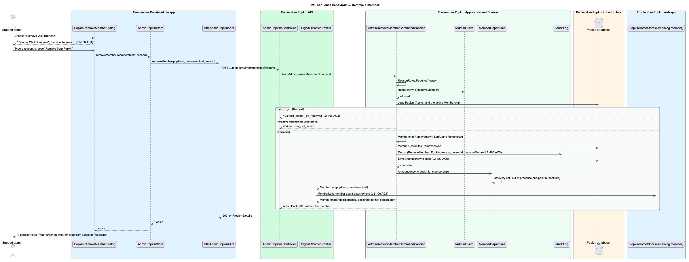
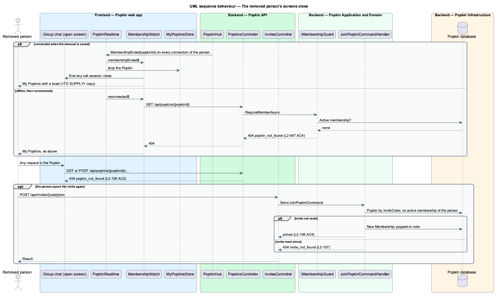

# Remove a member

## Overview

A member who is not the Host may leave a Popkin whenever they want (L2-047). When a person is in
a Popkin they should not be in, someone who joined from a leaked code or a member the Host asks
support to take out, an Owner or Support admin removes them from the Popkin's admin page.
*Remove a member* takes one person out of one Popkin; their account and their other Popkins are
not affected.

- **removal** — the end of one membership by an admin; it has the effects of leaving (L2-047)
  and is recorded with a reason
- **removed person** — the person whose membership was ended
- **open screen** — any screen of the Popkin app inside the Popkin (`/p/:popkinId/...`) that a
  connection of the removed person shows when the removal is saved

A removal is the leave of L2-047, done for the person: `Membership.Leave` ends the membership,
`MemberSchedules.RemoveAsync` removes their schedule entries, and `MemberDepartures.AnnounceAsync`
takes them off any call, out of presence and out of the Popkin's group, then sends `MemberLeft`
to the members who remain. One thing differs: the person did not choose to leave and may have the
Popkin open. A new hub event, `MembershipEnded`, goes to the removed person alone so that their
open screens close (L2-106 AC2). Every later request of theirs in the Popkin is answered `404`
`popkin_not_found` (L2-047 AC4). The invite still works for them unless it is reset (L2-106 AC4,
[Reset the invite](../reset-invite/README.md)).

The action is `AdminAction.RemoveMember`, allowed to Owner and Support (L2-086). The Host cannot
be removed: the page offers no "Remove" for them (L2-106 AC3), and the API refuses it.

## Description

### Screens and states

- `docs/mocks/admin/dialogs/popkin-remove-member/default.html` — `pk-dialog` "Remove Walt
  Brennan?", "They lose access to this Popkin straight away. Messages they sent stay, marked as
  from a former member. Their account isn’t affected.", the reason field (placeholder "e.g. Host
  asked; not part of the group"), the danger button "Remove from Popkin" and "Cancel" (L2-106
  AC1).
- `busy.html`, `invalid.html`, `failed.html` — the shared reason dialog states; the failure reads
  "Nothing changed: Walt is still a member." in the mock (L2-087 AC5 gives the alert's words).
- `docs/mocks/admin/pages/popkin/member-removed.html` — "9 people, showing 6", the row gone, and
  the toast "Walt Brennan was removed from Lakeside Weekend" (L2-106 AC2).
- **Not drawn.** No mock shows the removed person's side: what their open screen shows when it
  closes. The design expects `docs/mocks/pages/removed-from-popkin/default.html` (or a toast on
  My Popkins); its copy is `<TO SUPPLY>`.

### API

- `POST /api/admin/popkins/{popkinId}/members/{membershipId}/remove` — body `{ reason }`; `200`
  `AdminPopkinDto` without the member ([A Popkin](../view-popkin/README.md)). A `POST` to a named
  action carries the reason in its body, which a `DELETE` body does not reliably do through
  proxies and clients.
  Failures: `400` `reason_required`, `reason_too_long`; `401`; `403`; `403` `role_not_allowed`;
  `403` `host_cannot_be_removed` (new); `404` `popkin_not_found`; `404` `member_not_found` (new:
  no active membership with that id in the Popkin, or one already ended); `409`
  `popkin_wrapped_up`.
- Real time, after the commit, in order:
  1. The removed person's connections leave `popkin:{popkinId}` (`IPopkinConnections.RemoveFromPopkinAsync`).
  2. `MemberLeft(popkinId, membershipId)` to `popkin:{popkinId}`: the members who remain.
  3. `MembershipEnded(popkinId)` (new) to the removed person on every connection they hold
     (`Clients.User(personId)`), never to the group.
- `MembershipEnded` is a fact event. Its recovery read is `GET /api/popkins/{popkinId}`, which
  answers `404` `popkin_not_found` to the removed person.

### Backend

- **`AdminRemoveMemberCommand`** / **`AdminRemoveMemberCommandHandler`**
  (`Popkin.Application/Admin/Popkins/AdminRemoveMember.cs`, new) — in order:
  1. `ReasonRules.Required(request.Reason)`.
  2. `IAdminGuard.RequireAsync(AdminAction.RemoveMember)` — `403` `role_not_allowed`.
  3. Load the Popkin, or `404` `popkin_not_found`; `409` `popkin_wrapped_up` when wrapped up,
     because a wrapped-up Popkin's page offers no action (L2-103 AC4).
  4. Load the tracked `Membership` with `PopkinId` and `LeftAt == null`, or `404`
     `member_not_found`; a Host's is `403` `host_cannot_be_removed` (L2-106 AC3, L2-047 AC3).
  5. `Membership.Remove(now)` (new) — sets `LeftAt` as `Leave` does and `RemovedAt`, so the
     record says the person did not leave by choice.
  6. `MemberSchedules.RemoveAsync(db, [membership.Id])`, as the leave does.
  7. `IAuditLog.Record` — `AuditAction.RemoveMember`, target `Popkin` with its id and name, the
     reason, and `Details` `{ membershipId, personId, memberName }`, the person named by name and
     id (L2-106 AC5, L2-120 AC7).
  8. One `SaveChangesAsync`.
  9. `MemberDepartures.AnnounceAsync(popkinId, membership)` — off every call (`CallLeaver`), out
     of presence and the group, then `MemberLeft`.
  10. `IPopkinNotifier.MembershipEnded(membership.PersonId, popkinId)` (new).
- **`Membership.RemovedAt`** (new, nullable) — added by the migration `AddMembershipRemovedAt`.
  Nothing in the Popkin app reads it yet; it tells the admin pages and the audit what happened.
- **`IPopkinNotifier.MembershipEnded`** / **`IPopkinClient.MembershipEnded(Guid popkinId)`** (new)
  — `SignalRPopkinNotifier` sends it with `hub.Clients.User(personId.ToString())`, as
  `ThreadRead` is sent; a failed send is logged and counted and never fails the request.
- **Rejoining.** `JoinPopkinCommandHandler` makes a new membership for a person with no active
  one, so a removed person who opens the invite again joins as a new member (L2-106 AC4). Only a
  reset invite stops it.

### Frontend (Popkin admin app)

- **`PopkinRemoveMemberDialog`** (`frontend/projects/admin/src/app/dialogs/popkin-remove-member/popkin-remove-member.dialog.ts`
  and `.html`, new) — `pk-dialog` titled with the member's name, `pk-reason-field`, `pk-button`
  (danger) "Remove from Popkin", on `ActionDialogState`.
- **`AdminPopkinStore.removeMember(membershipId, reason)`** — replaces the Popkin with the
  answer, one member fewer, and raises the toast "{name} was removed from {Popkin}". After the
  dialog closes the focus moves to the next member's "Remove", or to the Members heading when
  none is left, because the row that opened it is gone.
- `ADMIN_POPKINS_API` — `removeMember(popkinId, membershipId, reason)`.

### Frontend (Popkin web app)

- **`PopkinRealtime`** — the typed event map gains `MembershipEnded`, and `membershipEnded$`
  emits its `popkinId`.
- **`MembershipWatch`** (`frontend/projects/api/src/lib/api/popkins/membership-watch.ts`, new, with
  unit tests) — started by the app root (`app.ts`) beside `WrapUpWatch`, so it watches every
  screen inside the Popkin. On `MembershipEnded` for the open Popkin it ends any call session of that Popkin,
  navigates to My Popkins and shows a toast (`<TO SUPPLY>` copy, mock missing). On `reconnected$`
  it reads `GET /api/popkins/{popkinId}`; a `404` `popkin_not_found` does the same, so a removal
  missed while offline still closes the screen.
- **`MyPopkinsStore`** — drops the Popkin on `MembershipEnded`, and its next read leaves it out.

### Decisions and conflicts

- **"Marked as from a former member".** L2-106 AC1 says the dialog says so. A member who leaves
  keeps their name on what they sent (`Membership.Leave`, L2-047 AC1), and only a deleted account
  becomes "Former member" (`Membership.Anonymise`, L2-049). How a removed member's messages are
  marked, by their name with a mark or by "Former member", is `<TO SUPPLY>`; until it is decided
  the messages keep the name and the dialog's sentence does not hold.
- **The removed person's screen.** No requirement or mock says what they see; the design closes
  the screen to My Popkins and leaves the copy `<TO SUPPLY>`.
- **Only the removed person is told.** A person who leaves by choice receives no event (their
  own action closes the screen); a removal sends `MembershipEnded` because nothing on their side
  caused it.

### Tests

- API: `AdminRemoveMemberTests` — a Support admin removes a member; a hub client of a remaining
  member receives `MemberLeft`, the removed person's client receives `MembershipEnded`, and each
  receives nothing meant for the other (ADR 0010); the removed person's next read is `404`
  `popkin_not_found`; the same invite lets them join again; the Host `403`
  `host_cannot_be_removed`; a Viewer `403` with nothing changed; the audit entry names the person
  by name and id.
- Frontend unit: `membership-watch.spec.ts`.
- Playwright: `e2e/tests/admin/popkin-remove-member.spec.ts` with its page object; in the Popkin
  app, `e2e/tests/removed-from-popkin.spec.ts`, pushing `MembershipEnded` through the `hub`
  fixture.

## Requirements

| L2 ID | Refines (L1) | Requirement |
|-------|--------------|-------------|
| `L2-106` | `L1-023` | Remove a member: An admin takes a person out of one Popkin. (AC1–AC5) |
| `L2-047` | `L1-006` | Leave a Popkin: A member who is not the Host leaves when they want. (AC3, AC4) |
| `L2-087` | `L1-028` | A reason for every change: An admin says why they change something, and the audit log keeps it. (AC1, AC2, AC4–AC7) |
| `L2-120` | `L1-028` | Audit log: Every action in the console, with who did it and why. (AC5, AC7) |

## Diagrams

### System context

An admin removes a person from a Popkin in the admin app; the others see one fewer member, and
the removed person's screens close.

### Containers

The admin app posts the removal; the API saves it with its audit entry and sends `MemberLeft` to
the Popkin's group and `MembershipEnded` to the removed person through `PopkinHub`.

### Components

`AdminRemoveMemberCommandHandler` ends the membership and reuses `MemberDepartures`;
`MembershipWatch` closes the removed person's screens.

### Class structure

`Membership.Remove` sets `LeftAt` and `RemovedAt`; the notifier gains `MembershipEnded`, sent to a
person, never to a group.

### Behaviour — remove a member

The admin confirms with a reason; the membership ends, the others are told, and the page shows
one fewer member (L2-106 AC1, AC2, AC5).

### Behaviour — the removed person's screens close

`MembershipEnded` closes every open screen of the Popkin; a missed event is recovered by the read
that answers `404`; the invite lets them back in unless it was reset (L2-106 AC2, AC4).

