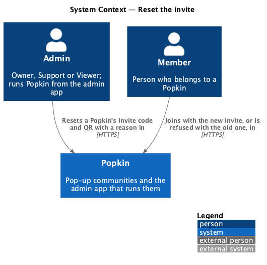
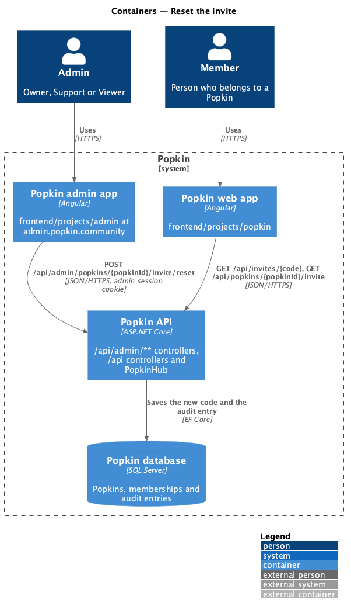
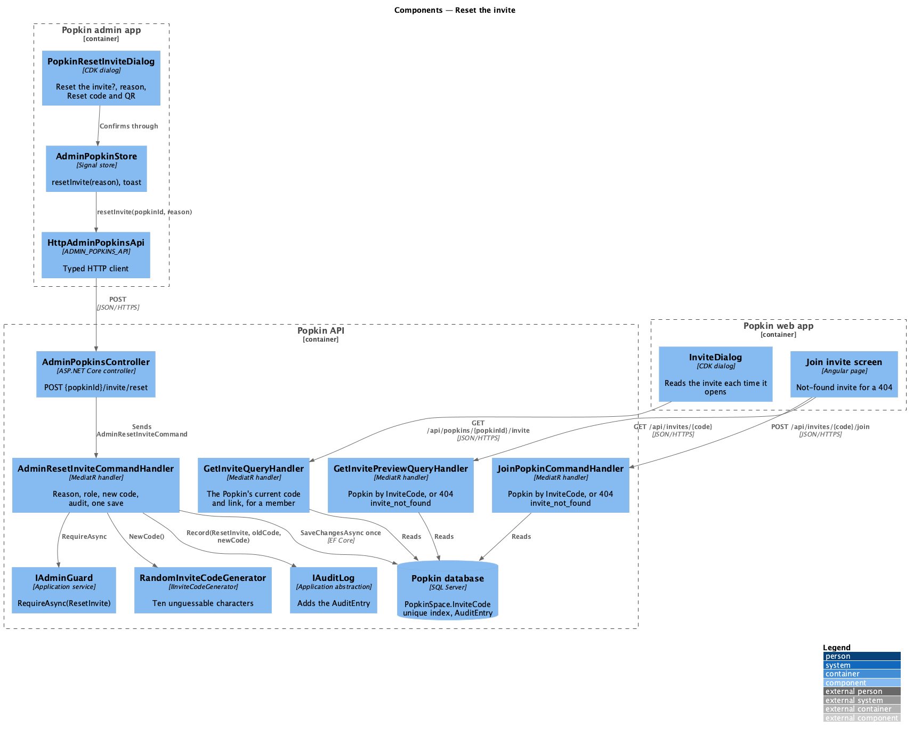
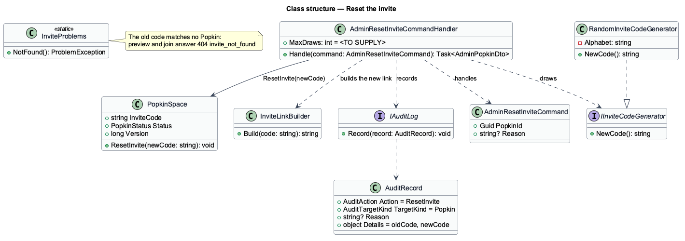
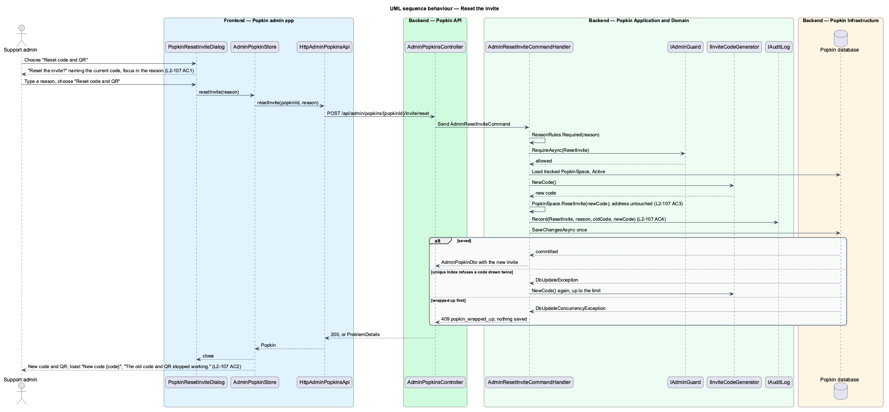
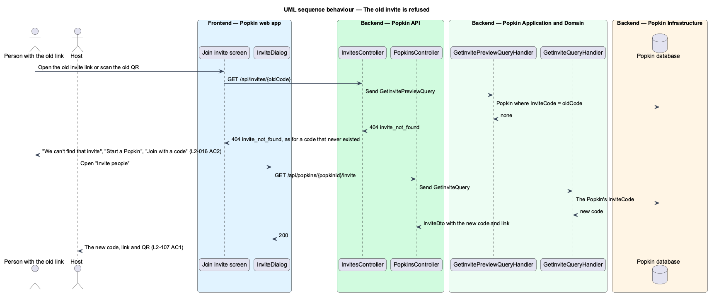

# Reset the invite

## Overview

Every Popkin has one invite code, and its invite link and QR code carry it
([Invite people](../../invitations/invite-people/README.md)). Anyone who holds the code may join.
When a code leaks, posted on a public forum or printed where it should not be, an Owner or
Support admin resets it from the Popkin's admin page: the Popkin gets a new code, link and QR,
and the old ones stop working at once.

- **invite code** — the unguessable code of one Popkin (`PopkinSpace.InviteCode`), drawn by
  `IInviteCodeGenerator` (L2-011 AC5)
- **invite link** — the link built from the code by `InviteLinkBuilder`; the QR code encodes it
- **reset** — the replacement of a Popkin's invite code by a new one, after which the old code
  matches no Popkin

Members already inside are not affected: membership does not depend on the code. The Host sees
the new code the next time their invite dialog opens, because the dialog reads
`GET /api/popkins/{popkinId}/invite` each time. The Popkin's address does not change (L2-066,
L2-107 AC3): the address and the invite code are separate values, and the reset writes only the
code. An old code is answered exactly as a code that never existed, `404` `invite_not_found`,
so it discloses nothing (L2-016 AC2).

The action is `AdminAction.ResetInvite`, allowed to Owner and Support (L2-086).

## Description

### Screens and states

- `docs/mocks/admin/dialogs/popkin-reset-invite/default.html` — `pk-dialog` "Reset the invite?",
  "PINE-4821 and its QR stop working immediately. Members already inside aren’t affected; the Host
  sees the new code on their invite screen.", the reason field (placeholder "e.g. Code shared
  publicly"), "Reset code and QR" and "Cancel" (L2-107 AC1).
- `busy.html`, `invalid.html`, `failed.html` — the shared reason dialog states; the failure reads
  "Nothing changed: the old code still works." in the mock.
- `docs/mocks/admin/pages/popkin/invite-reset.html` — the Invite panel with the new code
  "PINE-7316" and link, and the toast "New code PINE-7316" with "The old code and QR stopped
  working." (L2-107 AC2).
- In the Popkin app the invite dialog and the invite screen of an old code need no new state:
  the first shows the new code from its read, and the second is the not-found invite of L2-016
  AC2 (`docs/mocks/pages/join-invite/not-found.html`).

### API

- `POST /api/admin/popkins/{popkinId}/invite/reset` — body `{ reason }`; `200` `AdminPopkinDto`
  with the new `invite` ([A Popkin](../view-popkin/README.md)).
  Failures: `400` `reason_required`, `reason_too_long`; `401`; `403`; `403` `role_not_allowed`;
  `404` `popkin_not_found`; `409` `popkin_wrapped_up` (a wrapped-up Popkin's page offers no
  action, L2-103 AC4).
- After the reset, `GET /api/invites/{oldCode}` and `POST /api/invites/{oldCode}/join` answer
  `404` `invite_not_found`, as for a code that never existed (L2-107 AC2).
- No hub event. The Host's invite dialog reads when it opens; one open during the reset shows the
  old code until it is opened again.

### Backend

- **`AdminResetInviteCommand`** / **`AdminResetInviteCommandHandler`**
  (`Popkin.Application/Admin/Popkins/AdminResetInvite.cs`, new) — in order:
  1. `ReasonRules.Required(request.Reason)`.
  2. `IAdminGuard.RequireAsync(AdminAction.ResetInvite)` — `403` `role_not_allowed`.
  3. Load the tracked `PopkinSpace`, or `404`; `409` `popkin_wrapped_up` when wrapped up.
  4. `oldCode = popkin.InviteCode`; `newCode = IInviteCodeGenerator.NewCode()`.
  5. `PopkinSpace.ResetInvite(newCode)` (new) — requires the Popkin active and replaces the code.
     It takes the place of `ChangeInviteCode`, which no handler calls today. It leaves the name,
     the address and the `Version` as they are, so no member's settings event is due.
  6. `IAuditLog.Record` — `AuditAction.ResetInvite`, target `Popkin`, the reason, and `Details`
     `{ oldCode, newCode }` (L2-107 AC4).
  7. One `SaveChangesAsync`. The unique index on `InviteCode` refuses a code drawn twice; the
     handler draws again, up to `<TO SUPPLY>` times (3 assumed), before it fails. A wrap-up saved
     first fails the save on the concurrency token, and the handler answers `409`
     `popkin_wrapped_up` with nothing saved.
- **The old code.** `GetInvitePreviewQueryHandler` and `JoinPopkinCommandHandler` find a Popkin by
  `InviteCode` equality, so the old code matches none and answers `InviteProblems.NotFound()`
  with no change to either handler. No table keeps old codes.
- **The address.** The handler writes `InviteCode` only. The address of L2-066 is not built yet
  ([Choose the address](../../popkins/choose-address/README.md)); when it is, it is a separate
  property that this handler does not touch (L2-107 AC3).
- **Telemetry.** No log line, metric or span carries either code (ADR 0012).

### Frontend (Popkin admin app)

- **`PopkinResetInviteDialog`** (`frontend/projects/admin/src/app/dialogs/popkin-reset-invite/popkin-reset-invite.dialog.ts`
  and `.html`, new) — `pk-dialog` with the current code in its description, `pk-reason-field`,
  `pk-button` (primary) "Reset code and QR", on `ActionDialogState`.
- **`AdminPopkinStore.resetInvite(reason)`** — replaces the Popkin with the answer, so
  `pk-invite-box` and its `pk-qr` show the new code and link, and raises the toast "New code
  {code}" with "The old code and QR stopped working.".
- `ADMIN_POPKINS_API` — `resetInvite(popkinId, reason)`.

### Frontend (Popkin web app)

- Nothing new. `InviteDialog` reads the invite each time it opens, and the invite screen shows the
  not-found invite for a `404` `invite_not_found`.

### Decisions and conflicts

- **Codes in the audit log.** L2-107 AC4 records the old and new codes; L2-120 AC7 says an entry
  holds no code. The design reads L2-120 AC7 as the sign-in codes of L2-005 and L2-088, which
  would let a person in, and keeps the invite codes, which a reset has already made harmless or
  which members already share. The owner confirms this reading (`<TO SUPPLY>`).
- **The code's shape.** The mock's new code "PINE-7316" keeps the old one's word; the codes Popkin
  issues are ten random characters ([Find Popkins](../find-popkins/README.md)). A new code shares
  nothing with the old one, so the old one gives no hint of the new.
- **No event to the Host.** L2-107 AC1 says the Host sees the new code on their invite screen;
  the read on opening satisfies it. A live update of an open invite dialog is not required.

### Tests

- API: `AdminResetInviteTests` — a Support admin resets; the answer carries a new code; the
  preview and the join of the old code answer `404` `invite_not_found`; the new code's preview
  answers the Popkin; a member's reads still work; a Viewer `403` with the code unchanged; a
  wrapped-up Popkin `409`; the audit entry holds the old and new codes.
- Playwright: `e2e/tests/admin/popkin-reset-invite.spec.ts` with its page object.

## Requirements

| L2 ID | Refines (L1) | Requirement |
|-------|--------------|-------------|
| `L2-107` | `L1-023` | Reset the invite: An admin stops a leaked invite working. (AC1–AC4) |
| `L2-016` | `L1-004` | Invites that cannot be joined: An invite to a wrapped-up Popkin, or one that does not exist, says so and offers a way forward. (AC2) |
| `L2-066` | `L1-016` | The address does not change: A printed QR code and a saved link must keep working for as long as the Popkin exists. (AC1) |
| `L2-087` | `L1-028` | A reason for every change: An admin says why they change something, and the audit log keeps it. (AC1, AC2, AC4–AC7) |
| `L2-120` | `L1-028` | Audit log: Every action in the console, with who did it and why. (AC5, AC7) |

## Diagrams

### System context

An admin resets a Popkin's invite in the admin app; people holding the old invite can no longer
join through Popkin.

### Containers

The admin app posts the reset; the API draws a new code and saves it with its audit entry. The
web app's invite reads then find the new code, and the old one finds nothing.

### Components

`AdminResetInviteCommandHandler` uses `IInviteCodeGenerator` and `IAuditLog`; the existing invite
handlers refuse the old code with no change.

### Class structure

`PopkinSpace.ResetInvite` replaces the code; the audit entry's details hold the old and new codes.

### Behaviour — reset the invite

The admin confirms with a reason; the Popkin has a new code, and the page shows it with the toast
(L2-107 AC1, AC2, AC4).

### Behaviour — the old invite is refused

A person opens the old link: it is answered as an invite that does not exist; the Host's invite
dialog shows the new code (L2-107 AC2, L2-016 AC2).

