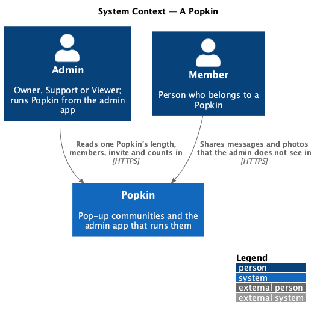
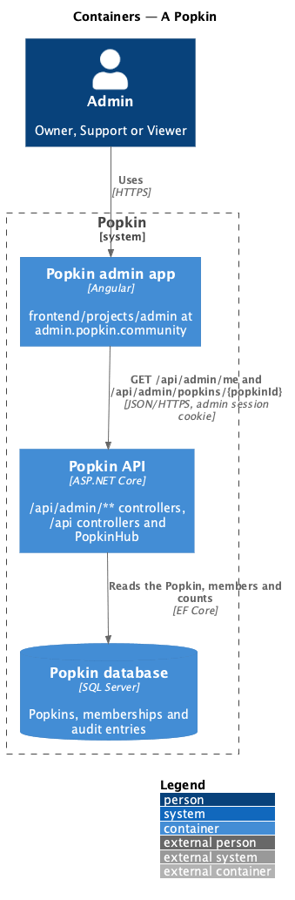
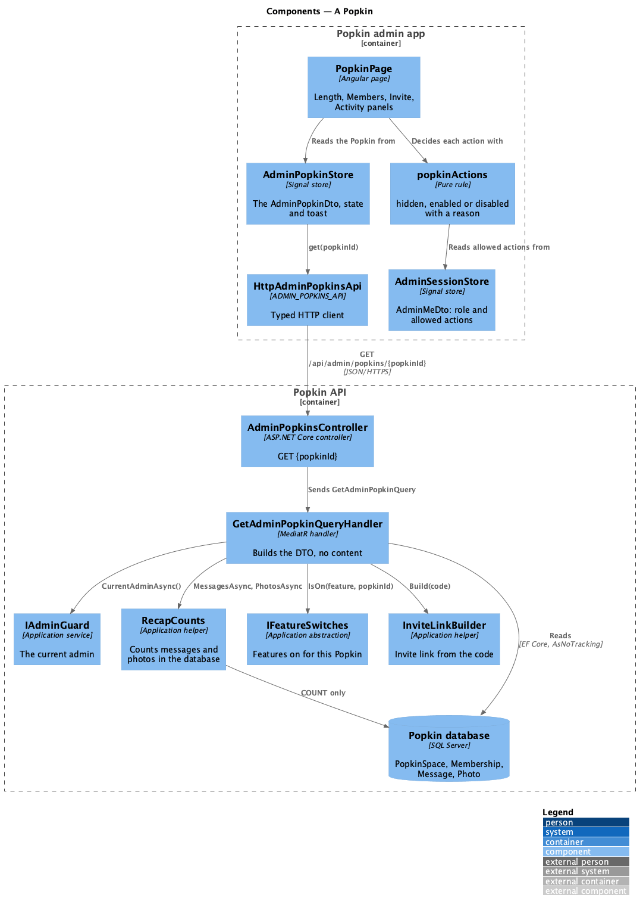
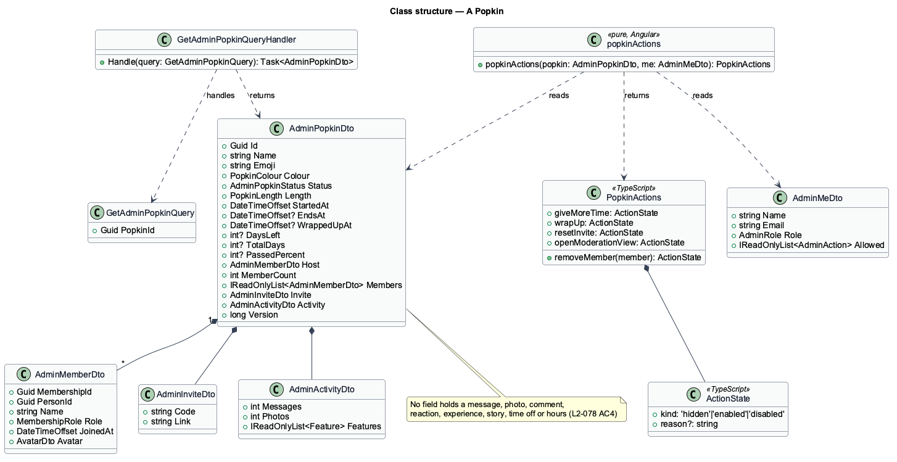
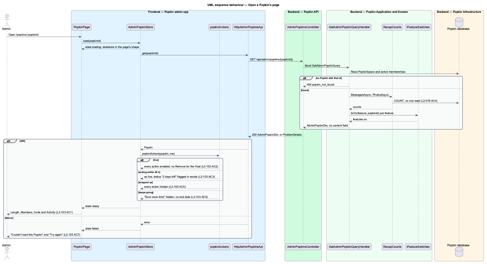
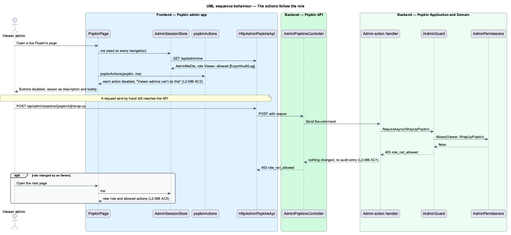

# A Popkin

## Overview

*A Popkin* is the admin app's page for one Popkin, at `/popkins/:popkinId` (route data `page`
`popkin`). It says how long the Popkin has left, who is in it, how it is invited to and how busy
it is, and it is where an Owner or Support admin helps it: "Give more time", "Wrap up now",
"Remove {member}" and "Reset code and QR".

The page never shows what members shared. Popkin promises its members a private space: an admin
sees a Popkin's emoji, name, Host, members, length, invite and counts, and no message, photo,
comment, reaction, experience, story, time off or hours (L2-078 AC4, L2-103 AC6). The one way to
see shared content from here is the moderation view, opened with a reason that the audit log
records ([Moderation view](../../moderation/moderation-view/README.md), L2-111); this design
places its entry point and nothing more.

- **length** — span from a Popkin's start (`PopkinSpace.CreatedAt`) to its end (`EndsAt`), or
  no end for "Keep it going"
- **activity** — counts of a Popkin's messages and photos and the features it has, never their
  content
- **action** — request that changes a Popkin and needs an `AdminAction` the admin's role allows
  (L2-086)

The four actions are designed by their own features: [Wrap up a Popkin now](../wrap-up-now/README.md),
[Give a Popkin more time](../give-more-time/README.md), [Remove a member](../remove-member/README.md)
and [Reset the invite](../reset-invite/README.md). This design covers the page, the read behind
it and how the page offers, disables or withholds each action.

## Description

### Screens and states

- `docs/mocks/admin/pages/popkin/default.html` — `pk-page-head` with the way back "Popkins", the
  tile, "Lakeside Weekend", "Hosted by Mara Okafor · 10 members" and the status "Live". Then
  `panel-grid--detail-aside`:
  - **Length** — "Give more time" and "Wrap up now", "14 of 28 days left", the progress bar with
    the accessible name "50% of its length has passed", "Started 1 Jul" and "Ends 28 Jul".
  - **Members** — "10 people, showing 7"; each row has the avatar, the name (a link to the
    person's page), "Host" or "Joined 1 Jul", and "Remove" with the visually hidden name, for
    every member but the Host (L2-103 AC2, L2-106 AC3).
  - **Invite** — the QR, "PINE-4821", "popk.in/pine-4821" and "Reset code and QR".
  - **Activity** — `pk-key-values`: "Messages", "Photos", "Features" ("Plan, Schedules"),
    "Region".
- `ending.html` — the status "2 days left" in the warning tone and "2 of 9 days left": the
  Popkin is flagged in words (L2-103 AC3).
- `wrapped.html` — the status "Wrapped up", the muted tile, "Ended", "Started 12 May", "Wrapped
  up 12 Jun", and no action at all: no "Give more time", "Wrap up now", "Remove" or "Reset code
  and QR" (L2-103 AC4).
- `viewer.html` — every action present and disabled with the title "Viewer admins can’t do
  this" (L2-086 AC2).
- `extended.html`, `wrapped-now.html`, `member-removed.html`, `invite-reset.html` — the page
  after each action, with its toast; each is described by its action's design.
- `loading.html` — skeletons in the page's shape; `error.html` — "Couldn’t load this Popkin",
  "Try again" and "Open Health" (L2-103 AC7, L2-089 AC7).
- **Not drawn.** No mock shows:
  - "Open moderation view" (L2-103 AC6, L2-111 AC1, AC5). The design expects it in the page
    head's actions of `default.html`, and disabled with the reason in `viewer.html`.
  - A Popkin with "Keep it going" (L2-103 AC5): its length with no end date and no "Give more
    time". The design expects `docs/mocks/admin/pages/popkin/keep-going.html`; its copy is
    `<TO SUPPLY>`.
  - How the members past the seventh are shown ("showing 7"). The control and its copy are
    `<TO SUPPLY>`.

### API

- `GET /api/admin/popkins/{popkinId}` — `200` `AdminPopkinDto`. Failures: `401`, `403` (L2-078
  AC3); `404` `popkin_not_found` when no Popkin has the id.
- `AdminPopkinDto` — `id`, `name`, `emoji`, `colour`, `status` (`AdminPopkinStatus`),
  `length` (`PopkinLength`), `startedAt`, `endsAt`, `wrappedUpAt`, `daysLeft`, `totalDays`,
  `passedPercent`, `host` (`AdminMemberDto`), `memberCount`, `members` (`AdminMemberDto[]`,
  the Host first, then in the order they joined), `invite` (`code`, `link`), `activity`
  (`messages`, `photos`, `features`) and `version` (`PopkinSpace.Version`).
- `AdminMemberDto` — `membershipId`, `personId`, `name` (`Membership.DisplayName`), `role`
  (`Host` | `Member`), `joinedAt`, `avatar` (`AvatarDto`).
- The DTO has no field for a message, photo, comment, reaction, experience, story, time off or
  hours (L2-078 AC4). The member's avatar is the one every member of the Popkin already sees
  beside their name, not content they shared.

### Backend

- **`GetAdminPopkinQuery`** / **`GetAdminPopkinQueryHandler`**
  (`Popkin.Application/Admin/Popkins/GetAdminPopkin.cs`, new) — calls
  `IAdminGuard.CurrentAdminAsync()`, requires no `AdminAction`, reads `PopkinSpace` and its
  active memberships with `AsNoTracking`, and builds the DTO:
  - Status and days from `AdminPopkinStatuses.Of` ([Find Popkins](../find-popkins/README.md)).
  - `totalDays` is the length from `CreatedAt` to `EndsAt` in whole days, rounded up;
    `passedPercent` is the share of that span already passed, from 0 to 100. A wrapped-up Popkin
    reads 100; a Popkin with no end has neither.
  - The invite link is `InviteLinkBuilder.Build(InviteCode)` (from `Invites:BaseUrl`; the
    shared architecture names `PopkinUrlBuilder` as its successor).
  - `activity.messages` and `activity.photos` are `RecapCounts.MessagesAsync` and
    `RecapCounts.PhotosAsync`: the database counts and no row is read. `activity.features` names
    each `Feature` on for this Popkin, from `IFeatureSwitches.IsOn(Feature, Guid popkinId)`,
    the per-Popkin form of the switch that the admin features design defines.
- **`AdminPopkinsController`** — `GET {popkinId}` sends the query.
- **Telemetry.** Recorded by route template; no span carries a name.

### Frontend (Popkin admin app)

- **`PopkinPage`** (`frontend/projects/admin/src/app/pages/popkin/popkin.page.ts` and `.html`,
  new) — composes `pk-page-head`, `pk-status-pill`, `pk-panel`, `pk-popkin-length` (the length
  headline, `pk-progress` with its accessible name, and the two dates), `pk-member-row` with
  `pk-avatar`, `pk-invite-box` with `pk-qr`, `pk-key-values`, `pk-skeleton`, `pk-empty-state`
  and `pk-toast-region`. `pk-popkin-length`, `pk-invite-box` and `pk-member-row` are the parts
  of the design system's "Popkin length, invite and members" (`popkin-facts.html`).
- **`AdminPopkinStore`** (`frontend/projects/api/src/lib/admin/popkins/admin-popkin.store.ts`,
  new) — holds the `AdminPopkinDto`, `state` (`loading` | `ready` | `failed`) and `toast`.
  `load(popkinId)` reads; `retry()` reads again. After an action it replaces the Popkin with the
  answer of the action, which is the same `AdminPopkinDto`, so the page needs no second read.
  On `409` `popkin_wrapped_up` from any action it reads again, so the page shows the Popkin
  wrapped up (L2-104 AC3).
- **`popkinActions(popkin, me)`** (`frontend/projects/api/src/lib/admin/popkins/popkin-actions.ts`,
  new, unit-tested) — the pure rule for the page's actions. For each of `giveMoreTime`,
  `wrapUp`, `removeMember`, `resetInvite` and `openModerationView` it answers `hidden`,
  `enabled` or `disabled` with a reason:
  - A wrapped-up Popkin hides every action (L2-103 AC4).
  - A Popkin with "Keep it going" hides "Give more time" (L2-103 AC5).
  - "Remove" is hidden for the Host (L2-106 AC3).
  - An action whose `AdminAction` (`ExtendPopkin`, `WrapUpPopkin`, `RemoveMember`,
    `ResetInvite`, `OpenModerationView`) is not in `AdminMeDto.allowed` is disabled with "Viewer
    admins can’t do this" for a Viewer, or "Only Owners can do this" otherwise (L2-086 AC2,
    AC3). Every action of this page is allowed to Support, so a Support admin sees all enabled.
- A disabled action is a real `disabled` button with the reason as its description
  (`aria-describedby`) and its tooltip, so the reason is read and not only shown on hover.
- **`popkinLengthText`** in `admin-popkin-text.ts` — "{n} of {m} days left", "Ended", and the
  accessible name "{p}% of its length has passed"; for a Popkin with no end, `<TO SUPPLY>` copy.
- Each action opens its CDK dialog from `frontend/projects/admin/src/app/dialogs/` and gives the
  focus back to the button that opened it (L2-089 AC4).
- **`AdminPopkinsApi`** — `get(popkinId)`.

### Decisions and conflicts

- **"Region".** The mock's Activity panel lists "Region" ("eu-west"). No requirement names a
  region, and Popkin runs one deployment (ADR 0018). The DTO has no region and the page shows
  none; the mock should drop the row, or the owner supplies what it means (`<TO SUPPLY>`).
- **Members past the seventh.** L2-103 AC1 lists the members; the mock shows seven of ten. The
  API returns every active member; how the page reveals the rest is `<TO SUPPLY>`.
- **Messages counted.** "Messages" counts what members wrote in the Everyone thread and did not
  delete, the same count the recap shows (`RecapCounts`). Whether direct messages count too is
  `<TO SUPPLY>`; counting them reveals nothing of their content.

### Tests

- API: `AdminGetPopkinTests` — the DTO of a live, an ending, a wrapped-up and a "Keep it going"
  Popkin; the DTO holds no content field; `404` for an unknown id; `401` and `403`.
- Frontend unit: `popkin-actions.spec.ts`, one case per row of the rule; `admin-popkin.store.spec.ts`.
- Playwright: `e2e/tests/admin/popkin.spec.ts` with `e2e/pages/admin/popkin.page.ts`; the routes
  of every state of the manifest in `e2e/fixtures/routes.ts`.

## Requirements

| L2 ID | Refines (L1) | Requirement |
|-------|--------------|-------------|
| `L2-103` | `L1-023` | A Popkin: One Popkin's length, members, invite and activity, never its content. (AC1–AC7) |
| `L2-078` | `L1-012` | Admin access: Only admins reach the admin app, and the admin app reaches a Popkin's content only as moderation allows. (AC3, AC4) |
| `L2-086` | `L1-028` | Admin roles: Every admin has one role, and the API, not the screen, decides what it allows. (AC2, AC3, AC5) |
| `L2-111` | `L1-024` | Moderation view: For a serious case, an Owner or Support admin looks at one Popkin's shared content, on the record. (AC5, entry point only) |

## Diagrams

### System context

An admin reads one Popkin's facts in the admin app; its members' content stays in Popkin.

### Containers

The admin app reads `GET /api/admin/popkins/{popkinId}`; the API counts in the database and
reads the feature switches.

### Components

`PopkinPage` takes its facts from `AdminPopkinStore` and its actions from `popkinActions` and
`AdminSessionStore`; the handler builds the DTO from `PopkinSpace`, `RecapCounts` and
`IFeatureSwitches`.

### Class structure

`AdminPopkinDto` holds the facts and no content; `popkinActions` maps a Popkin and the admin's
allowed actions to what the page offers.

### Behaviour — open a Popkin's page

The page reads the Popkin and shows it live, ending, wrapped up or with no end, or the failure
with "Try again" (L2-103 AC1, AC3 to AC5, AC7).

### Behaviour — the actions follow the role

The admin's allowed actions decide which buttons are enabled; a Viewer's are disabled with the
reason, and the API refuses the request regardless (L2-086 AC1, AC2).

