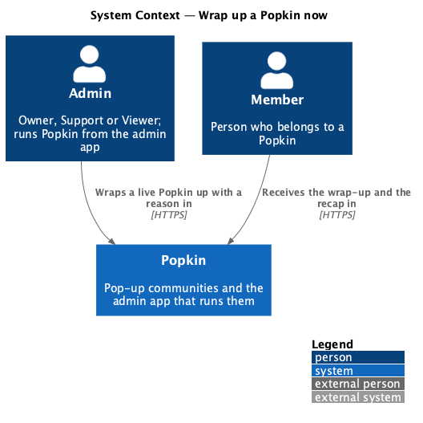
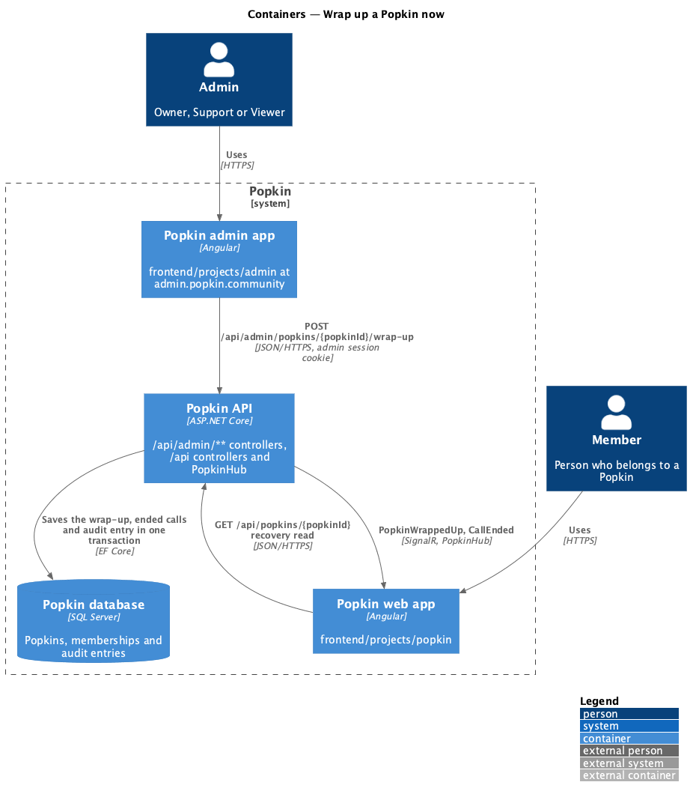
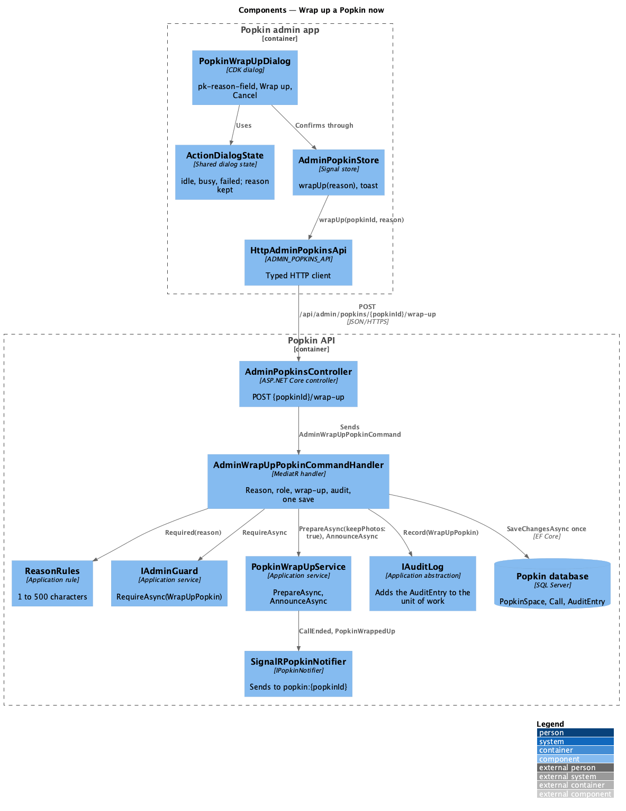
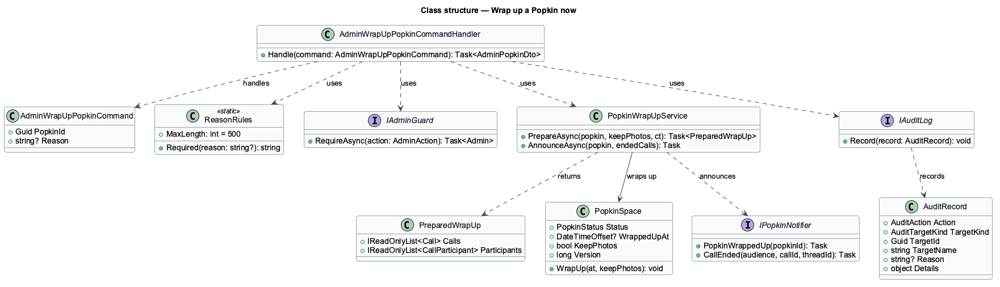
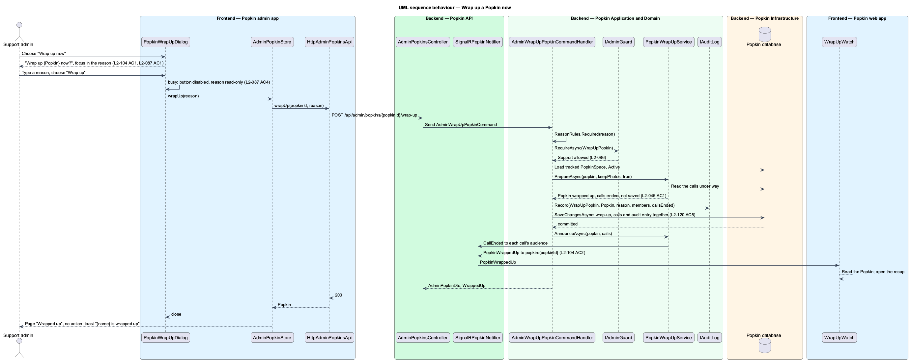
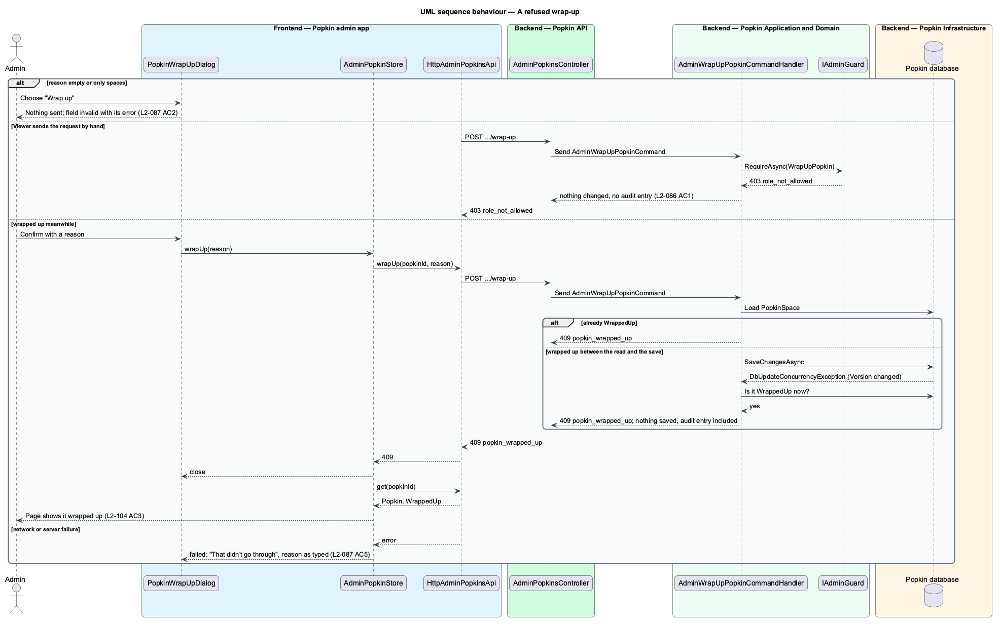

# Wrap up a Popkin now

## Overview

A Popkin ends when its Host wraps it up (L2-043) or when its time is up (L2-044). Sometimes
neither can happen in time: the Host asks support to end it and cannot reach the button, or a
Popkin is being used against its members. *Wrap up now* lets an Owner or Support admin end a live
Popkin from its admin page, exactly as its Host could, with the photo album kept.

- **wrap-up** — the change that ends a Popkin: it becomes read-only, every call under way in it
  ends, and every member gets the recap (L2-043, L2-045)
- **album kept** — wrap-up after which the photos stay for members to browse and save
  (`PopkinSpace.KeepPhotos == true`)
- **reason** — what the admin writes to say why, 1 to 500 characters, kept in the audit log with
  the change (L2-087)

The admin's wrap-up reuses `PopkinWrapUpService`, the service behind the Host's wrap-up and the
wrap-up by time ([The Host wraps up](../../wrap-up/host-wraps-up/README.md)). Members cannot tell
an admin's wrap-up from their Host's: they receive `PopkinWrappedUp`, their screens move to the
recap, and the album stays. The action is `AdminAction.WrapUpPopkin`, allowed to Owner and
Support (L2-086).

## Description

### Screens and states

- `docs/mocks/admin/dialogs/popkin-wrap-up/default.html` — `pk-dialog` "Wrap up Lakeside
  Weekend now?", "Chat and calls close for all 10 members and everyone gets the wrap-up card.
  This can’t be undone, though the album stays available.", the reason field "Reason, for the
  audit log" with the focus in it and the placeholder "e.g. Host asked to end early", the danger
  button "Wrap up" and "Cancel" (L2-104 AC1, L2-087 AC1).
- `busy.html` — the reason read-only, "Wrap up" disabled with `aria-busy="true"`, "Cancel"
  disabled (L2-087 AC4).
- `invalid.html` — the field marked `aria-invalid` with its error (L2-087 AC2).
- `failed.html` — `pk-alert` "That didn’t go through" over the description, the reason as typed
  (L2-087 AC5).
- `docs/mocks/admin/pages/popkin/wrapped-now.html` — the page after it: "Wrapped up", "Ended",
  "Wrapped up 28 Jul", no action, and the toast "Lakeside Weekend is wrapped up" with "Members
  got the wrap-up card and the album stays downloadable." (L2-104 AC2).
- Under 640 px the dialog is a bottom sheet (L2-089 AC4).

### API

- `POST /api/admin/popkins/{popkinId}/wrap-up` — body `{ reason }`; `200` `AdminPopkinDto` of
  the wrapped-up Popkin ([A Popkin](../view-popkin/README.md)).
  Failures: `400` `reason_required`, `reason_too_long`; `401`; `403` (Popkin app session);
  `403` `role_not_allowed`; `404` `popkin_not_found`; `409` `popkin_wrapped_up` (L2-104 AC3).
- Real time: `PopkinWrappedUp` to group `popkin:{popkinId}` and `CallEnded` to each ended
  call's audience, after the commit, as for the Host's wrap-up. The admin app receives no event.

### Backend

- **`AdminWrapUpPopkinCommand`** / **`AdminWrapUpPopkinCommandHandler`**
  (`Popkin.Application/Admin/Popkins/AdminWrapUpPopkin.cs`, new) — in order:
  1. `ReasonRules.Required(request.Reason)` — `400` `reason_required` or `reason_too_long`.
  2. `IAdminGuard.RequireAsync(AdminAction.WrapUpPopkin)` — `403` `role_not_allowed` and nothing
     changes (L2-086 AC1).
  3. Load the tracked `PopkinSpace`, or `404` `popkin_not_found`; a wrapped-up one is `409`
     `popkin_wrapped_up` (L2-104 AC3).
  4. `PopkinWrapUpService.PrepareAsync(popkin, keepPhotos: true)` — wraps the Popkin up and ends
     every call under way, without saving (L2-045 AC1).
  5. `IAuditLog.Record` — action `AuditAction.WrapUpPopkin`, target `Popkin` with its id and
     name, the reason, and `Details` `{ members, callsEnded, keepPhotos: true }` (L2-104 AC4).
  6. One `SaveChangesAsync`: the wrap-up, the ended calls and the audit entry commit together
     (L2-120 AC5).
  7. `PopkinWrapUpService.AnnounceAsync(popkin, calls)` — `CallEnded`, then `PopkinWrappedUp`.
  8. Answer `GetAdminPopkinQuery`'s DTO of the Popkin as saved.
- **A wrap-up that loses the race.** `PopkinSpace.Version` is a concurrency token. When the
  Host's wrap-up or the wrap-up by time is saved first, the save throws
  `DbUpdateConcurrencyException`; the handler checks the Popkin is wrapped up and answers `409`
  `popkin_wrapped_up`. Nothing of the request is saved, the audit entry included, so no entry
  says a wrap-up succeeded that did not (L2-120 AC5).
- **Why `PrepareAsync` and not `WrapUpAsync`.** `WrapUpAsync` saves itself; the audit entry has
  to be in that same save, so the handler prepares, records and saves, as
  `DeleteAccountCommandHandler` does with the Popkins an account hosts.
- **The recap.** The Popkin's recap and its album export follow from the wrap-up as for the Host
  ([Recap](../../wrap-up/recap/README.md)); the crew invite of L2-046 stays the Host's.
- **`AdminPopkinsController`** — `POST {popkinId}/wrap-up` sends the command.

### Frontend (Popkin admin app)

- **`PopkinWrapUpDialog`** (`frontend/projects/admin/src/app/dialogs/popkin-wrap-up/popkin-wrap-up.dialog.ts`
  and `.html`, new) — `pk-dialog` with the Popkin's name and member count in its title and
  description, `pk-reason-field` and `pk-button` (danger). It uses `ActionDialogState`: a reason
  empty or only spaces sends nothing and marks the field (L2-087 AC2); the confirmed request makes
  "Wrap up" busy and the reason read-only (AC4); a failure returns to `failed` with the reason
  kept (AC5); success closes the dialog with the answer.
- **`AdminPopkinStore.wrapUp(reason)`** — calls `AdminPopkinsApi.wrapUp(popkinId, reason)`,
  replaces the Popkin with the answer and raises the toast "{name} is wrapped up". On `409`
  `popkin_wrapped_up` it closes the dialog, reads the Popkin again and shows it wrapped up
  (L2-104 AC3); the toast for that case is `<TO SUPPLY>`.
- The page then hides every action (`popkinActions`, L2-103 AC4) and the focus returns to the
  page head, because the button that opened the dialog no longer exists (`<TO SUPPLY>` if the
  owner prefers another target).

### Frontend (Popkin web app)

- Nothing new. `WrapUpWatch` already moves every member with the Popkin open to the recap on
  `PopkinWrappedUp`, and the call screen closes on `CallEnded`
  ([Time is up](../../wrap-up/time-is-up/README.md), [Read-only Popkin](../../wrap-up/read-only-popkin/README.md)).

### Decisions and conflicts

- **The reason's error and failure copy.** The mocks read "Say why, in a few words. The reason
  goes in the audit log." and "Nothing changed." with a request to check the connection; L2-087 AC2
  and AC5 give "Give a reason; it goes in the audit log." and "Nothing has changed." with the
  sentence that the reason is kept. The requirement stands and the mocks change. The mocks also
  lack the hint "Other admins see it in the audit log." (L2-087 AC1) and the 500-character limit
  (AC6), which `pk-reason-field` adds.
- **"The wrap-up card".** The mock says members get "the wrap-up card"; the Popkin app calls it
  the recap (L2-046). The copy is the mock's; the term in code is recap.

### Tests

- API: `AdminWrapUpPopkinTests` — a Support admin wraps up a live Popkin with its album kept and
  every call ended, and a hub client in the Popkin's group receives `PopkinWrappedUp` (ADR 0010,
  awaited with a timeout); a Viewer is refused `403` `role_not_allowed` with nothing changed and
  no audit entry; an empty reason `400`; a wrapped-up Popkin `409`; the audit entry holds the
  reason.
- Application: the race, with a fault injected through `IAppDbContext` that fails the save as a
  concurrency conflict, answers `409` and writes no entry.
- Playwright: `e2e/tests/admin/popkin-wrap-up.spec.ts` with
  `e2e/pages/admin/popkin-wrap-up.dialog.ts`.

## Requirements

| L2 ID | Refines (L1) | Requirement |
|-------|--------------|-------------|
| `L2-104` | `L1-023` | Wrap up a Popkin now: An admin ends a Popkin, as its Host could. (AC1–AC4) |
| `L2-087` | `L1-028` | A reason for every change: An admin says why they change something, and the audit log keeps it. (AC1, AC2, AC4–AC7) |
| `L2-086` | `L1-028` | Admin roles: Every admin has one role, and the API, not the screen, decides what it allows. (AC1) |
| `L2-120` | `L1-028` | Audit log: Every action in the console, with who did it and why. (AC5, AC7) |

## Diagrams

### System context

An admin wraps a Popkin up from the admin app; its members receive the wrap-up in the Popkin app.

### Containers

The admin app posts the wrap-up; the API saves it with its audit entry and tells the members'
web apps through `PopkinHub`.

### Components

`AdminWrapUpPopkinCommandHandler` checks the reason and the role, then uses
`PopkinWrapUpService` and `IAuditLog` in one unit of work.

### Class structure

The command carries the reason; the handler depends on the guard, the wrap-up service and the
audit log.

### Behaviour — wrap up now

The admin confirms with a reason; the Popkin, its calls and the audit entry are saved together,
and every member is told (L2-104 AC1, AC2, AC4).

### Behaviour — refused or wrapped up meanwhile

An empty reason sends nothing; a Viewer is refused; a Popkin that wrapped up meanwhile answers
`409` and the page shows it wrapped up (L2-104 AC3, L2-087 AC2, L2-086 AC1).

