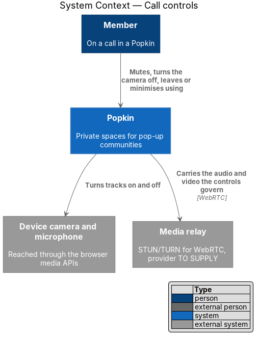
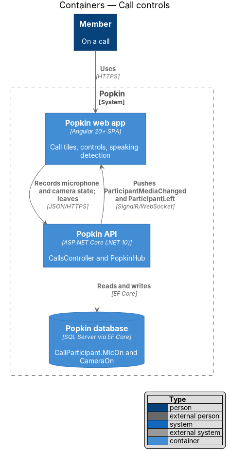
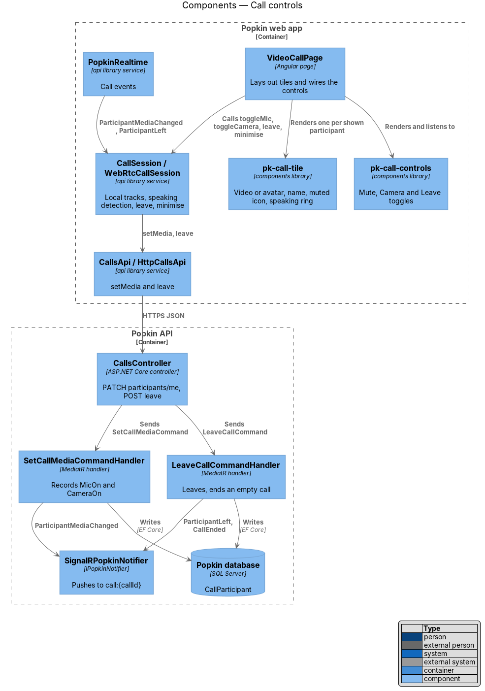
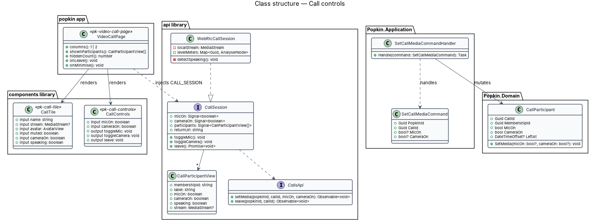
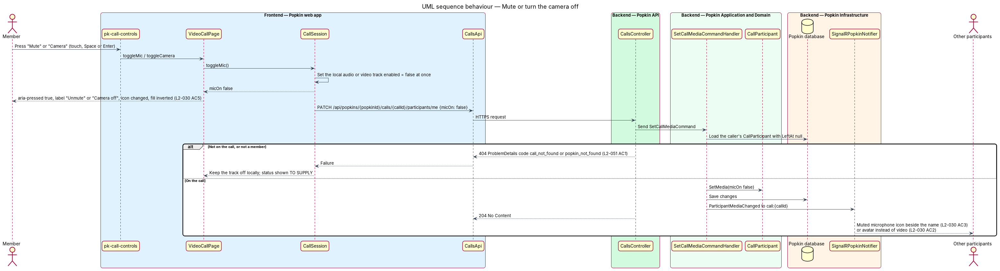
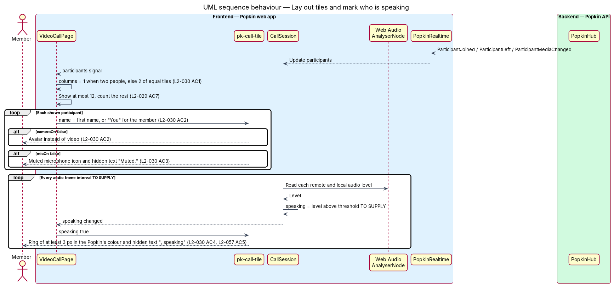
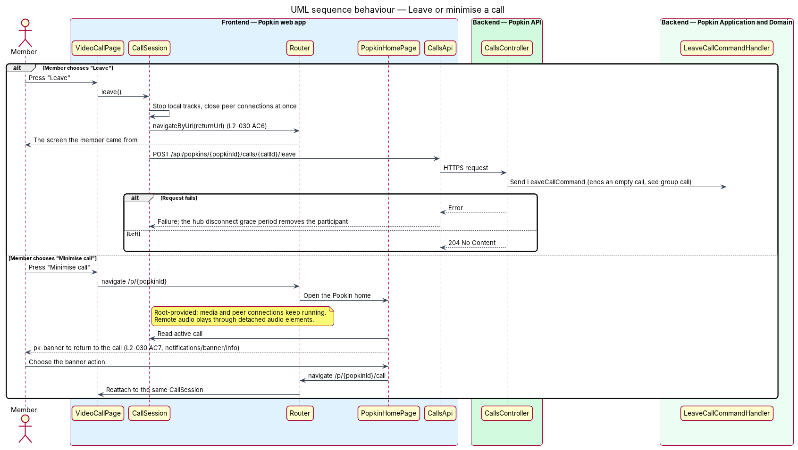

# Call controls

## Overview

Popkin is a free platform for pop-up communities. Its members may hold a video call for the
whole Popkin. The feature [start or join a group call](../group-call/README.md) brings a member
onto a call. This feature covers what the member sees and controls once there: the tiles of the
people on the call, their own microphone and camera, leaving, and minimising the call to keep it
running while using the rest of the Popkin. A call between the two members of a direct message
uses the same screen and is not built (journey 11).

- **tile** — square on the call screen for one participant. It shows their video, or their
  avatar when the camera is off, and carries their first name.
- **speaking ring** — outline of at least 3 px in the Popkin's colour round the tile of a person
  who is speaking
- **control** — button in the bar at the foot of the call screen: "Mute", "Camera" or "Leave"
- **minimise** — leaving the call screen for the Popkin home while the call keeps running
- **pane** — list of who is on the call, at the end of the screen from 1280 px (L2-058 AC12)

Each person controls only their own microphone and camera. The browser turns the local track off
at once, before any request, so no audio or video leaves the device after the press. The Popkin
API then records the new state, and the other participants show the muted icon or the avatar.
Speaking is measured in each browser, from the member's own microphone and from the sound it
receives; the server plays no part in it, and nothing is recorded or sent.

## Description

### Screens and states

- `docs/mocks/pages/video-call/default.html` — six people in two columns, "Walt, speaking" with
  the speaking ring, Ruth and Sam with avatars, Sam muted, controls "Mute", "Camera", "Leave",
  and "Minimise call" in the top bar.
- `docs/mocks/pages/video-call/two.html` — two people in one column, side by side from 640 px
  (L2-030 AC1). The mock is the direct call; the group call with two on it uses the same layout.
- `docs/mocks/pages/video-call/muted.html` — the member muted: the control reads "Unmute",
  `aria-pressed="true"`, and the member's tile shows the muted icon (L2-030 AC3, AC5).
- `docs/mocks/pages/video-call/camera-off.html` — the member's camera off: the control reads
  "Camera off" and the member's tile shows their avatar, their photo when they have one
  (L2-030 AC2, AC5). The mock was changed in journey 7 to draw the photo avatar.
- `docs/mocks/notifications/banner/info.html` — the Popkin home with the call banner, the screen
  "Minimise call" leads to (L2-030 AC7).

The mock banner offers "Join". A member who is on the call, having minimised it, is offered
"Return" instead ([Group call](../group-call/README.md)); that label has no mock. Neither has
the tile that counts the people not shown, which the design system draws
(`docs/design-system/components/call-tile.html`).

### API

- `PATCH /api/popkins/{popkinId}/calls/{callId}/participants/me` with `{ micOn?: boolean,
  cameraOn?: boolean }` — `204 No Content`. Each value is recorded only when given; a state
  that is held already changes nothing and is not announced. Errors: `404 popkin_not_found`
  (L2-051 AC1), `404 call_not_found` when the caller is not on the call,
  `400 validation_failed` when neither value is given (L2-052 AC1).
- `POST /api/popkins/{popkinId}/calls/{callId}/leave` — `204 No Content`; defined by
  [start or join a group call](../group-call/README.md).
- `PopkinHub` event `ParticipantMediaChanged(callId, membershipId, mediaVersion, micOn,
  cameraOn)` on `call:{callId}`. It is a state event: it carries both values in full and
  `CallParticipant.MediaVersion`, and a client drops one whose version is not above the one it
  holds for that participant.

### Frontend

- **`VideoCallPage`** — the page from the group call design. It passes `CallSession`'s tiles to
  `pk-call-grid`, its roster to `pk-call-aside`, and the member's microphone and camera to
  `pk-call-controls`; it handles `leave`. Each tile is labelled with the participant's first
  name, or "You" for the member (L2-030 AC2).
- **`pk-call-screen`** — `components` library, the `screen--stage` block of
  `docs/design-system/components/screen.html`: the dark stage, as wide and as tall as the
  window, with slots for the top bar, the controls and the pane. Its `layout` is `message`,
  `alone` or `call`.
- **`pk-call-grid`** — `components` library, block `call-grid`, a list labelled "On the call".
  Its `count` picks the columns (L2-030 AC1): one tile fills the grid; two are one above the
  other, and side by side from 640 px; three or four are in two columns; five and more are in
  two columns, and three from 640 px. The stylesheet picks by width; nothing reads the viewport.
- **`pk-call-tile`** — `components` library, block `call-tile`, from the design-system page
  "Call tile and controls" (`docs/design-system/components/call-tile.html`). Inputs: `name`,
  `stream`, `avatar`, `muted`, `cameraOff`, `speaking` and `rest`. It plays the stream in a
  `<video>` without sound, or shows `pk-avatar` when the camera is off or nothing has arrived
  yet. A muted tile shows the mic-off icon with the hidden text "Muted,". A speaking tile takes
  the modifier `call-tile--speaking`, which draws the ring, and the hidden text ", speaking".
  Colour is therefore never the only carrier (L2-057 AC5). With `rest` the tile is no person:
  it counts the people not shown (`call-tile--rest`).
- **More than 12 on a call** (L2-029 AC7) — `shownOnCall` (`calls/call-text.ts`) gives everyone
  a tile up to 12. From 13, the first 11 people in the order they joined have a tile, the
  member always among them, and the twelfth tile counts the rest: "4 more on the call". The
  stage never holds more than 12 tiles. The pane lists everyone.
- **`pk-call-controls`** — `components` library, block `call-controls`, from the same
  design-system page. "Mute" and "Camera" are `<button aria-pressed>`. On press they change
  icon and label ("Unmute", "Camera off") and invert their fill (L2-030 AC5). "Leave" is the
  `call-control--leave` variant, named "Leave call". Each carries its label under it at every
  width, and each target is at least 44 by 44 px on touch (L2-057 AC4). The component only
  shows and tells; the page gives it the state that results.
- **`pk-call-aside`** — `components` library, block `call-aside`: the pane "On the call", from
  1280 px, with each person's name in full, the member's own ending "(you)", and their
  microphone as an icon and in words: "Speaking", "Microphone on" or "Muted". Under the list a
  line says who else could join: "Everyone in {Popkin} is on the call." or "{n} others in
  {Popkin} can join anytime." ("1 other" for one). Below 1280 px the pane is absent, from
  assistive technology too.
- **`pk-stage-message`** — `components` library, block `stage-message`: what the stage says in
  place of its content, for the joining, waiting, permission and failure states of the group
  call design.
- **`CallSession`** — the root-provided class from the group call design. For this feature it
  has `toggleMic()`, `toggleCamera()`, `leave()`, the signals `micOn`, `cameraOn`, `tiles`,
  `more`, `roster` and `others`, and the `returnUrl` given when the call opened. A switched-off
  microphone or camera disables the track itself, so nothing is sent.
- **Speaking** — `SpeakingMeter` / `SPEAKING_METER` / `BrowserSpeakingMeter`
  (`calls/speaking-meter.ts`, `calls/browser-speaking-meter.ts`): one Web Audio `AnalyserNode`
  per person, the member included. Every 150 ms it takes the level of each, the root mean
  square of the samples on a scale of 0 to 1 (`soundLevel`, `calls/sound-level.ts`, with unit
  tests). A level of 0.04 or more counts as speech, and a person still counts as speaking for
  600 ms after their last sound, the pause between words. A person whose microphone is recorded
  as off is never shown speaking. A browser that cannot measure draws no ring, and the call
  goes on.
- **Sound** — what the others say is played by one audio element per link that
  `WebRtcPeerLinks` makes and attaches to no screen, so it is heard while the call is
  minimised. The tiles play pictures without sound.
- **`CallsApi`** — gains `setMedia(popkinId, callId, media)`, which sends both values.
- **Coalescing** — microphone and camera state is replaceable: each new state replaces the one
  before it. While a `PATCH` is in flight, `CallSession` keeps only the newest state the member
  chose and sends it when the request returns, so five quick presses cost two requests and end
  on the last press. Signals are the opposite and are never coalesced
  ([Group call](../group-call/README.md)). The echo of the member's own change, which the hub
  sends back, changes nothing.
- **`pk-top-bar`** — its back link is "Minimise call", a chevron pointing down that opens the
  Popkin home; "Invite to call" is a `pk-icon-button` with the word "Invite" beside its icon.

### Backend

- **`CallsController`** — the `PATCH …/participants/me` action.
- **`SetCallMediaCommand` / `SetCallMediaCommandHandler`** (`Calls/SetCallMedia.cs`) — loads the
  caller's membership through `IMembershipGuard`, and their `CallParticipant` whose `LeftAt` is
  empty, or answers `404 call_not_found`. It calls `CallParticipant.SetMedia`, saves, and sends
  `ParticipantMediaChanged` with the new `MediaVersion` through `IPopkinNotifier`. There is no
  validator class: the handler checks.
- **`CallParticipant`** — `SetMedia(micOn?, cameraOn?)` returns whether anything changed and
  raises `MediaVersion` when it did. The fields `MicOn` and `CameraOn` come from the group call
  design.
- **`CallLeaver`** — from the group call design. It ends the call when the last participant
  leaves (L2-029 AC6).

### Behaviour notes

- "Leave" stops the local tracks and closes the links before the request returns, then opens
  the screen of the app the member came from, or the Popkin home when the call was opened by
  its address (L2-030 AC6). A failed leave request leaves the participant row to the hub's
  disconnect grace period.
- "Minimise call" opens the Popkin home, whatever screen the call was opened from. The call
  keeps running in `CallSession`, and the banner there offers "Return" (L2-030 AC7).
- When the `PATCH` fails, the local track stays as the member set it; the device never resumes
  sending after a failure. The failure is not shown, and the request is not made again until
  the member next changes the microphone or the camera; until then the others see the earlier
  state (gap 29 in [the register](../../README.md#known-gaps)).
- The direct call would use the same page and controls (L2-030 AC8). It is not built
  (journey 11).

### Tests

- API integration tests on InMemory: `Popkin.Api.Tests/Calls/CallMediaTests.cs`.
- Unit tests of `CallSession` (the tiles, the roster, coalescing, the rejoin), of `shownOnCall`,
  `callGrid`, `othersLine` and `micWords` in `call-text.ts`, and of `soundLevel` and
  `heardSpeaking` in `sound-level.ts`.
- Playwright: `e2e/tests/call-controls.spec.ts` covers the tiles, the layout at each width, the
  pane, the controls by pointer and by keyboard, "Leave", "Minimise call" and the return of a
  dropped connection.
- A parity spec per component, in `e2e/tests/parity/`: `call-screen`, `call-grid`, `call-tile`,
  `call-controls`, `call-aside` and `stage-message`.

### Built in journey 7

Everything above except the direct call (L2-030 AC8), which waits for journey 11.

Decided in the build:

- The banner of a member who minimised reads "Return".
- Speaking: sampled every 150 ms, at a level of 0.04, held for 600 ms.
- Above 12 people: 11 tiles and "{n} more on the call"; the member always has a tile.
- "Leave" returns to the screen of the app the member came from, else the Popkin home.
- The line under the pane, and the copy of a call that cannot be joined
  ([Group call](../group-call/README.md)).

One gap was found: a failed `PATCH` of the microphone or camera is neither shown nor retried
(gap 29 in [the register](../../README.md#known-gaps)).

The diagrams below were not redrawn. They show the design as it stood before the build:
`WebRtcCallSession` behind a `CallSession` contract where there is now the one class
`CallSession`, without `PeerLinks`, `SpeakingMeter`, `pk-call-grid`, `pk-call-aside` and the
tile that counts the rest, and with the direct call.

## Requirements

| L2 ID | Refines (L1) | Requirement |
|-------|--------------|-------------|
| `L2-030` | `L1-008` | Call controls: Each person controls their own microphone and camera. |
| `L2-029` | `L1-008` | Start or join a group call: One tap puts the whole Popkin on a video call. |
| `L2-057` | `L1-014` | Accessible to WCAG 2.2 AA: Everyone can use every screen. |
| `L2-059` | `L1-014` | Light and dark themes: Popkin follows the device and the person. |

From `L2-029` this feature realises AC7 (at most 12 tiles). `L2-030` AC8, the direct call, is
not built (journey 11). From `L2-057` it realises AC4 and AC5 for the call screen, and from
`L2-059` AC3 (dark in both themes). The pane realises `L2-058` AC12 for this screen
([Responsive layout](../../accessibility/responsive-layout/README.md)).

## Diagrams

### System context

The member drives their own camera and microphone through Popkin. The media relay carries the
audio and video the controls govern.

### Containers

The web app records microphone and camera state in the Popkin API. The API pushes the change to
the other participants over `PopkinHub`.

### Components

`VideoCallPage` composes `pk-call-grid`, `pk-call-tile`, `pk-call-controls` and `pk-call-aside`
and delegates to `CallSession`. `CallsController` dispatches to `SetCallMediaCommandHandler` and
`LeaveCallCommandHandler`.

### Class structure

The page depends on the class `CallSession`, whose browser parts are behind `CALL_MEDIA`,
`PEER_LINKS` and `SPEAKING_METER`. The presentation components take plain inputs. `SetCallMediaCommandHandler` mutates
`CallParticipant`.

### Behaviour — mute or turn the camera off

The track goes off locally first and the control shows its pressed state (L2-030 AC5). The
server then records the change and tells the other participants (L2-030 AC2, AC3).

### Behaviour — lay out tiles and mark who is speaking

The grid picks its columns from the number of tiles and the width: one for two people (two from
640 px), two for three or four, two for five or more (three from 640 px) (L2-030 AC1). Each
browser measures audio levels and rings the tile of a person who is speaking (L2-030 AC4).

### Behaviour — leave or minimise a call

"Leave" ends the member's part at once and returns to the screen the member came from
(L2-030 AC6).
"Minimise call" opens the Popkin home, keeps the call running and offers a banner back to it
(L2-030 AC7).

