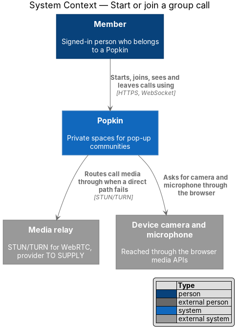
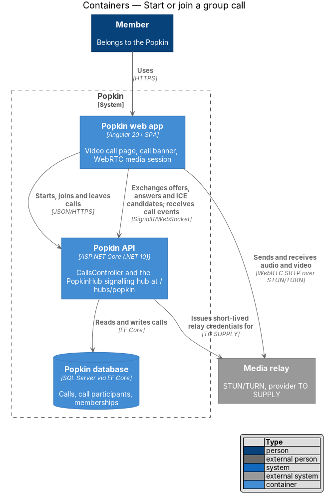
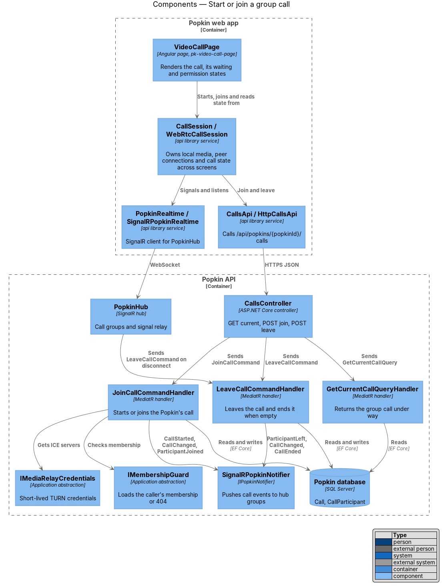
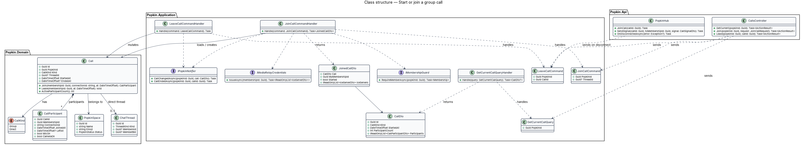
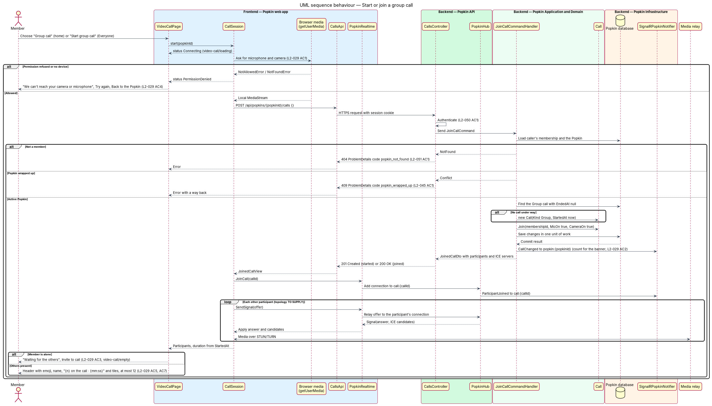
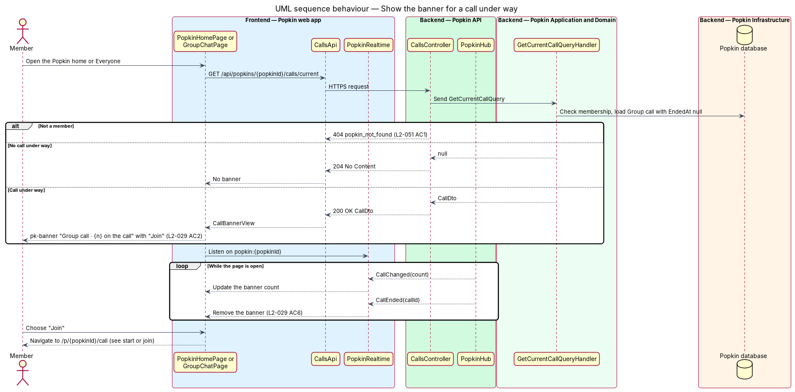
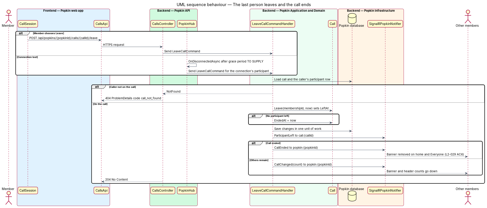
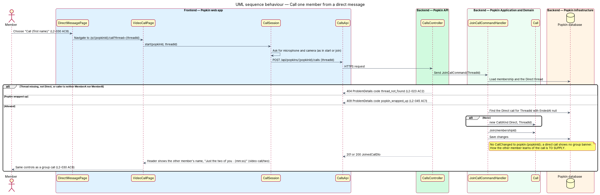

# Start or join a group call

## Overview

Popkin is a free platform for pop-up communities. Each Popkin is a private space for one group,
and its members chat, call, share photos and rate experiences together. This feature covers how
a call begins and ends. A member starts a video call for the whole Popkin with one tap, others
join it from a banner, and a member may also call one other member from a direct message.

- **group call** — video call open to every member of one Popkin (L1 Terms)
- **direct call** — video call between the two members of one direct message
- **call under way** — call with at least one participant whose `LeftAt` is empty
- **participant** — member who is on a call
- **call banner** — line on the Popkin home and in the Everyone thread that says how many are on
  the group call under way and offers "Join"
- **signalling** — exchange of WebRTC session descriptions (offer, answer) and ICE candidates
  that lets two browsers set up a media path
- **media relay** — external STUN/TURN service that lets browsers find a path to each other and
  relays media when a direct path fails

Audio and video travel over WebRTC between browsers. The Popkin API never carries media. It
records who is on which call, relays signalling over the existing SignalR hub `PopkinHub`, and
hands each participant short-lived credentials for the media relay. The media topology, a mesh of
peer connections or a selective forwarding unit (SFU), is `<TO SUPPLY>`. The specs do not settle
it. L2-029 AC7 implies calls larger than 12 people, which a mesh serves poorly on phones. The
frontend hides the topology behind one service, `CallSession`, so either choice keeps the pages
and the API contract unchanged.

The companion feature [call controls](../call-controls/README.md) covers the tiles, mute, camera,
leave and minimise (L2-030). This feature owns the call's life: start, join, the banner, the
waiting and permission states, the direct call, and the end of the call.

## Description

### Screens and states

- `docs/mocks/pages/video-call/loading.html` — "Connecting…", "Joining the call…" with a spinner
  while media and the join request are in flight.
- `docs/mocks/pages/video-call/default.html` — the header "🏕️ Lakeside Weekend", "6 on the call ·
  12:48", and the tiles (L2-029 AC5).
- `docs/mocks/pages/video-call/empty.html` — "Just you · 0:12", "Waiting for the others" and
  "Invite to call" (L2-029 AC3).
- `docs/mocks/pages/video-call/error.html` — "Not connected", "We can't reach your camera or
  microphone", "Try again" and "Back to the Popkin" (L2-029 AC4).
- `docs/mocks/pages/video-call/two.html` — the direct call: the header names the other member,
  "Just the two of you · 12:48".
- `docs/mocks/notifications/banner/info.html` — the call banner on the Popkin home: "Group call ·
  6 on the call" with "Join" (L2-029 AC2).
- Entry points: "Group call" on `docs/mocks/pages/popkin-home/default.html`, "Start group call" on
  `docs/mocks/pages/group-chat/default.html`, "Call Walt" on
  `docs/mocks/pages/direct-message/default.html`.

The mocks do not show the overflow when more than 12 people are on a call (L2-029 AC7). The
wording of the "+N more" count and which 12 people are shown are `<TO SUPPLY>`. No mock shows the
call banner inside the Everyone thread; the design reuses the home banner there.

### API

- `GET /api/popkins/{popkinId}/calls/current` — `200 OK` with a `CallDto` for the group call
  under way, or `204 No Content`. `404 popkin_not_found` for a non-member.
- `POST /api/popkins/{popkinId}/calls` with `{ threadId?: Guid }` — starts or joins.
  `201 Created` when the call starts, `200 OK` when the caller joins one under way. Body:
  `JoinedCallDto`. Errors: `404 popkin_not_found`, `404 thread_not_found`,
  `409 popkin_wrapped_up`, `400` with a `code` for a malformed body (L2-052 AC1).
- `POST /api/popkins/{popkinId}/calls/{callId}/leave` — `204 No Content`. `404 call_not_found`
  when the caller is not on that call.
- `PopkinHub` (`/hubs/popkin`): client method `JoinCall(callId)`, called with `invoke` because
  the caller needs the outcome, and `SendSignal(callId, toMembershipId, signal)`, called with
  `send`. Server events `CallChanged(callId, version, participantCount)` and `CallEnded(callId)`
  on `popkin:{popkinId}`; `ParticipantJoined`, `ParticipantLeft`, `Signal` on `call:{callId}`.
  A refused hub call fails with the ProblemDetails `code` of the same refusal over HTTP
  (`popkin_not_found`, `call_not_found`, `validation_failed`, `rate_limited`).

### Frontend (`frontend/projects/popkin`, `api`, `components`)

- **`VideoCallPage`** — introduced. `pages/video-call/video-call.page.ts`, selector
  `pk-video-call-page`, route `/p/:popkinId/call` with route data `{ shell: 'bare', page:
  'video-call' }`. An optional `thread` query parameter selects a direct call. The page reads
  `CallSession` state and composes `pk-top-bar`, `pk-call-tile`, `pk-call-controls`,
  `pk-empty-state`, `pk-progress` (spinner) and `pk-button`. It declares no presentation of its
  own (ADR 0007). The stage is dark in both themes (L2-059 AC3).
- **`CallSession` / `CALL_SESSION` / `WebRtcCallSession`** — introduced in the `api` library and
  provided in root, so a call outlives the page (minimise, L2-030 AC7). It asks the browser for
  the microphone and camera, calls `CallsApi`, joins the hub group, runs signalling and owns every
  `RTCPeerConnection`. It exposes signals: `status` (`Connecting`, `Connected`,
  `PermissionDenied`, `Failed`), `call` (`CallView`), `participants` (`CallParticipantView[]`)
  and `elapsed`. The elapsed time counts from the server's `StartedAt` (L2-029 AC5).
- **`CallsApi` / `CALLS_API` / `HttpCallsApi`** — introduced. `getCurrent(popkinId)`,
  `join(popkinId, threadId?)`, `leave(popkinId, callId)`.
- **`PopkinRealtime` / `POPKIN_REALTIME` / `SignalRPopkinRealtime`** — the shared real-time client.
  This feature adds `joinCall`, `sendSignal` and the call events listed above.
- **View models** (`lib/models/`) — `CallView` (id, kind, startedAt, participantCount, title),
  `CallParticipantView` (membershipId, firstName or "You", avatar, micOn, cameraOn, stream),
  `CallBannerView` (callId, participantCount).
- **Call banner** — `PopkinHomePage` and `GroupChatPage` read `CallsApi.getCurrent`, listen for
  `CallChanged` and `CallEnded`, and show `pk-banner` with "Join". The banner goes for everyone
  when the call ends (L2-029 AC6).
- **"Call {first name}"** — `DirectMessagePage` navigates to `/p/:popkinId/call?thread={threadId}`
  (L2-030 AC8).

### Backend

- **`CallsController`** — introduced, `/api/popkins/{popkinId}/calls`. Requires an authenticated
  caller through the fallback policy (L2-050 AC1) and dispatches to MediatR.
- **`JoinCallCommand` / `JoinCallCommandHandler` / `JoinCallCommandValidator`** — introduced. The
  handler loads the caller's membership through `IMembershipGuard`, so a non-member gets
  `404 popkin_not_found` (L2-051 AC1). It refuses a wrapped-up Popkin with
  `409 popkin_wrapped_up` (L2-045 AC1). It finds the `Call` under way of the requested kind or
  creates one, adds a `CallParticipant` with `MicOn` and `CameraOn` set, and saves in one unit of
  work, which raises `Call.Version`. For a group call it pushes `CallChanged` with that version
  to `popkin:{popkinId}`. It returns the call,
  the participants and the ICE servers from `IMediaRelayCredentials`. A direct call requires a
  `ChatThread` of kind `Direct` whose `MemberAId` or `MemberBId` is the caller; anything else is
  `404 thread_not_found` (L2-023 AC2).
- **`LeaveCallCommand` / `LeaveCallCommandHandler`** — introduced. Sets `LeftAt`. When no
  participant remains, sets `Call.EndedAt` and pushes `CallEnded`; otherwise pushes
  `CallChanged` with the new count.
- **`GetCurrentCallQuery` / `GetCurrentCallQueryHandler`** — introduced. Returns the group call
  under way, or `null`.
- **`PopkinHub`** — introduced by the real-time design and shared here. It refuses a connection
  without a valid session (L2-050 AC4). It is a transport: each method checks nothing itself and
  sends one MediatR request, as a controller does. `JoinCall` sends `JoinCallGroupCommand` and,
  when it succeeds, adds the connection to `call:{callId}`. `SendSignal` sends
  `RelaySignalCommand` and relays to the connection the command names.
- **`JoinCallGroupCommand` / `JoinCallGroupCommandHandler`** — introduced. Loads the caller's
  membership through `IMembershipGuard` and their `CallParticipant` whose `LeftAt` is empty, or
  fails with `call_not_found`. It records the connection as `CallParticipant.ConnectionId`.
- **`RelaySignalCommand` / `RelaySignalCommandHandler` / `RelaySignalCommandValidator`** —
  introduced. The validator holds the rules of `CallSignalDto`, as every command's does
  (L2-052 AC1): `type` is `offer`, `answer` or `candidate`; the payload is at most 32 KB for an
  offer or an answer and 2 KB for a candidate. The handler checks, through `IMembershipGuard`,
  that the caller and the target are both participants of the call, and returns the target's
  connection id. It never reads the payload. These sizes are design values, to be confirmed
  against the session descriptions the chosen topology produces in the first call slice.
- **Signals are edges.** Each `offer`, `answer` and `candidate` must arrive. The hub never
  coalesces them, never deduplicates them by content and never drops one under load; a dropped
  candidate can leave a call that never connects, and looks like an intermittent failure for a
  long time before anyone finds the cause. When a signal is refused (the limit below, or a
  target that has left), `CallSession` restarts negotiation with that participant once and then
  moves to `Failed`, which the page shows (L2-029 AC4).
- **Limits on what the hub accepts** — SignalR's maximum receive size is set to 64 KB (the
  default is 32 KB), because a session description with several media sections and the JSON
  envelope can pass the default; nothing larger is read. `SendSignal` is limited per connection
  to 600 signals a minute ([Abuse limits](../../security/abuse-limits/README.md)), well above
  what setting up a call with 12 people needs. Detailed hub errors are on in Development only.
- **Disconnect grace period** — `OnDisconnectedAsync` sends `LeaveCallCommand` for a participant
  whose connection drops, after a grace period of 20 seconds without a reconnect. The client
  retries 0, 2 and 10 seconds after a drop
  ([Live messages](../../chat/live-messages/README.md)), so its first three attempts, at 0, 2 and
  12 seconds, all fall inside the grace; a shorter grace would remove a participant whose client
  is still inside its own retry window. A participant who reconnects in time calls `JoinCall`
  again, which replaces `ConnectionId`. The grace is a timer built from `TimeProvider`, so its
  test advances the fake clock and never waits.
- **`IMediaRelayCredentials`** — introduced in `Popkin.Application.Abstractions`. Issues
  short-lived TURN credentials per participant. It is implemented in Infrastructure by
  `TurnCredentialIssuer`; the provider and the credential lifetime are `<TO SUPPLY>`.
- **`SignalRPopkinNotifier`** — implements `IPopkinNotifier` and gains `CallChangedAsync`,
  `CallEndedAsync`, `ParticipantJoinedAsync` and `ParticipantLeftAsync`.
- **Order of events** — `CallChanged` is a state event: it carries the full participant count
  and `Call.Version`, and a banner drops one whose version is not above the one it holds, so two
  joins that push out of order still end on the right count. `CallEnded` is a fact event and is
  final: a banner that has seen it for a call ignores every later `CallChanged` for that call,
  so a late event cannot bring the banner back. On `reconnected$` the banner's pages read
  `GET …/calls/current` again.
- **Domain** — `Call` (`Id`, `PopkinId`, `Kind: CallKind {Group, Direct}`, `ThreadId?`,
  `StartedAt`, `EndedAt?`, `Version`) and `CallParticipant` (`CallId`, `MembershipId`, `JoinedAt`, `LeftAt?`,
  `MicOn`, `CameraOn`). This design adds `CallParticipant.ConnectionId`, the hub connection that
  receives signals. `IAppDbContext` gains `DbSet<Call>` and `DbSet<CallParticipant>`;
  `CallConfiguration` and `CallParticipantConfiguration` map them. A unique filtered index allows
  one call under way per Popkin for `Group` and per thread for `Direct`. `Call.Version` is a
  counter the entity raises with every change to its participants. Every clock read uses
  `TimeProvider`.

### Open questions

- Media topology, mesh or SFU, and where an SFU would run: `<TO SUPPLY>`.
- Media relay provider and TURN credential lifetime: `<TO SUPPLY>`.
- How the other member learns of a direct call (ringing, notification, banner in the direct
  message): `<TO SUPPLY>`. No mock shows an incoming call.
- Whether a member may be on two calls at once, for example a direct call and the group call:
  `<TO SUPPLY>`.
- What happens to a call under way when its Popkin wraps up (L2-044 AC4 moves the screen to the
  recap): `<TO SUPPLY>`.
- The "+N more" wording and the choice of the 12 tiles shown (L2-029 AC7): `<TO SUPPLY>`.

## Requirements

| L2 ID | Refines (L1) | Requirement |
|-------|--------------|-------------|
| `L2-029` | `L1-008` | Start or join a group call: One tap puts the whole Popkin on a video call. |
| `L2-030` | `L1-008` | Call controls: Each person controls their own microphone and camera. |
| `L2-045` | `L1-011` | A wrapped-up Popkin is read-only: Nothing new is added to a Popkin that has ended. |
| `L2-050` | `L1-012` | Every request is authenticated: Nothing private is served without a session. |
| `L2-051` | `L1-012` | Popkins are private to their members: Membership decides everything a person sees. |
| `L2-059` | `L1-014` | Light and dark themes: Popkin follows the device and the person. |

From `L2-030` this feature realises AC8 only, a call from a direct message; the other criteria
belong to [call controls](../call-controls/README.md). From `L2-045` it enforces AC1 (no call can
be started), and from `L2-059` it realises AC3 for the call screen.

## Diagrams

### System context

A member reaches Popkin from a browser. The browser supplies the camera and microphone, and
media crosses the external media relay when browsers cannot reach each other directly.

### Containers

The web app calls the Popkin API over HTTPS to start, join and leave. It signals over the
`PopkinHub` WebSocket, and sends media through the media relay. The API records calls in the
Popkin database and never carries media.

### Components

`VideoCallPage` reads state from `CallSession`, which drives `CallsApi` and `PopkinRealtime`. In
the API, `CallsController` dispatches to three handlers, and `PopkinHub` sends a leave when a
participant's connection drops.

### Class structure

A `Call` owns its `CallParticipant` rows and belongs to one `PopkinSpace`. A direct call also
references one `ChatThread`. The handlers depend on the membership guard, the notifier and the
relay-credential abstraction.

### Behaviour — start or join a group call

The browser asks for the microphone and camera before any request. A refusal shows the
permission state (L2-029 AC4). Otherwise the handler finds or creates the call, adds the
participant and announces the new count for the banner. Signalling then connects the
participant to each other participant.

### Behaviour — show the banner for a call under way

The Popkin home and the Everyone thread ask for the current call. They keep the banner count
current from `CallChanged` and remove the banner on `CallEnded` (L2-029 AC2, AC6).

### Behaviour — the last person leaves and the call ends

A leave arrives from the "Leave" control or from a dropped hub connection. When the last
participant leaves, the call ends and every member's banner goes (L2-029 AC6).

### Behaviour — call one member from a direct message

"Call {first name}" in a direct message opens the same page with the thread. Only the two members
of the thread may start or join that call; anyone else receives `404 thread_not_found`.

