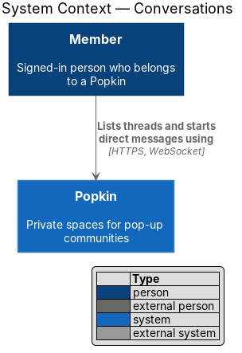
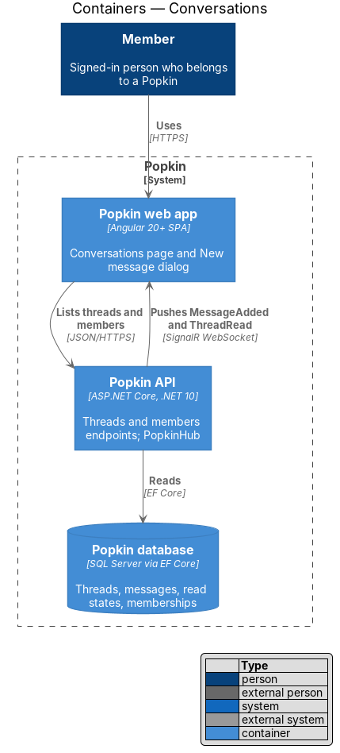
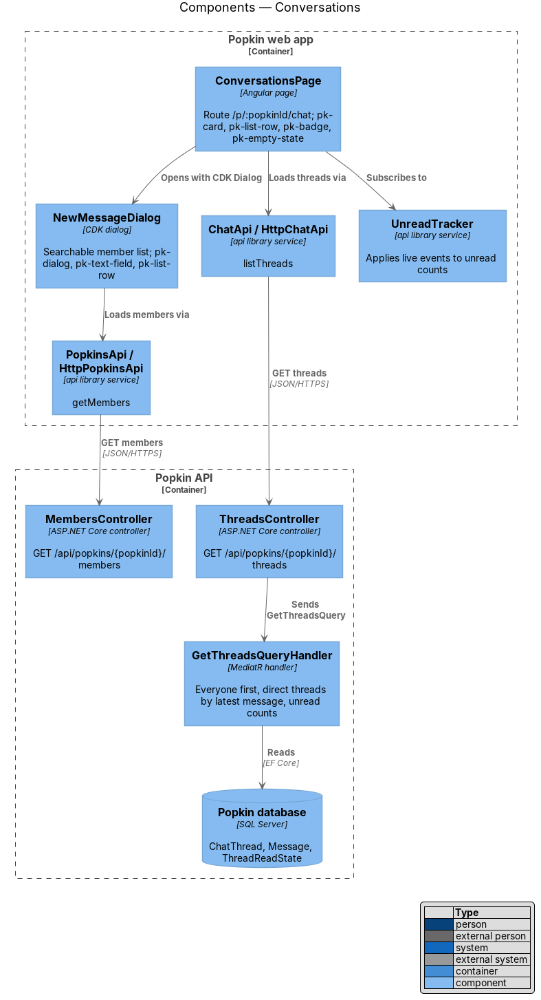
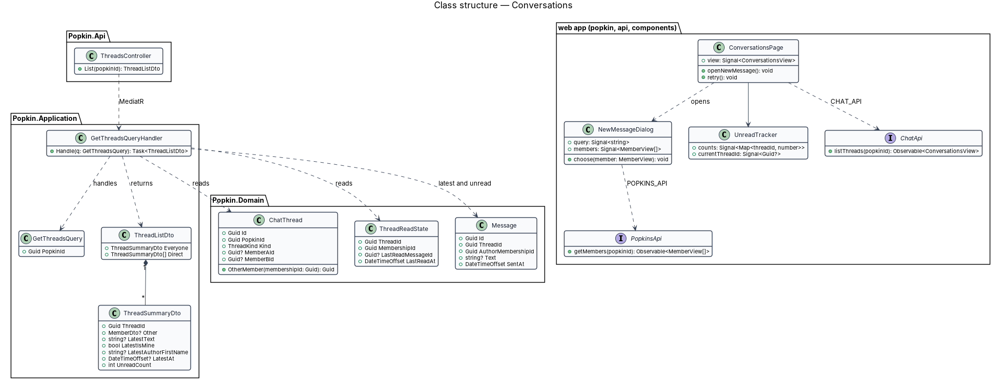
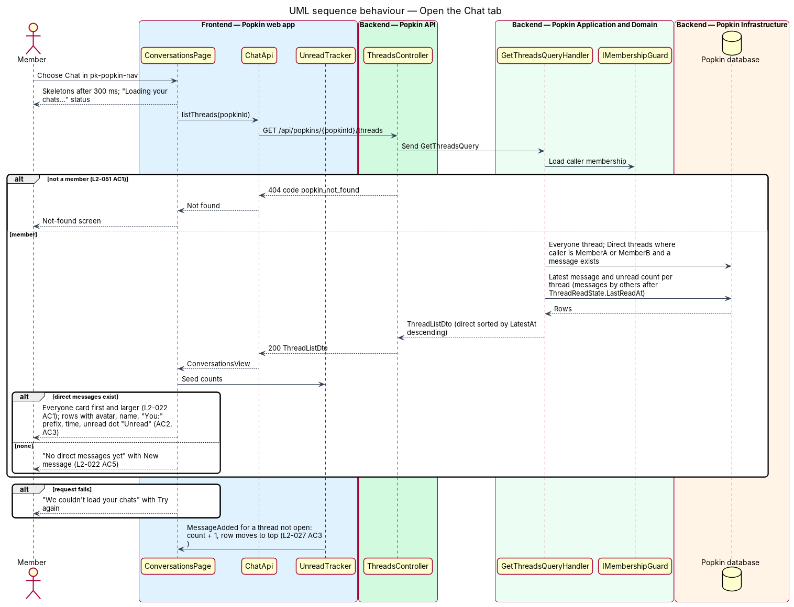
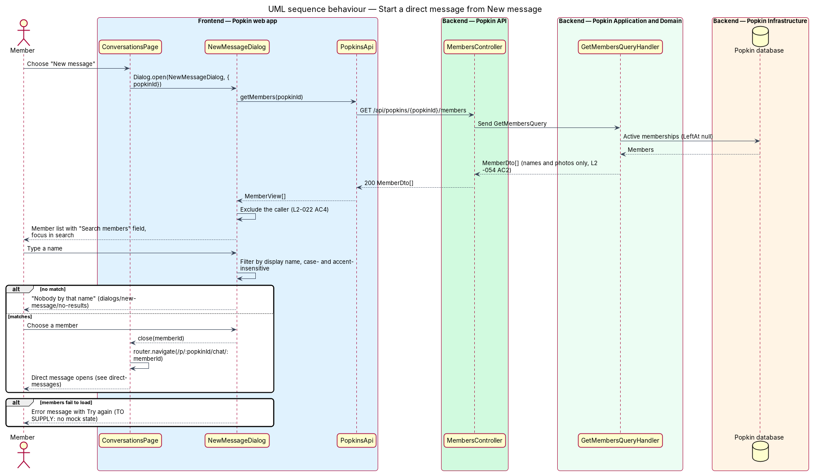

# Conversations

## Overview

A *Popkin* is a private space for one group; its *members* talk in two kinds of chat thread. The
*Everyone* thread is shared by all members; a *direct message* is a thread between two members of
the same Popkin. This feature is the Chat tab of a Popkin: the screen that lists the member's
threads in that Popkin and starts new direct messages.

- **Chat tab** — the Popkin's screen at `/p/:popkinId/chat`, reached from the Popkin navigation
- **unread count** — number of messages by other members in a thread after the member's last read point
- **last read point** — the newest message of a thread that the member has had in view, stored as `ThreadReadState`
- **New message** — dialog that lists the Popkin's other members and opens a direct message with the one chosen

The Everyone card comes first, larger than the rest and tinted in the Popkin's colour, with the
latest message, its time and the unread count. Direct messages follow under "Direct messages", the
most recent first, each with the other member's avatar and name, the latest message (prefixed "You:"
when the member sent it), its time and an unread mark. A member with no direct messages sees a short
explanation and a "New message" action. Unread counts change live as messages arrive (live-messages).
From 1024 px the Everyone thread opens beside the list.

## Description

**Screens and states:**

- `docs/mocks/pages/conversations/default.html` — Everyone card with "3 unread messages" badge; four direct-message rows, one unread with bold name and the dot "Unread"; from 1024 px the Everyone thread beside the list (L2-058 AC11).
- `docs/mocks/pages/conversations/loading.html` — card and row skeletons, status "Loading your chats…".
- `docs/mocks/pages/conversations/empty.html` — "No direct messages yet", "A direct message is between you and one other member. Nobody else can see it." and "New message" (L2-022 AC5).
- `docs/mocks/pages/conversations/error.html` — "We couldn't load your chats" with "Try again"; the Popkin navigation stays (L2-056 AC2).
- `docs/mocks/dialogs/new-message/default.html` — "New message" dialog with "Search members" and member rows.
- `docs/mocks/dialogs/new-message/no-results.html` — "Nobody by that name" and "Only members of Lakeside Weekend can be messaged here."

The loading and error mocks draw no thread beside the list from 1024 px, and the app follows
them (known gap 60). No mock draws a failed load of the New message dialog's members (known
gap 64).

**API:**

- `GET /api/popkins/{popkinId}/threads` — 200 `ThreadListDto`; 404 `popkin_not_found`.
- `GET /api/popkins/{popkinId}/members` — 200 `MemberDto[]`; 404 `popkin_not_found`. The endpoint belongs to `MembersController` and is shared with the Popkin home designs; this slice uses it unchanged.

**Frontend (Popkin web app):**

- **`ConversationsPage`** — `pages/conversations/conversations.page.ts`, selector `pk-conversations-page`, route `/p/:popkinId/chat` behind `signedInGuard`, route data `{ shell: 'app', page: 'conversations' }`, title "Chat · Popkin". Until journey 11 the route redirected to the Everyone thread. The page composes `pk-app-screen` with `layout="list"`, `pk-top-bar` (title "Chat", icon button "New message"), `pk-conversations` and `pk-popkin-nav`. The list comes first at every width. From 1024 px `pk-thread-pane` sets the Everyone thread beside it, with its own `pk-top-bar` ("Everyone", "Start group call", "Open thread"), `pk-thread`, `pk-message`, `pk-day-divider`, `pk-system-note` and `pk-composer` ("Message everyone") (L2-058 AC11). The page opens that thread with `ThreadStore.open(popkinId, undefined, { inView: false })`: it is not read until its latest message is on screen, so on a phone, where the pane is not drawn, Everyone stays unread.
- **`pk-conversations`** — the list: the Everyone card (`pk-conversation-card` with `pk-popkin-tile` and the badge "{n} unread messages"), the group label "Direct messages", one `pk-conversation-row` per direct message (avatar, name, latest line, time, unread dot), the empty section with "New message", and the loading and error states with "Try again". Its `current` input marks the row of the thread open beside it with `aria-current="page"`. The same component is the list pane of the Everyone thread and of a direct message from 1024 px, so the Everyone thread's list pane lists direct messages too.
- **Unread presentation** — an unread row shows a bold name and latest line plus a dot with the accessible name "Unread" (L2-022 AC3), so colour is never the only carrier (L2-057 AC5). The Everyone badge reads "{n} unread messages". Beside the open Everyone thread the Everyone card shows no count, since that thread is the one being read.
- **`ConversationsStore`** — `api` library, `chat/conversations-store.ts`, with unit tests; provided by each page that shows the list. `open(popkinId)` reads `ChatApi.listThreads`, seeds `UnreadTracker` with every thread's count and exposes `state` (`loading`, `ready`, `error`, `not-found`), `everyone` and `rows`. A `MessageAdded` by a member in Everyone changes the card's latest line; one in a listed direct message moves its row first with the new line; one in a direct message the list does not hold yet, begun by someone else, reads the list again quietly. `MessageDeleted` and `reconnected$` read it again quietly too, and a quiet read that fails keeps what is shown. A 404 opens the not-found screen (L2-051 AC1).
- **`conversation-text.ts`** — `api` library, with unit tests. `rowTime` gives the clock time for today ("9:41"), the weekday within the past week ("Fri"), then the date ("5 Sep"), with its year when it is another year; `directLatest` puts "You: " before the member's own latest message (L2-022 AC2); `matchesMember` finds a member by any part of the name, ignoring case and accents ("tomas" finds "Tomás").
- **`ConversationList`** — `pages/conversations/conversation-list.ts`, an injectable of the app provided beside `ConversationsStore`. It turns the store's card and rows into the inputs of `pk-conversations` (links, avatars, the Popkin's emoji) and opens New message. The Chat tab, the Everyone thread and a direct message share it.
- **`NewMessageDialog`** — `dialogs/new-message/new-message.dialog.ts`, opened with CDK `Dialog` (focus on the search field; Escape closes it and returns focus to "New message"), composed of `pk-dialog` and `pk-member-picker`, which holds `pk-search-field` (label "Search members") and the member rows. It loads members through `PopkinsApi.getMembers`, removes the caller (L2-022 AC4) and filters with `matchesMember` as the member types. Choosing a member closes the dialog with that member's membership id, and the page navigates to `/p/:popkinId/chat/:memberId` (direct-messages). A member list that cannot be read is shown as an empty one, "Nobody by that name" (known gap 64).
- **`UnreadTracker`** — root service in the `api` library (live-messages). Since journey 11 it counts a message in a direct message it was not told of, begun by someone else in a Popkin it knows, and `setPopkin` takes the count the API answers for a whole Popkin, direct messages included, so the Popkin home and My Popkins count direct messages too.
- **`ChatApi.listThreads`**, **`PopkinsApi.getMembers`** — methods on the `CHAT_API` and `POPKINS_API` contracts; view models `ConversationsView`, `DirectSummaryView`, `MemberView`.
- **The home's Chat card** opens the Everyone thread directly, not the Chat tab.

**Backend:**

- **`ThreadsController.List`** — sends `GetThreadsQuery(PopkinId)`.
- **`GetThreadsQueryHandler`** — checks membership with `IMembershipGuard` (404 for non-members, L2-051 AC1). It reads the Everyone thread and the caller's direct messages through `DirectThreads.Of`, which keeps those whose other member has not left; of these it lists the ones that hold at least one message, so a direct message opened but never written in stays hidden. Everyone's latest line is the latest message a member wrote, deleted messages and the notes Popkin writes itself ("popped in") left out; a direct message's latest is its latest message not deleted. Each thread's unread count comes from `ThreadUnread.CountsAsync`: messages by other members after the caller's read point. Direct messages are ordered by their latest message, newest first, then by id (L2-022 AC2).
- **`ThreadListDto`** — `ViewerMembershipId`, `Everyone` (`EveryoneSummaryDto`: `ThreadId`, `Latest` with `FirstName`, `Text`, `IsMine` and `SentAt`, or null, and `UnreadCount`) and `Direct[]` (`DirectSummaryDto`: `ThreadId`, `Other` as `ThreadOtherDto` with membership id, display name, first name and avatar only, L2-054 AC2, `Latest` with `Text`, `IsMine` and `SentAt`, and `UnreadCount`).
- **`DirectThreads`** (`Chat/DirectThreads.cs`) — `Of(db, membershipIds)`, the direct messages of those memberships whose other member has not left, which the Chat tab, the Popkin home and My Popkins all count from, and `Latest`, the latest message of each thread.
- **Query cost** — a handful of queries, none per thread, over the index `(ThreadId, SentAt, Id)`, inside the read budget of L2-055 AC3 (95% within 300 ms). A denormalised latest-message column is not introduced.

### Tests

- API integration tests on InMemory, in `Popkin.Api.Tests/Chat/`: `ThreadListTests` (the order, the latest lines and "You:", the counts, a direct message never written in, a non-member) and `DirectUnreadTests` (direct messages in the counts of the Popkin home and My Popkins).
- Unit tests of `ConversationsStore`, `conversation-text.ts` and `UnreadTracker` in the `api` library ([ADR 0011](../../../adr/0011-unit-tests-for-frontend-logic.md)).
- Playwright: `e2e/tests/conversations.spec.ts` covers the Chat tab and New message, by pointer and by keyboard, on a phone and from 1024 px, through `e2e/pages/conversations.page.ts` and `e2e/pages/new-message.dialog.ts`; the chat's requests are answered by `e2e/fixtures/chat.ts` and the hub by `e2e/fixtures/hub.ts`.
- A parity spec per component, in `e2e/tests/parity/`: `conversations`, `conversation-row`, `conversation-card`, `thread-pane`, `search-field`, `member-picker`, `list-pane` and `group-label`.

### Built in journey 11

Everything above. Decided in the build:

- The list comes first at every width, and from 1024 px the Everyone thread sits beside it and is not read until it is seen (L2-058 AC11).
- The cut-overs of a row's time: the clock time today, the weekday within the past week, then the date, with its year when it is another year.
- The home's Chat card opens the Everyone thread, and the Everyone card beside the open Everyone thread shows no count.
- A direct message whose other member has left is neither listed nor counted, a stopgap until the design of leaving a Popkin (known gap 63).

Gaps found, each in [the register](../../README.md#known-gaps):

- The Everyone card can read "No messages yet" beside an unread count of 1: the count includes the notes Popkin writes ("popped in"), and the latest line leaves them out (gap 59).
- The loading and error mocks draw no thread beside the list from 1024 px, which L2-058 AC11 asks for; the app follows the mocks (gap 60).
- A failed load of New message's members reads "Nobody by that name" (gap 64).

### Open questions

- Whether a denormalised latest-message column is needed at scale: `<TO SUPPLY>`.

## Requirements

| L2 ID | Refines (L1) | Requirement |
|-------|--------------|-------------|
| `L2-022` | `L1-007` | Conversations: The Chat tab lists the member's threads in one Popkin. |
| `L2-051` | `L1-012` | Popkins are private to their members: Membership decides everything a person sees. |
| `L2-056` | `L1-013` | Loading, failure and offline are always explained: A person is never left guessing. |

From `L2-058` this feature realises AC11 for the Chat tab: the list beside the Everyone thread
from 1024 px.

## Diagrams

The diagrams below were not redrawn after journey 11. They show `ThreadSummaryDto`, rows of
`pk-list-row` and a page that seeds `UnreadTracker` itself, where there are now
`EveryoneSummaryDto`, `DirectSummaryDto`, `pk-conversations` and `ConversationsStore`
(known gap 66).

### System context

A member lists threads and starts direct messages through Popkin; no external system takes part.

### Containers

The web app reads the thread list and the member list from the Popkin API, which reads the Popkin
database; live events over SignalR keep unread counts current.

### Components

`ConversationsPage` loads threads through `ConversationsStore` and `ChatApi`, opens
`NewMessageDialog`, which loads members through `PopkinsApi`, and follows `UnreadTracker`. In the
API, `ThreadsController` dispatches `GetThreadsQuery` and `MembersController` serves the members.

### Class structure

`GetThreadsQueryHandler` reads `ChatThread`, `Message` and `ThreadReadState` and returns a
`ThreadListDto` of an `EveryoneSummaryDto` and `DirectSummaryDto` rows. The page depends on
`ConversationsStore`, the `ChatApi` contract and `UnreadTracker`, and opens `NewMessageDialog`,
which depends on `PopkinsApi`.

### Behaviour — open the Chat tab

The page shows skeletons, loads the thread list and renders Everyone first, then direct messages or
the empty section. A failed load keeps the navigation and offers "Try again". Live events then raise
counts for threads that are not open.

### Behaviour — start a direct message

"New message" opens the dialog, which lists the Popkin's other members and filters them as the
member types; choosing one navigates to the direct message, and no match shows "Nobody by that name".

