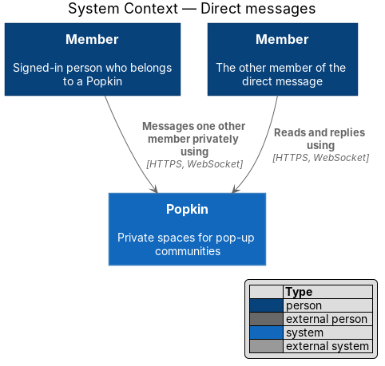
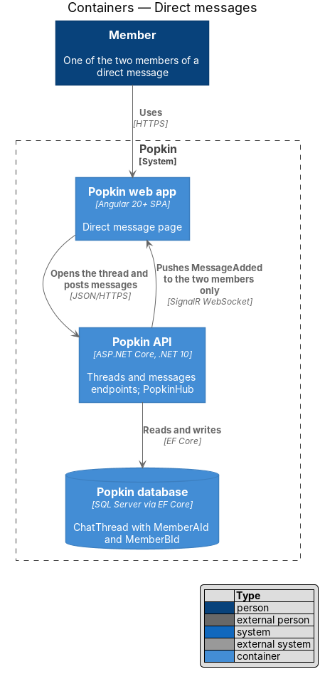
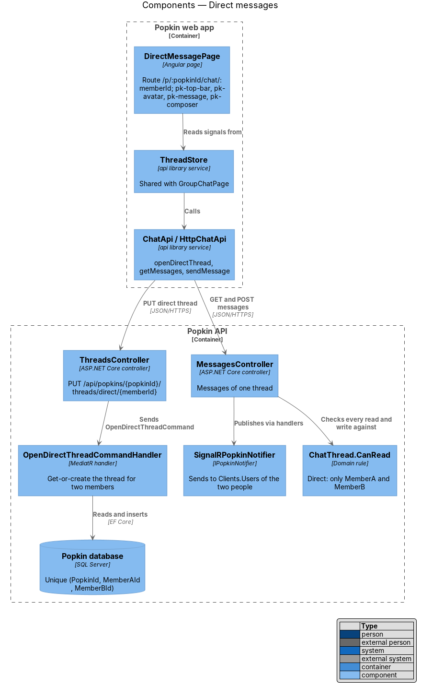
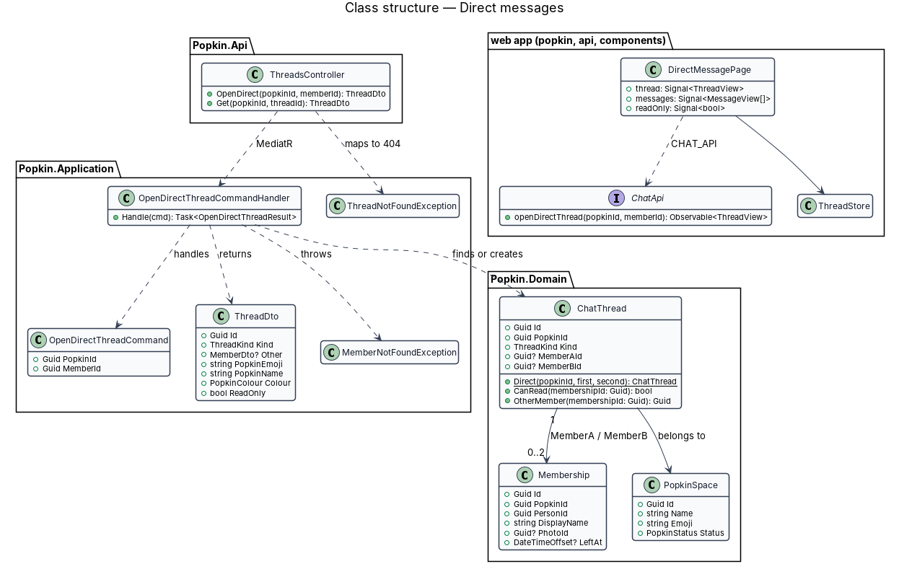
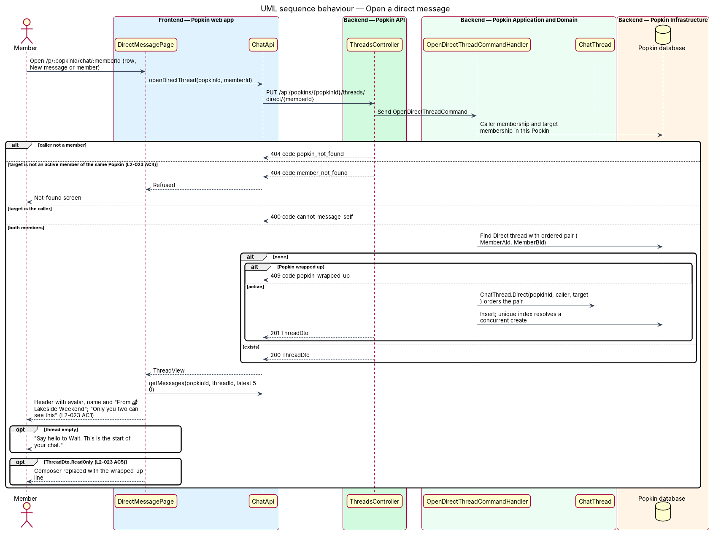
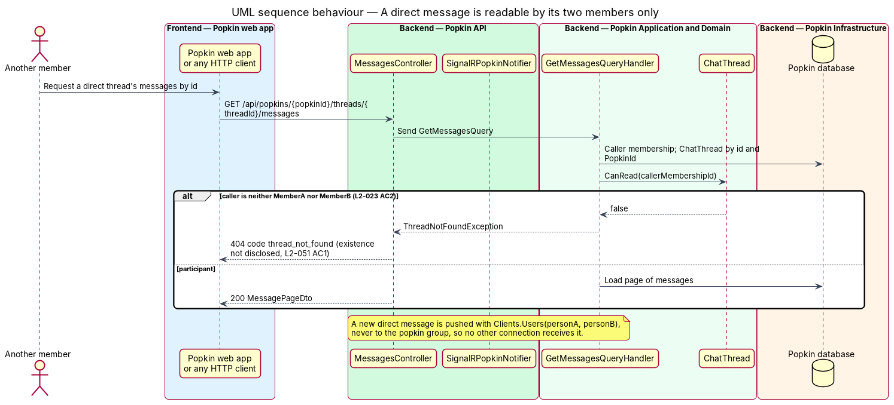

# Direct messages

## Overview

A *Popkin* is a private space for one group of *members*. Besides the *Everyone* thread that all
members share, two members of the same Popkin may talk privately in a *direct message*. This feature
covers opening a direct message, what it shows, and the rule that nobody but its two members can
read it.

- **direct message** — chat thread of kind `Direct` between exactly two members of one Popkin
- **participant** — one of the two memberships a direct thread names, `MemberAId` or `MemberBId`
- **ordered pair** — the two membership ids stored lowest first, so one pair of members has one thread per Popkin

A direct message opens from a row on the Chat tab, from the New message dialog (conversations) or
from its address. Its header shows the other member's avatar and name and "From {emoji} {Popkin
name}"; the thread starts with "Only you two can see this". Everything a member can do in Everyone
works the same way here: text, photos, reactions and replies; journey 11 built text, journey 12
reactions and replies, and photos come with journey 13, which builds them in Everyone and here alike: a photo sent here is readable only by the two members, never joins the album and opens in the photo view with no previous or next ([Send photos in chat](../send-photos-in-chat/README.md), known gap 64). A direct
message belongs to its Popkin: it exists only between members of that Popkin and becomes
read-only when the Popkin wraps up. "Call {first name}" opens a call between the two
([Group call](../../calls/group-call/README.md)).

## Description

**Screens and states:**

- `docs/mocks/pages/direct-message/default.html` — header with avatar, "Walt Brennan", "From 🏕️ Lakeside Weekend", "Call Walt"; `dm-intro` with "Only you two can see this"; messages, one with a reaction; the list pane from 1024 px and the person pane, "About Walt", from 1280 px.
- `docs/mocks/pages/direct-message/loading.html` — skeleton bubbles and "Loading messages…".
- `docs/mocks/pages/direct-message/empty.html` — "Say hello to Walt. This is the start of your chat."
- `docs/mocks/pages/direct-message/error.html` — "We couldn't load this chat" with "Try again" and "Back to Chat".
- `docs/mocks/pages/direct-message/read-only.html` — added in journey 11: the wrapped-up line in place of the composer, and no "Call Walt" (L2-023 AC5). Its list pane still offers "New message" (known gap 63).
- `docs/mocks/pages/direct-message/call.html` — added in journey 11: the banner "Call · 1 on the call" with "Join" when the other member has started a call between the two.

**API:**

- `PUT /api/popkins/{popkinId}/threads/direct/{memberId}` — 200 `ThreadDto` when the thread exists, 201 when created; 400 `cannot_message_self`; 404 `popkin_not_found`, `member_not_found`; 409 `popkin_wrapped_up` when no thread exists yet and the Popkin has wrapped up. It is the read of a direct message's header too: there is no `GET` of a thread by its id.
- `GET` and `POST /api/popkins/{popkinId}/threads/{threadId}/messages`, `DELETE …/messages/client/{clientMessageId}` and `PUT …/threads/{threadId}/read` — the endpoints of the Everyone thread, unchanged; each returns 404 `thread_not_found` to anyone but the two participants (L2-023 AC2). Reactions, replies and photos will use the endpoints of react-to-message, reply-to-message and send-photos-in-chat, under the same rule.

**Route.** The mock manifest gives the route `/p/:popkin/chat/:member`, so the page is keyed by the
other member's membership id: `/p/:popkinId/chat/:memberId`. The page resolves the thread with
the idempotent `PUT` above, which is safe to repeat and may create the thread.

**Frontend (Popkin web app):**

- **`DirectMessagePage`** — `pages/direct-message/direct-message.page.ts`, selector `pk-direct-message-page`, route `/p/:popkinId/chat/:memberId` behind `signedInGuard`, route data `{ shell: 'app', page: 'direct-message' }`, title "Direct message · Popkin". It composes `pk-app-screen`, `pk-top-bar` (Back to the Chat tab, the other member's `pk-avatar`, name, "From {emoji} {name}", icon button "Call {first name}"), `pk-dm-intro`, `pk-message`, `pk-day-divider`, `pk-system-note`, `pk-thread`, `pk-empty-state`, `pk-composer` with the label "Message {first name}", `pk-banner` for the call, the Popkin's last hour and offline, and `pk-popkin-nav`. From 1024 px `pk-list-pane` holds `pk-conversations` with the row of this direct message marked current (L2-058 AC11); from 1280 px `pk-detail-pane` shows the other member: avatar, name, "In {emoji} {Popkin}", "Call {first name}" and "Shared between you", which stays empty until photos in chat are built (L2-058 AC12, known gap 64).
- **`ThreadStore`** — the store of the Everyone thread. `open(popkinId, memberId?, { inView })` opens the direct message with that member through `ChatApi.openDirect`, then loads the latest 50 messages; the outbox, drafts, read point, "New messages" and loading earlier work as in Everyone. A 404, or `cannot_message_self` for a direct message with oneself, is the not-found screen; any other failure is the error state.
- **`ChatApi.openDirect(popkinId, memberId)`** — returns `ThreadView`, with `other` (`ThreadMemberView`) on a direct message.
- **Read-only** — when `ThreadView.readOnly` is true the composer is replaced by "This Popkin has wrapped up. Messages stay, but nobody can post new ones." and "Call {first name}" is hidden, in the top bar and the person pane (L2-023 AC5, L2-045 AC1).
- **Call banner** — `CallBannerStore.open(popkinId, threadId)` follows the call of this direct message only; the page shows "Call · {n} on the call" with "Join", or "Return" to a member on it, linking to `/p/:popkinId/chat/:memberId/call`.
- **Unread** — reading the direct message clears its unread mark in the list pane and lowers the Popkin's count on the navigation; a message from the other member that arrives while it is out of view counts as in Everyone.

**Backend:**

- **`OpenDirectThreadCommand`** / **`OpenDirectThreadCommandHandler`** (`Chat/OpenDirectThread.cs`) — loads the caller's membership (`IMembershipGuard.RequireMemberAsync`, 404 `popkin_not_found`). A target equal to the caller is refused with 400 `cannot_message_self`. The target must be a membership of the same Popkin with `LeftAt` null, or the request is refused with 404 `member_not_found`, so two people who share no active Popkin cannot start a direct message (L2-023 AC4) and a membership of another Popkin is not disclosed. The handler finds the `Direct` thread of the ordered pair; when none exists it requires an active Popkin (409 `popkin_wrapped_up`) and inserts one built by `ChatThread.Direct(popkinId, first, second)`. A direct message that exists is returned in a wrapped-up Popkin, read-only.
- **`ChatThread.CanRead(membershipId)`** — domain rule: true for any member on `Everyone`, and only for `MemberAId` or `MemberBId` on `Direct`. `ChatThreads.RequireAsync`, which every chat handler calls after the membership check, applies it and throws `ProblemException` 404 `thread_not_found` when it fails, the same as for a thread of another Popkin or none, so a direct thread's existence is not disclosed (L2-023 AC2, L2-051 AC1). `ChatThread.OtherThan(membershipId)` names the other participant.
- **`ChatThreadConfiguration`** — `MemberAId` and `MemberBId`, each a foreign key to `Membership`; a filtered unique index `(PopkinId, MemberAId, MemberBId)` where `Kind = 'Direct'`, and an index on `MemberBId`. Two members opening the thread at the same time race on the insert; the loser catches the update failure and reloads the winner's row. Migration `AddDirectMessages`.
- **`ThreadDto`** — `Id`, `PopkinId`, `Kind`, `PopkinName`, `Emoji`, `Colour`, `EndsAt`, `MemberCount` (2 on a direct message), `HereNow`, `PresenceVersion`, `ReadOnly`, `UnreadCount`, `LastReadMessageId`, `Viewer` and `Other` (`ThreadOtherDto`: membership id, display name, first name, avatar; never a phone number or email, L2-054 AC2), null on Everyone.
- **`MessageDto.PopkinId`** — every message names its Popkin as well as its thread, so a client that holds several threads knows where one belongs.
- **Delivery** — `ChatThreads.AudienceAsync` gives the `Audience` of a thread: the Popkin for Everyone, and for a direct message the people of its two members who have not left. `IPopkinNotifier` takes that `Audience`, and `SignalRPopkinNotifier` sends to the Popkin's group or with `Clients.Users(...)` to the people named, never to the group for a direct message (L2-023 AC2, L2-051). `MessageAdded` and `MessageDeleted` follow it; `ThreadRead` goes to the reader alone, as before.
- **Unread counts** — the Popkin home's header and each card of My Popkins add the unread messages of the member's direct messages of that Popkin to those of Everyone (L2-022 AC3), through `DirectThreads.Of`.
- **A participant who leaves** — journey 11 took a stopgap until the design of leaving a Popkin (L2-047): events reach only members who have not left; a direct message whose other member has left is neither listed on the Chat tab nor counted; and it can no longer be opened, since `PUT …/direct/{memberId}` answers 404 `member_not_found` for a member who has left. What a direct message shows after one participant leaves, and the `code` of a send refused then, are `<TO SUPPLY>` (known gap 65).

### Tests

- API integration tests on InMemory, in `Popkin.Api.Tests/Chat/`: `OpenDirectThreadTests` (200 and 201, one thread whoever opens it, two opens at once, a member outside the Popkin, a wrapped-up Popkin), `DirectMessageTests` (posting, reading, discarding and marking read, and 404 `thread_not_found` for anyone else), `LiveDirectMessagesTests` (events reach the two and nobody else) and `DirectUnreadTests`. The rules of `ChatThread` have direct tests in `Popkin.Application.Tests/Chat/ChatThreadTests.cs`.
- Unit tests of `ThreadStore` opening a direct message, in and out of view, in the `api` library.
- Playwright: `e2e/tests/direct-message.spec.ts`, through `e2e/pages/direct-message.page.ts`, with the states of `e2e/fixtures/direct-message-states.ts`.
- A parity spec per component: `dm-intro`, `detail-pane` (the person), `top-bar` (the avatar), `composer`, `banner` and `empty-state`.

### Built in journey 11

Everything above, for messages of text. Waiting, each in [the register](../../README.md#known-gaps):

- photos in a direct message (L2-023 AC3) and "Shared between you" in the person pane, with journey 13 (gap 64); journey 12 built reactions and replies here, with message actions;
- what a direct message shows when one of the two leaves the Popkin, with journey 18 (gap 65).

Decided in the build:

- The `PUT` is the only read of a direct message's header; there is no `GET …/threads/{threadId}`.
- The route is `/p/:popkinId/chat/:memberId`, as the mock manifest gives it.
- The read-only and call states, drawn as `direct-message/read-only.html` and `call.html`.

Gaps found: the read-only mock's list pane keeps "New message", though the API refuses to start a
direct message in a wrapped-up Popkin, so choosing a member with whom there is none yet ends on
"We couldn't load this chat" (gap 63).

## Requirements

| L2 ID | Refines (L1) | Requirement |
|-------|--------------|-------------|
| `L2-023` | `L1-007` | Direct messages: Two members of one Popkin talk privately. |
| `L2-051` | `L1-012` | Popkins are private to their members: Membership decides everything a person sees. |
| `L2-054` | `L1-012` | Personal data is protected: Phone numbers, emails, messages and photos are handled as private data. |
| `L2-045` | `L1-011` | A wrapped-up Popkin is read-only: Nothing new is added to a Popkin that has ended. |

From `L2-023` journey 11 realised AC1, AC2, AC4 and AC5, and AC3 for text. From `L2-058` it
realises AC11 and AC12 for a direct message.

## Diagrams

The diagrams below were not redrawn after journey 11. They show `ChatApi.openDirectThread`,
`ThreadNotFoundException`, a `GET` of a thread by its id and `Photo.DirectThreadId`, where there
are now `ChatApi.openDirect`, the `ProblemException` of `ChatThreads.RequireAsync`, the `PUT`
alone and no photos (known gap 68).

### System context

Two members of one Popkin exchange messages through Popkin; nobody else is party to the thread.

### Containers

The web app opens the thread and posts messages to the Popkin API; the API pushes new messages to
the two members only over SignalR and stores the thread in the Popkin database.

### Components

`DirectMessagePage` shares `ThreadStore` and `ChatApi` with the Everyone thread. In the API,
`ThreadsController` dispatches `OpenDirectThreadCommand`, and every message endpoint checks
`ChatThread.CanRead` before it reads or writes.

### Class structure

A `ChatThread` of kind `Direct` names two `Membership` rows and belongs to one `PopkinSpace`.
`OpenDirectThreadCommandHandler` finds or creates it and returns `ThreadDto`; a thread the
caller cannot read is 404 `thread_not_found`.

### Behaviour — open a direct message

The page resolves the thread with an idempotent `PUT`, which refuses a member outside the Popkin
(L2-023 AC4), then loads the latest messages and shows the header and "Only you two can see this"
(L2-023 AC1), or the read-only line for a wrapped-up Popkin (L2-023 AC5).

### Behaviour — privacy of a direct message

A request for a direct thread's messages from any other member returns 404 `thread_not_found`
(L2-023 AC2), and live events for the thread reach only the two participants.

